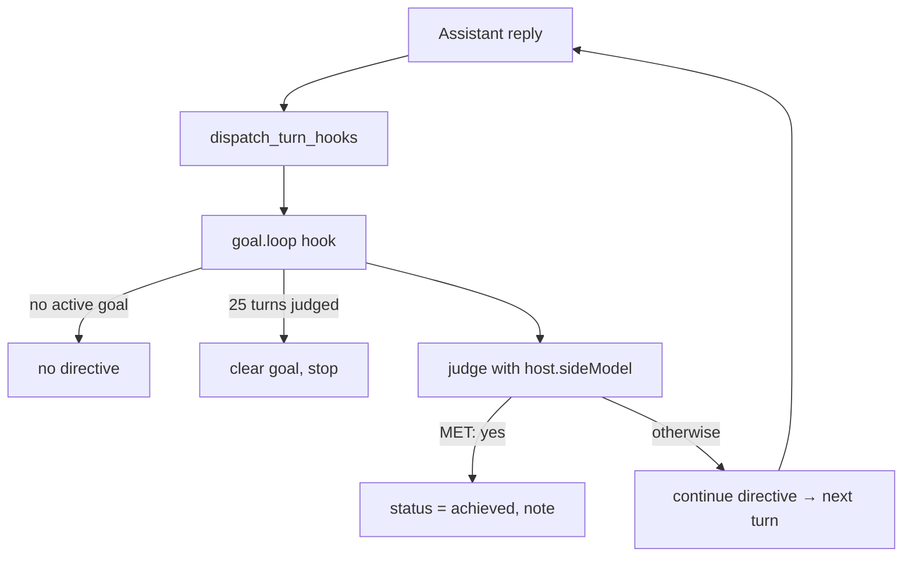

A goal is a plain-language completion condition attached to a conversation (for example
"refactor the auth module and make the tests pass"). After every turn a separate judge model reads
the transcript and decides whether the condition is met. If it is not, another turn runs. The loop
stops when the judge says the goal is met, when you clear it, or after 25 judged turns.

<Callout type="warn">
Goals ship as the `@ryu/goal` plugin, marked `experimental`. The `/goal` slash command drives a `post_assistant_turn` turn
hook (`goal.loop`, `hooks/loop.js` in the plugin package). An allowlisted agent can call the
plugin's `goal.set` tool to set or replace the condition for the current conversation. Core
supplies the caller conversation to the sandbox, so the tool cannot choose a different chat.
</Callout>

## Goal state

The plugin stores one record per conversation in its key-value storage. Core reads that record and
returns it as `GoalState`.

| Field | Type | Meaning |
|---|---|---|
| `goal` | `string?` | The completion condition. Omitted when none is set. |
| `status` | `string?` | `"active"` while the loop runs, `"paused"` while paused, `"achieved"` once met. Omitted when unset. |
| `started_at` | `int?` | Unix milliseconds the goal was set; drives the elapsed timer. |
| `achieved_at` | `int?` | Unix milliseconds when the judge marked the goal achieved. |
| `last_reason` | `string?` | The judge's most recent reply. |
| `turns` | `int` | Number of turns the judge has evaluated so far. |

| Route | Purpose |
|---|---|
| `GET /api/conversations/:id/goal` | Read the goal state |
| `PUT /api/conversations/:id/goal` | Set or replace the goal |
| `DELETE /api/conversations/:id/goal` | Clear the goal |
| `POST /api/conversations/:id/goal/pause` | Pause the goal without a chat turn |
| `POST /api/conversations/:id/goal/resume` | Resume a paused goal |

Setting a goal stamps `started_at` and resets `turns` to 0. When the judge succeeds, the desktop
adds a compact completion status to the ending assistant turn: the goal check icon, elapsed time
from `started_at` to `achieved_at`, and the localized completion time. It remains visible until the
goal is cleared or replaced.

## How it runs

After each assistant reply the plugin host calls `dispatch_turn_hooks`, and the `goal.loop` hook
runs in Core's plugin sandbox. Because the loop runs server-side, any client (CLI, channel bots,
mobile) can pursue a goal without implementing it.

The hook returns one of these directives:

- `continue` - the goal is not met yet. The text repeats the condition plus the judge's feedback and
  starts the next turn.
- `note` - the goal is met, was cleared with `/goal clear` or `/goal stop`, or the loop stopped at
  the 25-turn cap. Clearing and the cap both delete the goal record.
- `none` - no active goal on this conversation.

## The judge

One judge call evaluates the full transcript against the condition through `host.sideModel` with
`model_pref_key: "goal-judge-model"`. The model resolves through the plugin host's side-model chain:

1. The `goal-judge-model` preference (**Judge model** in the plugin's **Goals** settings tab)
2. The node-wide default selection
3. Env `RYU_DEFAULT_LLM_MODEL`
4. The bundled local chat model (Gemma 4 E2B)

With the bundled local model, goals judge with no API key or setup. The judge call routes through
the Gateway like every other model call.

### Verdict parsing

The judge is asked to answer `MET: yes - <reason>` or `MET: no - <reason>`. Only a reply that
contains `MET: yes` (case-insensitive) counts as met. Any other reply, including an unreadable one,
counts as not met, so the loop continues until the 25-turn cap.

[Formal verification](/docs/extend/develop/formal-verification) proves the bounded continuation
rules of this state machine. It does not prove that a live conversation or model reply met a goal.

## Using goals from the composer

Type `/goal <condition>` in chat to set a goal, and `/goal clear` or `/goal stop` to clear it. The
composer shows an active goal chip and a goal bar above the input with the editable condition, a
live elapsed timer, and the judge's latest reason.

In [Bot](/docs/surfaces/desktop/bot), the **Goals** view gathers goal records
from recently active conversations. It separates active goals from paused ones and lets you return
to the owning conversation or pause and resume the goal. It reads the goal plugin's state and is
not a second goal store.

<TryInRyu page="chat" />

<Cards>
  <DocCard href="/docs/plugins/goal" />
  <DocCard href="/docs/surfaces/desktop/user-guide/chat" />
  <DocCard href="/docs/core/double-check" />
  <DocCard href="/docs/core/side-questions" />
  <DocCard href="/docs/core/conversations-sessions" />
</Cards>
