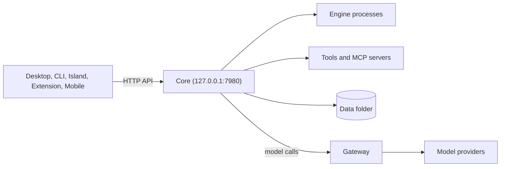

**Ryu Core** is the local Rust backend that decides what runs: engine processes, conversations,
memory, tools, workflows, schedules, and the MCP (Model Context Protocol) registry. These pages are
developer and operator references.

<Figure name="core" />

Desktop, CLI, Island, Extension, and Mobile clients all use Core's HTTP API. Every model call
passes through the Gateway. Core listens on `127.0.0.1:7980` by default
([`RYU_BIND`](/docs/start-here/environment-variables)).

- [Core vs Gateway](/docs/start-here/architecture/core-vs-gateway) explains the ownership split.
- [What's in the data folder](/docs/surfaces/desktop/user-guide/data-and-storage#whats-in-the-data-folder)
  lists where Core keeps its state.

## Conversations and memory

<Cards>
  <DocCard href="/docs/core/conversations-sessions" />
  <DocCard href="/docs/core/memory" />
  <DocCard href="/docs/core/spaces-rag" />
  <DocCard href="/docs/core/side-questions" />
</Cards>

## Orchestration and automation

<Cards>
  <DocCard href="/docs/core/workflows" />
  <DocCard href="/docs/core/agent-teams" />
  <DocCard href="/docs/core/delegation" />
  <DocCard href="/docs/core/scheduler" />
  <DocCard href="/docs/core/approvals" />
</Cards>

## Tools and catalogs

<Cards>
  <DocCard href="/docs/core/mcp-registry" />
  <DocCard href="/docs/core/built-in-tools" />
  <DocCard href="/docs/core/unified-tool-catalog" />
  <DocCard href="/docs/core/model-catalog" />
  <DocCard href="/docs/core/skills-catalog" />
</Cards>

## Runtime, data, and identity

<Cards>
  <DocCard href="/docs/core/sandbox" />
  <DocCard href="/docs/core/boxes" />
  <DocCard href="/docs/core/app-manifest-lifecycle" />
  <DocCard href="/docs/core/encryption-at-rest" />
  <DocCard href="/docs/core/identity-vault" />
</Cards>

## Operations

<Cards>
  <DocCard href="/docs/core/observability" />
  <DocCard href="/docs/core/observability-traces" />
  <DocCard href="/docs/core/node-and-presence" />
  <DocCard href="/docs/core/managed-fleet" />
  <DocCard href="/docs/core/updates" />
</Cards>

## App-backed features

These pages document the backends of apps that ship in the Store. The user-facing app pages are in
the [Apps catalog](/docs/apps).

<Cards>
  <DocCard href="/docs/core/finetuning" />
  <DocCard href="/docs/core/meeting-notes" />
  <DocCard href="/docs/core/quests" />
  <DocCard href="/docs/core/website-monitoring" />
</Cards>
