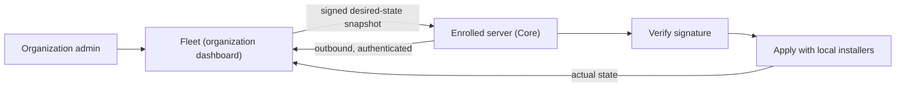
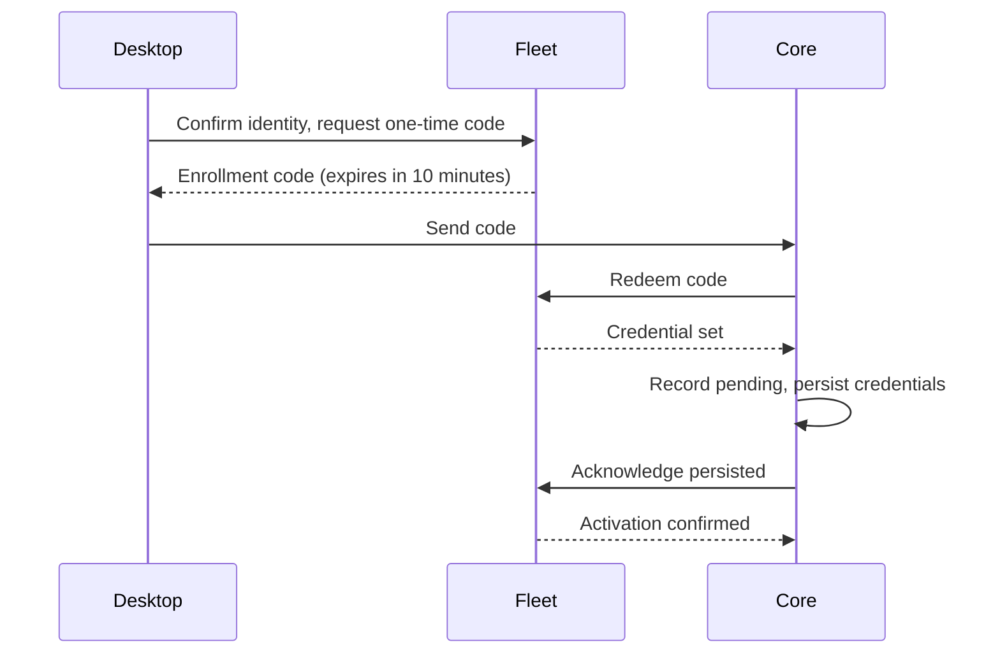
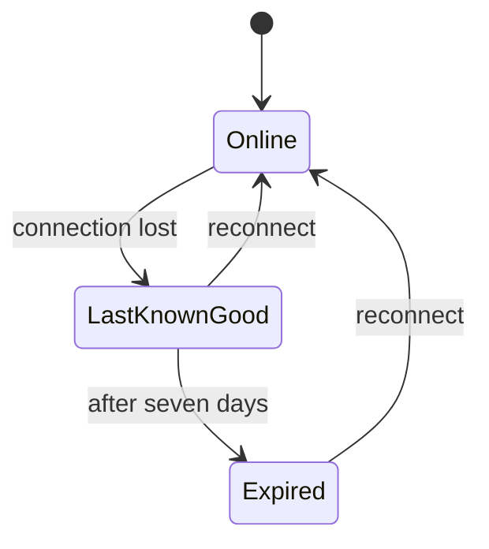

Fleet lets a Ryu organization keep one tool stack on its cloud-hosted and local servers without
opening an inbound administration port.



Each enrolled server makes an authenticated outbound connection, verifies a signed desired-state
snapshot, applies it through its normal local installers, and reports its actual state to the
organization dashboard.

Enrollment and MCP access are separate:

- Enrollment binds the server to an organization for Fleet configuration and policy.
- A direct MCP client on a local or self-hosted server still needs that server's bearer or a paired token.
- Desktop's managed server selector receives a short-lived delegation bound to each selected node.
  Core narrows it to the organization, team, or personal server scope, and a node cannot reuse it at a peer.
- An external MCP client uses the hosted `/mcp/<node-id>/<agent-id>` URL. The hosted service checks
  the user's grant and sends Core a short-lived delegation for that server and agent.

## Enroll a server

1. In Desktop, open **Gateway settings → Workspace → Organization binding** while the self-hosted
   server is active.
2. Choose an organization and name the server. Names are trimmed and must contain 1 to 128
   characters.
3. Select **Bind node** and confirm it's you.

Desktop then creates a one-time enrollment code and sends it straight to Core. The code expires
after ten minutes. You do not copy an organization ID, Fleet URL, or Gateway secret.

Enrollment creates two kinds of credential:

- a Fleet identity, used for desired configuration and status;
- purpose-separated organization credentials for server control and managed
  inference.



Core first records the enrollment as pending and durably saves the complete credential set. It
activates the server only after the server acknowledges that the credentials were persisted.

Afterward, Desktop shows the organization name, stable server ID, and **Managed inference ready**.
Those fields come from Core, so they remain visible after Desktop or Core restarts.

The web **Fleet status** page can also issue the same one-time code for a server enrollment client.
The code still binds Fleet identity and managed inference to the organization that issued it.
Desktop's Workspace card uses the direct flow above and does not ask you to paste that secret.

### Who can enroll

Creating or redeeming an organization binding requires the live `gateway.configure` permission.

- Organization owners and admins have it by default. A custom organization role may grant it to
  another member.
- A team-scoped grant applies only to enrollment for that team, and only while you are on that team.
- An organization-wide grant covers every team, so owners and admins can enroll, retry, and revoke a
  team's servers without joining the team.
- People without the permission can inspect status, but the binding controls stay read-only.

### Enrollment scope

A server's enrollment scope also limits which organization resources it can load. Team and
personal servers cannot load organization channel credentials or organization-wide Mail, so saved
[channel bots](/docs/gateway/channel-setup) run only on organization-scoped servers.

### Fleet status page

- Search filters servers by name or observed state, and reports when no servers match.
- **Refresh** reloads their latest status.
- **Retry** asks a non-revoked server to reconcile, then reloads its state. This action is
  separately authorized with `nodes.manage`, so a read-only request reports the permission error
  without changing the server.

<Callout type="warn">
An enrolled server cannot be moved to another organization by selecting a new one
or issuing another code. Revoke the existing binding first, then use an explicit
rebind flow. This prevents a server from silently changing which subscription it
can spend.
</Callout>

### Entitlements follow the organization

The enrollment does not copy a plan name, balance, or entitlement flag onto the server. Each
managed request resolves the organization from the enrolled relay credential and checks that
organization's current subscription, credits, budgets, and policy. A binding remains valid when a
subscription starts, stops, or changes tier. Access follows the live entitlement.

### Revocation and revisions

- Revoking a server stops future desired-state downloads.
- The dashboard shows desired and observed revisions, last contact, compatibility failures, missing
  setup, and whether a server is using stale last-known-good state.
- Fleet credentials created when an existing Gateway adopts another server remain tied to the
  issuing Gateway credential and server. Revoking either stops the adopted server's Fleet access.
- Fleet revisions are independent from policy configuration revisions. The config-as-code screen
  shows both counters, and policy rollback affects only policy layers.
- After a rollback, the Web editor reloads the restored snapshot and clears the old diff preview, so
  it cannot be mistaken for changes against the restored config.

## Cloud computer SSH and updates

SSH key setup, member keys, Shamir recovery, and the nightly self-update sequence for managed cloud
computers are on [Cloud Computer SSH and Updates](/docs/core/cloud-computer-ssh-and-updates).

## Managed content

The **Managed content** page assigns apps, plugins, MCP servers, Skills, and agent availability
policies at organization, team, project, or user scope. Every assignment is pinned to an exact
signed artifact digest. The [access hierarchy](/docs/security/access-hierarchy) explains how these
assignments compose with caller identity, resource ACLs, and per-agent capability allowlists.

### Assignment modes

| Mode | Apps, plugins, MCP servers, Skills | Agents (by stable Core agent id) |
|---|---|---|
| **Required** | Installs the item. It starts disabled unless the assignment explicitly enables it | Verifies that the definition is present on the node |
| **Optional** | Makes the item an approved choice without installing it | Adds it to the managed available set |
| **Blocked** | Disables the item and removes it from runtime discovery. A blocked user-owned copy and its data remain on disk | Removes it from discovery and runtime entry without deleting its version history |

Fleet does not overwrite an agent card. Publish, install, or author the definition through Core
first, then use Fleet to control where it is available. If at least one agent assignment is
present, only assigned non-blocked ids are available on that node. With no agent assignment, local
availability is unchanged.

### Precedence and project mapping

- The most specific applicable scope wins unless an ancestor assignment is locked.
- At the same scope, blocked wins over required, and required wins over optional.
- Local project folders are mapped to organization projects on each server. Local paths never leave
  the server.
- Team-bound servers may map only projects in their own team, and personal servers cannot
  self-assign organization projects. Fleet checks the mapping again before sending project rules or
  sealed secrets.

### Secret bindings

Configuration contains setup-slot references rather than credential values. A required integration
that is missing a credential remains disabled and reports **Needs secret**.

Organization secret bindings are managed from Fleet and remain scoped to the organization named in
the request.

- **Write-only values.** Listing shows only secret names and update times. Values are never
  returned after they are saved.
- **Re-verification.** A live member with `nodes.manage` permission must complete a credential
  re-verification step before replacing or removing a binding.
- **Audited revisions.** Each accepted change advances the organization's Fleet revision with the
  acting member recorded, so enrolled servers converge on the change and administrators can review
  who made it.
- **Team scope.** Add a team binding under **Organization → Teams → Policies → Team secrets**, or
  save it through the API with a `teamId`. A team binding is sealed only into the snapshots of
  servers bound to that team. An organization binding reaches every server.
- **Team permissions.** Listing, saving, or removing a team binding needs `nodes.manage` for the
  organization or through a role scoped to that team. Moving a binding between scopes needs
  authority over both.
- **Unique names per scope.** The organization and each team can each hold their own binding with
  the same name, such as `OPENAI_API_KEY`. Saving a new binding under a name its scope already uses
  returns `409 Conflict`. Replace the existing binding instead.

## Managed rules

- **Instruction rules** are composed from broad to specific scope. They appear in the agent context
  as a separately labelled organization-managed block, and do not edit a repository's `AGENTS.md`
  or other files.
- **Command rules** match executable argument prefixes and can allow, prompt, or deny. The
  built-in hardline safety rules always run first. An organization rule cannot bypass them, and
  neither can turning the ordinary risk scanner off.
- **Project-scoped rules** apply only when the current folder maps to that project.

## Offline behavior

An enrolled server caches its last verified snapshot and referenced artifacts. It can use that
last-known-good state for up to seven days while offline.



After expiry, Ryu retains managed deny and block rules, drops managed allows, and disables managed
executable integrations until the server reconnects. User-owned data is not deleted.

## Shared nodes

Shared nodes fail closed for destination-sensitive local bridges until the caller carries a
verified resource binding. Until then, these cannot use a model-selected cross-user resource:

- app chat continuation;
- arbitrary channel-agent or team selection;
- document parser jobs;
- application realtime rooms.

The node-wide Activity feed, Skills companion reads and authoring, and the approval inbox HTTP
bridge also stay disabled on shared nodes until their records carry a verified caller and resource
binding. Personal unbound nodes keep their single-user behavior.

## Stack Templates

A Stack Template is a portable list of pinned apps, plugins, MCP servers, skills, rules, project
aliases, and setup placeholders. It never contains secrets, account or server identifiers, absolute
paths, local URLs, caches, or artifact bytes.

Organization exports, previews, and applies require `nodes.manage`. Owners and admins hold it by
default, and custom roles can grant it. Members without that permission can still inspect
organization templates. Member-facing template lists omit the unlisted-share bearer hash.

### Export

Export a server's current verified stack from the terminal client. `ryu-cli stack export` reads
`GET /api/fleet/stack/export` from Core and prints the JSON:

```bash
ryu-cli stack export --json > ryu-stack.json
```

### Import

Import a template from the organization **Stack Templates** page.

1. Choose the destination: the organization, or a narrower team, project, or user.
2. Review the preview's conflicts, grants, and missing setup. Imports always show a preview before
   applying changes.
3. Apply the same import. The page reports the number of changes applied and the resulting Fleet
   revision.

Templates fork by default, so later publisher edits do not silently change an imported
organization. Importing a template never transfers access to a private artifact. The destination
organization's server ACL must authorize it.

Marketplace items referenced by a template must first be imported into the destination's managed
artifact registry. Free and paid items use the same signed-release and organization/server ACL
checks. The import copies the verified release into an immutable, organization-signed artifact
record without transferring the publisher's credentials or private artifact access.

### Sharing and publishing

A template can be private to named organizations, shared through an unlisted link, or published in
Marketplace.

- Publishing to Marketplace also requires `marketplace.publish` and two-factor authentication (an
  authenticator app or a passkey). The listing belongs to your organization and stays pending until
  Marketplace moderation approves it.
- For an **unlisted** template, send the one-time bearer in the `X-Ryu-Stack-Template-Token`
  header. Do not put it in a query string, bookmark, or referrer. Template reads are no-store
  responses, and the bearer is never returned by organization list or detail endpoints.

### Publisher subscriptions

An imported stack can optionally subscribe to its publisher.

- **Manual** subscriptions record a newer release for preview and explicit application.
- **Auto** subscriptions update only records owned by that template import. They stop and report a
  conflict if the release needs an unavailable artifact or would replace separately managed
  content.

Removing a template import never removes user-created assignments or local data.

## Related

<Cards>
  <DocCard href="/docs/core/node-and-presence" />
  <DocCard href="/docs/gateway/managed-data-plane" />
  <DocCard href="/docs/security/access-hierarchy" />
  <DocCard href="/docs/learn/academy/cloud/multi-node" />
</Cards>
