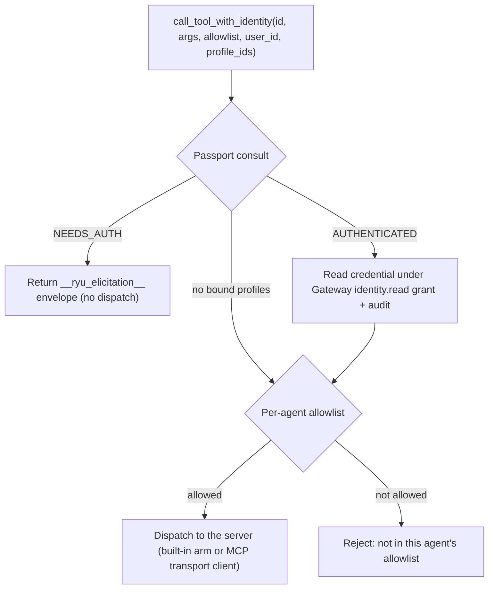

The MCP registry (`apps/core/src/sidecar/mcp/mod.rs`, `McpRegistry`) is Core's list of tool servers.
It speaks MCP (Model Context Protocol), combines built-in, plugin-declared, and user-configured
servers, and checks an agent's allowlist before each call. Chat, ACP and OpenAI-compatible agents, workflows, monitors,
recipes, and programmatic tool calls all use this registry.

The registry is **Core calling another MCP server**. The opposite direction, where an external MCP
host calls Ryu, is [Ryu MCP](/docs/extend/mcp). The public website also has an anonymous read-only
`/mcp` endpoint. It cannot reach this registry or a private node.

For the search and execution layer built on top of the registry (the Gateway tool-search front and
`POST /v1/exec/tool`), see [Unified tool catalog](/docs/core/unified-tool-catalog). For model-authored fan-out across many
tools, see [Programmatic tool calling](/docs/core/programmatic-tool-calling).

## How servers are registered

`load_merged_servers` builds the server map in this order, lowest precedence first:

1. Built-in config servers (`builtin_servers`, currently empty).
2. Servers declared in the `mcp_servers` block of an enabled plugin manifest.
3. The user's config in `~/.ryu/state/mcp.json`.

A user entry with the same name as a plugin-declared server wins, so you can repoint or disable it. The config file uses the common `mcpServers` map
shape, so an existing MCP host config can be pasted in. Ryu accepts local stdio servers, current
Streamable HTTP servers, and legacy HTTP+SSE servers.

When Ryu updates `~/.ryu/state/mcp.json`, it changes only the server entry involved. Top-level metadata,
schema markers, alternate config keys, and unknown fields inside existing entries are preserved, and
concurrent settings changes are serialized before the file is atomically replaced. This lets Ryu
share a config with another MCP host without silently discarding that host's settings.

### Catalog installs

Catalog MCP installs accept `dryRun: true`. `POST /api/mcp/catalog/install` then resolves and
validates the command or remote transport, reports the disabled server entry it would write, and
does not modify `mcp.json`, create a plugin lifecycle record, or warm an npm package. Executable
catalog packages need an exact version plus registry ownership metadata. Floating `latest` tags,
mutable OCI tags, and package names without provenance are rejected.

### Transport configuration

Each entry uses `type` when the source config declares it. The accepted values are:

| `type` | Connection behavior |
|---|---|
| `stdio` | Spawn `command` and exchange newline-delimited JSON-RPC over stdin/stdout. |
| `streamable-http` | POST JSON-RPC to `url`; responses may be JSON or request-scoped SSE. `http` is accepted as a compatibility alias. |
| `sse` | Open the configured SSE URL, read its `endpoint` event, then POST JSON-RPC messages to that endpoint. |

When `type` is omitted, Ryu infers stdio from `command` and Streamable HTTP from `url`.
Remote `headers` are sent on each request. Core owns protocol headers such as `Accept`,
`Content-Type`, session, and negotiated-version headers. A configured header cannot override them.
Remote URLs are screened before network access and redirects are not followed. HTTP failure details
redact configured header values before Core returns or logs them. If a legacy SSE
server announces a different-origin message endpoint, Core keeps the connection but does not
forward configured credentials to that second origin.
Network errors are reported without the endpoint URL, since URLs can contain operator credentials
in their query string.
Agent-scoped MCP requests also require the caller's `agent.run` permission for that exact agent.
Tool availability alone does not grant permission to invoke a denied agent.

```json
{
  "mcpServers": {
    "local-files": {
      "type": "stdio",
      "command": "npx",
      "args": ["--ignore-scripts", "-y", "@modelcontextprotocol/server-filesystem@2026.8.31", "/tmp"]
    },
    "hosted": {
      "type": "streamable-http",
      "url": "https://mcp.example.com/mcp",
      "headers": { "Authorization": "Bearer <token>" }
    },
    "legacy-hosted": {
      "type": "sse",
      "url": "https://legacy.example.com/sse"
    }
  }
}
```

| Action | Route |
|---|---|
| List registered servers | `GET /api/mcp/servers` |
| Register a server | `POST /api/mcp/servers` |
| Update a user-owned server | `PUT /api/mcp/servers/:name` |
| Remove a user-owned server | `DELETE /api/mcp/servers/:name` |
| List tools (optionally per agent) | `GET /api/mcp/tools?agent=<id>` |
| Call a tool | `POST /api/mcp/tools/call` |

User servers are hot-reloaded with no process restart (`McpRegistry::reload` re-derives the
built-in and plugin servers, re-overlays `mcp.json`, and clears the tool cache). A worked registration example lives in
[Register an MCP server](/docs/extend/develop/extensions/mcp-server).

Writing `mcp.json` is an administrative node mutation: registering, updating, or removing a
user-owned server requires the caller's `gateway.configure` permission. The check is applied at
Core's mutation routes, so a direct API caller cannot bypass the desktop's settings UI.

An organization can also apply a signed Fleet assignment with `kind: "mcp"` to block a server on
enrolled nodes. A blocked server is removed from summaries and tool discovery, and the dispatch
chokepoint rejects a direct call even if a stale user-owned config still names it. This node policy
is separate from the per-agent allowlist and from the caller's organization and resource
permissions. All three layers must allow the action.

The server summary also reports whether authentication is required and whether static credentials are
configured. A conventional credential header such as `Authorization` or `X-API-Key`, or a credential
environment variable such as `OPENAI_API_KEY`, is classified as static authentication. A manifest OAuth
declaration is classified as OAuth. Credential values are never included in the summary. OAuth
connection state is managed separately through Marketplace Connections, while local `env` and `headers`
values remain on the Core node and are only shown as masked fields in the desktop settings form.

### Tool ids

Every tool has a fully-qualified id of the form `<server>.<tool>` (`TOOL_ID_SEP = "."`). A configured
server key may contain dots (for example, `io.github.acme/files`); Core resolves the longest
registered server prefix before dispatch. The legacy `server__tool` spelling is accepted only at
compatibility ingress, while new registry rows and allowlist entries use dotted ids. The id is the
unit of allowlisting and the unit of dispatch end to end.

## Built-in servers

Two kinds of built-in exist:

- **Pre-installed plugin servers.** [Ghost](/docs/plugins/ghost) (`@ryu/ghost`) is a pre-installed
  system plugin whose manifest declares the `ghost mcp` stdio server. Core resolves the bare
  `ghost` command to the managed `<data dir>/bin/ghost` binary, so the server is unavailable until
  the Ghost sidecar is installed.
- **Reserved providers.** These are synthesized only in `server_summaries()` and `list_all_tools()`
  and dispatched by a name-matched arm in `call_tool_with_identity`. They are not in the `servers`
  map, and `contains_server` checks them by name. Most degrade gracefully when their backend is
  absent.

The full inventory of built-in server names and tool ids, including Ghost, Shadow, the facades,
and the builder tools, is the [built-in tools reference](/docs/core/built-in-tools).

Ghost's node-wide permission lives in the Gateway's `[computer_use]` section. In the
desktop this is **Device settings** for the selected device. `locked_use` is an
explicit opt-in and does not itself unlock a machine. The operating system and the
provider still decide whether a locked-session path is available, so unsupported
platforms remain foreground-only.

The reserved `web`, `browser`, `computer`, and `memory` names are facades, not vendor servers.
Their stable verbs are advertised only when the enabled provider set resolves the corresponding
capability and the selected provider declares that verb. Provider-native ids remain registered for
compatibility, so adopting a facade is additive. The facade re-enters the normal provider tool
dispatch and does not create a second execution authority.

Capability discovery distinguishes enabled providers from providers that are merely installable.
Use `GET /api/capabilities` to inspect `providers`, `available`, `bound`, `serves_verbs`, and
`serves_route`. `toolkit` and `decisionModel` identify which provider picker owns the capability.
Availability answers "could this provider serve the slot if enabled?" Permission answers "may this
caller perform the operation?" The two checks are separate.

### Optional Node MCP plugins

Ryu also ships two manifest-owned MCP plugins that are opt-in. They are not pre-installed,
because their `npx` launchers download third-party code when enabled. Once enabled, each server
starts lazily when an agent lists or calls its tools. Both need Node.js plus network access for
their first `npx` download.

| Plugin | Server | What it does | Command |
|---|---|---|---|
| [Expect](/docs/plugins/expect) | `expect` | Runs browser QA plans against the current agent changes | `npx -y expect-cli@0.1.3 mcp` |
| [Agentation](/docs/plugins/agentation) | `agentation` | Reads and updates visual annotations from a running web app | `npx -y agentation-mcp@1.2.0 server` |

Their tools use the same fully-qualified id rule as every registry server:
`expect.<tool>` and `agentation.<tool>`. Install or remove either plugin from the Store.

<Callout type="warn">
  Many built-ins are opt-in or require a sidecar or provider configuration. A server that fails to
  start is logged and skipped, so one unavailable built-in never hides the rest. Live desktop
  automation (the actual click or capture against a real window) is not exercised in CI; it needs a
  display.
</Callout>

## The governed call path

`call_tool_with_identity` is the boundary every plane funnels through. `call_tool` and
`call_tool_with_user` delegate to it. The chat, ACP, and programmatic tool calling planes call it directly so they can pass
the caller's bound [Passport](/docs/standalone/passport) profiles.



1. **Passport consult.** For a bound agent, a call targeting a domain that is `NEEDS_AUTH`
   returns the `__ryu_elicitation__` envelope as its result (the caller pauses for login, no
   dispatch). An `AUTHENTICATED` domain reads the credential through the Gateway-governed
   `identity.read` grant plus audit at this boundary, never exposing it to the LLM. No-op when the
   agent has no bound profiles.
2. **Allowlist.** The call is dispatched only if the tool passes the agent's allowlist.
3. **Dispatch.** A built-in reserved provider routes to its name-matched arm; a config server routes
   through a short-lived MCP client using its configured stdio, Streamable HTTP, or legacy SSE
   transport.

On the direct Core tool-call endpoint, `host_conversation_id` is an internal forwarding context, not
a caller-selected vault identity. A request carrying a managed user JWT may name only a conversation
that user owns. Visibility or collaboration on another user's conversation does not delegate that
owner's user-scoped vault secrets. Core-to-Gateway forwards carry a process-local proof, and a bare node
bearer cannot select a host conversation on a bound node. Core also validates the portable
conversation-id grammar before it can reach shell-backed agent startup.

## The per-agent allowlist

The allowlist is the governance boundary. Registering a server grants no agent access to it; you must
allowlist its tools for the agents that should use them. The MCP bridge filters every registered tool
through the agent's allowlist before injecting it into a session. An empty allowlist means no
tools are offered.

Explicitly denying an agent all tools persists across restarts, including for the built-in Ryu
agent and locked agent records. New built-in defaults do not overwrite saved restrictions.

`tool_allowed` matches a list entry against the tool's fully-qualified id, its bare name, or its
owning server name, so an entry of `exa` allowlists every Exa tool while `exa.search` allowlists just
one.

<Callout type="info">
  Two paths match the fully-qualified id only, with no bare-name or server fallback: Composio
  (`composio.<slug>`) and the `app.`-namespaced app tools. This stops a broad server-name entry from
  reaching a tool the author did not intend.
</Callout>

## Behavior and guarantees

- **One chokepoint, both planes.** Tool execution on the ACP and OpenAI-compatible planes is
  allowlist-gated and audited through this same dispatch. The ACP subprocess's own LLM provider
  calls still bypass the Gateway. Only tool egress is governed here.
- **No lock held across an await.** Server config is extracted under a short read lock that is dropped
  before any `.await`, so a slow or hung server cannot block the registry lock.
- **Cached tool lists.** Per-server `tools/list` results are cached and cleared on `reload`, so newly
  registered servers advertise their tools on the next `GET /api/mcp/tools`.
- **Bounded discovery.** Each tool-discovery request checks up to four servers concurrently, keeps
  each server's results, and skips failed servers. A slow server does not block the other discovery
  slots. An explicitly empty agent allowlist returns no tools without starting server discovery.

## Related

<Cards>
  <DocCard href="/docs/core/unified-tool-catalog" />
  <DocCard href="/docs/core/programmatic-tool-calling" />
  <DocCard href="/docs/standalone/passport" />
  <DocCard href="/docs/extend/develop/extensions/mcp-server" />
</Cards>
