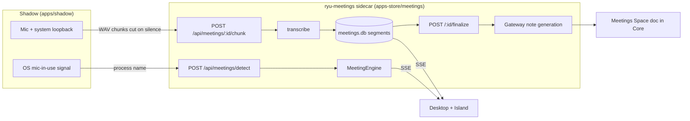

The `@ryu/meetings` app records a call, builds a live transcript chunk by chunk, and turns it into
structured notes (summary, key points, action items, decisions). The `ryu-meetings` sidecar
(`apps-store/meetings/backend/src/`) owns the meeting engine and the `/api/meetings/*` routes.
Device-bound audio capture and mic-in-use detection live in Shadow (`apps/shadow/src/capture/`).
Finalized notes are filed into the Meetings Space, so viewing, editing, and RAG reuse the Spaces
editor.

For the desktop how-to (start a recording, open the notes), see
[Meetings](/docs/surfaces/desktop/productivity/meetings).

<Callout type="warn">
The `@ryu/meetings` app is marked `experimental`. System-audio loopback capture
(`apps/shadow/src/capture/meeting.rs`) is Windows only; other platforms record the microphone
only. Mic-in-use detection (`apps/shadow/src/capture/detect.rs`) reads the Windows consent store,
asks PulseAudio/PipeWire on Linux, and on macOS only checks whether a known meeting app is running.
Loopback capture and live detection need a display and a real call, and are not runtime-verified.
</Callout>

## Where the work happens

Audio capture is a sensor bound to the local machine, but Core may run on a remote node, so the
two responsibilities are split.



| Concern | Owner | Reason |
|---|---|---|
| Mic + loopback capture | Shadow `capture/meeting.rs` | Sensor is bound to the local device |
| Mic-in-use detection | Shadow `capture/detect.rs` | Reads a local OS signal |
| Meeting lifecycle, transcript, notes, storage | `ryu-meetings` sidecar | The app owns its own data and routes |
| Speech-to-text | Core's STT path, through the app host | Reuses the whisper/parakeet voice engines |
| Note generation (the model call) | Gateway | Metered model calls route through the Gateway (see [Core vs Gateway](/docs/start-here/architecture/core-vs-gateway)) |
| Filing notes into a Space | Core `spaces.fileNotes` host capability | Core owns the Space store and its tenancy |

## Data model

The engine (`MeetingEngine`) persists to SQLite at `<data dir>/plugin-data/@ryu+meetings/meetings.db`,
the app's own data folder.

| Type | Fields | Notes |
|---|---|---|
| `Meeting` | `id`, `title`, `app`, `status`, `source`, `space_id`, `doc_id` | `app` is the detected meeting app slug (e.g. `zoom`, `teams`) when known |
| `Segment` | per-chunk transcript text + timestamp | Appended as each WAV chunk is transcribed |

`MeetingStatus` moves `Recording -> Processing -> Done`, with a transient `Detected` state for an
auto-detected meeting before the user starts notes. `MeetingSource` records whether a meeting was
started manually or from auto-detection.

## Routes

All routes live under `/api/meetings` (`apps-store/meetings/backend/src/api.rs`). Reading needs
the `meetings.view` permission level; recording and changes need `meetings.record`.

| Method + path | Purpose |
|---|---|
| `GET /api/meetings` | List meetings, newest first |
| `POST /api/meetings` | Start a meeting (best-effort begins Shadow capture) |
| `GET /api/meetings/:id` | One meeting (without the transcript body) |
| `DELETE /api/meetings/:id` | Remove a meeting and its transcript |
| `POST /api/meetings/:id/title` | Rename a meeting |
| `POST /api/meetings/:id/icon` | Set a meeting's icon |
| `POST /api/meetings/:id/chunk` | Ingest one captured WAV chunk (multipart `file`), transcribe, append |
| `GET /api/meetings/:id/transcript` | The full transcript (segments + text) |
| `POST /api/meetings/:id/finalize` | Stop capture, generate notes, mark done, file to the Meetings Space |
| `POST /api/meetings/import` | Import a recorded WAV file as a meeting |
| `GET /api/meetings/stream` | SSE feed of meeting events |
| `POST /api/meetings/detect` | Shadow's mic-in-use detection hook |
| `GET/PUT /api/meetings/detection-config` | Read or edit the detect-enabled flag and meeting-app list |
| `GET /api/meetings/templates` | List note templates |
| `POST /api/meetings/templates/select` | Select the active note template |

The chunk route takes an optional `?engine=` selector, mirroring the voice transcribe route. A
silent chunk is reported softly rather than returning a 5xx.

## Live transcription

There is no streaming speech recognition. Shadow cuts audio into chunks on silence, so words are
not split, and posts each chunk as a stereo WAV (left channel mic, right channel system audio) to
`POST /api/meetings/:id/chunk`. The sidecar downmixes it and transcribes it through Core's STT path
(whisper by default, parakeet selectable). The text is appended as a `Segment` and broadcast over
SSE, so the desktop transcript updates as the call proceeds.

## Note generation

`POST /api/meetings/:id/finalize` turns the accumulated transcript into structured notes with one
Gateway chat completion. The transcript stays on the app and Gateway path. The reply is parsed
into:

```json
{
  "summary": "a short paragraph",
  "key_points": ["..."],
  "action_items": ["... ideally naming an owner ..."],
  "decisions": ["..."]
}
```

The model, effort, and system prompt resolve from preferences (`meeting-notes-model`,
`meeting-notes-effort`, `meeting-notes-prompt`, `meeting-notes-template`). When
`meeting-notes-model` is unset, the model comes from `RYU_MEETING_NOTES_MODEL`, then
`RYU_DEFAULT_LLM_MODEL`, then the bundled default. A custom prompt wins. Otherwise the selected
template's prompt is used (built-ins in `apps-store/meetings/backend/src/templates.rs`), falling
back to the `default` template. Long
transcripts are summarized with a map-reduce pass (condense overlapping chunks, then combine) so
they do not overflow the model's context. An empty transcript skips the model call. Parsing is
fail-soft: if the reply contains no parseable JSON, the whole reply is kept as the `summary`.

Only one finalize runs per meeting at a time. A second `finalize` request for a meeting whose notes
are still being generated (a double-click, or a client retrying a slow request) returns
`409 Conflict` and changes nothing, so the notes are never generated or filed twice. A rename made
while the notes are being generated is kept, and so is the user-chosen title when auto-naming runs.
If note generation fails, the meeting returns to its previous status (a recording stays
recording), so **Stop & summarize** can be retried. Finalizing an already-finished meeting again
regenerates its notes.

## Mic-in-use detection

Shadow's poller (`apps/shadow/src/capture/detect.rs`, `spawn_poller`) checks the OS every 4
seconds. When the microphone newly comes into use and no meeting is recording, it posts the
owning process to `POST /api/meetings/detect`.

| Platform | Signal |
|---|---|
| Windows | The `CapabilityAccessManager\ConsentStore\microphone` registry hive; a subkey is in use when `LastUsedTimeStop == 0` |
| Linux | `pactl list source-outputs`, skipping monitor sources |
| macOS | A running process from a built-in list of meeting apps. This reports a running meeting app, not a live microphone |

The sidecar does the filtering, not Shadow. On `detect`, it checks the `meeting-detection-enabled`
preference, matches the reported app against the `meeting-detection-apps` list (editable through
`GET/PUT /api/meetings/detection-config`), debounces, and broadcasts a `detected` event over SSE.
The Island's main process forwards consent-gated `detected` events, and the Island shows them as a
**Meeting detected** suggestion chip that offers to start notes (`apps/island/src/renderer/hooks/use-meeting-detect.ts`).

## Notes reuse Spaces

On `finalize`, the sidecar sends the notes and transcript as markdown to Core's
`spaces.fileNotes` host capability (`apps/core/src/server/app_file_notes.rs`). Core files them as a
page in the shared Meetings system Space and returns `space_id` and `doc_id`, which the meeting
record keeps. The desktop's **Open notes** button opens the document in the standard Spaces editor,
and the notes are RAG-indexed like any other Space document. Every meeting reuses the same Space.
If Core cannot be reached, the notes still persist in `meetings.db` but are not filed into the
Space. See [Spaces and RAG](/docs/core/spaces-rag) for the storage and retrieval model.

## Related

<Cards>
  <DocCard href="/docs/apps/meetings" />
  <DocCard href="/docs/surfaces/desktop/productivity/meetings" />
  <DocCard href="/docs/core/spaces-rag" />
</Cards>
