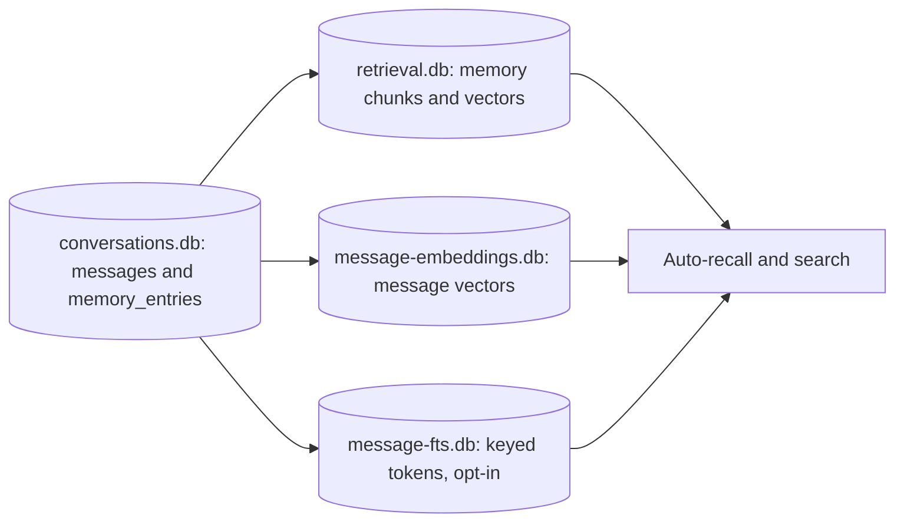
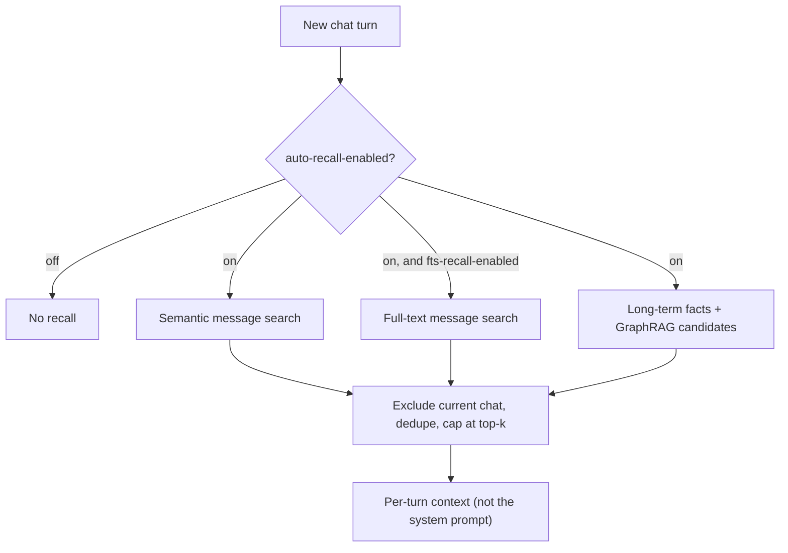

Ryu gives agents two kinds of recall. **Short-term memory** is the recent turns of the current
conversation, assembled from the conversation store. **Long-term memory** is durable facts carried
across conversations for a given user and agent. This page covers long-term memory
(`crates/core/memory`). For short-term context, see
[Conversations and sessions](/docs/core/conversations-sessions).

<Figure name="memory" />

## How it works

Long-term memory is stored encrypted in the same SQLite database as conversations
(`~/.ryu/db/conversations.db`), in a `memory_entries` table. That table is the authority. Search
indexes are derived copies, each in its own sealed database.

- **Encryption** - each entry is sealed at rest with Core's unified `FieldCipher`
  (ChaCha20-Poly1305 AEAD), with its own random nonce. Entries that fail to decrypt are skipped
  rather than crashing recall.
- **Master key** - resolved from the environment, then the OS keychain, then a local file. A legacy
  `~/.ryu/secrets/memory.key` is adopted as that master key on first run. See
  [Encryption at rest](/docs/core/encryption-at-rest) for the full model.
- **Typed scopes and facets** - a fact can be scoped to one agent, the user, this node, a project,
  or an organization. GraphRAG keeps Topic, Person, Category, Scope, and Agent nodes distinct. A
  person mentioned in a fact is not an access-control principal.
- **Scope ids** - agent-, project-, and organization-scoped facts require their matching scope id.
  An explicit sensitive fact cannot be stored outside user scope. Automatic chat capture keeps
  sensitive content at user scope instead.
- **Opt-in on the chat path** - long-term memory is recorded and recalled when the chat request
  enables it. By default Core recalls a small number of the most recent entries to prefix the model
  context.

The defaults are a short-term limit of the last 10 turns (`DEFAULT_SHORT_TERM_LIMIT`) and a
long-term recall limit of 5 entries (`DEFAULT_LONG_TERM_LIMIT`). Both are configurable on the
request.

<Callout type="warn">
  Memory entries are sealed with the node's single local master key, and there is no remote escrow.
  Treat that key as a secret: lose it and the encrypted entries become unreadable. To check, adopt,
  or retire keys, use the key commands on [Encryption at rest](/docs/core/encryption-at-rest).
</Callout>

The retrieval index that vector search runs on keeps its own sealed copy of memory text and embeddings. Vectors are opened into memory only to
score a search. Sensitive rows are read-gated, and their derived retrieval rows are removed when
consent is revoked.

### The memory graph

The memory graph is a bounded derived projection rebuilt from active source facts. It combines
direct facet matches with a small number of shared-topic hops before the existing vector/reranker
path assembles context.

It does not reuse the separate Space GraphRAG graph, which remains a chunk-term graph owned by
each Space.

### Sensitive topics

Sensitive topics are a separate privacy dimension from the memory category. The built-in detector
covers health conditions, religious beliefs, and several other special categories.

- **Include sensitive topics in memory** (on the Memory settings page) is off by default and is
  stored per verified user on the local node. It is a separate consent from the general
  long-term-memory switch.
- Turning it off hides existing sensitive facts from built-in recall, search, and graph results and
  stops future capture. It does not delete the encrypted source row.
- Without consent, sensitive facts are not captured or returned by recency recall, semantic
  search, GraphRAG, or the graph view.
- Explicit shared sensitive writes are rejected rather than silently down-scoped.

### Temporary chats

Temporary chats are read-only. They do not recall personalized memory or inject user
personalization unless the user turns on **Use memory in temporary chat** from the Memory plugin's
composer **+** menu.

- That control can read existing long-term facts, auto-recall results, and user personalization
  for the current temporary turn.
- It cannot write a new fact, sync a raw turn to an external memory provider, or save the
  conversation.
- The temporary chat can still be promoted to a saved conversation with its **Save chat** bookmark
  action.

## Routes

Memory is a **local, authenticated subsystem**. The Memory plugin exposes its CRUD surface through
`/api/memory`. The in-process chat path still reads the store directly, so the HTTP surface is not
the authority for auto-recall.

| Method + path | Purpose |
|---|---|
| `GET`, `POST /api/memory` | List or create memories |
| `GET`, `PUT`, `DELETE /api/memory/:id` | Read, edit, or remove one memory |
| `GET`, `PUT /api/memory/settings` | Read or change memory settings |
| `GET /api/memory/graph` | Access-filtered snapshot of the typed memory graph |
| `GET /api/memory/git/trace` | Bounded history of the Git-backed memory repository |
| `POST /api/retrieval/search` | Unified search across encrypted memory and [Spaces](/docs/core/spaces-rag) |

`POST /api/retrieval/search` is the same retrieval path the desktop uses to surface relevant
context. See the [HTTP API reference](/docs/extend/develop/api-reference) for request shapes.

The desktop Memory Library also provides a local, authenticated management surface at
`/library/memory`. It is where you can add, edit, filter, and remove durable memories without
putting their plaintext into a public service.

The built-in model-facing `memorystore.*` tools use Core's node-token loopback and are therefore
available on an unbound personal node. On an organization-bound node, use kernel auto-recall or
the Memory Library's verified-user surface; the loopback cannot safely impersonate a human caller.

The Library's **Graph** view is an access-filtered snapshot of the typed memory graph. It shows
which visible facts connect to topics, people, categories, agents, and scope levels. It is a view of
derived relationships, not a place to edit graph edges or bypass a memory access check.

### Git-backed memory

The Library's optional **Git-backed memory** card is a separate source projection. It writes one
Markdown file per selected memory below `memory/<scope>/<id>.md`, plus an index file.

- The projection is source-only. The encrypted store remains the authority, and vectors are never
  portable state.
- Importing Markdown is explicit and only reads that `memory/` subtree. A missing file does not
  delete a memory.

<Callout type="warn">
  The Markdown contains plaintext by design. Treat the repository as sensitive and review its diffs
  before commit or push.
</Callout>

Agents can inspect the configured repository's bounded history through
`GET /api/memory/git/trace?path=memory&limit=20`.

- Core resolves the repository from the node's explicit Memory Git binding and rejects paths
  outside `memory/`. The endpoint does not accept an arbitrary agent-supplied filesystem root.
- Because that binding is node-global, the trace is available only on an unbound personal node.
  Organization-bound nodes refuse it rather than expose one member's repository metadata to
  another.

## Dream review and Reflect

Dream is the review step for memories inferred from recent conversations. It presents each
proposal as a before/after diff and requires an explicit accept or reject action. A proposal is
never written to the memory store only because it was generated. The desktop calls these routes:

| Method + path | Purpose |
|---|---|
| `GET /api/memory/dream/review` | Read the review queue |
| `POST /api/memory/dream/review` | Prepare a new review |
| `GET`, `PATCH /api/memory/dream/review/settings` | Read or change Dream settings |
| `POST /api/memory/dream/review/proposals/:id/accept` | Accept one proposal |
| `POST /api/memory/dream/review/proposals/:id/reject` | Reject one proposal |

Open the review queue at `/library/memory/dream`. Older nodes that do not provide the Dream
routes show an unavailable state rather than silently discarding a review action.

When the node's automatic Dream preference is enabled, Core periodically prepares the same review
queue in the background. Manual and automatic review share one proposal path and the same
accept/reject controls. The background scheduler:

- honors the configured quiet hours;
- never writes a proposal without review;
- skips organization-bound nodes unless the caller is authorized.

### Reflect

Reflect is an on-demand dashboard for a selected seven-, thirty-, or ninety-day period. It
summarizes activity, recurring topics, and evidence-based observations. It does not make
productivity, identity, or emotional judgments.

| Method + path | Purpose |
|---|---|
| `GET /api/memory/reflect?period=7d` | Dashboard for `7d`, `30d`, or `90d` |
| `GET`, `PATCH /api/memory/reflect/settings` | Read or change Reflect settings |

The dashboard is a projection of the [usage review](/docs/core/usage-review).

- It reads the same conversations and activity, honors the same exclusions, and every count comes
  from that review.
- It requires usage review to be turned on. Otherwise the request is refused with
  `usage_review_disabled`, and the desktop dashboard offers a **Turn on usage review** button.
- Trends compare the selected period with the period immediately before it, and are omitted when
  there is nothing to compare against.
- Older nodes without the Reflect route fall back to reading `/api/usage-review` directly.

Open it at `/library/memory/reflect`. The settings route stores two preferences:

- **Quiet hours** (on by default, 22:00 to 08:00 local time). While the window is active, the
  automatic Dream review does not run, in addition to Dream's own quiet hours.
- **Break nudges** (off by default). The preference is saved on the node, but no reminder is
  delivered.

## Searchable chat history and auto-recall

Long-term memory is one source of recall. The other is your **past chat messages**, made
semantically searchable by a dedicated message index (`crates/core/search/src/message_index.rs`).

### The message index

Chat message bodies stay encrypted at rest in `conversations.db`. To avoid copying decrypted text
into a plaintext store, the index lives in its own database (`~/.ryu/db/message-embeddings.db`) and
holds **only sealed vectors and metadata**, never the message text.

- Each vector is encrypted and bound to its message and embedding model, because embeddings can be
  inverted into approximate text. Searches open the vectors into memory within a shared memory
  budget.
- Each row carries the `message_id`, `conversation_id`, `role`, `embed_model`, `embed_dims`, and
  `created_at`.
- A search returns `message_id`s. The snippet text is then re-read and decrypted from
  `conversations.db`.

- **Indexed on write** - `ConversationStore::append_message` spawns a best-effort task that embeds
  the plaintext before it is sealed and inserts a vector row. The conversation DB mutex is never
  held across the embed.
- **Lazy backfill** - the first search embeds any not-yet-indexed messages, decrypting their stored
  content first, so chats already on disk become searchable.
- **Embedder-scoped** - rows are tagged with the embedding model. A query embedded by a different
  model never matches an incomparable vector space. If you swap to a different-dimension embedder
  and restart, the index recreates itself at the new width and re-backfills on the next search.

Search is exposed to agents as the built-in tool `search_conversations.search`
(`apps/core/src/sidecar/mcp/search_conversations.rs`).

- It is a reserved registry server, so it rides the unified `call_tool` path. It is
  allowlist-gated and audited on both the ACP and OpenAI-compatible planes.
- It appears in `GET /api/tools/search`.
- When no message index is wired (CLI, tests, headless), the tool returns an `ok:false` envelope
  rather than failing.

### Auto-recall

Before each chat turn, `route_chat_stream` (`apps/core/src/sidecar/adapters/adapter_core/chat_stream_entry.rs`) can
automatically retrieve relevant context and deliver it as per-turn context, so both the ACP and
OpenAI-compatible planes receive it. Two sources are pulled:

- relevant **past chat messages**, with the current conversation excluded
- relevant **long-term memory facts**, lazy-backfilled into the retrieval index and then deduped
  **by fact id** against what the recency window already injected, so a fact never appears twice

The memory half also uses the typed GraphRAG projection as an additional bounded candidate source.
Chat recall carries the active agent id, so `agent`-scope facts only match that agent. User, node,
project, and explicitly allowed organization scopes keep their existing access rules. Graph edges
never grant access by themselves.

#### Settings

| Setting | Preference (env) | Default |
|---|---|---|
| Auto-recall on or off | `auto-recall-enabled` (`RYU_AUTO_RECALL_ENABLED`) | On |
| Snippets injected per turn, across both sources | `auto-recall-top-k` (`RYU_AUTO_RECALL_TOP_K`) | 5 |
| Full-text recall | `fts-recall-enabled` (`RYU_FTS_RECALL_ENABLED`) | Off |

The desktop toggle lives in Gateway settings, Plugins, Memory
(`apps/desktop/src/components/settings/MemoryTab.tsx`). Auto-recall is orthogonal to the memory
record toggle. It controls what is recalled, not what is written.

#### Where recalled context goes

Recalled snippets, the recent-memory window, an external memory provider's prefetch, and referenced
chats all change from turn to turn, so none of them go into the system prompt.

- **OpenAI-compatible plane.** They are appended to the newest user message for that request
  only. The stored message is unchanged.
- **ACP plane, first prompt.** A session's first prompt carries all of them after the reusable
  context, just before the user's text.
- **ACP plane, later turns.** The agent keeps its own transcript, so each later turn adds only what
  was chosen for that message (recalled snippets, the provider prefetch, and referenced chats),
  placed after the user's text. The recent-memory window is not repeated.

The system prompt and the earlier history stay the same between turns, so provider prompt caches
can reuse them.

### Memories cited in chat

When built-in long-term memory contributes a fact to an assistant turn, the desktop shows a brain
action in that turn's hover toolbar. Hovering **Memories cited** lists the durable facts that were
actually included in the model context. The same list is retained when the conversation is
reopened, so it describes the turn rather than asking the assistant to reconstruct its sources.

The action is hidden when no built-in memory fact was injected. It covers both the recent-memory
window and memory facts selected by auto-recall. Past-chat snippets, Space documents, and an
external memory provider's summary are not labeled as built-in memories.

<Callout type="warn">
  The whole auto-recall step runs inside a 4 second wall-clock budget and is fully fail-open: any
  embed, retrieve, or search error logs and skips recall for that turn, never blocking the reply.
  Live semantic quality needs a running Core plus the `llamacpp-embed` sidecar. With the
  embedder down, indexing on write and recall both no-op, and chats still send normally.
</Callout>

### Full-text (FTS5) recall

Semantic recall matches on meaning but misses exact terms, identifiers, and rare tokens that never
embed well. A full-text index (`crates/core/search/src/message_fts.rs`, `MessageFtsIndex`) adds a
lexical recall source that complements the semantic KNN pass, so an exact keyword surfaces the
message even when the vector does not.

- **Keyed-token index** - the index lives in its own database (`~/.ryu/db/message-fts.db`) and
  stores no words. Each message is split into whole words, very common words are dropped, and every
  word is replaced by a keyed token derived from your master key. A parallel metadata table holds
  `message_id`, `conversation_id`, `role`, and `created_at`.
- **Whole-word matching** - a search is tokenized the same way, so there are no phrase, prefix, or
  NEAR queries, and a search of only common words returns nothing.
- **Snippets** - a match returns `message_id`s, and `ConversationStore::fts_search_messages`
  re-reads and decrypts the snippet from `conversations.db`. An index written by an older build is
  deleted and rebuilt.
- **Lazy population** - there is no append-time FTS write. The term index materializes on disk only
  when a search runs, so it exists only for users who opt in.
- **Merged and deduped** - FTS hits fold into the same `chat_hits` set as semantic hits, deduped by
  `message_id` (both passes can surface the same message), with the current conversation excluded and
  the combined result still capped at `top_k`.

FTS is a **sub-source under the auto-recall gate**. It contributes only when auto-recall is on
*and* `fts-recall-enabled` is on (see [Settings](#settings)). Enabling FTS never re-enables
semantic recall for a user who disabled auto-recall.

<Callout type="warn">
  Privacy tradeoff: the tokens are deterministic for your install. Someone with `message-fts.db`
  cannot read your words, but can see which messages share a word, how many distinct words each
  message has, and how often each token occurs, and with outside knowledge can guess very common
  words. That is why FTS is opt-in and lazily populated.

  Turning **Remember chats** off empties the
  index, and deleting a conversation removes its rows.
</Callout>
