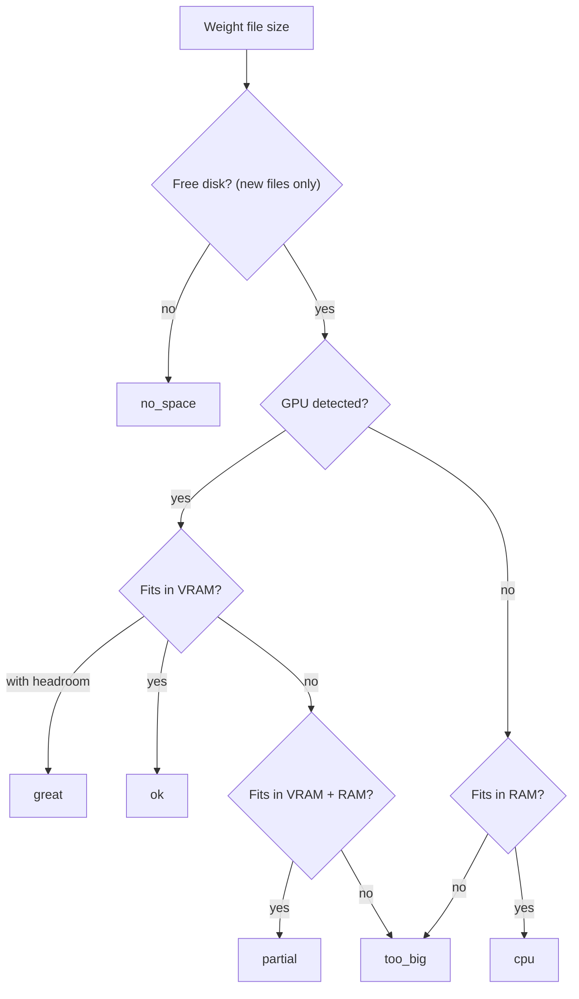
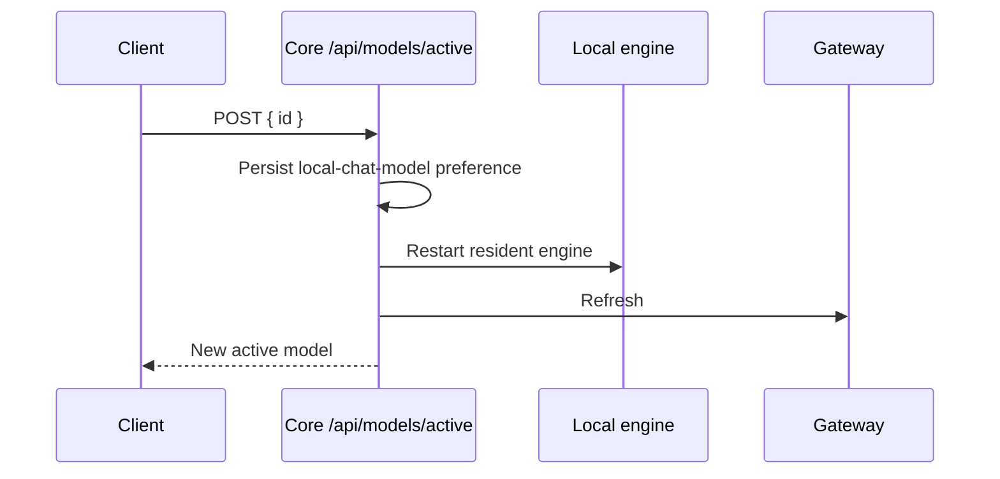

The model catalog is the Core subsystem that finds, checks, installs, and switches local models.
The logic lives in Core (`crates/core/model-catalog/`), so every client (Desktop, mobile, extension)
gets the same answer from one place.

<Callout type="info">
  Looking for the click-through how-to (browse, install, pick the active model)? See
  [Models](/docs/surfaces/desktop/models). This page is the Core internals and route reference.
</Callout>

## What it does

Whether a model can run on this machine is an orchestration question ("what runs"). Per the
[Core vs Gateway](/docs/start-here/architecture/core-vs-gateway) rule, it lives in Core, not the
Gateway. The catalog has four responsibilities:

- **Search** the Hugging Face (HF) Hub for models, filtered by task (`pipeline_tag`).
- **Detail** a model: README, every quant file with real size and SHA-256, and a per-file device-fit
  verdict.
- **Install** a chosen artifact via the shared checksum-verified downloader, tracking provenance.
- **Switch** which installed model the resident local engine serves (the active-model selection).

Catalog entries are models only. The engine runtimes that serve them are documented under
[Engines](/docs/surfaces/desktop/engines).

## Model task filters

The Marketplace category filter uses Hugging Face `pipeline_tag` values. Each selection filters to
its specific task tag.

| Group | `pipeline_tag` values |
|---|---|
| Image | `image-text-to-text`, `image-to-text`, `text-to-image`, `image-to-image`, `image-classification`, `object-detection`, `image-segmentation` |
| Video | `text-to-video`, `image-to-video`, `video-classification` |
| Audio | `automatic-speech-recognition`, `text-to-speech`, `text-to-audio`, `audio-to-audio`, `audio-classification`, `voice-activity-detection` |
| Retrieval and text | `sentence-similarity`, `feature-extraction`, `text-ranking`, `text-classification`, `question-answering`, `translation`, `summarization` |

The filter also covers chat and text models.

- **All categories** leaves the task unset, so other Hub task types remain available too.
- The category filter is disabled for installed-only results, because installed files do not retain
  task metadata.

Hosted typed-decision providers such as Cloudflare Clef are selected in the separate
[Decision Models layer](/docs/core/decision-models). They are not presented as locally downloadable
model weights.

## Routes

| Route | Purpose |
|---|---|
| `GET /api/models/catalog` | Search the Hub. Query params `query`, `sort`, `format`, `task`, `author`, `limit`, `cursor`, `installed_only` |
| `GET /api/models/catalog/detail` | Full detail for one repo: README, quant files, fit verdicts |
| `POST /api/models/catalog/install` | Install a chosen file (or snapshot repo) |
| `POST /api/models/catalog/uninstall` | Remove an installed file (also removes its vision adapter) |
| `GET /api/models/device` | The detected machine spec used for fit verdicts |
| `GET /api/models/llmfit-estimate` | Optional, on-demand context/quant-aware speed estimate for one model |
| `GET /api/models/engines` | Engines available to serve a given model format on this node |
| `GET /api/models/installed` | Installed models by stem, with fine-tune provenance |
| `GET /api/models/updates` | Installed GGUF models with a newer file available upstream |
| `GET /api/models/context-window` | A model's context window (`?model=`) |
| `GET /api/models/insight` | Hover-card insight for a model (`?model=`, optional `provider`) |
| `GET /api/models/active` | The current active-model selection |
| `POST /api/models/active` | Switch or preview the active model (`{ id, dryRun? }`); a live switch restarts the engine and refreshes the Gateway |

Handlers live in `apps/core/src/server/mod.rs`. The catalog logic is in
`crates/core/model-catalog/src/lib.rs`. An in-process TTL cache there holds list results for 60
seconds and detail results for 300 seconds, so repeat fetches skip the Hub.

## Device-fit verdicts

`crates/core/model-catalog/src/device.rs` detects the machine and computes a plain-language fit
verdict per file.

### Hardware detection

It probes total physical RAM, GPU VRAM, and free disk with small platform-specific commands:

- PowerShell on Windows, `/proc/meminfo` on Linux, and `sysctl` on macOS for RAM.
- `nvidia-smi` for discrete NVIDIA VRAM.
- Apple Silicon is treated as unified memory, where RAM doubles as VRAM.

Detection never fails. Unknown fields stay `None`, and the verdict degrades to `unknown` rather than
erroring.

### How the verdict is chosen

The verdict is GPU-aware. A file that fits in VRAM runs fully on the GPU, one that only fits in VRAM
plus system RAM runs with partial offload, and one that fits in system RAM alone runs on CPU.



On Apple Silicon unified memory, the single RAM pool is graded in tiers instead (`great`, `ok`,
`partial`, or `too_big`). The free-disk check applies only to files not yet on disk; an installed
file is judged on memory alone.

| Verdict | Meaning |
|---|---|
| `great` | Fits in VRAM with headroom - runs fully on the GPU, fast |
| `ok` | Fits comfortably in VRAM (or unified memory) - runs fully on the GPU |
| `partial` | Fits in VRAM plus system RAM - partial GPU offload, slower than full-GPU |
| `cpu` | Fits only in system RAM (no usable GPU) - runs, but on CPU and slower |
| `too_big` | Would exhaust memory even spilling to system RAM - will not fit |
| `no_space` | Not enough free disk space to download it (checked only for files not yet on disk) |
| `unknown` | Memory could not be detected, so no verdict |

The verdict enum is `FitVerdict` in `device.rs`, serialized snake_case. Because the verdict is
computed on the Core node, it is authoritative even when the client is remote: a desktop pointed at
a remote node sees that node's hardware, not its own.

## Optional LLM Fit estimate

The native fit verdict remains the catalog's primary recommendation. It is local, fast, available
for every model file, and needs no extra binary. The optional `llmfit` sidecar adds a more detailed
estimate for one model when a user explicitly requests it:

```http
GET /api/models/llmfit-estimate?repo=author%2Fname&context=32768&quant=Q4_K_M
```

- `context` is the requested context window in tokens, and `quant` is the selected model-weight
  quantization. The desktop detail page passes both when known, so LLM Fit evaluates the same
  recommendation shown in the download picker.
- The call is on-demand because it can be networked and slow, and the sidecar only recognizes its
  curated model catalog.
- Missing, unmatched, or failed estimates return a non-matching result, so clients can keep showing
  the native verdict.
- Successful estimates report `tps` as estimated output tokens per second.
- LLM Fit is not used to re-rank every Marketplace card.

## Engine-aware formats

The catalog is format-aware, not GGUF-only. Each model exposes a `ModelFormat` (GGUF, safetensors,
MLX), and the engine that serves a model is *derived* from that format. The model is the slot you
pick; the engine follows.

`GET /api/models/engines` returns, per format, whether a serving engine is supported on this node.
When it is not, it returns the human label of the engine that *would* serve it (`format_compat` in
`crates/core/model-catalog/src/lib.rs`, backed by `ryu_model_format`). MLX engines, for example, are
Apple-Silicon-only, so a non-Apple node reports MLX formats as not compatible.

## Artificial Analysis enrichment (optional)

When an Artificial Analysis API key is configured, `crates/core/model-catalog/src/aa.rs` enriches
detail results with third-party model stats.

- **Key.** It resolves from the key saved in desktop **Settings → Integrations**, then
  `ARTIFICIAL_ANALYSIS_API_KEY`.
- **Cache.** The AA model list is cached to disk at `~/.ryu/cache/aa-models-cache.json` with a daily
  TTL, so the rate-limited API is hit at most once a day.
- **Live data.** The `aa-mode` preference (the **Live data** switch in desktop **Settings →
  Integrations**) toggles between the cached default and a live fetch.

<Callout type="warn">
  Artificial Analysis has no anonymous endpoint. Without a key the enrichment is skipped and the
  catalog still works, showing models without those stats.
</Callout>

## Install and provenance

`POST /api/models/catalog/install` installs a chosen GGUF, or a multi-file snapshot for
safetensors/MLX repos, via the shared checksum-verified downloader. Provenance is recorded in
`crates/core/model-catalog/src/installed.rs`.

- Installs surface in the Download Center and are tracked, so the catalog can mark already-installed
  files.
- `installed_only=true` on the search route restricts results to what is on disk.
- **Pre-download refusal.** Before any byte is downloaded, Core refuses (`422`) a file this node
  cannot hold: `too_big` for memory (code `model_too_large`) or `no_space` for free disk (code
  `insufficient_disk`). An unknown size or unknown hardware never refuses.

### Dry runs

Both catalog mutations support a read-only plan:

- `dryRun: true` on `POST /api/models/catalog/install` resolves the active source and model detail
  without downloading weights or creating a Download Center task. It reports the same refusal a live
  install would.
- `dryRun: true` on `POST /api/models/catalog/uninstall` validates the GGUF filename and reports
  whether the weight and its vision adapter exist. Neither file is removed.

### Vision adapters (mmproj)

GGUF vision models pair a weight file with a multimodal projector (`mmproj-*.gguf`). The projector is
an adapter, not a standalone model, so it is excluded from the quant list and installed alongside the
model.

- llama.cpp loads it by the `<stem>.mmproj.gguf` convention.
- Uninstalling a model also removes its `*.mmproj.gguf` companion (`installed::mmproj_file_path`).
- The projector quant is selectable via `RYU_MMPROJ_QUANT` (default `f16`).

### Importance matrices (imatrix)

GGUF files whose filename contains an `imatrix` token are quantization inputs, not runnable model
weights. Core excludes them from detail quantizations, installed-model discovery, and both catalog
install paths. This keeps a small `imatrix_*.gguf` file from winning the device-fit recommendation
or being presented as a model the local engine can serve.

## Switching the active model

The active-model selection chooses which installed model the local engine serves at runtime.
`GET /api/models/active` returns the current selection.



`POST /api/models/active` with `{ id }` (a repo id or an installed stem) persists the
`local-chat-model` preference, restarts the resident local engine, and refreshes the Gateway, so the
new model is served immediately.

The plumbing:

- `installed.rs` owns `ACTIVE_MODEL_PREF`, `resolve_to_stem`, and `model_file_path`.
- `resolve_active_chat_model()` in `apps/core/src/sidecar/providers/llamacpp/mod.rs` consults the
  preference, overriding the launch config and `--model` flag, and falls back to the registry when
  no selection is set.
- `model_catalog::active_model_ref_for_engine(engine)` is the runtime-switch source feeding each
  provider's `start()`, sitting below an explicit `with_model` override.

Send `dryRun: true` to the same route to preview a switch without persisting the selection or
restarting anything. The response resolves the installed model, compatible engine, current resident
engine, and planned preference, engine, and Gateway effects. It is marked `dryRun: true` and
includes `writes` as an explicit side-effect summary.

The same switch is reachable from a [deep link](/docs/surfaces/desktop/user-guide/deep-links)
(`ryu://models/<source>/<id>`) and from the desktop **Chat with this model** action. The desktop
resolves the node-supported engine, installs it when needed, switches the active model, then opens a
new Ryu chat with that model selected for the tab.

## Behavior and guarantees

- **One source of fit truth.** Every client gets the verdict the Core node computed.
- **Checksum-verified installs** (SHA-256), with provenance for the installed view.
- **Atomic switch from the caller's view.** The route persists, restarts the engine, and refreshes
  the Gateway before returning.
- **Config-driven defaults.** The active model, the HF endpoint (swappable `HfEndpoint`, including
  ModelScope and custom base URLs), and the serving engine are all configurable.

<Callout type="warn">
  Device detection relies on platform probes (`nvidia-smi`, PowerShell, `sysctl`,
  `/proc/meminfo`). On a machine where those are unavailable the verdict is `unknown` rather than
  wrong. A `great` verdict does not guarantee that a model performs well under real load.
</Callout>

## Related

<Cards>
  <DocCard href="/docs/surfaces/desktop/models" />
  <DocCard href="/docs/surfaces/desktop/engines" />
  <DocCard href="/docs/core/skills-catalog" />
  <DocCard href="/docs/surfaces/desktop/user-guide/deep-links" />
</Cards>
