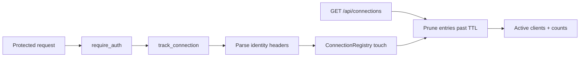
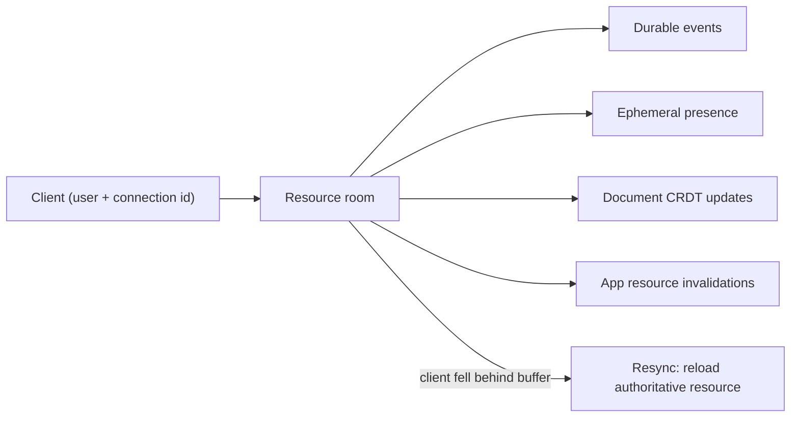

A Ryu node is one running Core instance. This page covers how clients pick and identify themselves
to a node, connected-client **presence**, and realtime collaboration. See
[Core vs Gateway](/docs/start-here/architecture/core-vs-gateway) for the ownership boundary.

## Node selector and identity

The node selector chooses a URL and a credential. It does not turn a website session into
universal node access.

| Entry | Credential |
|---|---|
| Local and self-hosted nodes | A node or paired bearer token |
| Managed nodes (from the control plane) | A short-lived user JWT scoped to the selected organization-bound node |

For MCP, use direct Core MCP for a node you already control, or hosted MCP OAuth for a managed
destination.

### Account attribution

Desktop and the mobile app attach your signed-in account identity to a node only when both hold:

- the node has a token (or, on Desktop, a managed credential);
- the node is reached over `https://` or runs on this machine.

On a node without a token, or one reached over plain `http://` from another machine, chats,
documents, and room joins are not attributed to your account. A managed node still identifies you
through its own node-scoped credential. Give a shared node an `https://` address to keep per-member
attribution.

### Compact selector

The compact selector is a quick switcher. It shows your computers, live hardware usage, and the
Core, Gateway, and Shadow services with their start, stop, and update actions.

- **Health dot.** The device or link icon stays neutral, and a small status dot at its lower-right
  corner shows node health: green for healthy, amber for degraded, red for unreachable, and a muted
  tone while the first probe is pending.
- **Default node.** Choosing a node in Desktop makes it the saved default for future conversations.
- **Auto-select computer.** Turn it on to prefer a reachable remote node and fall back to local
  compute when no remote answers. Turn it off to return to the saved manual choice.
- **Add computer.** Accepts a connection link or a manual name, URL, and optional token, and can scan
  the local network for Core nodes. The selector only connects after you confirm **Add computer**.
- **Share.** Builds a connection link for another device. Replace a loopback address with one the
  other device can reach before copying it.
- **Cloud suggestion.** A workspace cloud suggestion can be added to the saved node list, or
  dismissed until it is added.

### Full computer view

Select the expand button in the selector header, or **Engines, voice, toolkits…**, to open the full
computer view. It works like a settings app. The first page lists your computers and one row per
area:

- **Services**
- **Engines & models**
- **Voice & sandbox**
- **Toolkits**
- **Hardware**
- **Network & devices**, when a mesh network is on or other devices are connected

Rows that read from Core say so and stay closed while Core is unreachable. Select a row to open its
page, and select an engine or toolkit to see every option it offers, with the current one checked.
Use the back button to return.

<Callout type="info">
Presence is a display and diagnostics surface. Access control is evaluated separately from the
signed-in user identity and the resource's private, organization, or team visibility. Changing a
display header never grants access to a chat or Space.
</Callout>

## Connected-client presence

The presence registry (`apps/core/src/connections/mod.rs`, `ConnectionRegistry`) is an in-memory,
TTL-based view of the clients currently talking to a node.



- The `track_connection` middleware (`apps/core/src/server/mod.rs`) runs **inside** `require_auth`,
  so only authenticated protected requests are counted. Public routes like `/api/health` never
  pollute it.
- Each request parses a self-declared identity from headers and `touch`es the registry with the
  current time.
- Entries age out after the TTL. Nothing is persisted.

### Identity headers

Clients declare who they are with these headers. The desktop sends them on every Core request from
one place (`apps/desktop/src/lib/api/client.ts`, `identityHeaders()`).

| Header | Field | Role |
|---|---|---|
| `x-ryu-client-id` | `client_id` | Stable per-install id (random, persisted client-side). The **dedup key**, required to be tracked. |
| `x-ryu-client-label` | `client_label` | Short device label, for example `Desktop`, `CLI`, `Phone`. |
| `x-ryu-surface` | `surface` | Surface kind, for example `desktop`, `cli`, `mobile`, `extension`. |
| `x-ryu-user-id` | `user_id` | Stable per-user id (URL-encoded; the desktop sends the control-plane email). |
| `x-ryu-user-name` | `user_name` | Human display name (URL-encoded so non-ASCII names survive). |

A client with no `x-ryu-client-id` is not trackable and stays invisible. Older clients that send no
identity headers still work, but do not appear.

### Surface labels

The `surface` field lets a node operator tell which kind of client is present. The desktop renders
the same label and icon in Gateway → Connections and in the Node Selector:

| `surface` | Desktop label |
|---|---|
| `desktop` | Desktop app |
| `cli` | CLI |
| `mobile` | Mobile |
| `extension` | Browser extension |
| `web` | Web |
| another value | A humanized label for the future surface |

The label is still self-declared attribution behind the node token. It is not a login session,
authorization grant, device approval, or proof that the named user is the person operating the
client.

### Reading presence

```http
GET /api/connections
```

Returns the active set (newest activity first) with rollup counts:

| Field | Meaning |
|---|---|
| `data` | Array of connected clients, each with `client_id`, `user_id`, `user_name`, `client_label`, `surface`, `first_seen`, `last_seen`. |
| `client_count` | Number of distinct clients within the TTL window. |
| `user_count` | Distinct declared users (an anonymous client counts once by `client_id`). |
| `ttl_secs` | The TTL window in seconds (`DEFAULT_TTL_SECS`, currently `90`). |

- Dedup is by `(user_id, client_id)`, so one user with a desktop and a phone shows as two clients.
- A re-touch updates `last_seen` but never `first_seen`.
- Entries last seen more than `ttl_secs` ago are pruned on the next read.

The desktop surfaces this as a "Connected, N" section in `NodeSelector` and marks the current install
"(you)".

## The desktop connection hub

Open **Gateway → Connections** for one place to manage the machine boundary:

- **Control this device** contains pairing approvals, the local node access token, connected-client
  presence, phone linking, and cross-device sync.
- **Control other devices** lists the remote Ryu nodes configured in the desktop. Selecting one makes
  it the active node, so its filesystem becomes the source for remote project folders and Git actions.
- **SSH** keeps local connection profiles with a display name, host, and port, plus an optional
  username and identity-file path. Leave the username blank, or enter `user@host` as the host to fill
  it in. Ryu stores the path and connection metadata only. It never imports the private key.

### Failed reads and retry

The pairing, connected-device, and connected-client lists distinguish a failed node read from an
empty list. If the selected node cannot be reached, Desktop marks the state unavailable and offers
**Retry** instead of implying that no device is waiting or connected. Presence entries expire with
the node's TTL and never represent a device approval or access grant.

### Remote project folders

Project folders backed by the active remote node show that node's name and a compact connection dot
in the desktop sidebar. The dot is muted while the first health check is pending, green when the node
is reachable, and red when the node is offline. Local project folders omit the remote-node metadata.

This is a reachability signal only. It does not grant access or change which node owns the folder.

The SSH profile list is separate from Ryu node authentication. A remote project still needs a
connected Ryu node, because Core owns the remote filesystem and agent runtime. Git clones use the
active node's Git credential helper for HTTPS, or its own SSH configuration and keys for SSH, so
provider credentials stay on the machine that performs the clone.

## Realtime collaboration

Realtime is a node primitive shared by chats, Spaces documents, native clients, and installed apps.
A client joins a resource room with its signed-in identity and a stable per-connection client id.

The second id means two devices signed in as the same person still receive each other's changes,
while the device that originated an update can suppress only its own echo.



Rooms carry four kinds of change:

- durable events, such as a new chat message;
- ephemeral presence, such as cursors and active collaborators;
- document CRDT updates for pages, databases, comments, and suggestions;
- app resource invalidations, which tell Canvas, Whiteboard, Workflows, or Dashboards to refetch
  their authoritative state.

### Consistency guarantees

- **Resync, never skip.** A slow client that falls behind the room buffer receives an explicit resync
  request and reloads the authoritative resource. It never silently continues across a missing range.
- **Version restore.** Restoring a document version advances its document generation, clears
  discarded offline state, and asks every open editor to reload the restored source before editing
  resumes.
- **Offline recovery.** Document edits are cached locally. Reconnecting starts with a state-vector
  handshake, so queued local changes and the node's durable CRDT state converge without replaying
  the whole edit history.
- **Comments.** Comments use the signed-in person's name and avatar and are stored as granular
  shared entries, so concurrent replies merge instead of replacing an entire discussion.

## Private networks and webhook ingress

Linking nodes over a tailnet and exposing Core through a public tunnel are on
[Tunnels and Private Networks](/docs/core/private-networking). The public URL that Composio triggers
call is on [Webhook Ingress](/docs/core/webhook-ingress).

## Related

The `NodeSelector` also samples which engines are running on a node plus their memory and CPU. That
surface is documented with [Engines](/docs/surfaces/desktop/engines).

<Cards>
  <DocCard href="/docs/core/managed-fleet" />
  <DocCard href="/docs/surfaces/desktop/engines" />
  <DocCard href="/docs/surfaces/desktop/user-guide/data-and-storage" />
  <DocCard href="/docs/core/mcp-registry" />
  <DocCard href="/docs/surfaces" />
</Cards>
