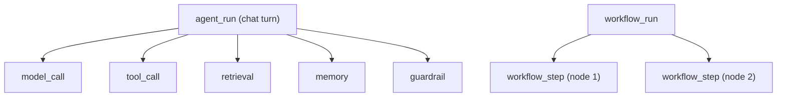
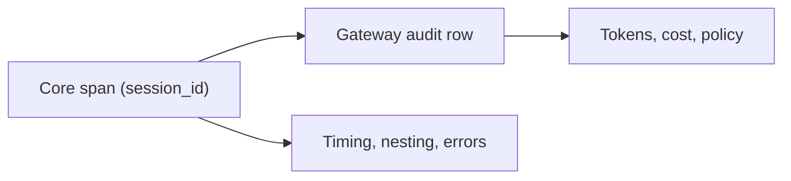

Core run traces record the order, nesting, and timing of the work in one agent or workflow run.
This page is the storage and data-model reference. For the trace viewer, the response shapes of the
trace routes, and OTLP export presets, see [Run Traces and Export](/docs/surfaces/desktop/observability).

## Where traces live

Core writes spans through `TraceStore` (`crates/core/tracing/src/lib.rs`) into SQLite at
`~/.ryu/db/traces.db`. The run id is the conversation id from the chat request.

- Each chat turn opens an `agent_run` root span. Model calls, tool calls, retrieval, memory, and
  guardrail work nest under it.
- A workflow execution opens a `workflow_run` root with one `workflow_step` span per node.

The full kind list is in [What a trace contains](/docs/surfaces/desktop/observability#what-a-trace-contains).

Rows written by older builds used the flat kinds `tool-call` and `model-call`. They still parse, so
older runs remain readable in the tree view.

## Fields in a span

| Field | Type | Meaning |
|---|---|---|
| `id` | string | Stable row id (UUID) |
| `conversation_id` | string | The run this span belongs to |
| `kind` | string | A span kind such as `agent_run`, `model_call`, or `tool_call` (or a legacy flat kind) |
| `name` | string | Tool name, model id, or agent, workflow, or step name |
| `args_hash` | string, nullable | SHA-256 hex of the raw tool input (tool calls only), never the raw payload |
| `started_at` | i64 | Unix milliseconds when the span opened |
| `ended_at` | i64, nullable | Unix milliseconds when the span closed, `null` while in flight |
| `error` | string, nullable | Set when the span ended with a failure |
| `session_id` | string, nullable | Link to the Gateway audit session |
| `seq` | i64 | Autoincrement ordering key |
| `trace_id` | string, nullable | 32-hex id shared by every span of one run |
| `span_id` | string, nullable | 16-hex span id (the OTLP span id) |
| `parent_span_id` | string, nullable | The parent's `span_id`, `null` for a root |
| `status` | string | `running`, `ok`, `error`, or `cancelled` |
| `agent_id` | string, nullable | The agent the span ran under, inherited from the parent |
| `attributes` | object | Small metadata such as counts, ids, and model parameters |
| `input`, `output` | any, optional | Captured payloads, present only when payload capture is on |

`trace_id`, `span_id`, and `parent_span_id` are `null` only for rows written before hierarchical
traces.

## Payload capture

By default Core persists no prompt, completion, or tool payload. Tool input is stored only as the
`args_hash` fingerprint. Payload capture follows `ContentPolicy` (`crates/core/tracing/src/content.rs`):

- Core turns capture on only when the user's privacy settings allow it. The privacy settings are
  resolved in `apps/core/src/privacy.rs`.
- Captured payloads are sealed at rest. A store without a sealer persists no payloads.
- Each input or output is capped at 750,000 serialized bytes (`DEFAULT_MAX_CONTENT_BYTES`).
- Turning capture off also clears the payloads already stored.

Core records sequencing, fingerprints, latency, and errors. Token counts and cost belong to the
[Gateway audit log](/docs/gateway/audit), where measurement lives.

## Routes

The trace routes are served from `apps/core/src/server/trace_api.rs`. The query parameters and
response shapes of `GET /api/runs/:id/trace` and `GET /api/traces` are documented in
[Run Traces and Export](/docs/surfaces/desktop/observability#api).

A run with no spans yet returns an empty list rather than `404`, so a client can poll during an
active run. Two more routes serve the background-runs view:

| Method + path | Purpose |
|---|---|
| `GET /api/runs` | Conversations that carry a `run_status` |
| `GET /api/runs/stream` | Live feed of run status changes |

## Retention and access

| Bound | Default | Variable | `node-config.json` key |
|---|---|---|---|
| Age | 90 days | `RYU_TRACE_RETENTION_DAYS` | `trace.retentionDays` |
| Span count | 1,000,000 spans | `RYU_TRACE_MAX_ROWS` | `trace.maxRows` |

Set either bound to `0` to disable it, or to a positive value to change it. The keys live in
[`node-config.json`](/docs/start-here/configuration#core-node-config), and an explicitly set
environment variable still wins. Local audit and trace stores run the same bounded retention pass
at startup.

- Trace reads require the owning conversation's resource access.
- If that owner row is gone, Core deletes any orphaned spans and returns `404`.
- Temporary plugin-eval spans are deleted immediately after grading.

## Explore traces in Activity

The desktop agent editor's **Activity → Observability** view, and the pre-installed Activity app's
**Observability** view, combine Core spans with the Gateway audit log in an agent-scoped explorer:

- It reads a bounded Gateway audit window with one-hour, 24-hour, seven-day, or all-time ranges,
  plus search and failure, slow, model, and tool filters.
- It calculates request, error, latency, token, cost, and quality rollups.
- It follows a selected `session_id` back to the Core span timeline.
- **Discover** groups the window into provider, model, and failure facets and saves named filter
  views on the device.
- **Prune local audit** applies the Gateway's configured retention policy.
- A completed trace can be sent to the Gateway's online scorer without replaying its provider request.
- **Add to Quality tests** captures the last user and assistant pair into the agent's Prompt Studio
  suite. Core creates the baseline suite when none exists, and repeated imports of the same run are
  idempotent.

The Activity app also offers a Promptfoo-compatible quality replay and a bounded local security
sweep:

- The sweep uses the Gateway evaluator catalog for prompt injection, jailbreak, PII-leakage,
  tool-misuse, and toxic-output probes.
- The server owns the fixed prompts, rejects unknown strategies, and does not execute a real tool.
- Provider-backed actions use the normal Gateway budget and audit path.

The dashboards poll every 15 seconds and have a manual refresh action. The explorer is a read-only
projection: Core owns run state, the Gateway owns measured usage and policy, and the UI is never a
billing source.

## Core and Gateway correlation

A span's `session_id` links it to the Gateway audit session. Core spans carry sequencing and timing;
the matching audit rows carry tokens and cost.

<Callout type="warn">
  The span-to-audit link is only present when the request carries a Core conversation or session
  id. Direct Gateway calls can appear in the audit view without a local Core timeline, and tool
  spans may stay unlinked even when the surrounding model span is linked.
</Callout>

## Related

<Cards>
  <DocCard href="/docs/surfaces/desktop/observability" />
  <DocCard href="/docs/core/observability" />
  <DocCard href="/docs/gateway/audit" />
  <DocCard href="/docs/surfaces/desktop/user-guide/agent-observability-and-evals" />
</Cards>
