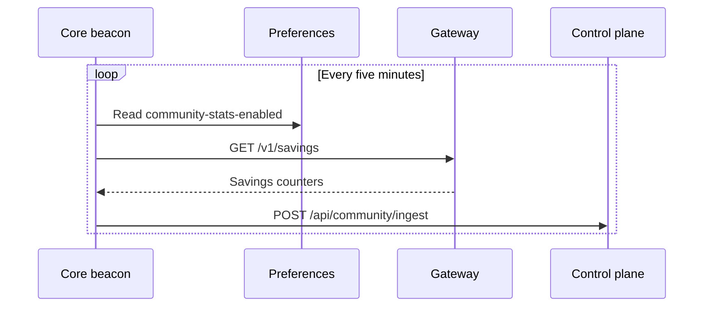

Core owns local runtime logs, cross-device sync, preferences, per-engine resource sampling, crash
reporting, and community-savings telemetry. These subsystems describe what runs and what state
exists, so they live in Core.

<Figure name="observability" />

- Per-run span timelines are on [Core Run Traces](/docs/core/observability-traces).
- Measurement of paid usage stays in the [Gateway audit log](/docs/gateway/audit).

## Local runtime logs

The CLI and one-line installer keep Core's console diagnostics in `~/.ryu/logs/ryu-core.log`.

| Log | Level | Rotation |
|---|---|---|
| Core console log (`ryu-core.log`) | `info` by default | Rotates at 5 MiB, keeps four numbered backups |
| Desktop native log | Info and higher | Rotates at 1 MiB, keeps one backup |

A single log record can put a file slightly over its rotation size. Core and Gateway use `info` by
default; set `RUST_LOG=ryu_core=debug,info` or `RUST_LOG=ryu_gateway=debug,info` when you need debug
output.

These diagnostic files are separate from `traces.db` and the Gateway audit database. Those record
model and tool spans and audited requests during actual work.

## Sync

Cross-device sync is the opt-in durable mirror for nodes signed in to the same Ryu account. Each
enabled node periodically pushes local changes and pulls remote changes without blocking local work.

| Property | Value |
|---|---|
| Mirrored data | Chats plus editable Spaces pages, databases, whiteboards, and app documents |
| Conflict rule | Last-writer-wins on conversation metadata by `updated_at` |
| Message merge | Union-merge by stable UUID (append-only, additive insert) |
| Document merge | Last-writer-wins by document edit time, preserving stable Space and document ids |
| Excluded data | Binary file attachments, models, engines, memory, and local app setup |
| Storage | Mirrored titles, messages, and document source are encrypted at rest |

The loop exists at startup but does no network work until you opt in. Errors are best-effort, so a
flaky network or signed-out account never stalls the node. Once connectivity returns, the next pull
converges from the last successful watermark.

<Callout type="warn">
  Sync is **off by default**. Enable it in **Gateway settings → Connect → Connections → Cross-device
  sync** on each node ([Cross-Device Sync](/docs/surfaces/desktop/user-guide/cross-device-sync)). A
  restart may perform an extra full pull; replay is idempotent.
</Callout>

## Preferences

Core exposes a generic key-value preferences store with live change notifications
(`apps/core/src/server/preferences.rs`), backed by SQLite at `~/.ryu/db/preferences.db`.

- Many features read their config from it, including sync, goals, auto-recall, and the voice engine.
- It keeps separate processes aligned without shared browser storage. For example, the desktop
  publishes a feature toggle, and the Island companion subscribes to the SSE stream and updates
  live.

| Action | Endpoint |
|---|---|
| Get a preference | `GET /api/preferences/:key` |
| Set a preference | `PUT /api/preferences/:key` |
| Subscribe to changes | `GET /api/preferences/stream` (SSE) |

## Engine resource sampling

For the node selector, Core samples per-engine memory and CPU for the sidecars it owns a resident
child for (`apps/core/src/sidecar/resources.rs`). A `ResourceSample` is three numbers:

| Field | Type | Notes |
|---|---|---|
| `pid` | u32 | The sampled OS process id |
| `memory_bytes` | u64 | Resident-set size (RSS) |
| `cpu_percent` | f32 | Per single core; can exceed 100 across cores |

CPU is a *delta*. `sysinfo` reports usage since the previous refresh of a PID, so a one-shot read
always returns `0.0`.

The `SidecarManager` background sampler therefore holds one long-lived `System`. It refreshes only
the known sidecar PIDs every two seconds (`RESOURCE_SAMPLE_INTERVAL`), never a full process scan, so
the second tick onward yields real CPU numbers.

The latest sample rides the existing status poll as optional fields (`pid`, `memory_bytes`,
`cpu_percent`) on:

```http
GET /api/sidecar/status
```

The fields are serde-skipped when absent. Adopt-mode, serverless, and in-process engines that own no
child report no usage rather than zeros. The desktop joins this with the engine catalog to render
the node-selector breakdown.

## Crash reporting

Core reports Rust **panics** to Sentry (`apps/core/src/crash.rs`). It does not forward `tracing` or
log events, because those can carry prompt or agent content and `~/.ryu` paths.

- The only integrations are panic, backtrace, and contexts.
- A `before_send` hook scrubs the home-dir prefix out of the panic message and every stack frame's
  path.
- `send_default_pii` is forced off, and `server_name` is `None`, so the machine hostname never
  leaves the box.

Two gates must both hold, or the module is a no-op:

1. The `crash-reports-enabled` preference (resolved by `crate::privacy::crash_reports_enabled`).
2. A configured DSN (`SENTRY_DSN`).

Core mirrors the resolved consent into a process-global that the Gateway sidecar spawn-env reads, so
the Gateway gets the same consent. Core forwards the DSN to it as `RYU_SENTRY_DSN`.

<Callout type="warn">
  A stock local install reports nothing, because the module stays a no-op until a DSN is configured.
  Core reads the preference once at boot, so turning the desktop toggle off takes effect on the next
  Core restart. The consent default and the toggle are on
  [Transparency](/docs/surfaces/desktop/transparency#crash-reports).
</Callout>

## Community-savings telemetry

Core runs an anonymous community-stats beacon (`apps/core/src/stats_beacon.rs`). Per the Core vs
Gateway rule, Core owns consent and the phone-home but never computes the measurement inline. It
forwards what the Gateway already measured.



Every five minutes (`BEACON_INTERVAL`), an enabled tick:

1. Re-reads the `community-stats-enabled` preference.
2. Reads the Gateway's public savings counters at `GET /v1/savings` (compression, cache, protected
   API-call, and blocked-guardrail totals).
3. POSTs a snapshot to the control plane at `/api/community/ingest`.

The same content-free snapshot carries marketplace install events, and successful `skills.load`
calls count as skill invocations.

The row is keyed by a locally minted random install id (`community-stats-install-id`, a uuid v4) plus
a per-process session id. No hostname, Gateway key, org id, or any identity value is ever sent.

Every step is fail-open. A Gateway-down, network, or parse error logs and skips the tick, and the
beacon never panics or blocks chat.

<Callout type="warn">
  The beacon is default-on (opt-out) and, unlike crash reporting, has no DSN gate, so a stock install
  phones anonymous aggregates home once the Gateway is healthy. Turn it off with the
  `community-stats-enabled` preference (or `RYU_COMMUNITY_STATS_ENABLED`). The preference is re-read
  every tick, so an in-session opt-out stops egress at once.
</Callout>

The public [Community Stats](https://ryuhq.com/community) page shows the aggregate as a Radar-style
overview: deployments, protected API calls, blocked guardrail calls, app installs, unique apps
observed, skill invocations, workflow runs, and the existing compression savings.

"Deployments" means distinct anonymous install ids that have reported. It is not a count of customer
accounts or a production deployment claim.

## Profile activity (streak) ping

`apps/core/src/profile_activity.rs` sends the signed-in account's "active today" marker. When the
local Gateway does not report usage to Ryu Cloud, it also sends a per-device snapshot of that UTC
day's totals, read from the local [Gateway audit](/docs/gateway/audit) rollup.

- Ryu Cloud's control plane stores the marker and the per-device usage snapshot.
- Core re-reads the `profile-activity-enabled` preference before every send, and does nothing while
  signed out.
- Delivery runs in the background with retries, so it never blocks a turn.

What the ping carries, its send cadence, the device limit, and how to turn it off are on
[Transparency](/docs/surfaces/desktop/transparency#profile-activity-streak).

## Related

<Cards>
  <DocCard href="/docs/core/observability-traces" />
  <DocCard href="/docs/core/node-and-presence" />
  <DocCard href="/docs/gateway/audit" />
  <DocCard href="/docs/surfaces/desktop/transparency" />
</Cards>
