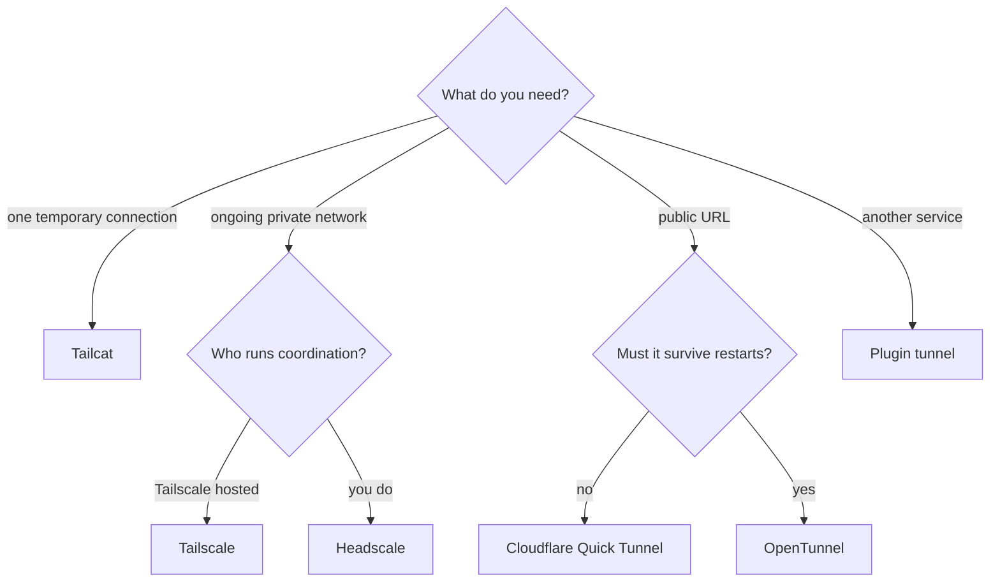
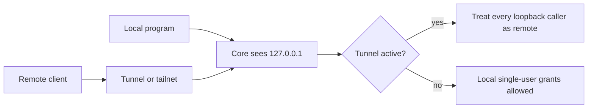

Ryu can link nodes over a private tailnet, or expose Core through a public tunnel:

- **Tailscale and Headscale** link nodes over a private tailnet, so a client can reach a remote node
  by its MagicDNS name instead of a LAN IP.
- **[Tailcat](https://tailscale.com/tailcat)** provides a short-lived point-to-point connection.
- **Cloudflare Quick Tunnel** exposes Core at a temporary public URL.
- **[OpenTunnel](https://github.com/anomalyco/opentunnel)** exposes Core at a stable public URL whose
  TLS is terminated on this node.
- **A plugin tunnel** covers any other service. See
  [Build a tunnel adapter](/docs/extend/develop/extensions/tunnel-adapters).

## Backends

Core owns **what runs** here. The selected backend is an opt-in sidecar. Ryu automatically downloads
and verifies the selected client into the node profile when a managed release is available:

- Tailscale and Headscale use the official `tailscale` and `tailscaled` pair in userspace networking
  mode, with Tailscale SSH off and no proxy listeners by default.
- Tailcat uses its pinned CLI.
- Cloudflare Quick Tunnel uses `cloudflared`.
- OpenTunnel uses its pinned `opentunnel` CLI.
- Plugin tunnels run inside the plugin's own sidecar.

| Backend | Best for | Ryu setup | Network model |
|---|---|---|---|
| Tailcat | One temporary connection | Ryu installs the server-side CLI automatically | One short-lived bearer address; no account, control server, or peer discovery |
| Tailscale | An ongoing private network using Tailscale's hosted service | Ryu installs the client pair automatically; enrollment still needs Tailscale authentication | Persistent tailnet with hosted coordination and peer discovery |
| Headscale | An ongoing private network you operate yourself | Ryu installs the same client pair automatically; an existing reachable Headscale URL is required | Persistent tailnet with self-hosted coordination |
| Cloudflare Quick Tunnel | Share this Core briefly over the public internet | Ryu installs the pinned Cloudflared release when supported | Temporary `*.trycloudflare.com` URL; no account or access policy |
| OpenTunnel | A public URL that survives restarts | Ryu installs the pinned OpenTunnel release on macOS and Linux | Stable `https://<route>.<id>.opentunnel.xyz` URL; TLS terminates on this node; no account or access policy |
| Plugin tunnel | Any other tunnel service | Install an app that provides a tunnel from the Store | Whatever the plugin's provider offers; Core only receives its public URL |



### Defaults and switching

- **Tailcat is the default** for a fresh node (`DEFAULT_MESH_BACKEND`), because it needs no account,
  control server, or persistent tailnet. An existing explicit backend preference remains unchanged
  during upgrade.
- **Headscale needs a control server URL**, because it is the self-hosted coordination server, not a
  client binary. Ryu installs the client pair for that connection, but never silently creates or
  exposes a Headscale control server.
- **Switching Tailscale and Headscale.** Enrolling with a new auth key starts from clean client
  settings. Change the tunnel and supply a key for the new control server; Ryu reapplies the control
  server URL and node hostname itself.

### Network settings in Desktop

**Gateway settings → Network** shows the selected node's tunnel and Headscale settings.

- Switching nodes reloads those values and retires the previous node's pending status updates and
  installation notices. It does not cancel installation on that node.
- If you return to a node or reopen settings while its save is still pending, the form waits for that
  save to finish before reloading its values.
- If the settings cannot be read, Desktop shows an error and **Retry**. Saving stays unavailable
  until the read succeeds.

For Headscale, enter the control-server URL on the same page and choose **Save**:

- Use a complete `http://` or `https://` URL. Desktop rejects malformed URLs and other schemes before
  sending a write, and trims surrounding whitespace from a valid URL.
- If Core cannot save it, Desktop keeps the edited value and re-enables **Save** so you can retry.

## Mesh status

`GET /api/mesh/status` shapes every backend into one status contract.

```http
GET /api/mesh/status
```

| Field | Meaning |
|---|---|
| `enabled` | Whether the Tunnel toolkit is enabled on this node (`RYU_MESH_ENABLED` or the desktop toggle), not whether the provider process runs. |
| `reachable` / `up` | Both present and equal; `true` only when `backend_state == "Running"`. |
| `backend` | `tailscale`, `headscale`, `tailcat`, `cloudflared`, `opentunnel`, `plugin`, or `null`. |
| `backend_state` | Raw `BackendState` string, for example `Running`, `NeedsLogin`, `Stopped`. OpenTunnel reports `Provisioning` while its first certificate is issued. |
| `control_server` | Coordination/login server URL, or `null` when unknown. |
| `magic_dns_name` | This node's MagicDNS name (trailing dot stripped). |
| `tailscale_ips` | This node's tailnet IPs. |
| `tailcat_address` | The active short-lived Tailcat connection address, or `null` for Tailscale/Headscale. It is a bearer for this connection. |
| `cloudflaredUrl` | The active public Quick Tunnel URL, or `null` for other backends. Kept for older clients; prefer `publicUrl`. |
| `publicUrl` | The active public URL of a Cloudflare Quick Tunnel, OpenTunnel, or plugin tunnel, or `null`. Anyone with the URL can reach Core's public routes; protected routes still require the node token. |
| `tunnelProvider` | `{ "id", "name" }` of the app serving a plugin tunnel, or `null` for other backends. |
| `backendError` | Why the selected public tunnel is not running, when its provider reported a reason, or `null`. |
| `peers` | Peer nodes, each with `name`, `host_or_dns`, `magic_dns_name`, `tailscale_ips`, `online`, `os`. |
| `webhook_ingress_mode` | Always `null` here. The ingress mode is read from `GET /api/webhook-ingress/status`. |
| `nodeKey` | Tailscale and Headscale only: `{ "expiry", "expired" }` for this node's key. `expiry` is an RFC 3339 time, or `null` when key expiry is off for the node (for example a tagged node) or was not reported. Omitted for other backends. |
| `tailnetLock` | Tailscale and Headscale only: `enabled`, `disabled`, `unknown` (the client did not report it), or `unsupported` (Headscale has no Tailnet Lock). Omitted for other backends. |

- When the Tunnel toolkit is disabled, `query_status` returns the all-default object with HTTP 200.
- When it is enabled but the provider is absent or erroring, it returns an enabled-but-unreachable
  object, so the desktop can render an amber "configured but down" state.

<Callout type="warn">
The Tunnel toolkit is **opt-in and off by default**. Enable it from Desktop, or with
`RYU_MESH_ENABLED` (truthy is anything but empty, `0`, `false`, or `no`). When the variable is set,
it overrides the desktop toggle.

It is **fail-closed**. Core refuses to start tokenless when a backend can reach it, and the Gateway
admin/exec gates do not trust loopback traffic from an active tunnel.

Cloudflare Quick Tunnel, OpenTunnel, and plugin tunnel URLs are public, not an access policy.
Protected Core routes still require `RYU_TOKEN`; share that credential only with trusted clients.

Quick Tunnels do not support Server-Sent Events and have a 200 in-flight request limit, so use them
for development and brief sharing, not production. Treat a Tailcat address like a password;
stopping or restarting its listener replaces it.
</Callout>

## Local-only features while a tunnel runs

Tunnels deliver remote requests to Core from `127.0.0.1`, so Core cannot tell them apart from
programs on this computer. Tailscale and Headscale do the same in userspace networking mode: every
tailnet peer reaches Core as a loopback connection.



Core treats every loopback connection as remote while Tailscale or Headscale is enabled or running,
or while Tailcat, a Cloudflare Quick Tunnel, OpenTunnel, or a plugin tunnel is running:

- `GET /api/auth/status` omits the signed-in account's bearer.
- `GET /api/auth/user-jwt` refuses to issue a user identity token. The CLI, Island, the browser
  extension, and Raycast cannot attach your signed-in identity to their requests until the tunnel
  stops.
- WebSocket tickets do not carry the local single-user grant, and a node without a token refuses to
  issue them.

This applies whichever feature started the tunnel. A Cloudflare Quick Tunnel used only for
[webhook ingress](/docs/core/webhook-ingress) exposes every Core route, not just the webhook path, so
it counts too.

## Use Tailcat for one connection

1. Select Tailcat on the node selector's **Toolkits → VPN** page.
2. Enable the backend in **Settings → Gateway → Network**. Core starts a Tailcat listener for its own
   HTTP port and shows a fresh address there.
3. Choose **Copy** beside the address, and share that bearer only with the client that needs to
   connect.

Ryu downloads the server-side Tailcat CLI automatically on supported platforms, so there is nothing
to install on the Ryu node. A non-Ryu machine that connects directly still needs a Tailcat client.
From that machine, use the copied address with the Core port:

```bash
tailcat <address> <core-port>
tailcat socks <address> curl http://server.tailcat:<core-port>/api/health \
  -H 'Authorization: Bearer <RYU_TOKEN>'
```

The Tailcat address is a connection bearer, separate from Ryu's `RYU_TOKEN`. Do not put it in source
control, logs, or a public issue. Tailcat does not provide persistent peer discovery or Tailscale
Funnel; use Tailscale or Headscale when the node needs an ongoing governed tailnet.

## Use a Cloudflare Quick Tunnel

1. Select **Cloudflare Quick Tunnel** on the node selector's **Toolkits → VPN** page and turn it on.
   Core starts `cloudflared` against its local HTTP port and displays the generated
   `https://<random>.trycloudflare.com` address.
2. Use **Copy public URL** to share it.
3. Stop the tunnel when you finish sharing it.

- The URL changes when the tunnel restarts.
- If Webhook ingress is also set to Cloudflared, Core reuses the same process and URL.
- Quick Tunnels do not start when a Cloudflared `config.yaml` is present in its default config
  directory. See the [Quick Tunnel instructions](https://developers.cloudflare.com/cloudflare-one/networks/connectors/cloudflare-tunnel/do-more-with-tunnels/trycloudflare/) for that case.
- Anyone who obtains the URL can reach Core's public routes. Protected routes require the node's
  `Authorization: Bearer <RYU_TOKEN>` header, which the client must forward.

## Use OpenTunnel for a stable public URL

Select **OpenTunnel** on the node selector's **Toolkits → VPN** page and turn it on. Ryu downloads the
pinned `opentunnel` CLI if it is not already on `PATH`.

- **First start.** Core creates this node's tunnel and waits for its certificate, which can take a few
  minutes. The menu reads **Creating tunnel certificate…** until it finishes.
- **Later starts** reuse the same identity, so the URL stays the same across restarts.
- **URL visibility.** Ryu shows the URL only after a request sent to it has reached this node. If the
  relay connection drops, the menu says the tunnel is reconnecting and hides the URL until requests
  reach the node again.

The URL has the form `https://<route>.<id>.opentunnel.xyz`. The route is a random 16-character name,
so the URL cannot be guessed from certificate logs, but it is not authentication. Anyone you share it
with can reach Core's public routes, and protected routes still require `RYU_TOKEN`.

TLS is terminated
by the `opentunnel` process on this node, so the OpenTunnel relay does not see request contents.

Ryu keeps its OpenTunnel identity in its own data directory, separate from any `opentunnel` profiles
you use yourself. It runs the tunnel as a child of Core, not as a login service, so the tunnel stops
when you turn it off or quit Ryu. Uninstalling OpenTunnel with data deletion removes the identity and
gives up its hostname.

| Setting | Effect |
|---|---|
| Platform | macOS and Linux only. On Windows, Core refuses the OpenTunnel choice and keeps the current tunnel |
| `RYU_BIND` | The tunnel forwards to the address Core listens on, so `[::1]` or a LAN address works too |
| `RYU_OPENTUNNEL_API` | API URL of a self-hosted OpenTunnel server, set before starting Core |
| `RYU_OPENTUNNEL_BIN` | Your own `opentunnel` binary (or put it on `PATH`) |

## Use a plugin tunnel

Apps can add tunnel services that Ryu does not ship. After you install and enable one, it appears in
the **VPN** menu under its own name.

- Selecting it tells Core to ask that app to expose Core's port. The app's public URL appears in the
  menu like any other public tunnel.
- Disabled tunnel apps are listed with **not enabled**; selecting one enables it first.
- The same token rules apply: protected routes still require `RYU_TOKEN`, and Core stops trusting
  loopback traffic as local while a plugin tunnel is running.

## Tailscale Funnel scope

When Webhook ingress is set to `TailscaleFunnel`, Core publishes only the paths a webhook sender
needs, at the node's `https://<magic-dns-name>` address on port 443:

- the Composio webhook path (`/api/composio/webhook`);
- the `/api/workflows/` prefix used by per-workflow webhook URLs.

Every other Core route, including chat, the vault, settings, and sidecar proxies, is not published.
Routes under `/api/workflows/` other than the webhook itself still require the node token.

Core turns the Funnel off when you stop the mesh, when you select a different webhook ingress, and
when it starts the mesh daemon while the configured ingress is not the Funnel. It also clears a
Funnel left behind by an older build that published Core's whole port.

## Harden your tailnet

### What Ryu enforces

- Ryu runs its own Tailscale or Headscale client without Tailscale SSH, without `tailscale serve`,
  and without subnet-router, exit-node, or app-connector roles.
- The client runs as an ordinary user in userspace networking mode.
- Enrolling resets the client's settings and passes `--ssh=false`. If Core adopts a client that
  already has Tailscale SSH on, it turns SSH off, and refuses to start the mesh if that fails.
- Core refuses to start the mesh when it cannot restrict the mesh directory, which holds the node's
  private keys, to its owner. It logs an error when it runs as root with the mesh enabled.
- The unauthenticated SOCKS5 and HTTP proxy listeners that `tailscaled` can open are off by default,
  because a tailnet peer arrives from the node's own loopback address and could dial through them as
  the node. Enable them only for a specific outbound-dialing need.

### What you configure

Which devices and people can reach the node is set in your tailnet policy, which Ryu does not
manage. These steps keep a compromised or over-trusted tailnet member from reaching more than it
needs:

- **Write narrow access rules.** Use one source and one destination per rule, for example
  `tag:ryu-client` to `tag:ryu-node` on the Core port. Avoid `autogroup:member` to `tag:*` and
  `*:*`, because every device you later add inherits that reach.
- **Do not enable Tailscale SSH on a node host.** If you need it, add one source-to-destination rule
  with check mode, and treat any SSH grant to the host as root-equivalent. Disable SSH port
  forwarding for the rule where your control plane allows it. Headscale may not offer that control,
  so check your version's documentation.
- **Remove unneeded roles.** Delete app connector, subnet router, and exit node permissions that Ryu
  nodes do not use, and remove any `tailscale serve` rules that point at Unix sockets.
- **Limit key lifetime.** Keep node-key expiry on, turn on automatic client updates, and enable
  Tailnet Lock and hardware-bound node keys where your control plane supports them. Headscale has no
  Tailnet Lock. `GET /api/mesh/status` reports the node's key expiry and Tailnet Lock state.
- **Respond to a compromise at the control plane.** Delete the device in your admin console.
  Re-imaging the machine does not revoke key material that was already copied.
- **Keep `RYU_TOKEN` set.** The tailnet is the first layer. Protected Core routes still need the node
  token, so a device that reaches the node still cannot call them without it.

### Client updates

Ryu bundles a pinned client version, so a fix released by Tailscale reaches a node with the next Ryu
release. If you need a fix sooner, install the official client and daemon on the node's `PATH`. Ryu
uses a pair found there in preference to its own download, and logs a warning when that client is
older than the oldest release Ryu considers safe.

## Related

<Cards>
  <DocCard href="/docs/core/node-and-presence" />
  <DocCard href="/docs/core/webhook-ingress" />
  <DocCard href="/docs/extend/develop/extensions/tunnel-adapters" />
  <DocCard href="/docs/security/network-binding-auth" />
</Cards>
