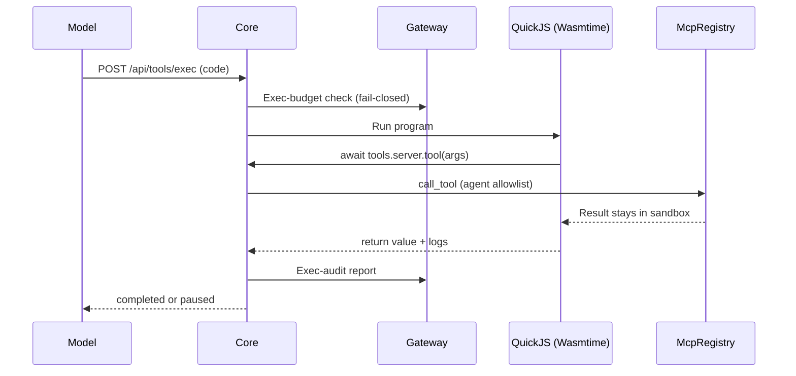
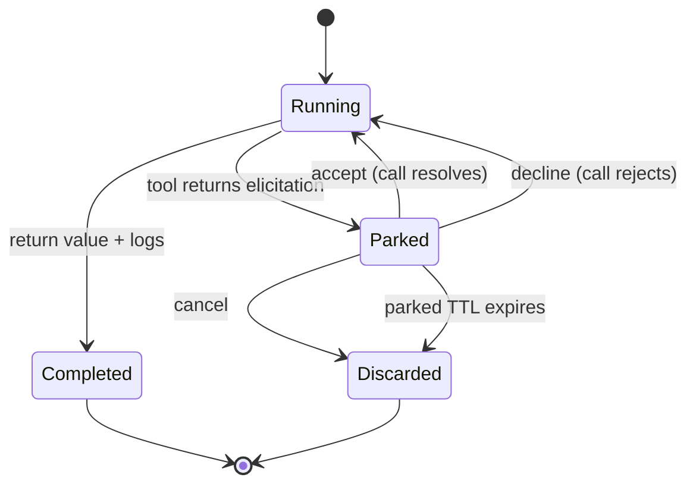

Programmatic tool calling lets a model author one JavaScript program that calls many tools, and
returns only its final value plus console logs. Intermediate tool results never re-enter the model.
The implementation lives in `crates/core/tool-exec/src/`.

## Why PTC

The usual chat tool loop sends one tool call per turn, and every intermediate result re-enters the
model's context. With PTC, the model emits a single program that fans out across tools through an
injected `tools` proxy. Only its `return` value and `console.log` output come back, which saves model
context (`crates/core/tool-exec/src/lib.rs`).

```js
const issues = await tools.composio.GITHUB_LIST_ISSUES({ owner: "ryu", repo: "core" });
const open = issues.filter((i) => i.state === "open");
return open.length;
```

- **Discovery.** The `execute` meta-tool's description (`crates/core/tool-exec/src/schema.rs`) steers
  the model to call `tool_search` first to discover tool paths, then write a program. That search
  uses the same unified catalog and defaults to the local Needle 2 selector for tools and Agent
  Skills (`apps/core/src/needle2.rs`).
- **Tool paths.** `tools.spider.crawl` maps to the registry id `spider.crawl`, and
  `tools.composio.<SLUG>` maps to `composio.<SLUG>` (`crates/core/tool-exec/src/invoker.rs`,
  `tool_path_to_id`).



## Endpoints

Core exposes two routes (`apps/core/src/server/mod.rs`):

| Action | Endpoint |
|---|---|
| Run a program | `POST /api/tools/exec` |
| Resume a paused execution | `POST /api/tools/exec/resume` |

`POST /api/tools/exec` takes:

- a required `agent_id`;
- the `code` to run;
- an optional `conversation_id`, used only to select the Composio entity for per-user connected
  accounts.

It returns a flattened outcome: `completed` with the final value plus logs, or `paused` awaiting a
connect step.

`POST /api/tools/exec/resume` takes `agent_id`, the `execution_id` returned by the pause, an `action`
of `accept`, `decline`, or `cancel`, and optional `content` (form values when the pause requested a
schema). An unknown id returns `404 execution_not_found`.

## Per-agent allowlist, no escalation

The agent's resolved tool allowlist travels unchanged into the execution, so a program cannot reach a
tool the agent could not call in chat. Tool calls route through the same `McpRegistry::call_tool`
path the chat tool loop uses (`crates/core/tool-exec/src/invoker.rs`).

- `resolve_agent_allowlist` (`apps/core/src/tool_exec/mod.rs`) is fail-closed. An absent or unknown
  `agent_id` is rejected before any code runs.
- The flagship `ryu` agent has no restriction by default. Other agents are restricted to their
  allowlist.
- Core checks the caller's `agent.run` permission on that exact agent before starting or resuming a
  program. A member denied access to the agent cannot use its tool allowlist through these routes.
- When a short-lived delegation is signed for one agent, REST tool calls and program execution or
  resume must name that same agent. Choosing another agent in the request body is refused.

## Reading private data, then sending data out

A program can chain tool calls without the model seeing what passes between them. An injected
instruction could therefore ask it to read your data and send it somewhere in the same run.

Once a program has read private data, any later call in the same program that can send data off the
machine waits for your approval in the Approvals inbox.

- **Private reads that arm the hold:** conversation history; memory, including a memory provider's
  own tools; Spaces; the agent inbox's mail and verification codes; connected-account reads; pages
  fetched with your saved sign-in.
- **Later calls that wait:** web and browser tools; desktop clicks, typing, and key presses; writes
  through Ryu's own API and app APIs; delegation and new threads; outbound channels; sending or
  replying from an agent inbox; external MCP tools.

How the hold behaves:

- Reading the same connected account again (listing items, then opening each one) is not held.
- The program sees a catchable error that names the earlier read. If you approve, the call runs
  outside the program, and its result does not return to the program.
- The hold applies in every approval mode, including **off**, and an earlier "Allow for this chat"
  does not skip it.
- A program that only reads, or only reaches the web, runs as before.

## Execution backend

Programs run in QuickJS (the Bytecode Alliance's Javy runtime) compiled to WebAssembly and executed
inside Core by Wasmtime (`crates/core/tool-exec/src/js_backend.rs`). The WebAssembly instance has no
network, no filesystem, and no environment, so isolation does not depend on permission flags.

Nothing is downloaded or spawned to run a program, and the sandbox behaves the same on macOS, Linux,
and Windows.

### Engine cache

Core compiles the engine in the background when it starts.

- **macOS and Linux.** Core keeps the compiled code in the `cache/js-sandbox` folder of its data
  directory, and later starts load it instead of compiling. Deleting the folder is safe: Core
  compiles the engine again on its next start.
- **Windows.** The compiled engine is never kept on disk, because Core cannot check there that nobody
  else could have changed the file. Core compiles it once on every start.

### The `tools` proxy and globals

The `tools` proxy is the program's only way out. Each `await tools.<server>.<tool>(args)` becomes a
host call into Core, which performs the privileged registry call and hands the result back.

- **Concurrency.** Calls run concurrently, so `await Promise.all([...])` fans out, up to a per-run
  limit (see [Bounds](#bounds)). Further calls wait for a free slot, and a call keeps its slot until
  the program reads its result.
- **Unawaited calls.** A program that starts more calls than the waiting queue holds without awaiting
  any of them (for example a loop that never awaits) fails with an error. Await results in batches
  instead.
- **Globals.** Programs get `console`, `setTimeout` / `setInterval`, `URL` / `URLSearchParams`, and
  `TextEncoder` / `TextDecoder`.
- **Not available.** There is no `fetch`, `require`, `process`, or module loader. Programs are
  JavaScript (strict mode), not TypeScript.

The `CodeExecutor` enum keeps the engine swappable behind the same `tools` protocol, so programs do
not depend on which engine runs them.

### Bounds

Each run carries hard limits (`crates/core/tool-exec/src/lib.rs`, `js_backend.rs`):

| Bound | Default | Override |
|---|---|---|
| Wall-clock deadline | 30 seconds | - |
| Sandbox memory | 256 MiB | `RYU_TOOL_EXEC_MEMORY_MB` (`tool.execMemoryMb` in `node-config.json`) |
| Max log preview | 30,000 bytes and 1,024 entries | - |
| Max final value or error preview (serialized) | 30,000 bytes | - |
| Max single request or result from the program | 64 KiB | - |
| Tool calls running at once, per run | 8 | - |
| Child processes running at once, per run | 2 | - |
| Pending timers, per run | 1,024 | - |
| Operations waiting for a free slot, per run | 10,000 (4 MiB of requests) | - |
| Concurrently parked executions | 64 | - |
| Parked-execution TTL | 30 minutes | - |

- The program yields to Core every few milliseconds, so even a tight loop is stopped at the deadline.
- A final result is authoritative. A timer still pending when the program returns does not keep the
  run alive.
- The deadline bounds active compute only. A human wait during a Composio pause does not count
  against it; that wait is bounded by the parked-store TTL.
- Tool output, logs, and error text are control-stripped and length-capped before they re-enter the
  model.

## Performance

Each program runs in a new WebAssembly instance inside Core, and a tool call reaches Core's tool
registry through an in-process call rather than across processes. The engine's fixed cost per
program is therefore small.

In the benchmark below, an empty program took about 1.7 ms from start to result. A program that made
20 tool calls took about 2.2 ms, plus however long the tools themselves took. These figures cover the
sandbox alone. A program sent to `POST /api/tools/exec` also waits for the Gateway budget check before
it runs and for the audit report after it (see [Gateway governance](#gateway-governance)).

QuickJS interprets JavaScript. It has no just-in-time compiler, and code running inside WebAssembly
cannot generate native code on its own, so plain computation is slower than in engines built on V8.
In the same benchmark, a JSON round trip of 20,000 objects took about 124 ms in QuickJS and about
23 ms in workerd.

For a program that mostly waits on tools and reshapes their results, the time goes to the tools
rather than to the engine. A job that is mostly computation is better done by a tool. A container or
microVM [sandbox backend](/docs/core/sandbox) can also run it under a full JavaScript runtime, but
only when that backend is available and its image includes one, and code there cannot call `tools`.

### First program after Core starts

Core starts preparing the engine in the background when it boots, so a program waits only if it
arrives before that work finishes.

| Situation | The first program waits for | Measured |
|---|---|---|
| A normal start on macOS or Linux | Core to finish loading the cached engine | About 14 ms |
| The first start after an install, after an upgrade that changes the engine, or after the `cache/js-sandbox` folder is deleted | Core to finish compiling and caching the engine | About 0.7 s |
| Any start on Windows | Core to finish compiling the engine | About 0.7 s |

### Engine comparison

The table compares QuickJS with the engine Ryu used before it (a Deno process for each program) and
with Cloudflare's [workerd](https://github.com/cloudflare/workerd) running each program as a new
dynamic Worker. Each latency is the time from submitting a program to receiving its checked result.

| Workload | QuickJS on Wasmtime (current) | Deno, one process per program (previous) | workerd, new Worker per program |
|---|---|---|---|
| Empty program (`return 1;`) | 1.7 ms | 20 ms | 4.8 ms |
| 20 tool calls in sequence | 2.2 ms | 37 ms | 5.8 ms |
| 20 tool calls with `Promise.all` | 2.3 ms | 33 ms | 6.9 ms |
| Recursive `fib(25)` | 21 ms | 22 ms | 6.5 ms |
| `JSON.stringify` then `JSON.parse` of 20,000 objects | 124 ms | 43 ms | 23 ms |
| Regular-expression replace and split of 20,000 words | 51 ms | 35 ms | 18 ms |
| Empty programs per second, 8 at a time | 1,230 to 1,450 | 158 to 180 | 164 to 172 |
| First program after the process starts | 14 ms | 24 to 32 ms | 33 to 41 ms, including starting workerd |
| Peak memory | 31 to 32 MiB for the whole benchmark process | 57 MiB for each `deno` process, one per running program | 48 to 50 MiB after start, 83 to 86 MiB by the end of a round |

QuickJS is the current engine because every PTC program pays a per-program and per-tool-call cost on
top of its tools' own time, and that cost is lowest in QuickJS. An empty program took about a third of
workerd's time and a twelfth of Deno's. QuickJS also needs nothing installed or started beside Core,
behaves the same on every platform, and holds every run to the bounds above.

workerd computed about 3 to 5 times faster than QuickJS, but:

- **Per-program cost.** An empty program in a new Worker took about 4.8 ms, about 4 ms more than
  calling an already-loaded Worker. With 8 programs in flight, workerd finished 7 to 9 times fewer
  programs per second than QuickJS. That compares one workerd process, which finished 8 programs in
  flight no faster than it ran them one at a time, with QuickJS on a 4-thread runtime; running
  several workerd processes was not tested.
- **No reuse.** Calling an already-loaded Worker again took 0.8 ms, but that reruns the code the
  Worker was first loaded with, and a later call can reach the same isolate and see state an earlier
  call left, which PTC does not allow. The Worker Loader expects one ID to always carry the same
  code, so each new program needs a new Worker.
- **Cross-process tool calls.** Core's tool registry dispatches every tool call, so with workerd each
  call would first cross from the workerd process into Core. With tool calls forwarded over HTTP to a
  separate process, 20 calls took 18 ms in sequence and 7.7 ms with `Promise.all`.
- **Size and hardening.** It is a separate 128 MiB binary on Linux x86-64, and its maintainers state
  that [workerd is not a hardened sandbox](https://github.com/cloudflare/workerd#warning-workerd-is-not-a-hardened-sandbox)
  when run on its own.

#### How the comparison was measured

- **When and where.** 13 October 2026, on one Linux x86-64 cloud VM (KVM) with 4 vCPUs (Intel Xeon,
  2.1 GHz) and 16 GB of memory. The engines ran in one session, interleaved: each of three rounds
  ran Deno, then QuickJS, then workerd. In each round, every workload ran 3 times unrecorded and
  then 15 to 40 times recorded. Each latency is the median, across the three rounds, of each round's
  median. All binaries were read into the page cache before the first round.
- **Treat figures as relative.** An earlier run on a 2.8 GHz host, with workerd loading programs
  through `get()`, measured higher latencies for every engine, in the same order on every workload.
  The figures compare engines; they are not the speed of your machine.
- **QuickJS.** Ryu's guest (Javy 8.1.0, built at `opt-level = 3`) on Wasmtime 46.0.3, run by the
  benchmark below with the compiled engine cached. The 0.7 s figure under
  [First program after Core starts](#first-program-after-core-starts) comes from one run with an
  empty cache, made before round 1; every other QuickJS figure, including the 14 ms first program,
  comes from rounds 1 to 3. Tool calls were answered by a stub that returns `{ "ok": true }`.
- **Deno.** Ryu's previous backend with Deno 2.9.5: one `deno` process per program, run with
  `--no-prompt` and no `--allow-*` permission flags, with the same programs and the same stub. The
  first-program range leaves out the session's first `deno` run, which took 1.1 s.
- **workerd.** Release 1.20260929.1, run with `--experimental`. A host Worker ran each program as a
  new dynamic Worker created with the Worker Loader's `load()`
  ([API reference](https://developers.cloudflare.com/dynamic-workers/api-reference/)), with
  `globalOutbound: null` so the program had no network, and answered tool calls over Workers RPC
  inside the workerd process. Programs reached workerd over local HTTP; calling an already-loaded
  Worker over the same path took 0.8 ms, so the hop accounts for less than 1 ms of each figure.
- **workerd `get()`.** Loading each program with `get()` under a new ID instead, which caches every
  Worker by its ID, was slower (6.6 ms per empty program) and left the workerd process at 688 to
  690 MiB after a round. Cloudflare recommends `load()` for code that is always new, so the table
  uses it.
- **Memory.** The QuickJS figure is the benchmark process's peak resident memory as the operating
  system reports it. The Deno figure is the peak of the largest `deno` process; the process that
  started them stayed under 5 MiB. The workerd figures are the workerd process's peak resident
  memory after start and by the end of a round.

To rerun the QuickJS side, run the ignored benchmark in `crates/core/tool-exec/src/bench.rs` twice.
The first run compiles and caches the engine, and the second reports the cached first-program time:

```sh
cargo test -p ryu-tool-exec --release bench_js_sandbox -- --ignored --nocapture
```

## Human-in-the-loop pause and resume

When a tool call needs a connected account or consent, the registry returns a `__ryu_elicitation__`
envelope (`crates/core/tool-exec/src/invoker.rs`, `detect_elicitation`). The invoker suspends the
whole program: Core stops running it, parks it in the bounded global store, and returns `paused` with
an `execution_id` and the elicitation details.



A parked program does not run at all, so an unawaited tool call cannot keep guest code consuming CPU
while a person responds. `POST /api/tools/exec/resume` continues it from where it stopped:

- `accept` resolves the pending call with the form content;
- `decline` makes that call reject, and the program may catch it;
- `cancel` discards the program.

The resume is ownership-checked. Only the agent that created the execution may resume it, and a
mismatch returns `404` exactly like an unknown id, so a foreign agent cannot use resume as an
existence oracle (`crates/core/tool-exec/src/js_backend.rs`, `resume_parked`).

## Gateway governance

Per the Core vs Gateway rule, what runs is Core and what is measured is the Gateway. Every execution
and every resume brackets the work with a fail-closed Gateway exec-budget check before it runs and an
exec-audit report after (`apps/core/src/tool_exec/mod.rs`, `execute_code` and
`resume_execution_opt`).

Without the budget bracket a program could pause then resume to run an
unmetered, unaudited second segment.

The Gateway also exposes a direct governance front, `POST /v1/exec/tool`
(`apps/gateway/src/tools/exec.rs`). It has three kinds:

| `kind` | Forwards to |
|---|---|
| `tool` (default) | Core `POST /api/mcp/tools/call` |
| `execute` | Core `POST /api/tools/exec` |
| `resume` | Core `POST /api/tools/exec/resume` |

- The front is gated on a trusted-forwarder or master key, and is neutralized when mesh is enabled
  (`(trusted_forwarder || master_key) && !mesh_enabled()`).
- It is inert unless the Gateway has a Core URL configured. Without `CORE_URL`, the Gateway leaves its
  tool catalog unset and returns a clear error (`apps/gateway/src/tools/catalog_client.rs`).

<Callout type="warn">
  The exec surface only runs when a code-execution backend is built. `is_available()` is true in
  every standard Core build (the sandbox ships inside Core) and false only in a build without the
  `js-sandbox` feature. The Gateway exec front additionally needs `CORE_URL` plus a trusted-forwarder
  or master key and a running Core to exercise end to end.
</Callout>

The desktop Library **Tools** section (`apps/desktop/src/components/tools/ToolsLibrary.tsx`) lists and
calls tools over the same MCP registry that PTC programs fan out across, and can filter by an agent's
allowlist.

## Related

<Cards>
  <DocCard href="/docs/core/unified-tool-catalog" />
  <DocCard href="/docs/core/mcp-registry" />
  <DocCard href="/docs/core/sandbox" />
  <DocCard href="/docs/gateway/tools" />
</Cards>
