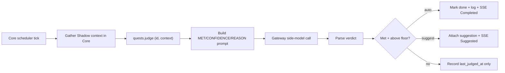
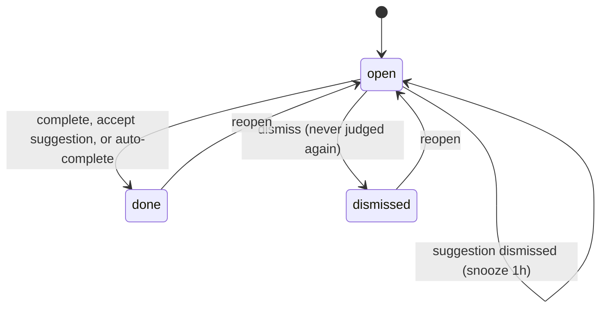

Quests is a todo list where each task carries a natural-language *completion condition*. On a
schedule, the engine gathers your recent activity from Shadow's context and asks a judge model
whether the task looks finished. Depending on the detection mode, it either *suggests* completion
(a chip you confirm) or *auto-completes* the task.

The engine ships in the `@ryu/quests` app (`apps-store/quests/backend/`, crate `ryu-quests`):

- Its `ryu-quests` sidecar serves `/api/quests/*` on loopback, and Core forwards those routes to it.
- Core keeps the scheduler tick and the Shadow evidence lookup.
- The judge model call routes through the Gateway like every other model call.

For the app listing and Companion UI, see [Quests app](/docs/apps/quests).

The same board also keeps *captures* (`kind` `note`, `link`, `prompt`, or `snippet`): text, links,
prompts, and code kept from other apps. A capture has no completion condition and is never judged.
Only items of `kind` `task` take part in detection.

<Callout type="warn">
Detection depends on Shadow. Before each judge pass, Core calls the `shadow.recent_context` and
`shadow.semantic_search` MCP tools (`apps/core/src/scheduler/legacy_quest_jobs.rs`) and posts the
result as the judge context. When Shadow is unavailable or has captured nothing, the pass is skipped.

Shadow capture has platform limits (see [Meeting Notes](/docs/core/meeting-notes)). On a machine
without a working Shadow surface, quests act as a plain manual todo list. The sidecar cannot read
Shadow itself, so a `POST /api/quests/:id/judge` call without a `context` body returns
`{ "skipped": true }`.
</Callout>

## Where the work happens



| Concern | Owner | Reason |
|---|---|---|
| The detection schedule (what runs, when) | Core scheduler | Orchestration lives in Core |
| Recent-activity and semantic evidence | Shadow, read by Core through the [MCP registry](/docs/core/mcp-registry) | The sensor is bound to the local device |
| Quest state, the judge prompt, and verdict handling | `@ryu/quests` sidecar | The app owns its data |
| The judge model call | Gateway | Metered model calls route through the Gateway |

## Detection modes

`DetectionMode` (`apps-store/quests/backend/src/lib.rs`, serde `snake_case`) controls how the engine
acts on a "done" verdict. It is stored under the `quest-detection-mode` preference and read on every
pass.

| `mode` | Behavior |
|---|---|
| `off` | No auto-detection. Quests are a plain manual todo list |
| `suggest` | Only suggest completion (a chip you confirm), never auto-complete |
| `auto_high` | Auto-complete on a high-confidence verdict, otherwise suggest |
| `auto_all` | Auto-complete on any verdict above the confidence floor |

<Callout type="info">
When the preference is unset, the default is `auto_high` (`DetectionMode::default()`), so a fresh
install auto-completes tasks it is confident about and suggests the rest. `DetectionMode::from_pref`
maps any unrecognized stored string to `suggest`. An absent value uses the default.
</Callout>

The thresholds are constants in `lib.rs`, listed below.

| Constant | Value | Meaning |
|---|---|---|
| `CONFIDENCE_FLOOR` | 50 | Below this, a "done" verdict is ignored as noise |
| `HIGH_CONFIDENCE` | 85 | At or above this, `auto_high` auto-completes rather than suggests |
| `CONTEXT_MINUTES` | 15 | Minutes of recent activity the judge sees |
| `DISMISS_SNOOZE_SECS` | 3600 | After a dismissed suggestion, skip judging this quest for an hour |
| `MAX_EVIDENCE_CHARS` | 4000 | Cap on gathered evidence handed to (and stored with) the judge |

## Data model

The `Quest` struct (`apps-store/quests/backend/src/lib.rs`) carries the item plus its detection
state.

| Field | Notes |
|---|---|
| `id`, `title`, `detail` | Identity and description |
| `kind` | `task` (default), `note`, `link`, `prompt`, or `snippet` |
| `body`, `source` | A capture's verbatim text and where it came from (app, window title, URL) |
| `pinned`, `used_at` | Board ordering and the last time an item was copied back out |
| `completion_condition` | The natural-language condition the judge evaluates; empty falls back to `title` (see `Quest::condition`) |
| `status` | `QuestStatus` - `open` (judged each tick when it is a task), `done`, or `dismissed` (never judged again) |
| `completion_source` | `manual` or `detected`, set when the quest is completed |
| `last_judged_at`, `completed_at` | Timestamps |
| `snoozed_until` | While set, judging is skipped until it elapses (set on a dismissed suggestion) |
| `suggestion` | The current pending `Suggestion` (confidence, reason, evidence snippet), if awaiting your confirmation |

`Suggestion` and the completion event carry a 0-100 `confidence`, a one-line `reason`, and a short
evidence snippet so you can check what the judge saw.



## The judge

One detection pass (`QuestEngine::judge_quest_with_context`) is a no-op (returns `Ok(None)`) when:

- the item is not a task, or is not open;
- the item is snoozed;
- detection is `off`;
- there is no context to judge.

Otherwise it:

1. Uses the evidence Core gathered from Shadow: a `shadow.recent_context` summary of the last 15
   minutes plus a `shadow.semantic_search` keyed on the quest condition, truncated to
   `MAX_EVIDENCE_CHARS`.
2. Resolves the judge model (pref `quest-judge-model`, then env `RYU_QUEST_JUDGE_MODEL`, then
   `RYU_DEFAULT_LLM_MODEL`, then the bundled local default) and effort (pref `quest-judge-effort`,
   then env `RYU_QUEST_JUDGE_EFFORT`).
3. Calls the Gateway (`POST /v1/chat/completions`, non-streaming) with a prompt that asks for exactly
   three lines. [Goals](/docs/core/goals), [side questions](/docs/core/side-questions), and
   [double-check](/docs/core/double-check) use the same side-model path.
4. Parses the reply into a `Verdict` of met, confidence, and reason, then acts per the detection mode.

The judge answers in a fixed three-line shape:

```text
MET: yes or no
CONFIDENCE: an integer from 0 to 100
REASON: one short sentence citing the evidence
```

`parse_verdict` treats an unreadable reply as not-met with zero confidence, so the engine never
auto-completes on garbage. A value like `CONFIDENCE: 130%` is clamped to 100.

### Acting on a verdict

A verdict that is not met, or is below `CONFIDENCE_FLOOR`, only updates `last_judged_at`. A met
verdict above the floor either auto-completes or suggests:

- `auto_all` always auto-completes, `auto_high` auto-completes only at or above `HIGH_CONFIDENCE`,
  and `suggest` never auto-completes.
- Auto-complete sets `status = done`, `completion_source = detected`, appends a `detections` row with
  disposition `auto_completed`, and broadcasts `QuestEvent::Completed { auto: true }`.
- A suggestion attaches to the quest and broadcasts `QuestEvent::Suggested`. The broadcast is
  suppressed when an equivalent suggestion (same confidence and reason) already exists, so a
  repeating verdict does not resend the chip each tick.

## Storage

The `QuestStore` persists to SQLite at `~/.ryu/plugin-data/@ryu+quests/quests.db` with two tables.
The sidecar keeps its detection preferences in `prefs.json` in the same directory.

| Table | Holds |
|---|---|
| `quests` | The quest definitions (the full `Quest` as embedded JSON, plus `created_at` / `updated_at`) |
| `detections` | An append-only log of every judge "looks done" event: `confidence`, `reason`, a short evidence snippet, and a `disposition` (`suggested` / `auto_completed`), so the history of *why* a quest was flagged survives |

A Tokio broadcast channel fans changed quests out to SSE subscribers (the Companion UI and the Island
completion chip), like [monitors](/docs/core/website-monitoring) and [meetings](/docs/core/meeting-notes).

## Scheduler tie-in

A quest does not run its own loop. Core reads the quest list through the `quests.list` capability and
keeps one scheduled job per quest, with the deterministic id `quest-<id>` and target
`JobTarget::Quest` (`apps/core/src/scheduler/legacy_quest_jobs.rs`).

- The job is enabled only while the quest is open, and jobs whose quest is gone are removed.
- The sweep runs only on a successful list, so an unreachable or disabled app never deletes jobs.
- When a job fires, Core gathers Shadow evidence and calls the `quests.judge` capability with
  `{ id, context }`.
- When the Quests app is disabled or not installed, a tick is a quiet no-op.

The interval resolves from the `quest-detection-interval` preference, then env `RYU_QUEST_INTERVAL`,
then the `2m` default, and must parse as a humantime duration. See [Scheduler](/docs/core/scheduler)
for the tick loop.

## Routes

All routes are under `/api/quests` (`apps-store/quests/backend/src/api.rs`).

| Method + path | Purpose |
|---|---|
| `GET /api/quests` | List all items, newest first; optional `?kind=` filter |
| `POST /api/quests` | Create a quest (Core adds its detection job on the next reconcile) |
| `POST /api/quests/capture` | Keep a captured selection, link, prompt, or note |
| `GET /api/quests/:id` | One quest |
| `PUT /api/quests/:id` | Edit title, detail, or completion condition |
| `DELETE /api/quests/:id` | Remove a quest and its detection history (Core removes its job on the next reconcile) |
| `POST /api/quests/:id/use` | Record that an item was copied back out (optionally completing it) |
| `POST /api/quests/:id/pin` | Pin or unpin an item to the top of the board |
| `POST /api/quests/:id/judge` | Run one detection pass immediately; optional body `{ "context": "..." }` supplies the evidence |
| `POST /api/quests/:id/complete` | Mark done (manual check-off) |
| `POST /api/quests/:id/dismiss` | Abandon the quest (never judged again) |
| `POST /api/quests/:id/reopen` | Reopen a done or dismissed quest |
| `POST /api/quests/:id/suggestion/accept` | Confirm a pending detection (completes it as `detected`) |
| `POST /api/quests/:id/suggestion/dismiss` | Reject the pending suggestion but keep the quest open (snoozes judging for an hour) |
| `GET /api/quests/events` | SSE feed of quest events (suggested, completed, updated, deleted) |
| `GET /api/quests/scratchpad` | Read the freeform scratchpad buffer |
| `PUT /api/quests/scratchpad` | Overwrite the scratchpad buffer |
| `GET /api/quests/detection-config` | Read the detection mode, judge model, effort, and interval |
| `PUT /api/quests/detection-config` | Set the detection mode, judge model, effort, and interval |
| `POST /api/quests/list` | Capability-only route behind `quests.list`; Core's scheduler is its caller |
| `POST /api/quests/judge` | Capability-only route behind `quests.judge`; Core's scheduler is its caller |

## Related

<Cards>
  <DocCard href="/docs/apps/quests" />
  <DocCard href="/docs/core/website-monitoring" />
  <DocCard href="/docs/core/scheduler" />
</Cards>
