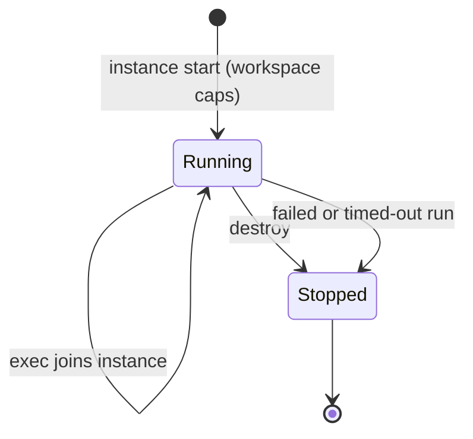

This page gives the behavior of each backend. The backend list, the shared execution contract, the
`sandbox_exec` tool, and limits are on [Execution Backends](/docs/core/sandbox).

Each setting below that names a `node-config.json` path can live in
[`node-config.json`](/docs/start-here/configuration#core-node-config) under `settings`. The
environment name still works, and a set environment value wins over the file.

The Docker, microsandbox, and OpenSandbox CLIs follow one pattern. `<backend>` is `docker`,
`microsandbox`, or `opensandbox`, and each CLI is probed for 3 seconds by default.

| Variable (`node-config.json` path) | Meaning |
|---|---|
| `RYU_SANDBOX_<BACKEND>_BINARY` (`sandbox.<backend>Binary`) | CLI to invoke (defaults `docker`, `msb`, `osb`) |
| `RYU_SANDBOX_<BACKEND>_IMAGE` (`sandbox.<backend>Image`) | Image to run (defaults `alpine:3.20`, `python`, `python:3.12`) |
| `RYU_SANDBOX_<BACKEND>_DETECT_SECS` (`sandbox.<backend>DetectSecs`) | Timeout for the availability probe, in seconds (default 3) |
| `RYU_SANDBOX_OPENSANDBOX_TIMEOUT` (`sandbox.opensandboxTimeout`) | Upper bound on an OpenSandbox run (default `30m`) |

## How the wasmtime backend behaves

`WasmtimeSandbox` (`crates/core/sandbox/src/wasmtime.rs`, behind the `sandbox-wasmtime` feature)
holds a shared `Engine`. Cranelift initialization is paid once and reused across calls.

Each run then:

1. Checks the module (at most 4 MiB, plus the shape limits in [Execution limits](/docs/core/sandbox#execution-limits))
   and compiles it from `stdin`.
2. Wires WASIp1 into a `Linker` and redirects stdout and stderr to in-memory `MemoryOutputPipe`
   buffers capped at 4 MiB each.
3. Passes `command` and `args` as `argv`, sets the guest's WASI environment to the `env` pairs
   only (never the host environment), and preopens only the directories that the capability set
   grants, after the workspace-access clamp.
4. Invokes the module's default `_start` export.

### Timeouts and exit codes

- Core enables Wasmtime epoch interruption and gives each store its own deadline, so a non-yielding
  module is interrupted and reported as a timeout.
- A wasmtime run without `timeout_secs` stops after 120 seconds. The `sandbox_exec` tool always sets
  one: the caller's `timeout_secs`, clamped to between 1 and 30 seconds, or 30 seconds when omitted.
- A clean exit is success, including `proc_exit(0)`, which WASI surfaces as a trap wrapping
  `I32Exit(0)`.
- A non-zero exit code surfaces as an error carrying the captured stderr.

### Default-deny

The default-deny posture is structural. With the default capability set, no directories are
preopened and no socket WASI ABI is wired, so a module cannot reach the host disk or network.

The `microsandbox` and `opensandbox` command surfaces do not document equivalent filesystem or
network flags. They accept the deny-all capability set, but fail closed when a caller requests a
path or network grant instead of ignoring it. Use Wasmtime or Docker for a verified capability
mapping.

## Local and SSH backends

<Callout type="warn">
  Neither backend enforces filesystem or network grants. `local` has no isolation at all, and `ssh`
  relies only on the remote account.
</Callout>

### Local

`local` runs the command as a child process of Core, in a new temporary directory. The directory is
removed after a one-shot run, or on `destroy` for a workspace.

- **Environment.** The child gets a cleared environment. Only `PATH` is inherited, and `HOME` and
  `TMPDIR` point at the temporary directory, so Core's own environment is not passed through.
- **No other isolation.** The child runs as the Core user, can reach any file that user can, and has
  the host's network.
- **Opt-in only.** Because host execution is not a sandbox, `local` stays unavailable and every run
  fails until the operator sets `RYU_SANDBOX_LOCAL_ENABLE=1` (or `sandbox.localEnable`). It is never a
  default or a fallback.

### SSH

`ssh` runs the command on a remote host with non-interactive authentication (`BatchMode=yes`, keys or
an agent) and your normal `known_hosts` verification.

- Each one-shot run uses a fresh remote temporary directory that is removed afterwards.
- A workspace keeps its remote directory until `destroy`.
- The isolation boundary is the remote account. Ryu adds nothing on top.

| Variable (`node-config.json` path) | Meaning |
|---|---|
| `RYU_SANDBOX_LOCAL_ENABLE` (`sandbox.localEnable`) | `1` allows the `local` backend to run commands on the host |
| `RYU_SANDBOX_SSH_HOST` | Remote host. Required: `ssh` is unavailable without it |
| `RYU_SANDBOX_SSH_USER` | Remote user (defaults to your ssh config) |
| `RYU_SANDBOX_SSH_PORT` | Remote port (defaults to your ssh config) |
| `RYU_SANDBOX_SSH_IDENTITY` | Private key file passed to `ssh -i` |
| `RYU_SANDBOX_SSH_BINARY` (`sandbox.sshBinary`) | ssh client to invoke (default `ssh`) |

## MXC backend (Windows)

`mxc` runs each command inside a [Microsoft eXecution Container](https://github.com/microsoft/mxc)
using MXC's Windows `processcontainer` containment, an AppContainer or BaseContainer process
boundary. It needs no extra Windows accounts, no administrator setup, and no firewall rules. That
makes it the native option on Windows nodes where Docker is not available.

<Callout type="warn">
  Ryu treats `mxc` as OS-level process isolation for everyday agent commands, not a VM or container
  boundary. Prefer Docker (rootless), microsandbox, or OpenSandbox when you need one.
</Callout>

### Availability

Ryu does not install MXC. Put `wxc-exec.exe` on `PATH`, or point `RYU_SANDBOX_MXC_BINARY` (`sandbox.mxcBinary`) at it.

- Core runs `wxc-exec --probe` with a request shaped like a real run (a writable working directory
  and the node's host-permission setting) to decide whether the backend is available.
- The backend is reported unavailable on every non-Windows node.
- If MXC rejects a run's request or finds no isolation tier the request may use, the call reports
  the backend unavailable instead of returning a command exit code.
- On machines where MXC can only isolate by temporarily editing host file permissions, Ryu reports
  the backend unavailable rather than allowing those edits silently. Set
  `RYU_SANDBOX_MXC_ALLOW_DACL_MUTATION=1` (or `sandbox.mxcAllowDaclMutation`) to consent. MXC
  reverts the edits after each run.

### What a run gets

- **Working directory.** A fresh directory that is the only writable path unless more are granted.
  It is removed afterwards; a workspace keeps its directory until `destroy`.
- **Filesystem grants** map to MXC read-only and read-write paths, and must be absolute.
- **Network** is denied, including host loopback, unless the run is granted network, which allows
  outbound traffic only.
- **Desktop access.** Visible UI, input injection, and the clipboard are disabled.
- **Environment.** The child gets an explicit environment rather than Core's.

Programs the container runs must be readable by an AppContainer. System locations such as
`C:\Windows` and `C:\Program Files` are, but tools installed only in your user profile need a read
grant.

| Variable (`node-config.json` path) | Meaning |
|---|---|
| `RYU_SANDBOX_MXC_BINARY` (`sandbox.mxcBinary`) | MXC executor to invoke (default `wxc-exec`) |
| `RYU_SANDBOX_MXC_DETECT_SECS` (`sandbox.mxcDetectSecs`) | Timeout for the availability probe, in seconds (default 5) |
| `RYU_SANDBOX_MXC_ALLOW_DACL_MUTATION` (`sandbox.mxcAllowDaclMutation`) | `1` allows MXC's host-permission fallback tier |

## Apptainer / Singularity backend

`singularity` runs the command in an [Apptainer](https://apptainer.org) (formerly Singularity)
container through whichever CLI the host has: `apptainer` is preferred, then `singularity`. If
neither is installed, discovery reports the backend unavailable and every run fails with an error
that says what to install. It never falls back to host execution.

### Container flags

Every one-shot run and every workspace start uses (Apptainer 1.0 or newer):

- `--containall` - no host home, no host environment, private `/tmp`;
- `--no-privs`;
- `--no-mount hostfs,bind-paths,cwd` - the current working directory and administrator-configured
  bind paths are not mounted automatically.

Grants map to flags as follows:

- **Network.** Without a network grant it adds `--net --network none`, which leaves only loopback.
- **Filesystem.** Grants become `--bind <path>:<path>:ro` or `:rw` at the same path inside the
  container, under the same workspace-access clamp as Docker.
- **Unexpressible paths.** Paths that contain `:` or `,` cannot be expressed as a bind and are
  rejected.

Some Apptainer installations restrict `--net` for unprivileged users. In that case a run without a
network grant fails with the CLI's error instead of running with the host network.

### CLI environment

The CLI itself starts with a cleared environment. It keeps only `PATH`, `HOME`, `LANG`, temporary
and runtime directories, the user session bus, Apptainer's own cache, config, and temp locations,
and the host's proxy and CA certificate settings for image pulls.

Node secrets never reach it. Variables such as `APPTAINER_BIND` or `APPTAINERENV_*` cannot add host
mounts or inject container variables, so the capability set is the only source of host mounts.

### Workspaces

A workspace is an Apptainer instance started with the workspace's capabilities.

- Later runs join that instance, and `destroy` stops it.
- Each run inside a workspace also passes `--cleanenv` and `--no-privs`, because Apptainer applies
  the environment and privilege drop to every joining process, not to the instance.
- A failed or timed-out workspace run stops the instance, so the workspace must be recreated.

| Variable (`node-config.json` path) | Meaning |
|---|---|
| `RYU_SANDBOX_SINGULARITY_IMAGE` (`sandbox.singularityImage`) | Image to run: a local `.sif` file or any URI the CLI accepts (default `docker://alpine:3.20`) |
| `RYU_SANDBOX_SINGULARITY_BINARY` (`sandbox.singularityBinary`) | CLI to invoke instead of searching `PATH` for `apptainer`, then `singularity` |
| `RYU_SANDBOX_SINGULARITY_DETECT_SECS` (`sandbox.singularityDetectSecs`) | Timeout for the `--version` availability probe (default 3) |

## Modal and Vercel Sandbox

`modal` and `vercel_sandbox` are recognized names, but Core has no driver for either provider.
Discovery reports them as not implemented. Selecting one returns an error that suggests either a
backend plugin that owns the provider credentials, or an implemented backend such as `docker`,
`singularity`, `daytona`, or `box`.

## Related

<Cards>
  <DocCard href="/docs/core/sandbox" />
  <DocCard href="/docs/core/boxes" />
  <DocCard href="/docs/security/sandboxing-isolation" />
</Cards>
