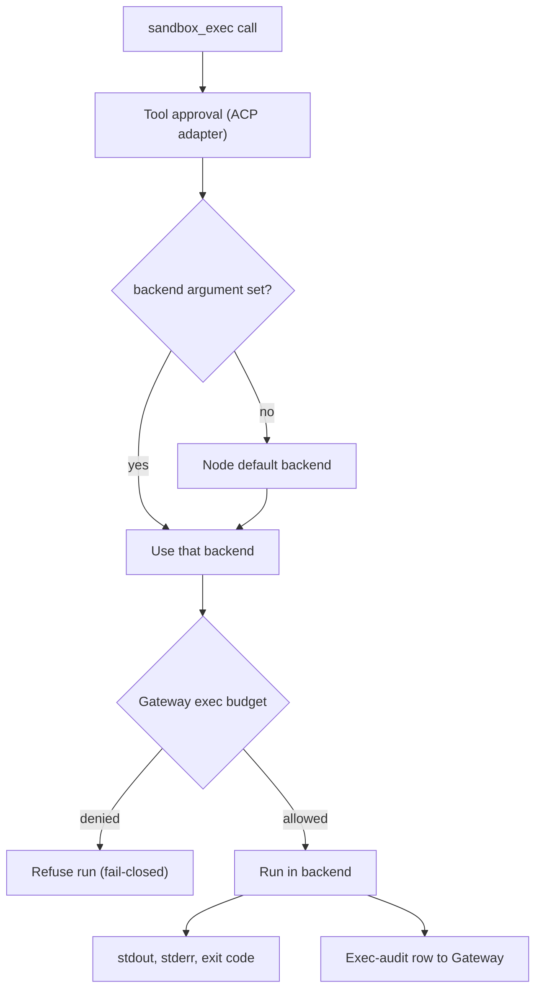

Core can run untrusted code through an explicit execution backend. This page is for operators and
plugin authors who choose or add a backend.

<Figure name="sandbox" />

The default secure backend is [wasmtime](https://wasmtime.dev) running WASIp1 modules. It needs no
daemon and no external process, and it has no network or filesystem access unless a directory is
explicitly preopened. A backend is a runtime choice, not a promise that the host has that runtime
installed.

Placement follows the [Core vs Gateway](/docs/start-here/architecture/core-vs-gateway) rule:

- **Core decides what runs** - which module and which capabilities.
- **The Gateway decides what is allowed** - DLP on the module's stdout and network egress.
- **The sandbox module enforces only the structural default-deny.** Policy belongs upstream.

## Backend vocabulary

The public configuration term is **backend**. The historical MCP server name remains `sandbox`, so
existing tool ids and allowlists keep working.

- `sandbox.sandbox_exec` is the one-shot entry point.
- The persistent `sandbox_create`, `sandbox_run`, and `sandbox_destroy` tools use the configured
  Box or Daytona workspace path.

| Backend | Shape | Current status |
|---|---|---|
| `wasmtime` | In-process WASI module, default-deny | Implemented when the Wasmtime feature is compiled |
| `docker` | Local container command execution | Implemented only when a rootless Docker daemon is reachable; rootful daemons are refused |
| `microsandbox` | Local microVM command execution | Implemented when its CLI/runtime is reachable; rejects unexpressible FS/network grants |
| `opensandbox` | Local isolated command execution | Implemented when its CLI/runtime is reachable; rejects unexpressible FS/network grants |
| `mxc` | Windows process container (Microsoft eXecution Container) | Implemented on Windows 11 when MXC's `wxc-exec` executor is installed and its probe finds a supported isolation tier |
| `daytona` | Remote persistent workspace and command execution | Implemented through the metered Daytona path |
| `box` | Durable Ryu Box service over HTTP | Implemented through the Ryu Box API and metered remote workspace path |
| `local` | Host subprocess in a fresh temporary directory | Implemented with **no isolation**; refuses to run until the operator sets `RYU_SANDBOX_LOCAL_ENABLE=1` |
| `ssh` | Remote host over the system `ssh` client | Implemented when `RYU_SANDBOX_SSH_HOST` is set and an `ssh` client is installed; isolation is the remote user account |
| `singularity` | Local Apptainer/Singularity container command execution | Implemented on Linux when the `apptainer` or `singularity` CLI is installed; contained, network `none` unless granted |
| `modal` | Remote provider slot | Recognized; no Modal driver ships in Core, so selecting it returns an error that names the alternatives |
| `vercel_sandbox` | Remote provider slot | Recognized; no Vercel Sandbox driver ships in Core, so selecting it returns an error that names the alternatives |

<Callout type="warn">
  A recognized backend is not automatically available, and availability is not authorization. Core
  probes only what it can safely identify. It returns an explicit unavailable or error result when a
  selected backend is missing or not wired, and it never silently falls back from an explicit
  backend to another runtime.
</Callout>

This strictness makes a Box, Daytona, Modal, Vercel Sandbox, or Singularity plugin a valid extension
point. The plugin owns provider credentials and the implementation, while Core keeps the stable
backend vocabulary and approval boundary.

### Command backend behavior

- **Docker refuses rootful daemons.** A Docker socket backed by a rootful daemon is equivalent to
  host-root access. Use a rootless daemon or the default Wasmtime backend for local execution.
- **Docker, microsandbox, and opensandbox return** captured standard output, standard error, and
  the command exit code. Supplied standard input reaches the command; a command without input
  receives end of input immediately.
- **Output is capped at 4 MiB per stream.** On overflow or deadline, Core terminates the CLI child. Docker also asks the rootless
  daemon to remove the affected container.
- **Microsandbox one-shot runs** use a named VM that Core force-removes after execution or a
  deadline. A cleanup failure is reported as an error.
- **A timed-out workspace** on Docker, microsandbox, or opensandbox must be recreated.
- **Daytona runs** register their provider workspace before execution, so a budget stop targets the
  running sandbox. If the provider cannot confirm a stop, Ryu keeps metering and retries instead of
  treating that workspace as terminated.

Per-backend behavior (the wasmtime run sequence, local, SSH, MXC, Apptainer and Singularity, Modal
and Vercel Sandbox) is on [Execution Backend Reference](/docs/core/sandbox-backends).

## The execution contract

Every backend takes an `ExecSpec` and returns an `ExecOutput` (`crates/core/sandbox/src/lib.rs`).
One-shot runtimes and command backends share the same request shape.

| `ExecSpec` field | Type | Meaning |
|---|---|---|
| `command` | `String` | The program to run (`argv[0]`). The wasmtime path sets it to `wasm` |
| `args` | `Vec<String>` | Arguments after `argv[0]` |
| `capabilities` | `SandboxCapabilities` | Filesystem, network, scope, and workspace-access grants. Defaults to deny-all |
| `stdin` | `Option<Vec<u8>>` | Bytes piped to the command. The wasmtime backend reads the WASM module bytes from here |
| `env` | `Vec<(String, String)>` | Environment variables for the workload. Only the wasmtime backend honors them, as the guest's WASI environment. Command backends start from a cleared environment |
| `timeout_secs` | `Option<u64>` | Wall-clock cap. See [Execution limits](#execution-limits) for defaults |

| `ExecOutput` field | Type | Meaning |
|---|---|---|
| `exit_code` | `i32` | Process exit code (`0` is success) |
| `stdout` | `Vec<u8>` | Captured standard output |
| `stderr` | `Vec<u8>` | Captured standard error |

## The `sandbox_exec` tool

Agents reach the backends through the built-in MCP tool `sandbox.sandbox_exec`
(`apps/core/src/sidecar/mcp/sandbox.rs`). It uses the same registry call surface as every other
tool; see the [MCP registry](/docs/core/mcp-registry) for how built-in tools are listed and
dispatched.

| Argument | Meaning |
|---|---|
| `backend` | Backend name. Omit to use the node default (see [Selecting a backend](#selecting-a-backend)) |
| `wasm_b64` | Base-64 WASM/WASI module. Required for `wasmtime` |
| `command` | Program to run. Required for command backends |
| `args` | Arguments after `argv[0]` or the module |
| `stdin_b64` | Base-64 bytes piped to standard input (command backends) |
| `env` | Up to 64 `key`/`value` pairs, set as the WASM guest's WASI environment. The guest sees only these, never the host environment. Only `wasmtime` accepts `env`, and the other backends reject a call that sets it |
| `timeout_secs` | Wall-clock cap in seconds, `30` when omitted. On `wasmtime` it is clamped to between 1 and 30 seconds |
| `scope`, `workspace_access` | See [Scope and workspace access](#scope-and-workspace-access). The `wasmtime` path runs with the deny-all capability set |

The tool returns stdout, stderr, and the exit code. Each call follows the same path:

- **Approval.** Calls go through the existing tool-approval path in the ACP adapter. The sandbox
  adds no approval UI of its own.
- **Budget.** Each run checks the Gateway exec budget before it starts (fail-closed), and is refused
  when the Gateway denies it.
- **Audit.** Each run reports an exec-audit row to the Gateway after it ends.
- **Disable switch.** `RYU_SANDBOX_DISABLED=1` disables the tool at runtime. It stays listed so the
  agent knows it exists, and calls return an unavailable result.

## Scope and workspace access

Two declarative capability fields on `SandboxCapabilities` narrow how a run is isolated and what it
may do to the workspace. They are parsed from optional tool arguments. An absent or unknown value
falls through to the deny-safe default, so a call that sets neither gets the per-exec run.

### Sandbox scope

`SandboxScope` declares the lifetime an isolated environment should be shared across:

| `scope` arg | Enum | State |
|---|---|---|
| `exec` (default) | `Exec` | One environment per execution, torn down after the run |
| `agent` | `Agent` | Declared, not yet honored |
| `session` | `Session` | Declared, not yet honored |
| `shared` | `Shared` | Declared, not yet honored |

<Callout type="warn">
  Scope is declarative metadata. Only `Exec` is wired. `Agent`, `Session`, and `Shared` record
  intent but do not change how the run is isolated.
</Callout>

### Workspace access

`WorkspaceAccess` is a tightening-only clamp on the filesystem mounts a sandbox run receives:

| `workspace_access` arg | Enum | Effect on mounts |
|---|---|---|
| `read_write` (default) | `ReadWrite` | Per-path access: read grants mount read-only, write grants mount read-write |
| `read_only` | `ReadOnly` | Every mount is forced read-only |
| `none` | `None` | All workspace mounts are stripped |

Because the default is `ReadWrite`, the clamp changes nothing unless a caller sets it. The shared
`SandboxCapabilities::effective_mounts()` applies the same strip, force-read-only, and per-path rules
to wasmtime preopened directories and Docker `-v` mounts. The clamp only tightens filesystem access;
the network-deny posture is unchanged.

## Execution limits

### Output and timeouts

| Limit | Value |
|---|---|
| Local command backend output | At most 4 MiB captured from each stream |
| Remote Box response body | 4 MiB |
| Daytona response body / command output | 12 MiB / 4 MiB |
| Default timeout, Local, SSH, and MXC | 120 seconds when the caller passes none |
| Default timeout, Docker, microsandbox, and OpenSandbox | 30 seconds when the caller passes none |
| `sandbox_exec` timeout for command backends | Always passed: 30 seconds unless the call sets `timeout_secs` |
| Accepted timeout range, host command backends | 1 to 300 seconds, checked before execution or workspace cleanup |

The body limits also apply to responses without a declared length. Exceeding any limit returns an
error instead of silently truncating output.

A failed command capture or a timeout kills and reaps the local launcher and triggers workspace
cleanup. Cancellation keeps a bounded cleanup task alive, so dropping a tool call cannot leave its
known workspace running.

### Persistent sandboxes and metering

- **Budget can only tighten.** A persistent sandbox's requested budget may tighten the operator's
  configured per-run cap. Zero or a larger amount cannot disable or raise that cap.
- **Paid runs are metered.** Paid Box and Daytona executions register their real workspaces for
  metering. An explicitly active Box subscription passthrough remains unmetered.
- **Cancelling still bills.** Cancelling a paid execution finalizes its accrued charge, so a stop
  verdict can destroy the billed workspace.
- **The billed shape is fixed.** A persistent sandbox is billed for the shape its backend provisions
  from operator configuration. A create request may omit `spec` or restate that shape; any other
  shape is refused, so a caller cannot choose a cheaper or larger billed shape than the machine it
  gets.
- **Box time to live.** A Box that reports a time to live stops being metered when that time ends,
  and Core then removes it from its live sandboxes.
- **Never-ready Boxes** are deleted, not left running.

Core records each persistent workspace in its data directory before returning it. Workspaces outlive
the Core process, but their metering does not:

- When Core starts again, it deletes the workspaces a stopped or crashed Core left running.
- Destroying such a run by id also deletes its workspace, and reports an error if the provider
  delete fails.
- A metered run survives a short Gateway outage. Core retries a failed metering tick and stops the
  workspace after three consecutive failed ticks or 30 seconds of failed ticks, whichever comes
  first.
- A stop verdict from the Gateway still takes effect immediately.

### WASM module limits

| Limit | Value |
|---|---|
| Guest memory | 64 MiB per memory, one memory |
| Tables | At most four, each at most 10,000 elements |
| Module input | 4 MiB |
| Concurrent WASM workers | Two |
| Defined functions, expanded imports, exports, globals, element segments, types | 4,096 each (recursive type groups count toward the type limit) |
| Function body size | 16 KiB each, 1 MiB total code |
| Locals per function | 4,096 |
| Parameters, results, or fields per type | 4,096, with at most 65,536 across the module |

These shape limits are checked before compilation. Compilation runs sequentially within each
admitted worker.

## Selecting a backend

A per-call `backend` argument always wins. Otherwise the node default backend resolves in this
order:

1. The selection saved through `POST /api/sandbox/backend` (stored in `sandbox-backend.json`).
2. The `RYU_SANDBOX_BACKEND` environment variable.
3. `wasmtime`.

The selected backend, credentials, quota, approval, and runtime availability remain separate checks.
When a backend is disabled or unavailable, the tool remains discoverable and returns an explicit
unavailable result. It does not silently change runtimes.

To validate a default-backend choice without changing the node, send `dryRun: true` to
`POST /api/sandbox/backend`. Core checks that the backend is known and reports:

- the current default;
- platform support;
- the live detection result;
- the `sandbox-backend.json` write that a live request would perform.

A dry run never changes the default or starts a sandbox.

## Sandbox vs programmatic tool calling

The wasmtime sandbox runs an arbitrary WASM module.
[Programmatic tool calling](/docs/core/programmatic-tool-calling) (PTC) is different: it runs
model-authored JavaScript that fans out across tools.

PTC runs that JavaScript in a QuickJS engine compiled to WebAssembly. It also uses Wasmtime, but
with its own runtime and no filesystem or network at all, and it does not go through the backends on
this page.

- Use the sandbox when you have a WASM workload to run in isolation.
- Use PTC when an agent needs to orchestrate many tool calls in code.

## Building a backend plugin

Use a plugin when a backend needs a provider SDK, credentials, a quota model, or a sidecar that
should not be compiled into Core. The plugin should:

- Declare the backend name and required grants.
- Expose a typed tool or app contribution that accepts the shared execution request.
- Report availability separately from authorization.
- Preserve default-deny filesystem and network capabilities and bounded output.
- Return an explicit unavailable result when its provider is not configured.

Do not register an arbitrary name and quietly route it to host execution. The backend selector is
strict, so a typo, an unsupported Hermes-compatible name, or a disabled provider is visible to the
caller.

See [built-in tools](/docs/core/built-in-tools) for the stable tool ids. The
[Hermes terminal backend configuration](https://hermes-agent.nousresearch.com/docs/user-guide/configuration#terminal-backend-configuration)
shows the backend vocabulary this contract is compared with.
