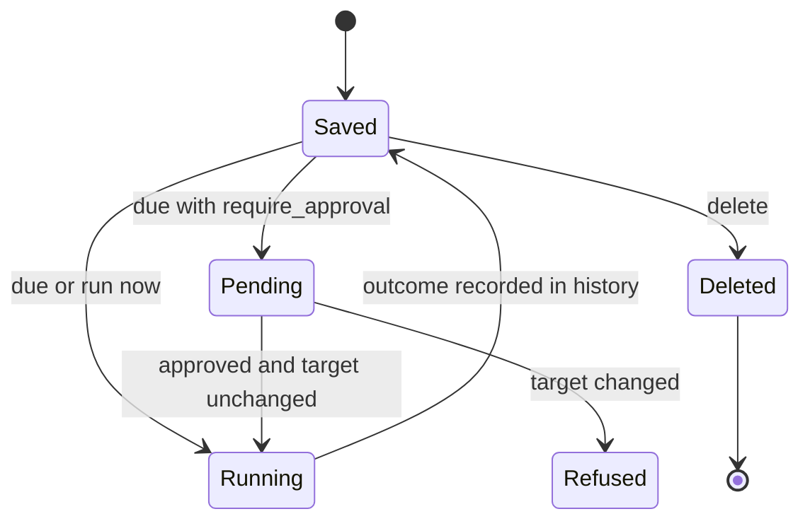
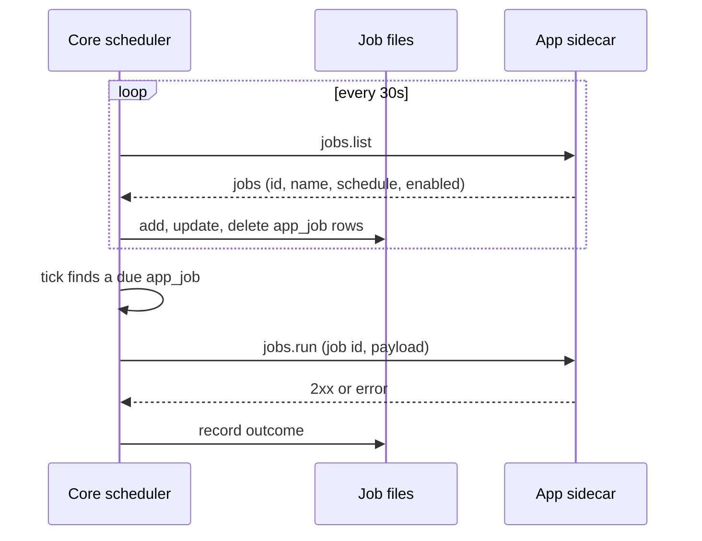

The scheduler is Core's always-on tick loop. It fires persisted jobs on a cron expression or a
fixed interval, and each job runs one [target](#job-targets), such as a workflow or an agent
prompt (`apps/core/src/scheduler/mod.rs`).

The scheduler decides *what runs and when*. It enforces no policy: each fired job sends its model
calls through the normal chat and workflow routing path, where the Gateway applies policy.

Jobs are file-backed, so schedules survive a Core restart. On boot the scheduler reloads every job
from disk and resumes ticking (`apps/core/src/scheduler/store.rs`).

<Figure name="scheduler" />

## The job model

A `ScheduledJob` (`scheduler/store.rs`) is one persisted unit of work.

| Field | Type | Meaning |
|---|---|---|
| `id` | string | Unique job id (also the on-disk filename). |
| `name` | string | Display name, logged when the job fires. |
| `schedule` | `Schedule` | Cron expression or fixed interval (see below). |
| `target` | `JobTarget` | What the job runs (see below). |
| `enabled` | bool | When false the tick loop skips the job without deleting it. Default true. |
| `require_approval` | bool | When true a due firing raises an approval request instead of running. Default false. |
| `created_at` / `updated_at` | string | RFC 3339 timestamps. |
| `last_run_at` | string? | When the latest run finished (success or failure). |
| `last_outcome` | `success` \| `failure` | Outcome of the most recent run. |
| `history` | `ExecRecord[]` | Bounded execution log, oldest first. |

Each job is stored at `~/.ryu/state/scheduled-jobs/<id>.json`, under a configurable
[data folder](/docs/surfaces/desktop/user-guide/data-and-storage).

## Schedules

A `Schedule` is one of two shapes (`Schedule` enum, tagged on `kind`).

| Kind | Field | Example | Behavior |
|---|---|---|---|
| `cron` | `expr`, optional `tz` | `0 9 * * *` | Classic 5-field cron expression, evaluated in UTC unless `tz` names an IANA time zone. Fires at most once per matching minute. |
| `every` | `interval` | `30s`, `5m`, `1h` | Fixed interval parsed by `humantime`. |

`CronSchedule::parse` (`apps/core/src/scheduler/cron.rs`) parses cron expressions. A malformed
cron expression, time zone, or interval makes the job never due. It does not crash the loop.

<Callout type="info">
An interval job that has never run fires once immediately, then waits for its interval. A restart
does not replay a recent run; see [Once-per-slot semantics](#once-per-slot-semantics).
</Callout>

## Job targets

`JobTarget` (`scheduler/store.rs`) is tagged on `type` and has seven variants.

| Variant | Fields | What it runs |
|---|---|---|
| `workflow` | `workflow_id`, `input` map | Loads the persisted workflow and runs it (`workflow::executor::run_workflow`). Records the workflow run id on success. |
| `agent` | `agent_id`, `prompt`, optional `model`, optional `conversation_id` | A durable chat turn against the configured agent. `conversation_id` appends to one existing chat. When omitted, every firing gets a new persistent chat. |
| `app_job` | `plugin_id`, `job_id`, optional `payload` | One job an app owns, run through that app's `jobs.run` capability (see [App-owned jobs](#app-owned-jobs)). Website-monitor checks are app jobs of the Monitors app. |
| `provider_account` | `provider_id`, `account_id`, `prompt`, optional `model` | One minimal turn on one saved subscription account of a provider pool, bypassing the pool's account selection. Used for usage-window warmups. |
| `quest` | `quest_id` | One quest detection pass: Core gathers Shadow context and calls the Quests app's `quests.judge` capability (see [Quests](/docs/core/quests)). |
| `identity_health` | none | Runs the configured Passport health sweep (or the embedded compatibility store) and flips stale connections to `NEEDS_AUTH`. |
| `learning_cycle` | none | Runs the opted-in continual-learning sweep and dispatches eligible retraining work. |

### The agent target

The `agent` target routes through `global_agent_runner()`, so the configured agent handles the
prompt on the real chat path. Each scheduled run saves both the instruction and the response in
the selected conversation.

A routine created while an agent is answering in an existing chat can omit `conversation_id`
to keep using that chat. To create a separate durable transcript per firing, set `new_chat` in the `routines`
tool or choose **New chat each run** in the Desktop editor.

### Legacy `monitor` jobs

A job file from an older Core with the retired `monitor` target (`{ "type": "monitor",
"monitor_id": "<id>" }`) still loads. Core reads it as an `app_job` of the Monitors app. At
startup it rewrites the file in place and keeps the id, name, schedule, enabled state, and history.

<Callout type="warn">
Downgrading to a Core that predates `app_job` is not supported. That Core cannot read the
migrated jobs.
</Callout>

## Agent routines

Agents have a built-in `routines` tool server:

| Tool | Purpose |
|---|---|
| `routines.list` | List the current user's routines, destinations, outcomes, and bounded history. |
| `routines.create` | Create a cron or interval routine with instructions, approval, model, and chat destination. |
| `routines.update` | Edit a saved routine without recreating it. |
| `routines.delete` | Remove a routine while leaving its chat transcripts intact. |
| `routines.run_now` | Execute the saved target immediately and record the result. |

Rules that apply to every routine:

- Routine mutations (`create`, `update`, `delete`, `run_now`) are approval-gated by default under
  the normal agent approval policy (`apps/core/src/approvals/policy.rs`).
- On an org-bound node, Core scopes routine visibility and existing-chat selection to the verified
  user who owns the current conversation.
- Only **Active** agents may run an enabled routine. Pausing an agent pauses its schedules without
  deleting their definitions.
- Scheduled runs need an awake, running node. The scheduler does not wake an offline computer.

### Desktop surfaces

- The agent editor's **Routines** view is the setup and operations surface. It shows a 24-hour
  status strip, per-routine history, and the last outcome. It has controls to add, edit, pause,
  run now, or delete several routines without a workflow for each one.
- The **Run history** view links automated entries back to their persistent transcripts.
- **Calendar → Agenda** shows the cross-agent timeline, including each materialized job.

### Quick routines

`POST /heartbeat/jobs` accepts an optional `quick_routine: true` for an agent target. Core then
saves one canonical quick routine per agent, within the existing routine ownership scope.
Concurrent requests and retries reuse its id, creation time, and execution history. Requests
without the field create independent jobs, including several jobs for the same agent.

On an update through the quick-routine contract, `target.conversation_id` works like this:

| Value | Effect |
|---|---|
| omitted | Keeps the existing destination, after Core checks current access. |
| `null` | Clears the destination. |
| a string | Selects an existing transcript the caller can access. |

Failure and conflict behavior:

- Ambiguous legacy generated routines return `409` for review.
- Invalid targets or inaccessible destinations are refused before a slot is saved.
- Corrupt slot state fails closed.
- A refused file replacement leaves the original job available for readback and retry.
- Configuration updates merge execution records completed during validation. If the saved
  configuration changed meanwhile, the stale update returns `409`; reload the routine and retry.

Deletion is final:

- Deleting a routine invalidates in-flight saves, and a late execution completion cannot recreate
  it. A new quick routine created after deletion gets a new id.
- If physical file removal is refused after the deletion marker is saved, the routine stays hidden
  and a late completion cannot resume it. Retry the deletion to remove the file.

### Execution binding and approvals

Each execution is bound to the saved routine configuration before work starts. Core refuses to run
a routine that changed or was deleted. Completion merges into the current history of the same
routine identity, so edits made during the run survive.

Approval-triggered runs use the same history contract. An approval covers its saved target,
including the agent instructions, model, and chat destination. If that target changes while the
approval is pending, Core refuses the old action; request a new approval for the updated routine.

### Agent templates can carry several schedules

An exported or marketplace agent template may include `agent_config.schedules`. Each entry has:

- a name;
- a cron or interval schedule;
- its own custom `instructions`;
- an `enabled` flag;
- an optional approval gate.

Importing the template materializes one independent agent-target job per entry, so one agent can
do different work at different times. Exporting the agent includes its current schedules, and
deleting the agent removes those jobs. A template grants only tools that Core registers, and
mutating calls stay approval-gated.

The first-party templates are listed in [Agent Templates](/docs/surfaces/desktop/user-guide/marketplace#agent-templates).
Two show how templates use the scheduler:

- **Security Guard** ships two schedules with separate instructions: an hourly quick scan and a
  midnight deep configuration scan.
- **Codex Quota Reset Watch** runs about every 30 minutes. Once a reset time is confirmed, the
  agent edits its own routine to a longer interval that ends after that time, then restores the
  30-minute cadence on waking.

For **Codex Quota Reset Watch**:

- An interval starts when the current run finishes, so the wake can come later by that run's
  duration.
- Source failures back off from 30 minutes to at most four hours.
- Routine edits made during a run survive its completion.
- Unknown model pricing, a missing connection, or an unavailable action blocks setup instead of
  choosing an expensive fallback.
- The template never posts on X, does not buy credits, and does not grant itself permissions.

## Reconciled jobs

`workflow` and `agent` jobs are created by hand, and `provider_account` jobs come from warmup
scheduling. Core reconciles the other jobs automatically under deterministic ids, so they ride the
same tick loop.

| Source | Deterministic id | Reconciled by |
|---|---|---|
| A workflow schedule trigger | `wf-sched-<workflow_id>-<idx>` | Core, from the workflow's triggers |
| An app's scheduled job | `app-<hash>` (32 hex characters of a SHA-256 of the app id and job id) | Core, from the app's `jobs.list` |
| A website monitor created before app jobs | `monitor-<id>` (kept for its existing history) | Core, from the Monitors app's `jobs.list` |
| An open quest | `quest-<id>` | Core, from the Quests app's quest list |
| Passport health | `identity-health` | Ensured once at startup |
| Continual learning | `learning-cycle` | Ensured once at startup |

The ids are stable across re-saves, so reconciliation is idempotent:

- Editing a workflow's triggers converges the `wf-sched-*` jobs to the declared set and deletes
  stale ones.
- Deleting the workflow, monitor, or quest tears down its backing job.
- Quest jobs are enabled only while the quest is open. Completing or dismissing a quest disables,
  then removes, its backing job.

See [Workflows](/docs/core/workflows) for trigger reconciliation and
[Website monitoring](/docs/core/website-monitoring) for the monitor lifecycle.

Authoritative reconciliation may recreate one of these fixed ids after it was deleted. The
recreated job starts with a fresh creation time and an empty history, and a completion from the
deleted identity cannot appear in it. A refused recreation stays hidden until reconciliation
retries successfully. Ordinary updates preserve history and cannot restore a deleted identity.

### App-owned jobs

An app that needs scheduled work does not write jobs itself. It provides two capabilities, and
Core keeps one `app_job` per job the app lists:

- `jobs.list` returns the app's jobs, each with an id, a name, a schedule and an enabled flag.
  Every 30 seconds Core writes the jobs it has not seen, updates the ones that changed, and deletes
  the ones the app no longer lists.
- `jobs.run` runs one job when it is due. A non-2xx reply is recorded as that run's failure.

Only first-party apps take part, and Core is the only caller of these capabilities. See
[Scheduled job capabilities](/docs/extend/develop/sdk/plugin-sidecar-capabilities#scheduled-job-capabilities)
for the contract.

Reconciliation and run limits (`apps/core/src/scheduler/app_jobs.rs`):

- Deletions happen only on a complete, successful list.
- While the app is disabled, unreachable, or answering with an error, Core keeps its jobs as they
  are, and the tick skips them without recording anything.
- An `every` interval shorter than one minute is raised to one minute.
- Each run is bounded to two minutes.
- A job runs at most once at a time. An app may have at most two runs in flight, and all apps
  together at most four, so app jobs never take the whole run budget from agent and workflow jobs.
- **Run now** and approved runs count against the same limits. Run now answers `409 Conflict`
  while the job or its app is busy. An approved run waits up to five minutes for a free slot.

App jobs carry the app as their owner, so they appear in the app's uninstall inventory and stop
while the app is off. Uninstalling the app removes its jobs. If you install it again, Core
recreates them from the app's list on the next pass, with an empty run history.

### What `/heartbeat/jobs` allows for app jobs

App jobs follow the app on every pass, so Core refuses changes that the next pass would undo.
Clients show these rows read-only.

| Action | Result |
|---|---|
| Run now | Allowed. |
| Create, retarget (to or from `app_job`), or approval-gate | Refused. |
| Change name, schedule, or enabled state | Refused. |
| Delete while the app is installed | `409 Conflict`, because the next pass would recreate it with an empty history. |
| Delete after the app is uninstalled | Allowed, for a job left behind. |

App jobs never wait for approval when they come due. To pause or remove one, pause or remove the
item in the app that owns it, for example the monitor in the Monitors app.

## The tick loop

The scheduler spawns one background loop that wakes on a fixed interval and evaluates every
persisted job against the current time (`Scheduler::tick`).

| Constant | Value | Meaning |
|---|---|---|
| `TICK_INTERVAL` | 30 seconds | How often the loop wakes to evaluate due jobs |
| `MAX_CONCURRENT_JOBS` | 8 | Bound on jobs running concurrently |

On each tick the loop lists all jobs from disk, skips the disabled ones, and fires those that are
due. The 30-second cadence catches a cron job within its matching minute. An interval shorter than
30 seconds is effectively raised to the tick.

Firing marks the job's last-fired instant *before* it spawns the run, so a slow run never stalls
other due jobs in the same tick. Spawned runs share a semaphore of `MAX_CONCURRENT_JOBS` permits,
so a flood of due jobs queues instead of spawning unbounded tasks.

<Mermaid chart={`flowchart TD
  Tick["Tick every 30s"] --> List["List jobs from disk"]
  List --> Enabled{"enabled?"}
  Enabled -- no --> Skip["Skip"]
  Enabled -- yes --> Due{"due now?"}
  Due -- no --> Skip
  Due -- yes --> Approval{"require_approval?"}
  Approval -- yes --> Gate["Raise approval request"]
  Approval -- no --> Mark["Mark last_fired"]
  Mark --> Permit["Acquire permit (max 8)"]
  Permit --> Run["Run target"]
  Run --> Record["Record outcome + persist"]
`} />

### Once-per-slot semantics

The only mutable in-memory job state is a per-job last-fired instant
(`SchedulerInner.last_fired`), used to avoid double-firing. After a restart that instant is empty,
so `is_due` falls back to the persisted run record.

| Schedule | Fires when | Restart fallback |
|---|---|---|
| `cron` | At most once per matching minute, compared in the job's own time zone | The latest history entry's `started_at` |
| `every` | Once the interval has elapsed since the last firing | `last_run_at` |

Restart effects:

- Restarting Core (an update, a crash, or relaunching the desktop app) does not replay a recent
  interval run or fire a cron minute twice.
- `last_run_at` records when a run finished, so the first interval run after a restart can come up
  to one run's duration later than the interval alone suggests.
- A run is recorded only when it finishes. A run that a crash or restart interrupted leaves no
  record, so an interval job runs again after the restart.

## Execution history

Every run appends an `ExecRecord` to the job and persists it. The history is bounded to the last 50
records (`MAX_HISTORY`), oldest dropped first.

| Field | Meaning |
|---|---|
| `started_at` / `finished_at` | RFC 3339 timestamps for the run. |
| `outcome` | `success` or `failure`. |
| `run_id` | Workflow run id, or the persistent conversation id for an agent run. |
| `error` | Human-readable error string, on failure. |

A failed workflow or agent run records the failure and the loop continues. One failing job never
blocks the others.

## The API

The scheduler is served under the `heartbeat` prefix (`apps/core/src/server/mod.rs`).

| Action | Endpoint |
|---|---|
| List jobs | `GET /heartbeat/jobs` |
| Create a job | `POST /heartbeat/jobs` |
| Fetch a job | `GET /heartbeat/jobs/:id` |
| Update a job | `PUT /heartbeat/jobs/:id` |
| Delete a job | `DELETE /heartbeat/jobs/:id` |
| Run a job now | `POST /heartbeat/jobs/:id/run` |

Route behavior:

- Creating a job validates the cron expression or interval before saving it, so a malformed
  schedule is rejected up front.
- On an org-bound node, the list, update, delete, and run routes are scoped to the verified user.
  Personal nodes keep their single-user behavior.
- Running a job now while it is already running (a scheduled firing or an earlier manual run)
  returns `409` instead of starting an overlapping run.
- `GET /heartbeat/jobs` leaves out `app_job` rows unless the request adds `?include=app_jobs`, and
  `provider_account` rows unless it adds `?include=provider_accounts`, so older clients keep
  parsing the list. `GET /api/approvals` applies the same rule to approvals that run an app job.

<Callout type="info">
Most users never call these routes directly. You create scheduled work from an agent's **Routines**
view, a [workflow](/docs/core/workflows), a [website monitor](/docs/core/website-monitoring), or a
[quest](/docs/core/quests).
</Callout>

## Related

<Cards>
  <DocCard href="/docs/core/workflows" />
  <DocCard href="/docs/core/website-monitoring" />
  <DocCard href="/docs/core/quests" />
  <DocCard href="/docs/standalone/passport" />
  <DocCard href="/docs/surfaces/desktop/user-guide/data-and-storage" />
</Cards>
