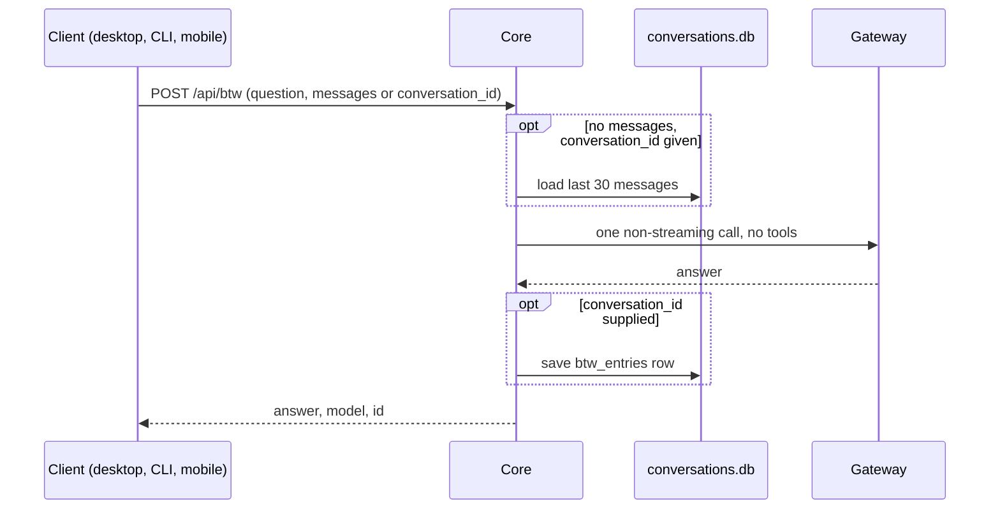

A side question asks something quick about the conversation you are already in, without starting
a new turn or calling a tool. It is the inverse of a sub-agent: full conversation context, zero
tools.

This page documents the Core primitive for client and integration developers. To ask one from the
composer, see [Chat](/docs/surfaces/desktop/user-guide/chat).

Core handles side questions with `POST /api/btw` (`btw_handler` in `apps/core/src/server/mod.rs`).
It reuses the single non-streaming Gateway call from [double-check](/docs/core/double-check)
(`call_side_model`), so the model call routes through the Gateway like every other model call.

The built-in `@ryu/side-chats` plugin owns the feature. It contributes the `/btw` command and the
desktop side-chat UI, and gates the routes below. Disabling the plugin removes the command and
makes the routes unavailable.



## What it is

| Property | Value |
|---|---|
| Route | `POST /api/btw` (top-level, not under `/conversations/:id`) |
| Handler | `btw_handler`, `apps/core/src/server/mod.rs` |
| Backing call | `call_side_model` - one non-streaming Gateway call |
| Tools | None. The system prompt tells the model it has no tools and cannot run commands, read files, or browse |
| Owner | `@ryu/side-chats` (Core-tier, pre-installed, disableable) |
| Persistence | A `btw_entries` row keyed to the parent conversation, when a `conversation_id` is supplied. The exchange never becomes chat history |
| Returns | `{ answer, model, id }` |

The route is top-level rather than nested under a conversation because a client such as mobile holds
its own transcript and has no Core `conversation_id` to address.

## Request

The body is a `question` plus a transcript, supplied one of two ways.

| Field | Type | Required | Notes |
|---|---|---|---|
| `question` | string | yes | The side question. An empty/whitespace-only value returns `400` |
| `model` | string | no | The active main-chat model. Desktop selection actions provide this so the side answer uses the same model |
| `messages` | array of `{ role, content }` | no | A client-held transcript. The server uses at most the most recent 30 messages |
| `conversation_id` | string | no | A stored Core conversation used when `messages` is absent; the last 30 messages are loaded |

Transcript selection:

1. If `messages` is present and non-empty, Core uses it.
2. Otherwise Core loads the transcript from `conversation_id`.
3. If neither is supplied, the side question still answers, without prior context.

The desktop sends `conversation_id` plus the visible main-chat transcript, including the latest
in-flight text. The side question then sees what the user sees, not a stale server snapshot.

```json
POST /api/btw
{
  "question": "wait, which provider did we decide on earlier?",
  "model": "the-active-main-model",
  "conversation_id": "conv_01abc..."
}
```

```json
{
  "answer": "You chose OpenRouter routing the Gemini slug, since there is no direct Google provider.",
  "model": "...",
  "id": "…"
}
```

When the request carried a `conversation_id`, `id` is the persisted side-chat entry. A request with
only a client-held `messages` transcript gets `id: null` and is not persisted. Persistence is
best-effort: if the write fails, the answer still returns, with `id: null`.

## Persistence

Side questions over a stored conversation are kept in the `btw_entries` table of
`db/conversations.db` under the data directory, next to the messages. They are sealed at rest with
the same `FieldCipher` (see [Encryption at rest](/docs/core/encryption-at-rest)).

Each row stores the question, answer, model, and timestamp, keyed to its parent conversation. It
is **not** chat history and never renders in the conversation timeline. You can list and delete
rows:

| Route | Purpose |
|---|---|
| `POST /api/btw` | Ask a side question; persists a row when `conversation_id` is supplied |
| `GET /api/conversations/:id/btw` | List a conversation's side chats, newest first |
| `DELETE /api/btw/:id` | Delete one side chat |

When the `@ryu/side-chats` plugin is enabled, the desktop Context rail and sidebar both show a
conversation's persisted side chats and can re-open them. The rail's "New side chat" action and
the sidebar rows round-trip through these endpoints (`apps/desktop/src/lib/api/btw.ts`). A
`conversation_id` supplied only for context also leaves a recoverable entry behind.

## Model and effort resolution

The answering model and reasoning effort resolve through a preference chain, like Core's other
side-model surfaces. A request `model` takes precedence over the `btw-model` preference.

| Setting | Preference | Env fallback | Final fallback |
|---|---|---|---|
| Model | `btw-model` | `RYU_BTW_MODEL`, then `RYU_DEFAULT_LLM_MODEL` | the active chat model, then the built-in default (`registry::DEFAULT_LLM_MODEL`) |
| Effort | `btw-effort` | `RYU_BTW_EFFORT` | resolver default |

### Selection actions in the desktop

When the desktop launches **Ask in side chat** or **Explain** from a highlighted selection:

- It passes the active main-chat model in `model`, so the side answer uses the same model.
- The question includes the selected text and any note typed into the selection's annotate box
  (the note is the question for **Ask in side chat**).
- The visible transcript is sent separately, with the same bounded context.
- Tools, pending main-chat actions, and the main timeline are not copied into the side chat.

## Behavior and guarantees

- **Side chat, not history.** See [Persistence](#persistence). A client-held transcript with no
  `conversation_id` is answered and forgotten.
- **No tools.** The system prompt instructs the model to answer only from the provided context and
  to say so briefly rather than guess when the answer is not there.
- **Single answer.** One Gateway call in, one `{ answer, model, id }` out. There is no streaming and no
  follow-up turn.
- **Context-bounded.** Only the most recent 30 messages (`BTW_TRANSCRIPT_LIMIT`) are included,
  whether the transcript came from the desktop/client or from `conversation_id`.
- **Fails loud on the model.** If the Gateway model is unreachable the route returns `502` with
  `side-question model unavailable: ...`.

## Clients

Side questions are wired on all three clients that reach Core, each intercepting `/btw <question>`
before the message is sent.

| Client | Intercept | Transport | Surface |
|---|---|---|---|
| Desktop | `ChatPage` | `lib/api/btw.ts` (passes `conversation_id` and the visible transcript) | `components/chat/BtwOverlay.tsx` dialog |
| CLI (`ryu-cli`) | `apps/cli/src/surfaces/chat/index.tsx` `/btw` command | `askBtw` from `@ryuhq/core-client/btw` (passes `conversation_id`) | Chat surface overlay |
| Mobile | `apps/native/app/(drawer)/ai.tsx` `onSubmit` | `lib/btw.ts` (posts the `useChat` transcript) | `components/btw-modal.tsx` |

<Callout type="warn">
The live answer round-trip needs a routable Gateway model. It has not been verified end to end
against a running model.
</Callout>

## Related

<Cards>
  <DocCard href="/docs/core/double-check" />
  <DocCard href="/docs/core/goals" />
  <DocCard href="/docs/surfaces/desktop/user-guide/chat" />
</Cards>
