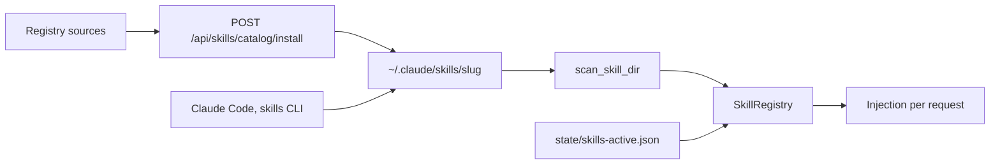
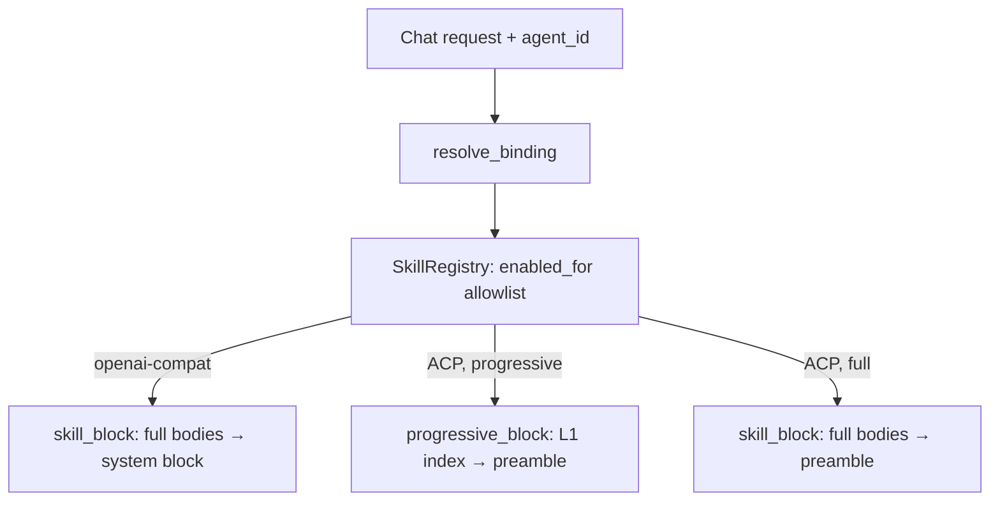
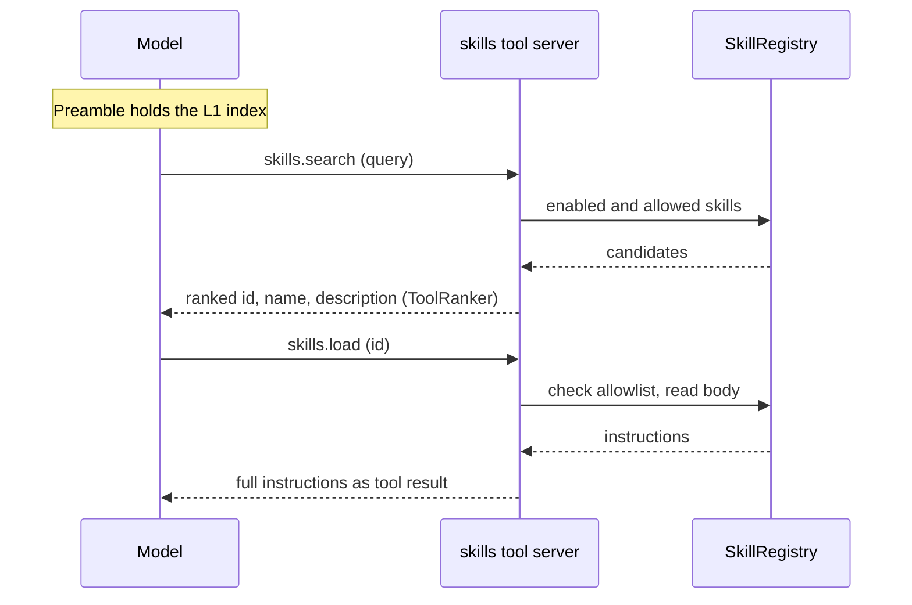

Skills are Agent Skills (a `SKILL.md` plus optional resource files) that inject
instructions into a chat turn. Core owns the whole pipeline (`apps/core/src/skills_catalog/` and
`crates/core/skills/`), as follows:

- It browses the [registry sources](#registry-sources).
- It installs into the universal Agent Skills layout shared with Claude Code.
- It tracks which skills are active.
- It injects the filtered skill block into every request on both chat planes.

For the desktop walkthrough, see [Skills](/docs/surfaces/desktop/skills).

<Figure name="skills" />

## Routes

| Route | Purpose |
|---|---|
| `GET /api/skills/catalog` | Search a source with `query`, `limit`, `installed_only`, and request-local `source`; `source=all` merges every registry |
| `GET /api/skills/catalog/detail` | Detail by `id` plus optional `source`; returns `SKILL.md` docs, front-matter description, and file list |
| `POST /api/skills/catalog/install` | Install `{ id, source?, promptForTargets?, targetIds?, rememberTargetIds? }` into the universal layout, hot-reload, and mark active; `dryRun: true` returns the target/write plan |
| `GET /api/skills/targets` | List supported local agent targets, detection state, and saved install preferences |
| `PUT /api/skills/targets/preferences` | Save the default target selection with `{ targetIds }` |
| `DELETE /api/skills/targets/preferences` | Clear saved target preferences |
| `POST /api/skills/:id/distribute` | Copy an installed skill to selected local agents with `{ targetIds, rememberTargetIds }` |
| `POST /api/skills/install-from-source` | Install `{ source }` from a direct source reference; `dryRun: true` validates the source request without fetching or writing |
| `GET /api/skills` | List installed skills with their enabled state |
| `POST /api/skills/activate` | Toggle injection: `{ id, active }` |

This table lists the catalog, install, and activation routes only. Core also serves other
`/api/skills` routes, such as packs (`/api/skills/packs`), system skills (`/api/skills/system`),
and updates (`/api/skills/updates`). Core's OpenAPI document at `GET /api/openapi.json` describes
them.

The catalog uses the **anonymous** endpoints the official CLI uses
(`GET https://skills.sh/api/search`, `/api/download/<owner>/<repo>/<slug>`). The
documented `/api/v1` path needs a Vercel OIDC token, so Ryu does not use it.

## Health and agent review

On the desktop Skills detail view, **Health** runs a deterministic scorecard over source trust,
published audits, maintenance, documentation, and package integrity.

A node-backed desktop also exposes **Audit with agent**:

- It sends a bounded evidence snapshot to the reviewer selected in
  **Gateway → Guardrails → Health audit agent** (by default, the default chat agent).
- The advisory score, evidence, recommendations, and limitations are shown separately and cannot
  change the static score.
- Published skill files are untrusted evidence, so the reviewer is instructed not to follow
  instructions found inside them.
- Audits run only when requested, under the agent's normal runtime, permissions, and approvals.
  The bundled `ryu-health-audit` skill guides read-only investigation.
- **Open audit conversation** inspects or continues the review. Auditing does not authorize
  repairs.

## Registry sources

The desktop opens the Skills tab on `source=all`, a live, de-duplicated view built
from every registered source. A source failure is isolated, so one offline
registry does not hide the others. The picker can narrow the view to one source.

| Source | What it contributes |
|---|---|
| skills.sh | Public Agent Skills directory and featured search |
| Anthropic, OpenAI, Hugging Face, NVIDIA, MiniMax, and community GitHub taps | Vendor or curated repositories that expose `SKILL.md` files |
| browse.sh | Website-task skills, with inline or linked `SKILL.md` detail |
| ClawHub | Open-publish skills from the ClawHub registry |
| LobeHub | LobeHub agents converted into installable `SKILL.md` files |
| Claude marketplaces | Custom `.claude-plugin/marketplace.json` sources added from the picker |
| Ryu Marketplace | First-party hosted skill listings |

Cards carry the producing registry and a registry-level trust label. `trusted`
means the source curates a vendor-owned repository; `community` means the source
allows third-party publishing. Neither label is a security audit of the skill, so
review the `SKILL.md` before enabling unfamiliar instructions.

### When GitHub is unavailable

GitHub-backed skill taps and Marketplace listings keep the last successful browse result in a
short-lived memory cache and, for the default catalog view, a disk cache. If GitHub or the
Marketplace endpoint is temporarily unavailable, Ryu labels the result as cached and browsing
still works.

An already-installed skill can be retried from its local copy when its recorded catalog identity
matches the requested skill. A first install still fails closed when the bytes cannot be verified
or downloaded. Stale data never becomes an unverified install or a same-named skill from another
repository.

## Install layout (shared with Claude Code)

Install writes the skill in the universal Agent Skills layout under
`~/.claude/skills/<slug>/SKILL.md`, plus any bundled resource files (path-traversal guarded).
Claude Code and the skills CLI read the same directory. A Ryu-installed skill is usable by those
agents, and any skill they install shows as installed in Ryu.

| Root | When Core reads it |
|---|---|
| `~/.claude/skills` | Default install directory. `RYU_SKILLS_DIR` overrides it. |
| `~/.agents/skills/<slug>/SKILL.md` | Also scanned when `RYU_SKILLS_DIR` is unset. On an id collision, `~/.claude/skills` wins. |

`scan_skill_dir` (`crates/core/skills/src/lib.rs`) is the single source of truth for what is on
disk. It loads both the universal layout and the legacy flat `<slug>.md` form.

<Callout type="info">
Because `~/.claude/skills` is shared, "installed" in Ryu means "present on disk for
any agent that reads this directory", not "Ryu downloaded it".
</Callout>

## Use a skill with local agents

On desktop, installing a catalog skill can also offer it to supported agent clients on the same
computer. Ryu reads the target registry and lists detected agents first. Project-only targets are
shown but cannot be selected for global distribution.

To share an installed skill:

1. Choose **Use with agents** from the skill's detail view or Library card.
2. Select one or more targets.
3. Optionally remember the selection for future catalog installs.

An empty selection keeps the skill available in Ryu only.

### Distribution rules

- Catalog installation and **Use with agents** stay on the node selected for the invoking tab,
  even while a target-selection dialog is open. Remembered target choices belong to that node.
- On managed nodes, changing these defaults requires install permission through
  `/api/skills/targets/preferences`. The generic preferences API cannot overwrite or clear them.
- Core performs the copy, including the skill's supporting files. If a target already contains a
  different copy, Ryu leaves that destination unchanged and reports the conflict.
- The browser catalog stays read-only and does not offer local distribution.
- Generated updates keep a recovery copy until you resolve or remove it. Removing that copy clears
  its recovery metadata, even if a separate destination conflict remains.
- Ryu preserves an external edit. Resolving that conflict allows a later update without manually
  repairing the distribution ledger.
- When `promptForTargets` is true and no saved preference exists, the install route returns `409`
  with `skill_targets_required`. The desktop then opens the target picker and retries with the
  user's explicit choice.
- Target selection is a local filesystem operation. It does not grant the target agent access to
  Ryu credentials.

## Installed is not active

The shared directory can hold dozens of skills, and the openai-compat route injects every enabled
skill body into one system block with no cap. Injecting all of them would overflow a local
model's context, so a Ryu-owned activation set gates injection. On the ACP plane,
[progressive disclosure](#progressive-disclosure) reduces this further.

- The activation set lives in `state/skills-active.json` under the data directory (override
  `RYU_SKILLS_ACTIVE_FILE`).
- Skills installed through Ryu, plus migrated legacy skills, are **active**.
- Bulk-discovered shared-directory skills are visible and installed but **inactive**
  until toggled via `POST /api/skills/activate { id, active }`.
- `SkillRegistry::reload()` sets `SkillRecord.enabled = front_matter_enabled && active`,
  so a skill injects only when its front matter enables it **and** it is active.

The desktop surfaces this as a Switch on the Skills page (`SkillsCatalogSection`),
backed by `GET /api/skills` and `POST /api/skills/activate`.

## Per-agent allowlist

Each agent carries a `skills: Vec<String>` allowlist (`AgentRecord.skills` in
`db/agents.db`):

- **Empty allowlist** - all enabled skills inject.
- **Non-empty allowlist** - the intersection with the globally enabled set injects. The
  allowlist never re-activates a skill that is globally inactive.

`SkillRegistry::{enabled_for, skill_block, inject_into_messages_filtered}`
(`crates/core/skills/src/lib.rs`) is the shared source of truth. Core resolves it per request from
the agent record via `resolve_binding`
(`apps/core/src/sidecar/adapters/adapter_core/turn_binding.rs`). Edit the allowlist in the desktop
agent editor's skill picker.

## Both-plane injection

Injection runs on both chat planes from the same filtered skill set:

| Plane | Where it injects | What it injects |
|---|---|---|
| openai-compat | A filtered system block prepended to the request | Full skill bodies (always, because its default fast path has no tool loop) |
| ACP | Folded into the prompt preamble via `long_term_system` in `build_acp_prompt` | The L1 index by default ([progressive disclosure](#progressive-disclosure)); full bodies in `full` mode or for `always-on` skills |

The flagship `ryu` (acp:pi) agent and other ACP agents get skills as well as the openai-compat
route. Skills stay in `long_term_system` because they hold still between turns. Memory recall and
auto-recall change every turn, so they travel separately as per-turn context after the cached
prefix (see [Memory](/docs/core/memory#auto-recall)).

<Callout type="warn">
Known tradeoff: an ACP agent that self-reads `~/.claude/skills` (for example Claude
Code) also receives the injected preamble, so an active skill can appear twice for
it. The flagship Pi does not self-read, so for `ryu` injection is the only path and
there is no doubling. Injection is not yet skipped for self-reading ACP agents.
</Callout>

## Progressive disclosure

Injecting every enabled skill's full instructions into every prompt is the heaviest cost on a
low-context local model. Progressive disclosure follows the Agent Skills standard instead, and it
is **on by default**:

- **L1.** Only each skill's name and description are in context up front.
- **L2.** The model loads a skill's full instructions on demand, when it decides the skill is
  relevant.

### The `skills` tool server

A built-in tool server (`apps/core/src/sidecar/mcp/skills_tool.rs`, a reserved server
like `web_fetch` and `threads`) exposes two tools through the same catalog and
`tool_search` plumbing as every other tool:

| Tool | Purpose |
|---|---|
| `skills.search { query }` | Find skills by task. Returns ranked `{ id, name, description }`. |
| `skills.load { id }` | Return a skill's full `instructions`. |

`skills.search` ranks through the shared `ToolRanker`, so skill discovery and tool discovery use
one ranking strategy and one preference. See [Unified tool catalog](/docs/core/unified-tool-catalog#ranking).

A loaded skill's instructions come back as the **tool result**; the result *is* the injection.
The model follows it for the rest of the turn, the same mechanism as Claude Code's Skill tool. A
skill stays instruction text, not a callable function.

### What gets injected up front

In progressive mode, the ACP preamble carries the **L1 index** built by
`SkillRegistry::progressive_block` (`crates/core/skills/src/lib.rs`) instead of full bodies:

- one line with the id, name, and description of each enabled and allowed skill;
- at most 20 entries (`SKILL_INDEX_CAP`); beyond that the model is pointed at `skills.search`;
- a one-line instruction to call `skills.load` before using a skill.

The index is **ordered by skill id**, so the cut past 20 skills is stable across restarts but
alphabetical. To keep a skill always visible up front, mark it `always-on: true`.

The index is **query-independent**. It is part of the system preamble, and a preamble that varied
per message would invalidate the provider-side prompt cache on every turn. Narrowing by relevance
is the job of `skills.search`.

### ACP only, by design

Progressive disclosure applies on the **ACP plane only**. That plane has a guaranteed tool loop
(the MCP bridge), so the model can call `skills.load`. The plane is the signal; there is no
separate capability probe.

The **openai-compat plane keeps full injection**. Its default fast path offers no tools, so
on-demand loading would leave the model no way to reach a skill. The flagship low-context target,
`ryu` (acp:pi), is an ACP agent, so it gets the benefit.

### Mode and the always-on escape hatch

- Global mode is the `skills-disclosure` preference (`progressive`, the default, or
  `full`), with boot seed `RYU_SKILLS_DISCLOSURE` (`skills.disclosure` in `node-config.json`) and the process-global flag
  `skills::is_progressive_disclosure()` set per chat request from the pref.
- Desktop toggle: **Gateway settings → Plugins → Memory → Load skills on demand** (`apps/desktop/src/components/settings/MemoryTab.tsx`).
- A skill can opt out of progressive loading with front-matter `always-on: true`
  (`SkillRecord.always_on`): its full body is injected up front regardless of mode. This is the
  escape hatch for a critical skill or a model you do not trust to self-load.

### The allowlist scopes discovery and loading

`skills.search` and `skills.load` are scoped by the calling agent's allowlist as well as the
global enabled set, so the index the model sees and the skills it can reach are the same set. A
load for an id outside the allowlist gets the same refusal as a load for an id that does not
exist, so the response cannot probe for hidden skills.

Scoping is resolved from the agent record, so it applies on both agent planes. Autonomous engine
operations with no agent configuration (scheduled quests, monitors, workflow steps) run against
the full enabled set. A skill is instruction text, not a credential, so this scoping keeps an
agent focused; it is not a confidentiality control.

<Callout type="warn">
An agent that carries a restricted **tool** allowlist must include `skills.*` in it, or it cannot
reach any skill at all. The per-skill always-on control is front-matter only (no desktop toggle
yet).
</Callout>

## Autonomous skill authoring

An agent can write its own skill with the `skills.author` tool
(`apps/core/src/sidecar/mcp/skills_tool.rs`, the same reserved server as `skills.search` and
`skills.load`). It renders a `SKILL.md` with four fixed sections (Purpose, Procedure, Failure
modes, Verification) at `~/.claude/skills/<slug>/SKILL.md`.

The new skill is immediately discoverable through `skills.search` and `skills.load`, subject to
the per-agent allowlist. Calling `author` again on the same slug refines it in place.

`do_author` is fail-closed at every step:

1. `sanitize_slug` reduces the name to a single safe path segment and fails closed on `../`,
   absolute, UNC, or drive-qualified inputs.
2. `render_skill_md` serializes quoted YAML front matter (via `noyalib`) plus the four body
   sections.
3. The rendered document is pre-parsed through `crate::skills::parse_skill_md` as a round-trip
   guard: if it does not parse back, nothing is written.
4. The file is written atomically (temp file plus rename, mirroring the catalog installer), then the
   skill is activated (`set_active(slug, true)`) and the registry reloads.

The result is `{ ok, id, path, refined }`.

<Callout type="warn">
  Authoring is gated **off by default** behind `RYU_SKILLS_AUTHOR` (or `skills.author` in `node-config.json`;
  truthy `1`/`true`/`yes`/`on`).
  When unset, `skills.author` is neither listed by `tools()` nor callable: `do_author` returns
  `{ ok: false, available: false }` and writes nothing. The read-only `skills.search` and
  `skills.load` stay ungated; only `author` has file side effects, so only `author` is opt-in.
</Callout>

## Related

<Cards>
  <DocCard href="/docs/surfaces/desktop/skills" />
  <DocCard href="/docs/core/unified-tool-catalog" />
  <DocCard href="/docs/core/memory" />
  <DocCard href="/docs/surfaces/desktop/user-guide/agents" />
  <DocCard href="/docs/core/model-catalog" />
</Cards>

<TryInRyu page="skills" />
