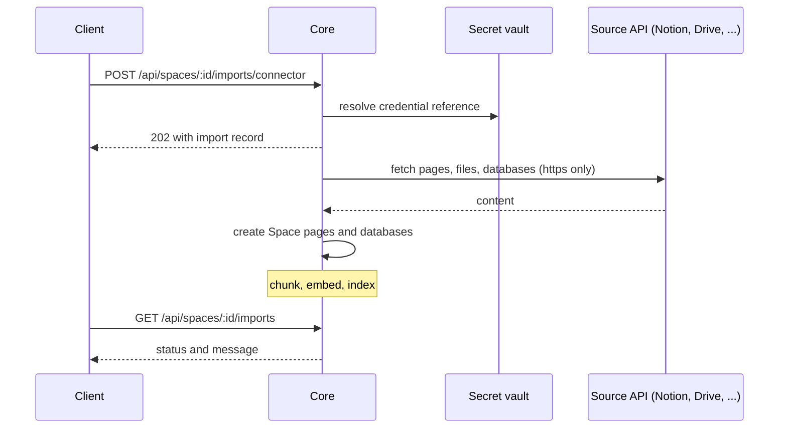

This page covers how Core cuts documents into chunks and imports them from connected sources. For
retrieval modes, embeddings, and search, see [Spaces and RAG](/docs/core/spaces-rag).

## Chunking strategies

Each Space chooses how its documents are cut into chunks (`ChunkingStrategy` in
`crates/core/rag/src/splitter.rs`). A Space that was never configured uses the `default`
strategy, so existing Spaces keep their chunks unchanged.

| Strategy | What it does | Options (defaults) |
|---|---|---|
| `default` | Packs paragraphs word by word into chunks of at most 1,000 characters, with no overlap. | None |
| `recursive` | Splits on the coarsest separator that occurs (`\n\n`, `\n`, sentence ends, `, `, spaces, then characters), recurses into pieces that are still too long, and packs the rest into overlapping windows. | `chunk_size` (1000), `chunk_overlap` (200), `separators` |
| `markdown` | Cuts at ATX headers (`#` to `######`; `#` lines inside fenced code are ignored), then splits each section recursively. Every chunk records its header path. | `chunk_size` (1000), `chunk_overlap` (200), `include_header_path` (true) |
| `token` | The recursive splitter measured in approximate tokens instead of characters. | `chunk_size` (256), `chunk_overlap` (32) |
| `semantic` | Embeds each sentence with the Space's embedder and starts a new chunk where the distance between neighbouring sentences is above a percentile of all such distances. | `breakpoint_percentile` (95), `buffer_size` (1), `max_chunk_size` (2000) |

### Set a strategy

Read the current strategy with `GET /api/spaces/:id/chunking`. Set one with a
`PUT /api/spaces/:id/chunking` body like this:

```json
{ "chunking": { "strategy": "markdown", "chunk_size": 800, "chunk_overlap": 100 } }
```

Rules:

- Send `{ "chunking": null }` to return to `default`.
- A new strategy applies to documents ingested or edited after the change. Existing chunks are not
  cut again until their document is saved.
- `chunk_overlap` must be smaller than `chunk_size`, and sizes are limited to 32,000.

### Strategy details

- **`markdown`.** With `include_header_path`, a chunk starts with its breadcrumb (for example
  `Guide > Install`), so a chunk retrieved on its own still says where it came from.
- **`token`.** Uses a deterministic approximation of a GPT-style tokenizer (about four characters
  per word piece, one token per punctuation mark), not a specific model's tokenizer.
- **`semantic`.** Costs one embedding per sentence at ingest. Documents with more than 2,048
  sentences fall back to recursive splitting.

### Chunk metadata

Every chunk stores the splitter's metadata: its `index`, an approximate `token_count`, and, for
markdown, its `header_path`. The metadata is encrypted on disk like the chunk text. Search results
return it, and [metadata filters](/docs/core/spaces-rag#metadata-filters) can match it.

### Knowledge bundles

Knowledge bundles accept the same strategy object. Pass `chunking` to
`POST /api/knowledge/catalog/install` to cut concept bodies with it. Without it, bundles keep the
historical splitter.

A bundle cut with a strategy still exports its concept bodies exactly as they were ingested. Each
of its chunks can be filtered by `okf_type`, `concept_path`, `tags`, and (for markdown)
`header_path`.

## Connector imports

`POST /api/spaces/:id/imports/connector` reads a source directly through its API and imports it
into the Space (`apps/core/src/server/space_imports/connectors.rs`). It needs `space.write`,
answers `202` with the import record, and runs in the background. Follow it in
`GET /api/spaces/:id/imports`.



| `provider` | Fields | Creates |
|---|---|---|
| `web` | `urls` (https, up to 200) | A page per HTML page (converted to Markdown); PDF, Office, CSV, and text responses go through the file import path |
| `notion` | `page_ids`, `database_ids` (ids or URLs) | A page per Notion page; a database per Notion database |
| `google_drive` | `file_ids`, `folder_ids` (ids or URLs; a folder imports its direct children) | Docs as pages, Sheets as databases, Slides as text pages, and supported files by format |
| `confluence` | `base_url`, `email`, `page_ids`, `space_key` | A page per Confluence page |
| `github` | `repo` (`owner/name`), `ref`, `path` | A page or database per Markdown, text, HTML, PDF, Office, or CSV file |

Every request also takes `title` (the history label) and `max_items` (default 50, at most 200),
which bounds the pages, files, and databases one import creates and the rows read per Notion
database.

```bash
curl -X POST "$NODE/api/spaces/$SPACE/imports/connector" \
  -H "Authorization: Bearer $TOKEN" -H "Content-Type: application/json" \
  -d '{"provider":"notion","credential":"secret:NOTION_TOKEN","database_ids":["https://www.notion.so/acme/0123456789abcdef0123456789abcdef"]}'
```

### Credentials

`credential` is a vault reference such as `secret:NOTION_TOKEN` or
`secret:/connectors/GITHUB_TOKEN`, never the token itself. Core resolves it for the calling user
with the same precedence agent tools use: your user scope, then node, team, and organization. A
missing or unreadable secret fails the request with `400`.

| Provider | Credential | Secret value |
|---|---|---|
| `notion` | Required | The integration token |
| `google_drive` | Required | A Google OAuth access token |
| `confluence` | Required | See below |
| `github` | Optional, for private repositories | A GitHub token |
| `web` | None | - |

For Confluence Cloud, store the API token and pass `base_url`
(`https://<site>.atlassian.net/wiki`) and `email`. For Confluence Data Center, store a JSON value
so the site is bound to the token:

```json
{ "token": "<personal access token>", "base_url": "https://wiki.example.com" }
```

A request cannot send a stored Confluence token to a host other than an Atlassian Cloud site or
the `base_url` stored with it.

### Network and failures

- Requests use https only and refuse private, loopback, link-local, and cloud metadata addresses.
  They pin the addresses they checked.
- Redirects are followed one hop at a time, and each hop is checked again. The `Authorization`
  header is dropped when a redirect leaves the original host.
- Items that fail (an unsupported file type, a page that returns an error) are listed in the
  import's `message`. The import fails only when nothing could be imported.

Imported documents are ordinary Space pages and databases: they are chunked, embedded, and
searched like any other document. The [TypeScript document loaders](/docs/extend/develop/sdk/document-loaders)
read the same sources into your own code instead of a Space.

## Related

<Cards>
  <DocCard href="/docs/core/spaces-rag" />
  <DocCard href="/docs/extend/develop/sdk/document-loaders" />
  <DocCard href="/docs/core/encryption-user-content" />
</Cards>
