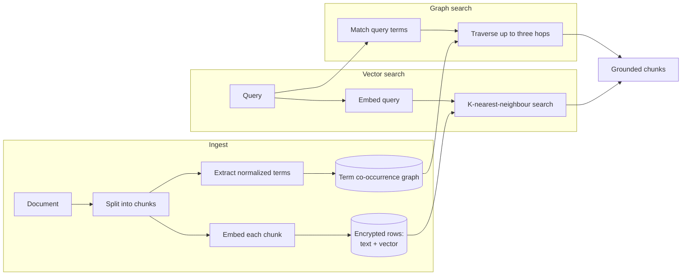
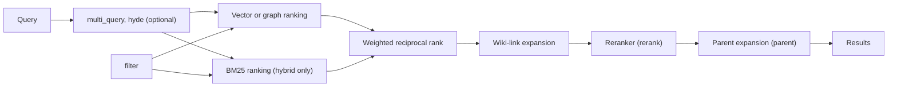
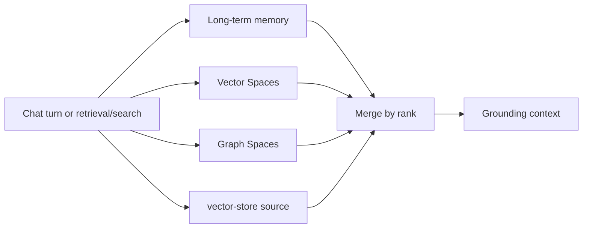

A **Space** is a document collection used for retrieval-augmented generation (RAG). An agent with
a Space attached pulls relevant passages from your documents to ground its answers. Core stores
Spaces locally and keeps their text, vectors, and files encrypted at rest (see
[Encryption and search](#encryption-and-search)).

Chunking strategies and connector imports are on [Spaces Ingestion](/docs/core/spaces-ingestion).

<Figure name="memory" />

## Retrieval modes

Each Space stores its own `retrieval_mode`. Choose a mode when you create the Space, or omit it to
use the node default. The default on a new installation is `vector`.

- **Vector** searches the Space's chunk embeddings by nearest-neighbour distance.
- **Graph** runs the shipped GraphRAG path. Core extracts normalized, noun-like terms from each
  chunk and connects every pair that occurs in that chunk. A search matches terms from the query,
  then follows the stored graph for at most three hops to find grounded chunks.

Graph extraction is deterministic and works offline. The only supported extractor id is
`local-cooccurrence`. Its edges mean "these terms occurred in the same chunk", not semantic
relations an LLM inferred, such as "works for".

Setting `graph_extraction_model` (or `RYU_GRAPH_EXTRACTION_MODEL`) to any other value makes Core
reject the configuration at startup. A model id is never accepted while a different extractor runs.

Both modes obey the requested result limit and return document-backed chunks. Graph traversal
bounds each next-hop frontier, and the same query over the same graph follows a deterministic
order.

### Graph limits

| Limit | Value |
|---|---|
| Unique terms per chunk or query | 64 |
| Term size | 128 UTF-8 bytes (larger terms are ignored) |
| Chunks per document in Graph mode | 256 |
| Graph node-plus-edge rows per Space | 2,000,000 |
| Wiki-link expansion per search | 16 linked documents, 32 linked chunks |

Oversized writes and rebuilds fail with an actionable error while the previous mode stays active
(`crates/core/spaces/src/lib.rs`).

On an organization-bound node, visibility is applied inside vector selection, graph seeding and
traversal, and link expansion. Private rows cannot steer a shared result or consume its candidate
budget. Every verified team membership counts; JWT team ordering does not change results.

### Change a Space's retrieval mode

Changing a mode is an asynchronous index operation, not a metadata toggle.

- Switching to **Graph** builds a fresh term co-occurrence graph from every existing chunk. New and
  edited documents update the graph after the switch completes.
- Switching to **Vector** removes the term graph. Existing vectors remain in place, so changing
  modes never requires re-embedding the Space.
- The previous mode and graph remain active until the replacement is ready. Cancelling a rebuild
  leaves them unchanged.

To change the mode:

1. `POST /api/spaces/:id/retrieval-mode` accepts the change and returns `202` with a `job_id`.
2. Poll `GET /api/spaces/:id/retrieval-mode/status?job_id=...` for progress and the final counts.
3. To stop a running rebuild, send the `job_id` to `POST /api/spaces/:id/retrieval-mode/cancel`.

Starting another mode change while one is running returns a conflict. Rebuild jobs belong to the
running Core process: after a restart the staged graph is discarded and the previous mode stays
active. Refresh the Space, then submit the change again if needed.

## Space home

The desktop Space home is a shared-context workspace for people and agents. It shows:

- the Space name, a left navigation rail, and quick templates for a new page or database;
- the most recently updated Markdown pages with previews, under **Recent**, **Pinned**, and
  **Shared with Me** tabs (select a row to open the page);
- the **Files** table, one index of every page, database, whiteboard, uploaded file, and
  app-owned document, with type, size when available, last modified date, and search reach;
- the file drop zone and the retrieval-mode, import/export, backup, and semantic-search controls.

The home search filters the recent rows and the file index together, locally. The separate Space
search runs retrieval across stored document text. A file row indexed by name and type only shows
that status, and the file still opens. Dropped files go through the node's configured extraction
and embedding path.

## Embeddings

Embeddings are a swappable default. Core can embed in two ways:

- **Local** - a deterministic, dependency-free embedder, or the bundled llama.cpp embedding engine.
  See [Engines](/docs/surfaces/desktop/engines/chat-engines).
- **Remote** - a self-hosted OpenAI-compatible embeddings endpoint, configured through the
  node environment. Cloud providers should use the Gateway-backed provider path so provider
  selection and credentials stay in Gateway rather than in Core.

RAG defaults to the local embedding engine, so it works without an API key.

Changing the embedding model is an index migration:

- Core tags every vector with its model and dimensionality.
- It installs the new provider only after the provider has a valid configuration.
- It re-embeds stale rows in Spaces, unified retrieval, and encrypted message search. The
  migration resumes after a restart.
- Until a row is re-embedded, it is excluded from search rather than compared across vector spaces.

Core sends the OpenAI `dimensions` parameter only to models that can shorten their output, such as
`text-embedding-3-small` and `text-embedding-3-large`. Fixed-width models such as
`text-embedding-ada-002` are called without it, and an endpoint that rejects it gets one retry without it. A returned vector of the wrong width
fails with an error naming both sizes instead of being stored.

For cloud embeddings, set the model's provider to `gateway`. Core then calls the local or managed
Gateway at `POST /v1/embeddings`. Gateway authenticates the request, routes the model through its
provider map, and keeps the upstream key server-side. Reranking uses the same boundary at
`POST /v1/rerank`, and both endpoints reject oversized batches before forwarding them.

## Working with Spaces

| Action | Endpoint |
|---|---|
| List Spaces | `GET /api/spaces` |
| Create a Space | `POST /api/spaces` |
| Rename a Space | `POST /api/spaces/:id/name` |
| Delete a Space | `DELETE /api/spaces/:id` |
| List documents | `GET /api/spaces/:id/documents` |
| Ingest a document | `POST /api/spaces/:id/documents` |
| List import history | `GET /api/spaces/:id/imports` |
| Import a file as pages or databases | `POST /api/spaces/:id/imports/files` |
| Import connected-app data | `POST /api/spaces/:id/imports/composio` |
| Import from Notion, Google Drive, Confluence, GitHub, or web URLs | `POST /api/spaces/:id/imports/connector` |
| Start a retrieval-mode change | `POST /api/spaces/:id/retrieval-mode` |
| Read mode-change progress | `GET /api/spaces/:id/retrieval-mode/status?job_id=...` |
| Cancel a mode change | `POST /api/spaces/:id/retrieval-mode/cancel` |
| Search within a Space | `POST /api/spaces/:id/search` |
| Read a Space's chunking strategy | `GET /api/spaces/:id/chunking` |
| Set a Space's chunking strategy | `PUT /api/spaces/:id/chunking` |
| Change embedding provider/model | `POST /api/embeddings/model` |
| Re-embed stale vectors | `POST /api/embeddings/reindex` |
| Re-embed progress | `GET /api/embeddings/reindex/status` |

Ingesting a document splits it into chunks, embeds each chunk, and stores both the text and the
vector. In Graph mode, ingestion also writes the chunk's term nodes and co-occurrence edges.

A Space search returns grounded chunks with `chunk_id`, `document_id`, `content`, and `distance`.
A non-finite distance is returned as `null`, and the mobile app shows "distance unavailable". Rank
hits by the returned order, not by distance.

File and connected-app imports use the same document lifecycle after conversion. Document-like
files become editable pages. Delimited and spreadsheet data becomes a database whose cell text is
flattened for embedding. The import history records the conversion result. The created documents
are ordinary Space documents and follow the same visibility and retrieval rules.



## Encryption and search

Document titles and bodies, chunk text, Space names and descriptions, link targets, page history,
import records, embedding vectors, and uploaded files are encrypted on disk with keys derived from
your data folder's master key. This changes how some searches match:

- **Titles, Space names, and descriptions** still match any part of a word, ignoring case, in the
  global Spaces search.
- **Page bodies and extracted file text** match **whole words only** in the global Spaces search.
  Each word is stored as a keyed token instead of the word itself, so a partial word, a phrase in
  quotes, or a search made only of very common words (such as "the") does not match a body.
- **Wiki links** still resolve `[[Title]]` to a page whose title matches ignoring case.
- **Vector search** decrypts a Space's vectors into memory, within a shared memory budget, and
  ranks chunks by cosine distance. While a large Space's vectors are still loading (or were set
  aside to make room), its search uses the keyword index instead and loads the vectors in the
  background.
- **Graph search** is unchanged in behavior. The stored graph keeps a keyed token for each term
  rather than the term itself, so the order in which a capped hop keeps neighbours is fixed but not
  alphabetical.

Spaces created by older builds that stored plaintext are encrypted in the background after an
upgrade. Those older builds cannot read the encrypted values, so export your data before downgrading. See
[Sealed User Content](/docs/core/encryption-user-content#spaces-documents-versions-links-graph-vectors-search-files) for exactly what is encrypted and what the
keyed tokens reveal.

## Search options

`POST /api/spaces/:id/search` takes the query and `limit` plus these optional fields:

| Field | Meaning |
|---|---|
| `hybrid` | `{ "alpha": 0.5 }` fuses a BM25 keyword ranking with the Space's own vector or graph ranking. `alpha` (0 to 1) weights the semantic side: `1` is the native ranking alone, `0` keyword ranking alone. |
| `filter` | A metadata predicate every result must satisfy (see below). |
| `parent` | Small-to-big expansion. `{ "mode": "window", "window": 1 }` adds the neighbouring chunks of each hit; `{ "mode": "document", "max_chars": 8000 }` returns the hit's whole document, once per document. |
| `rerank` | `false` returns the fused order without the reranker pass. Defaults to `true`. |
| `multi_query` | Number of alternative phrasings (0 to 5) a model writes for the query. Each is searched and the rankings are fused. |
| `hyde` | `true` asks a model for a short passage that would answer the query and searches with it too. |
| `expansion_model` | The model for `multi_query` and `hyde`. Without it, Core uses the model selected for the `retrieval-expansion-model` feature, then the node default. On an organization node, only organization owners and admins can choose a model here; for other members the field is ignored. |

Keyword search ranks chunks with BM25 over the same keyed word index as global Spaces search. It
matches whole words only, ignores very common words, and stays in step with every chunk change.

Both rankings merge by weighted reciprocal rank, because a BM25 score and a vector distance are not
on comparable scales. With fusion, each result carries a `score` (higher is better, comparable only
within one response).

Query expansion calls the model through Gateway, so the usual routing, policy, and budget apply.
It fails open: if the model is unavailable or returns nothing usable, Core still searches the
original query and adds a `warning`. When expansion ran, the response lists the searched `queries`
and any `hypothetical_document`.



Each result includes `metadata` (the splitter metadata plus the chunk's `ordinal`) and, when
`parent` was requested, `parent_content`.

### Metadata filters

Filters are JSON objects in the operator style most vector stores use:

```json
{
  "kind": "page",
  "ordinal": { "$lt": 3 },
  "$or": [{ "header_path": "Install" }, { "title": { "$in": ["Setup", "Quickstart"] } }]
}
```

- A field maps to a value (equality) or to operators: `$eq`, `$ne`, `$in`, `$nin`, `$gt`, `$gte`,
  `$lt`, `$lte`, `$exists`. Keys at the same level must all match.
- `$and` and `$or` take a non-empty list of filters; `$not` takes one filter.
- A dotted key such as `source.lang` reads nested objects.
- When the stored value is a list, `$eq` and `$in` match if any element matches, and `$ne` and
  `$nin` match only if no element does.
- Comparisons are numeric for numbers and alphabetical for strings. Values of different types never
  match, and a missing field fails every operator except `$ne`, `$nin`, and `$exists: false`.
- Filters are limited to 16 levels of nesting, 256 predicates, and 1,024 values per list. An
  invalid filter is rejected with `400`.

In a Space search, a chunk's metadata is its splitter metadata plus `source` (always `space`),
`space_id`, `document_id`, `title`, `kind`, `mime`, `ordinal`, `created_at`, and `updated_at`.
The filter applies before ranking and inside the caller's visibility rules, so a filtered search
still returns up to `limit` matching chunks.

## Portable source and local retrieval

Portable Space packages exchange the source layer, not the retrieval layer. A package contains
Markdown pages, YAML frontmatter, database schema files, and Markdown row files. It does not carry
embedding vectors, vector tables, provider identifiers, or model-specific dimensions.

Importing a package creates a new private Space without vectors. Run the manual embedding re-index
when you want RAG; it uses the target node's current embedding and retrieval configuration. This
keeps a package portable across local, remote, and Gateway-backed embedding setups.

If the package is edited outside Ryu, import it again to create a fresh source snapshot. Changing
the node's embedding model stays a normal local re-index operation.

## Source history and realtime collaboration

Space page and database saves are checkpointed in a node-local Git repository at
`files/source-history/spaces/` under the data directory.

- The generic `VersionHistory` control and version endpoints stay the UI and API contract, so
  diffs and restores work without exposing Git to the editor.
- Git commit ids are the version ids for documents with Git checkpoints. Older SQLite snapshots
  stay readable as a fallback.
- If the Git projection is temporarily unavailable, a successful SQLite write is not rolled back.
  Core logs the degraded checkpoint and keeps the write available for repair.
- Yjs (CRDT) is the realtime collaboration and merge primitive. SQLite `document_versions` is the
  bounded conflict/retry and legacy snapshot store, not a second user-facing history.
- Neither Git history nor portable packages include embeddings, vectors, credentials, or chat or
  session state.

## Unified retrieval

Beyond per-Space search, Core exposes one retrieval endpoint that spans both Spaces and encrypted
[memory](/docs/core/memory).

### Index a chunk

`POST /api/retrieval/index` adds a stable-id chunk to retrieval.

- The default `memory` source is encrypted and replaces the same-id user-level memory on a repeat
  request. Use `POST /api/memory` for explicit scope, category, importance, or tags.
- For a Space chunk, pass `source: "space"` and a `space_id`. A `space_id` that names a Space needs
  write access to it.
- A Space chunk may carry a `metadata` JSON object (up to 16 KiB) for filtering.
- A Space chunk can replace only a Space chunk you indexed yourself. An id already used by memory,
  an imported knowledge bundle, or another member's chunk returns `409`.

### Search memory and Spaces

`POST /api/retrieval/search` searches across memory and selected Spaces. It takes `top_k`,
`space_ids`, `include_memory`, and a `min_score` threshold, plus `filter`, `hybrid`, `multi_query`,
`hyde`, and `expansion_model` as in [Search options](#search-options).

A filter matches an indexed chunk's `metadata` plus `source`, `space_id`, `scope`, `agent_id`, and
`importance`. Inside each selected Space it matches the Space fields listed above, and `hybrid`
applies inside the selected Spaces.

This is also the chat recall path. When an agent has Space ids in its memory settings, Core
searches those Spaces under each Space's stored mode, then merges the results with eligible
long-term memory. A Graph Space uses the same bounded traversal in chat as in Space search.



### External vector stores

A node can also attach one collection in Qdrant, Chroma, Pinecone, Weaviate, Milvus, pgvector, or a
separate local sqlite-vec file.

That collection answers as the `vector-store` source: include
`"vector-store"` in `space_ids` (or in an agent's Space list) to search it, and its hits are merged
by rank with memory and Spaces. See [Vector store configuration](/docs/start-here/configuration#vector-store).

## GraphRAG and the wiki graph are different

GraphRAG stores chunk-level term co-occurrence. The wiki graph stores explicit page-to-page links
created with `[[wikilinks]]`, mentions, and page hierarchy. Wiki links power backlinks and the
Knowledge Graph view. They can also expand retrieval to linked pages, but they do not create or
replace the GraphRAG term graph. A Space can use both during one search.

## Database query limits

Database queries (`POST /api/spaces/:id/databases/:doc_id/query`) enforce SQLite value and
SQL-length limits before they execute caller SQL. Large computed values and oversized result rows
are rejected before they are copied into the response. Stored grid input is projected separately,
so long column labels do not consume the caller's SQL allowance.

## Related

<Cards>
  <DocCard href="/docs/core/spaces-ingestion" />
  <DocCard href="/docs/core/memory" />
  <DocCard href="/docs/core/encryption-user-content" />
</Cards>
