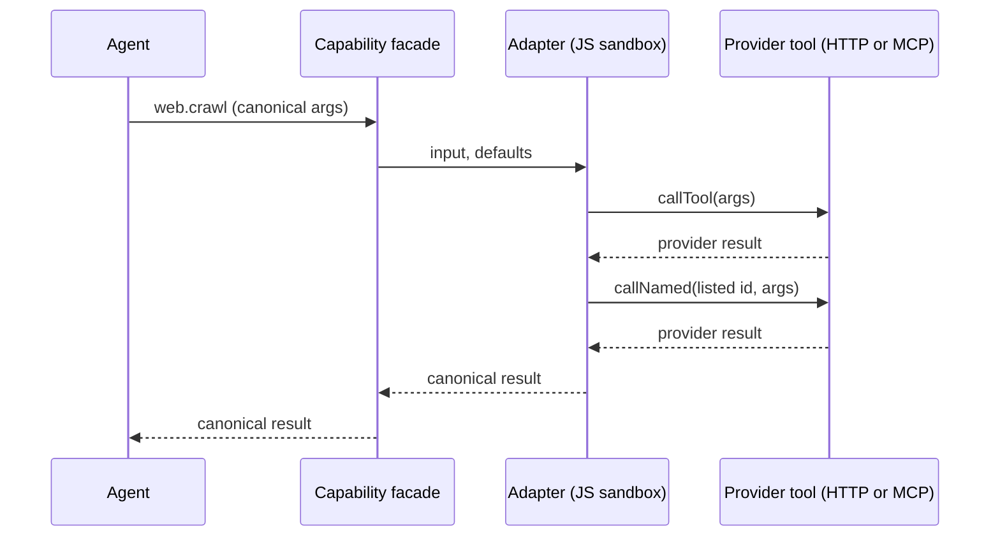

A provider plugs into a [swappable layer](/docs/core/swappable-layers) by mapping the layer's
canonical verbs onto its own tools. Most providers need only JSON; the rest ship an adapter.

## Binding a provider: declarative first

Most providers are a rename plus a field map, and that is expressed as JSON in the provider's own
`manifest.json` with no code:

```json
"provides": [
  {
    "capability": "web.search",
    "version": "1.0.0",
    "selectable": true,
    "tools": {
      "web.search": {
        "tool": "firecrawl.search",
        "args": { "limit": "limit" },
        "response": {
          "results": "data.web",
          "fields": { "title": "title", "url": "url", "snippet": "description" }
        }
      }
    }
  }
]
```

| Field | Purpose |
|---|---|
| `tool` | The provider's own tool id this verb forwards to |
| `args` | Canonical argument name to the provider's name. Map to `""` to drop it |
| `arg_defaults` | Constant arguments merged into every call. A `pref:` value is read per install |
| `arg_template` | A request body template for providers needing a nested shape |
| `arg_clamp` | Per-argument numeric limits the provider can actually honour |
| `response` | Where the result array lives and how to rename each item's fields |

## Adapters: when no JSON can express the shape

Some provider shapes are beyond any declarative field:

- An async job API starts work at one endpoint and reads results from another.
- A token vocabulary needs normalizing.
- A request body needs a value that only exists per install.

For those, a provider ships an **adapter**: JavaScript that receives the canonical arguments and
returns the canonical result. It runs in the same JS sandbox as an `inline_js` plugin tool.



```json
"web.crawl": {
  "tool": "firecrawl.crawl_start",
  "adapter": {
    "tools": ["firecrawl.crawl_status"],
    "code_file": "adapters/web.crawl.js"
  }
}
```

Write the body in its own file, `adapters/<verb>.js`, next to `manifest.json`. The file is a
fragment rather than a module: it has no `import` or `export`, and a top-level `return` hands back
the canonical result.

`code_file` is the authoring form and `code` is the wire form. Ryu reads the file when it loads a
plugin from a directory. `bunx ryu pack <dir>` inlines it into `code`, so the published bundle
carries the whole body inside the signed manifest.

The adapter is handed three things:

- `input` - the canonical arguments, with layer defaults already applied
- `defaults` - the provider's `arg_defaults` with `pref:` tokens **already resolved**. This is the
  one thing `arg_template` cannot do, since a template expands from the caller's arguments and so
  never sees a resolved preference
- `callTool(args)` and `callNamed(id, args)` - the provider's own tools

An adapter **replaces** the declarative mapping for its verb. Declaring both describes the same
transformation twice and only one runs.

### Shipping a custom adapter

Start from the adapter template:

```bash
bunx create-ryu-app my-adapter --template adapter
```

It emits these pieces already wired together:

- an HTTP provider tool runnable;
- a `provides` binding whose `adapter.code_file` is `adapters/search.js`;
- the `tool:execute` and `tool:http-egress:<host>` grants;
- golden cases in `cases.json`;
- a `bun test` suite that runs them with only the globals the sandbox provides.

Then:

1. Declare the provider tool the adapter calls as one of your own tools: an HTTP tool runnable, or
   a tool served by one of your `mcp_servers`. `tool` and every `adapter.tools` id must belong to
   your plugin. Mark the `provides` entry `"selectable": true` so it can be picked.

   `callTool` returns what that tool returns. Read the shape your tool actually produces:

   | Tool | Result |
   |---|---|
   | HTTP tool | `{status, body}` |
   | HTTP tool with `"unwrap_body": true` | The parsed body itself, on a 2xx |
   | HTTP tool with `"fail_open": true` | `{available: false, reason, hint}` on a 401/403 or an unreachable host |
   | MCP tool | Its MCP result |
2. Add `"tool:execute"` to `permission_grants`. Without it the provider is still listed in the
   layer picker, but every call through the adapter is refused. An HTTP provider tool also needs
   `"tool:http-egress:<host>"` for the host in its `url`; change the two together.
3. Test the body against stubbed provider answers. See
   [Testing Plugin Tools](/docs/extend/develop/extensions/testing-plugin-tools).
4. Run `bunx ryu pack <dir>`. It inlines `code_file` and runs Core's own manifest validation, so
   an adapter that targets a tool your plugin does not own fails at pack time, not at install.
5. Install and enable the plugin, then pick it as the provider for its capability. The canonical
   verb ids stay the same, so agents need no changes.

### Why an adapter is not an escape hatch

Its authority is a strict subset of the declarative path it replaces:

- `callTool(args)` takes **no tool id**. The target is fixed from the manifest before the sandbox
  starts, so sandboxed code cannot redirect the call.
- `callNamed(id, args)` reaches only ids the manifest listed in `adapter.tools`, checked host-side
  in `CapabilityAdapterBridge::resolve_target`. The facade itself is never re-enterable.
- No `host.*` surface: no side model, no `runAgent`, no storage.
- Deny-all sandbox with no network of its own. The provider's HTTP egress still happens inside the
  bound tool, where the Gateway grant governs it.
- Gated on the `tool:execute` grant, read from the Gateway-approved set for a Community-tier
  plugin, so a third party cannot self-authorize shipping code.

<Callout type="warn">
The sandbox bounds **active compute** (`DEFAULT_DEADLINE_SECS`, 30s) and awaiting a tool call
spends that budget. An adapter polling an async job cannot wait out a job larger than the budget:
Firecrawl's crawl adapter returns the pages that completed, flagged `complete: false`, rather than
being killed at the wall clock with nothing.
</Callout>

## Related

<Cards>
  <DocCard href="/docs/core/swappable-layers" />
  <DocCard href="/docs/extend/develop/extensions/capability-broker" />
  <DocCard href="/docs/extend/develop/extensions/testing-plugin-tools" />
</Cards>
