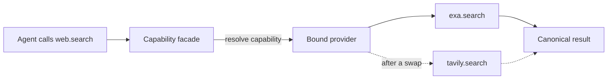
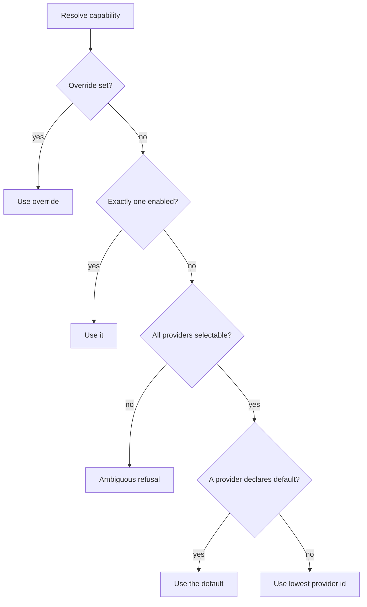

A **layer** is a capability with more than one provider you can pick between, such as web search,
browser control, device control, or memory. Selecting a different provider re-points a stable set
of tools at it. The agent keeps calling `web.search`; only who answers changes.

Desktop calls these **Toolkits** (the **Toolkits** page of the expanded node selector). "Layer"
and "capability" are the names Core and manifests use. To change a provider, use that page or
`PUT /api/capabilities/bindings`.

Typed classification and choice models use the same binding contract but appear in the separate
**Decision Models** layer. Their manifest `layerKind` keeps them out of Toolkits, and the stable
`decision.predict` tool follows the selected provider. See [Decision Models](/docs/core/decision-models).

## How the facade works

Core registers a fixed table of **canonical verbs** (`apps/core/src/sidecar/mcp/capability_tools.rs`).
`web.search`, `browser.snapshot`, `computer.click` and `memory.store` are Core's own tool ids
with Core's own schemas. They do not belong to any provider.

At call time the facade resolves the capability to its bound provider, reads that provider's
binding, renames the arguments, re-enters tool dispatch on the provider's real tool, and maps the
response back into the canonical shape.



The verb id and schema never move, so a swap changes no prompt, allowlist, or agent definition.

## Available capability providers

| Capability | Providers | Notes |
|---|---|---|
| `web.search` | exa (default, **on by default**), Ryu Cloud Search (**on by default**), parallel, tavily, brave, firecrawl, serper, [DeepSeek](/docs/plugins/deepseek) | exa and Parallel support anonymous search. Ryu Cloud Search stays unselected until you pick it; see [Web search works with no API key](#web-search-works-with-no-api-key) |
| `web.extract` | spider (default), tavily, firecrawl, serper, [DeepSeek](/docs/plugins/deepseek), [Jina Reader](/docs/plugins/jina-reader) | Jina Reader can read pages anonymously; an optional key raises its upstream limit |
| `web.crawl` | spider (default), spidercloud, firecrawl | |
| `memory` | @ryu/memory (default), mem0, honcho | |
| `browser.control` | @ryu/browser (default), agentbrowser, Cloudflare Browser Run, [Kernel](/docs/plugins/kernel) | Cloudflare is hosted with URL-scoped snapshot, navigate and screenshot adapters; Kernel is hosted and session-scoped, see below. [Browser Use](/docs/plugins/browser-use) and [Steel](/docs/plugins/steel) are hidden previews that do not work as this layer yet |
| `computer.control` | ghost (default), bytebot, [Codex Computer Use](/docs/plugins/codex-computer-use) | bytebot drives a **different machine**, see below; the other two drive this device |
| `verify.claim` | [Automated Reasoning](/docs/apps/reasoning) (default) | Checks a claim against a source of truth; see [Verification layer](#verification-layer) |

<Callout type="warn">
Outside the Chromium browser sidecar, none of this has been driven against a live Core yet. The
bindings are contract-tested and every field was checked against published vendor docs, but no
provider swap has been performed in a running app. Cloudflare Browser Run and Kernel are external and
opt-in; they do not silently replace the local browser.
</Callout>

## A hosted browser provider

**Cloudflare Browser Run** is a remote `browser.control` provider. Install and enable its external
plugin, then select **Cloudflare Browser Run** in the same Toolkit picker used for Agent Browser
and Ego Browser. The canonical adapters keep the stable Ryu verbs and send the URL to Cloudflare's
Browser Run MCP server:

| Canonical verb | Cloudflare operation | Boundary |
|---|---|---|
| `browser.navigate` | `cloudflare.get_url_snapshot` | Opens a URL-scoped remote page and returns a snapshot |
| `browser.snapshot` | `cloudflare.get_url_snapshot` | Reads a URL-scoped accessibility snapshot |
| `browser.screenshot` | `cloudflare.get_url_screenshot` | Returns the remote page image |

The provider also exposes Cloudflare's native HTML, Markdown, PDF, JSON, links, crawl, and browser
session tools under the `cloudflare.*` namespace. Click, type, scroll, and tab persistence stay
native session operations until a session-backed adapter is selected, so the layer card lists only
the swappable verbs. The remote server uses
OAuth, and the Store shows it with an external badge.

## Local computer-use engine

An opt-in `computer.control` provider brings OpenAI's Codex computer-use engine to this device. It
is an explicit install and does not replace Ghost unless you select it:

| Provider | Engine | How it acts | Verbs it serves |
|---|---|---|---|
| [Codex Computer Use](/docs/plugins/codex-computer-use) | OpenAI's signed Codex Computer Use engine from the ChatGPT macOS app, through the unofficial `codex-computer-use-mcp` bridge | In the background on one **target app** that you set in its settings, through the accessibility tree; your cursor is not moved | capture, click, type, key |

A verb the provider does not serve, such as scroll, stays unavailable while it is selected; nothing
falls back to another provider. The Codex bridge is unofficial and can break with a ChatGPT update.

## Session-backed cloud browsers

[Kernel](/docs/plugins/kernel) is a remote `browser.control` provider in which each cloud browser
session is one Ryu tab:

- Every `browser.navigate` creates a new Kernel browser on the URL and returns its session id. The
  other verbs act on that session.
- Each new session starts without the cookies or sign-in state of earlier ones. Kernel bills it
  until it is deleted or times out.
- Kernel drives browsers by viewport coordinates, so it binds tabs, screenshot, `click_at`, key,
  scroll, and drag rather than the element-reference verbs.

Where a provider cannot honour a canonical behavior, such as appending text or scrolling sideways,
its adapter returns an error instead of doing something different. Each plugin page lists those
limits.

<Callout type="warn">
[Steel](/docs/plugins/steel) (cloud) and [Browser Use](/docs/plugins/browser-use) (local) declare
`browser.control` bindings but are not usable as the Browser layer yet. Each tool call starts a
fresh process, so the session that `browser.navigate` opens is gone before the next verb runs.
Both are hidden from the Store; do not select them in the Browser provider picker.
</Callout>

## Which provider gets picked

A capability marked `selectable` resolves deterministically
(`apps/core/src/plugins/binding.rs`):

1. Your override, if you set one
2. The only provider, if exactly one is enabled
3. The provider that declares `"default": true`
4. The lexicographically lowest provider id



A capability that is **not** selectable (`rag`, `engines`) treats a second enabled provider as an
`Ambiguous` refusal instead. Selectability needs every provider of the capability to declare
`selectable`. If any provider omits it, the capability stays strict, so one third-party manifest
cannot loosen a strict capability.

## A provider says which machine it acts on

Swapping a search provider changes who answers the same question. Swapping `computer.control`
changes **which device gets typed on**:

- `ghost` drives the machine Ryu runs on.
- `bytebot` drives the desktop its `bytebotd` daemon runs on. In the shipped Bytebot product that
  is a containerized Linux desktop.

Providers of a machine-controlling capability therefore declare a `target` in their manifest:

| Value | Meaning |
|---|---|
| `local-machine` | Acts on the machine Ryu is running on |
| `remote-desktop` | Acts on a separate machine or virtual desktop |

Absent means not applicable, as for `web.search` and `memory`. The picker
shows the label only when a capability's providers actually disagree, so `browser.control` (both
local) stays quiet and `computer.control` reads "this device" against "remote desktop".

On a node that runs the [Virtual Desktop](/docs/surfaces/desktop/user-guide/virtual-desktop), Ghost's
`computer.control` tools drive the same headless X display that the Virtual Desktop panel streams.
You can watch the agent work live and take over with your own mouse and keyboard.

## Verification layer

The verification layer gives agents one stable way to ask "is this claim backed?" whichever checker
answers. It has two verbs:

| Verb | Input | Result |
|---|---|---|
| `verify.claim` | `claim`, plus an optional `question` and `scope` | An overall `verdict`, a per-claim breakdown with the evidence that decided it, and any counterexample |
| `verify.scopes` | none | The sources of truth `verify.claim` can check against, with their ids |

Every provider maps its own outcome onto the same five verdicts:

| Verdict | Meaning |
|---|---|
| `proved` | The source of truth entails every part of the claim |
| `refuted` | The source contradicts the claim; a counterexample is included when the provider has one |
| `undecided` | The claim is consistent with the source but not implied by it |
| `inconsistent` | The source of truth contradicts itself, so nothing follows from it |
| `unverifiable` | No verdict covers the whole claim: nothing or only part of it could be formalized, readings disagreed, a budget ran out, or no scope matched |

Only `proved` means the claim is backed. Treat every other verdict, `unverifiable` especially, as
unverified rather than as a pass.

The overall verdict is folded from the per-claim breakdown:

- One refuted part refutes the claim.
- If every checked part was proved but something was left out of the check, the claim is
  `unverifiable`, with a `reason`, not `proved`.

[Automated Reasoning](/docs/apps/reasoning) is the first provider. A scope is one of its saved
policies:

- When `scope` is omitted and exactly one policy exists, that policy is used.
- With several policies, the call returns `unverifiable` with the policy ids to choose from.

Translating the claim into logic uses the app's **Extraction model**, so the verdict is only as
faithful as that translation. The solver step after it is deterministic. See
[how its verdicts map](/docs/apps/reasoning#verification-verdicts).

## Binding a provider

A provider maps each canonical verb onto its own tool in its `manifest.json` `provides` entry,
with a declarative field map or, when JSON cannot express the shape, a sandboxed JavaScript
adapter. See [Provider Bindings and Adapters](/docs/core/swappable-layers-adapters).

## Layer defaults

Per-capability argument defaults ("web search returns 25 results", "crawl at most 50 pages") are
merged **under** the caller's own arguments, so an explicit argument always wins. They are read
per call, because preferences can change at any time through the generic preferences API.

## Reading the current state

`GET /api/capabilities` returns every capability, its candidate providers, which one is bound and
whether that came from an override, plus the verb ids the facade currently serves. The computed
`toolkit` and `decisionModel` flags keep the Toolkits and Decision Models pickers separate.

```bash
curl http://localhost:7980/api/capabilities \
  -H "Authorization: Bearer $RYU_CORE_TOKEN"
```

A provider that serves **nothing** still joins resolution and can win the pick, which would make
that layer disappear with no error. The read model reports two flags so a picker can show such a
provider as unselectable. A picker must read **both**:

- `serves_verbs` - the provider binds capability verbs such as `web.search`.
- `serves_route` - Core serves the provider by calling its sidecar route directly, with no verbs.
  `document.parse` works entirely this way: all five parsers declare an empty `tools` map.

A provider is selectable when `serves_verbs || serves_route`. Gating on `serves_verbs` alone marks
every route-backed provider, such as the document parsers, as unselectable.

### Capabilities with no enabled provider still appear

`capabilities[].providers` lists the **enabled** candidates; `capabilities[].available` lists
providers that serve the capability but are switched off. A capability whose providers are all
disabled is still reported, with an empty `providers` and a populated `available`.

Most providers ship opt-in. Because disabled candidates are still listed, a capability with no
enabled provider keeps its row in the picker and shows which Store providers can serve it.

## Web search access modes

The Web search row under **Toolkits** → **Search** in the expanded node selector controls which
web tools agents can discover and execute. Core enforces the selected mode during dispatch as well
as tool listing.

| Mode | Access |
|---|---|
| **Disabled** | Blocks web search, extraction, crawling, page fetch, and browser tools. |
| **Cached** | Allows `web.search` through the selected provider's maintained search index. |
| **Indexed** | Allows `web.search`, `web.extract`, and `web.crawl` through their selected providers. |
| **Live** | Allows all web and browser tools, including direct page fetch and browser control. |

Cached means the provider answers from its own maintained index. It is not a local result cache,
and the provider's search endpoint still receives the query. Live adds direct page access through
`web_fetch.get` and the browser layer.

Enforcement rules:

- The default is Live, to preserve existing access on nodes without a saved mode.
- A malformed or unreadable saved preference fails closed and blocks web tools.
- A mode cannot be bypassed by calling a provider's raw tool id. While a mode blocks a verb, every
  enabled provider's tool bound to that verb is hidden and refused, including providers not
  selected for the layer.
- Other tools those plugins expose stay available.

## Web search works with no API key

`exa` is the default search provider on a fresh install. Exa's `web.search` binding is an adapter
that calls Exa's keyed REST API first. When `RYU_EXA_API_KEY` is unset, it falls back to Exa's
public MCP endpoint (`mcp.exa.ai`, free and rate-limited).

The fallback fires **only** on the no-key signal. `fail_open` turns a 401/403 into
`{available: false, ...}`, and any other failure passes through untouched, so a broken key or an
outage costs one request rather than two. Add a key in the Exa settings tab and every search uses
the keyed path, with higher limits and richer fields.

Other search providers:

- **Ryu Cloud Search** is seeded too but never picked automatically, and agents cannot call it
  directly before you select it. It needs no key and bills your Ryu Cloud credits
  ([details](/docs/gateway/web-services#hosted-web-search)).
- **parallel** is another anonymous-search option. Its `web.search` adapter tries the keyed REST
  API first, then Parallel's public Search MCP endpoint when no key is configured. Its
  `web.extract` provider still requires a key, so Parallel stays an opt-in swap.
- **tavily, brave, firecrawl, serper, and DeepSeek** need your own API key and stay opt-in. Enabling
  them without a key would ship a tool that does nothing until you add one.

## Related

<Cards>
  <DocCard href="/docs/core/swappable-layers-adapters" />
  <DocCard href="/docs/extend/develop/extensions/capability-broker" />
  <DocCard href="/docs/core/unified-tool-catalog" />
  <DocCard href="/docs/core/memory" />
  <DocCard href="/docs/extend/develop/extensions/plugin-json-manifest" />
</Cards>
