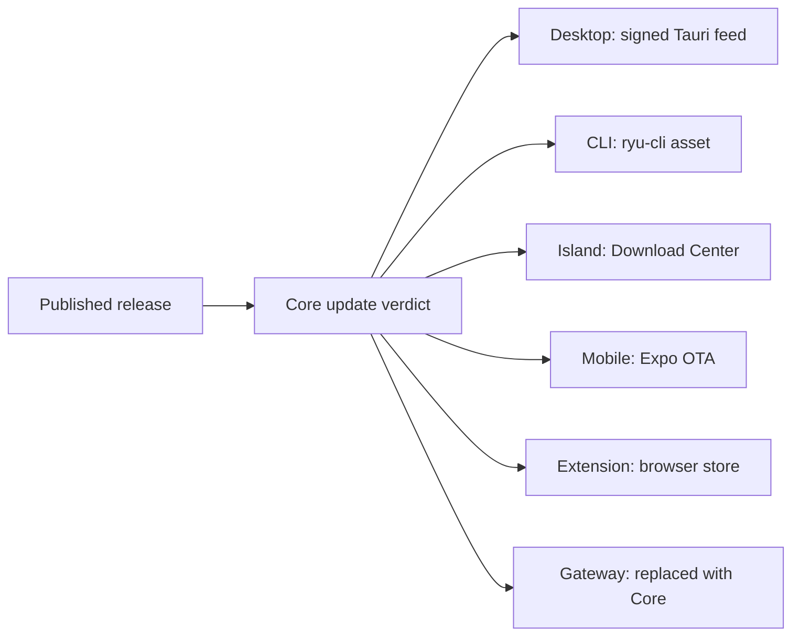
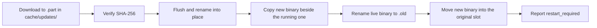

Core computes one update verdict for every surface that talks to it: Desktop, web app, CLI, Gateway,
Island, browser extension, and mobile. The install mechanism stays platform-specific. This page is
for operators and client developers.

Per the [Core vs Gateway](/docs/start-here/architecture/core-vs-gateway) rule, deciding what runs
(including which build of the binaries runs) is Core's job. The Gateway governs what is allowed,
measured, and paid, never the install lifecycle.

For the Stable, Beta, Nightly, Canary, and local Dev comparison, including local data roots and sharing boundaries, see
[Ryu Release Channels](/docs/start-here/release-channels).

## One verdict, native install

Each Stable Ryu release uses a **single release train**. One git tag (`vX.Y.Z`) builds and publishes
every binary together, so `core`, `gateway`, `cli`, and `desktop` share a version.

- Canary and Nightly are separate prerelease trains with versioned suffixes and their own feeds.
- Beta is currently backed by the signed Stable feed.
- Dev is a local build rather than a published train.

Core's own crate version (`CARGO_PKG_VERSION`) is therefore the canonical version for the build that
answers an update check; `current_version()` returns it. Every client reads Core's verdict instead
of polling GitHub releases itself. Only the install path differs.

| Surface | Mechanism | Behavior |
|---|---|---|
| Desktop (Tauri) | Signed Tauri updater feed with a durable, one-artifact cache | By default, eligible updates download and verify in the background. Ryu then asks before installing and restarting. See [Desktop first-run check](#desktop-first-run-check) |
| Web app (browser) | Deployment refresh | Picks up a new deployment through the browser's normal reload. It shows no native-app update step and never claims a desktop bundle is current |
| CLI (`ryu-cli` terminal client) | Official `ryu-cli` release asset with SHA-256 verification | When the shared `auto-updates` preference is on, checks its channel in the background, stages the matching binary, and installs it for the next launch. A running session is not interrupted; source and development runs skip self-update |
| Browser extension | Browser add-on store | The browser manages package updates for store installs. Ryu's release toast is for the connected Core node; the extension does not install its own package. Unpacked development installs update by reloading the development build |
| Island (Electron) | Core `DownloadCenter` for the managed bundle, plus `electron-updater` when the companion is running | See [Island](#island-and-the-electron-companion) |
| Mobile (Expo) | `expo-updates` (EAS OTA) | Settings controls automatic launch checks. Enabled updates download and reload automatically; manual checks remain available. Native-code changes still require an App Store or Play Store build |
| Gateway (Rust) | Updated with Core (managed sidecar) | Ships in the same release, replaced when Core is |

Core owns the shared verdict and the verified update API. The terminal client applies its own
`ryu-cli` asset, while Core applies updates to the binaries it runs.

## Desktop first-run check

After a user presses **Get Started** and completes device sign-in, onboarding opens on an update step.
It runs before the choice to run locally, use Ryu Cloud, or connect to an existing node.

- The step checks the signed-in user's Core verdict and compares it against the running desktop
  bundle.
- **Continue** stays available even when Core or the release service is unreachable.
- An unknown result is shown as "Couldn't check for updates," never as a false "up to date" claim.
- Browser builds skip this step, because a web deployment cannot install a Tauri bundle.

## Desktop update settings

The step and App Settings share the Desktop-local **Download updates automatically** preference. It
defaults to on and controls only whether this desktop downloads an eligible app bundle in advance.

- After download and signature verification, App Settings and the persistent update notice offer
  **Install and restart**. Ryu never treats the download preference as permission to install.
- Turning the preference off changes the first action to **Download update**.
- The choice is saved on this device, in the order you make changes. If your latest change cannot be
  saved, the switch returns to the last saved value and explains the failure.

The Tauri app keeps at most one prepared update:

- It survives an app restart, and its signature is checked again immediately before installation.
- It stays ready if installation is canceled or the installer fails, so you can retry.
- An obsolete release or changed signed feed requires downloading again. A preparation response for a
  different release is rejected; check for updates again before installing.
- An interrupted or invalid download is never offered for installation. If a signed feed is
  unavailable, Ryu keeps working and offers the manual download page.

This preference does not change whether a server updates its Core or Gateway binaries; Core and
remote-node automatic updates are a separate policy. The Chrome extension is notify-only, mobile uses
its own device setting for Expo OTA, and the web app has no binary toggle.

## Checking for an update

| Endpoint | Purpose |
|---|---|
| [`GET /api/version`](/docs/extend/develop/api-reference/core/health/get_version) | Installed version, the per-component build list, the running `os-arch` platform, and `features` a client checks before relying on them (`web_delegated_ext` means the node accepts app requests from the Ryu web app) |
| [`GET /api/update/check`](/docs/extend/develop/api-reference/core/health/update_check) | Compares the installed version against the latest release on its channel and returns the verdict |
| [`POST /api/update/apply`](/docs/extend/develop/api-reference/core/health/update_apply) | Downloads and installs an update for the headless binaries |

`GET /api/update/check` accepts two optional query parameters:

| Parameter | Meaning |
|---|---|
| `channel` | `stable`, `beta`, `nightly`, or `canary`. Defaults to the running build's channel; comparisons stay within it |
| `updates_until` | An RFC-3339 cutoff. Only releases published at or before it are offered. Advisory: Core declines to offer a newer build but cannot prevent one |

Core compares semver (a malformed tag parses to `(0,0,0)`, so it never claims to be newer than a real
version) and picks this platform's standalone Core binary. It returns an `UpdateCheck` object:

| Field | Meaning |
|---|---|
| `current` | Currently installed Ryu version |
| `latest` | Latest published release on the channel, with a leading `v` stripped |
| `channel` | The channel the verdict was computed on |
| `update_available` | `true` only when `latest` is strictly newer than `current` |
| `notes` | The GitHub release body, if any |
| `html_url` | Link to the human-readable release page |
| `asset` | This platform's Core binary (`name`, `url`, `kind`, `size`), when the release publishes one |
| `tag`, `published_at` | The release's git tag and publish time. Use `tag`, never `v{latest}`, to address a specific release |
| `latest_unrestricted` | The newest release ignoring `updates_until` |
| `restricted_by_cutoff`, `cutoff_waived_for_security`, `cutoff_unresolved` | Whether the cutoff held `latest` back, whether a later security release was offered anyway, and whether no eligible release could be resolved |

`asset` is matched by exact name: `ryu-core-<os>-<arch>` (with `.exe` on Windows), for example
`ryu-core-linux-x86_64` or `ryu-core-windows-x86_64.exe`. A release also carries the Gateway, CLI, app
binaries, checksums, and desktop installers, so Core never guesses among them. When the release has
no Core binary for this platform, `asset` is `null`.

The `kind` is `exe` for the Core binary and is otherwise inferred from the extension (`msi`, `exe`,
`dmg`, `appimage`, `deb`, `archive`, or `unknown`).

<Callout type="info">
  The check **fails open** for launch safety: a network or API error returns `200` with
  `update_available: false` and an `error` field, and never blocks the app. Surface clients still
  distinguish "unknown" from a genuine no-update verdict, so they do not tell users that they are
  current when the service could not answer.
</Callout>

## Applying an update

For the headless binaries, `POST /api/update/apply` stages the asset and either self-replaces or
hands the path back:

- **Core binary.** Swapped in place on Windows, macOS, and Linux, then `restart_required` is reported.
  A Core running inside the macOS desktop app bundle is not swapped, because the desktop updater owns
  that bundle.
- **Gateway binary.** When the Gateway Core launches (`RYU_GATEWAY_BIN`, or `ryu-gateway` on `PATH`)
  is installed outside an app bundle, the matching `ryu-gateway-<os>-<arch>` from the same release is
  verified and swapped in alongside Core. If only Core could be updated, the response says so.
- **Other executables or archives.** Staged, and the path returned without replacing Core.
- **OS installers** (`msi`, `dmg`, `deb`, `appimage`). Staged to disk and the path returned. The
  client runs the platform installer; Core does not launch GUI installers itself.

The swap renames the live binary aside to `<exe>.old` and moves the new binary into its slot. If the
final move fails, the old binary is restored. The previous executable is removed on the next launch.

The download stages atomically in `cache/updates/` under the data dir (`~/.ryu` on the release
profile). Core writes to a `.part` file, verifies its checksum, flushes it to disk, then renames it
into place. On macOS and Linux the staging folder is flushed after the rename, so a staged update
reported complete survives a power loss.

### Restarting after a deferred update

An update deferred to the node's quiet hour installs then, but the new binary only runs after Core
restarts. On a node run under a process supervisor (systemd, a container restart policy), set
`RYU_RESTART_AFTER_UPDATE=1`. Then:

- Core shuts down gracefully after a deferred update, stopping the Gateway and sidecars.
- Core exits with code `75`, so the supervisor starts the new build.
- Core skips the restart when the Gateway was not updated with it, so it never pairs the new Core
  with the old Gateway.

Leave the variable unset on an unsupervised node, where exiting would leave Core stopped.

### Island and the Electron companion

The Island bundle is a Core-managed artifact. Desktop and one-line setup stage its first install and
refresh through the global Download Center with a release checksum, so progress, pause and resume, retry, cancellation, and durable history
are shared with models and sidecars.

- Island stays stopped while the feature is disabled; downloading its bundle does not launch it.
- Desktop keeps no second direct downloader, so an older Core without this verified installer must
  be updated before Island can be installed.
- Once enabled, the running companion reads the shared `auto-updates` preference. Disabled updates
  stay available without an unattended install.
- Enabled updates complete after the signed download. On Windows the companion runs the NSIS updater
  in silent mode and relaunches. Windows can still show a UAC prompt when the install location needs
  administrator approval.

## Verified update downloads

Applying, scheduling, or canceling a node update requires node-management permission on managed or
organization-bound nodes. The headless apply API accepts only assets from Ryu's official published
releases.

Before staging a download, Core checks the filename, release tag, asset URL, size, and SHA-256 digest
against fresh release metadata. The downloaded bytes must match that digest before an installer
handoff or binary replacement. Missing digests, unpublished assets, and mismatches stop the update;
they never fall back to an unchecked download.

## Updates while work is running

Downloading an update keeps the current app and its running work available.

### Managed runtime set

When Desktop manages the local runtime, it prepares Core, Gateway, and CLI as one release set:

- Every binary must pass checksum and version checks before the app installer starts.
- The next launch selects the complete matching set together.
- A failed preparation leaves the active runtime unchanged. Ryu refuses to start a mismatched managed
  set after a failed install.
- Prepared files are checked against their saved SHA-256 digests before reuse. Changed or incomplete
  files are prepared again.
- Prepared runtimes follow the target build's profile. Canary and Nightly keep runtime files in
  their own profile folders. Explicit profile or data-folder
  overrides remain authoritative.

### Installing the app update

Installing a packaged desktop update restarts the app and can stop local chats, tools, workflows, and
work waiting for approval. Ryu warns before installation and offers **Keep working**. Cancelling keeps
the verified update ready for later.

- If cancelling a scheduled update fails, its schedule stays visible and you can retry. Ryu does not
  report it as cancelled until the saved schedule is cleared.
- A delayed check or download does not restore an older ready notice after you clear it or prepare a
  newer update.
- Once you approve, Ryu pauses its owned local runtime and blocks runtime starts and data-folder
  changes during the update. If the installer reports an error, Ryu tries to restart the previous
  runtime and keeps the update for retry.
- Windows installers keep the current installation folder, including paths with spaces. Recovery
  reinstalls the previous package into that same folder.

Remote nodes continue running. Local Dev reloads retain their separate execution runtime, as
described in [Chat basics](/docs/surfaces/desktop/user-guide/chat-basics).

### Pi agent runtime

The managed Ryu agent's Pi runtime updates separately. Ryu installs the entire dependency tree into a
new directory and checks that its SDKs load before selecting it.

Existing agent processes keep their original runtime files; newly spawned processes use the selected
generation. A failed install or validation leaves the previous runtime available. Previous
generations are retained so running work can still use them, which needs extra disk space.

<Callout type="warn">
  Runtime preparation and selection are transactional. The native desktop application installer
  remains platform-specific: Ryu does not yet guarantee automatic restoration of the desktop
  executable or database migrations if an installed release fails to start. A reported installer
  failure keeps the prepared update for retry.
</Callout>

### Recovery checkpoints

Ryu checks the prepared update before replacing the running app. If preparation fails, the update
remains available for retry and Ryu reports the failure. A failed preparation does not mean the new
version was installed.

Preparation needs free disk space for a data checkpoint and rollback files. Its time depends on the
total size and the number of files. Large model files and
folders with many small runtime files take longer to copy and verify. If the checkpoint cannot be
prepared, the app installer does not start.

After a normal app start, background maintenance keeps the two most recent verified checkpoints for
the current profile. Cleanup is conservative:

- Pending updates and checkpoints still owned by a recovery process are preserved.
- Configured profile data locations are protected, including profiles that are not running.
- Redundant rollback copies are removed only when their ownership can be proved. Replaced or older
  unidentified folders are preserved, and failed integrity checks defer cleanup.
- Temporary restore copies left by a crash are removed only after their update finishes and their
  recorded filesystem identity still matches. Copies owned by another profile or overlapping a
  configured data location remain protected.
- Abandoned checkpoint captures are removed only when an ownership record proves that publication and
  installation never began.
- Verified installer history is kept while current releases, retained checkpoints, prepared updates,
  or unfinished handoffs reference it. Unknown older files are preserved.

Preparation refuses oversized metadata, or directory trees that are too deep or too wide, before it
starts the installer (`crates/core/runtime-install/src/recovery.rs`). File contents are streamed, not
loaded into memory, and have no size limit.

| Limit | Value |
|---|---|
| Captured roots per transaction | 128 |
| Directory depth per root | 64 |
| Entries per root | 100,000 |
| Cumulative encoded path names per root | 64 MiB |

To keep development profiles and custom feeds separate from everyday data, see
[Updates and Profile Data](/docs/extend/develop/update-recovery).

## Desktop signing

The desktop updater verifies a minisign signature on every downloaded artifact using the public key
embedded in the installed app. The private release key stays outside the source repository. A
prepared artifact is verified again immediately before installation, so changed cached bytes make
the update invalid.

<Callout type="warn">
  Automatic desktop installation requires a newer published artifact signed by the release key that
  the installed app trusts. If a future release must use a different key, existing installations may
  need a one-time manual reinstall before automatic downloads can continue.
</Callout>

The desktop minisign key covers only desktop updates. Managed cloud computers use a separate scheme:
each stable release can include a list of checksums for its Linux binaries, signed with a different
key. When that signing is enabled, a managed cloud computer installs a release only if the list
verifies.

Release signing for cloud computers is not enabled yet, so they currently report new releases
without installing them automatically. See
[Cloud Computer SSH and Updates](/docs/core/cloud-computer-ssh-and-updates) for the update schedule.

<Cards>
  <DocCard href="/docs/extend/develop/api-reference/core/health/update_check" />
  <DocCard href="/docs/extend/develop/api-reference/core/health/update_apply" />
  <DocCard href="/docs/core/node-and-presence" />
  <DocCard href="/docs/surfaces/desktop/user-guide/data-and-storage" />
</Cards>
