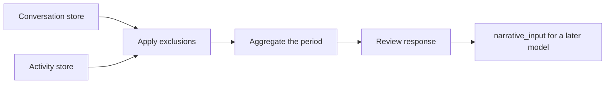

Usage review is a Core endpoint that summarizes your recent conversations and activity on request.
Core builds the review from its existing conversation and activity stores
(`apps/core/src/server/usage_review.rs`). It adds no telemetry, no background capture, and no LLM
call.



| Route | Purpose |
|---|---|
| `GET /api/usage-review/settings` | Read the privacy settings |
| `PUT /api/usage-review/settings` | Replace the privacy settings |
| `GET /api/usage-review` | Build a review for a period |

## Privacy settings

<Callout type="warn">
Usage review is off by default. Turn it on with `PUT /api/usage-review/settings`. While it is off,
`GET /api/usage-review` returns `403` with the error `usage_review_disabled`.
</Callout>

The settings can exclude:

- conversation ids (up to 1,000);
- activity kinds and activity sources (up to 100 each);
- message excerpts.

Exclusions apply before aggregation. Core stores the settings in its existing preferences database.

```json
{
  "enabled": true,
  "excluded_conversation_ids": ["conversation-to-leave-out"],
  "excluded_activity_kinds": ["meeting"],
  "excluded_activity_sources": [],
  "include_message_excerpts": false
}
```

Message excerpts are off by default. Topic labels can still use an existing conversation title or
the first user turn. The review never returns full transcripts.

## Review endpoint

`GET /api/usage-review` accepts optional Unix epoch millisecond bounds.

| Parameter | Meaning | Default |
|---|---|---|
| `from` | Inclusive start | Seven days before `to` |
| `to` | Exclusive end | Now |

A period can be at most 90 days.

The response contains:

- period metrics and UTC daily buckets;
- topic summaries and workflow summaries;
- activity counts;
- non-scoring AI-fluency observations, such as iterative refinement, tool orchestration, workflow
  continuity, and multi-agent collaboration.

The observations are evidence-based signals. They are not productivity, identity, or emotional
judgments.

The `narrative_input` field repeats the bounded structured data with a grounding instruction for a
later narrative model. Core does not call that model from this endpoint.

## Related

- [Conversations and sessions](/docs/core/conversations-sessions)
- [Observability](/docs/core/observability)
- [Gateway audit log](/docs/gateway/audit)
- [Core usage-review API](/docs/extend/develop/api-reference/core/usage-review)
