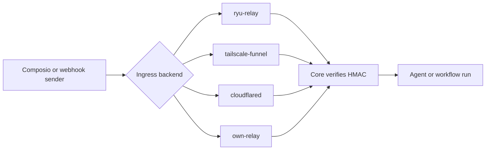
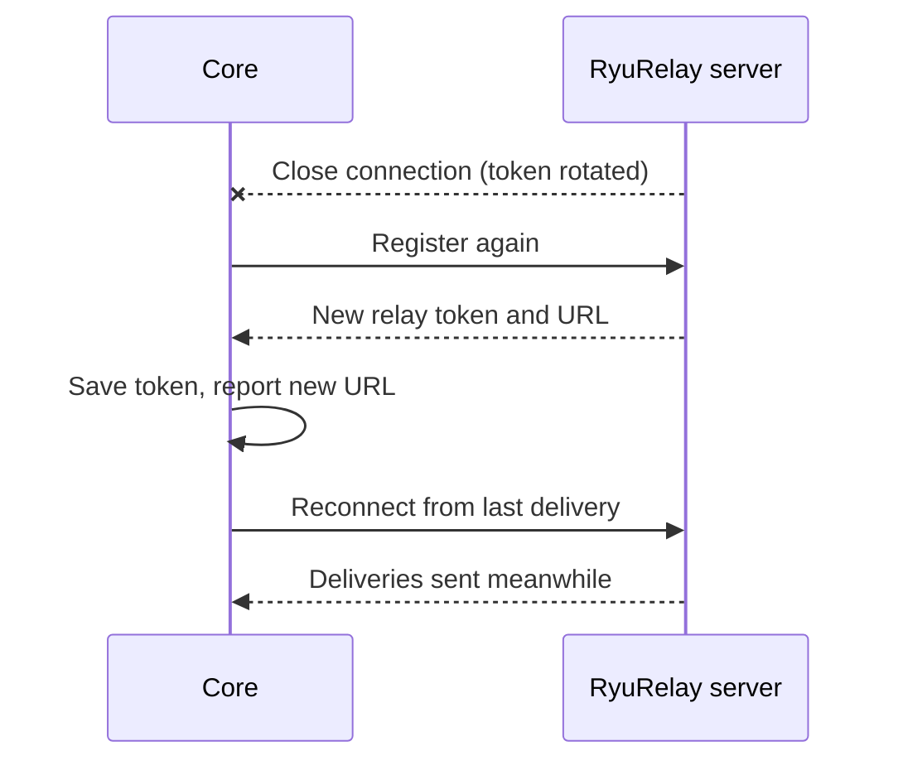

The webhook ingress seam (`crates/core/webhook-ingress/`, wired in `apps/core/src/webhook_ingress.rs`)
gives Composio triggers and workflow webhooks a public URL to call. It is a swappable
`WebhookIngress` source. A node can expose Core through its own relay, the mesh Funnel, a tunnel, or
a Ryu-hosted relay without changing the rest of the stack.

## Backends

The backend selector resolves in this order:

1. the `RYU_WEBHOOK_INGRESS_URL` env override, which pins `own-relay`;
2. the `webhook.ingress.backend` preference;
3. the default, `ryu-relay`.

| Backend (`IngressKind`) | What it is |
|---|---|
| `ryu-relay` | Ryu-hosted managed push (an outbound SSE client into `composio_triggers`). The default |
| `tailscale-funnel` | Publishes only Core's webhook paths over the mesh's Tailscale Funnel (needs the mesh enabled). See [Tailscale Funnel scope](/docs/core/private-networking#tailscale-funnel-scope) |
| `cloudflared` | A Cloudflare tunnel in front of Core. It exposes every Core route, so [local-only features](/docs/core/private-networking#local-only-features-while-a-tunnel-runs) pause while it runs |
| `own-relay` | Bring your own: you already expose Core at a public URL, configured with `RYU_WEBHOOK_INGRESS_URL` or the `webhook.ingress.url` preference |

## Status and backend routes

| Route | Purpose |
|---|---|
| `GET /api/webhook-ingress/status` | The active backend `kind`, its resolved `public_url` (or `null`), `up` (true once a public URL has been resolved), and a `reason` when one applies |
| `GET /api/webhook-ingress/backend` | The configured `backend`, the `default`, and the `available` backends |
| `POST /api/webhook-ingress/backend` | Select a backend with `{ "backend": "<kind>" }`. The change takes effect on the next Core start |

`POST /api/webhook-ingress/backend` refuses selections that could not take effect:

| Status | When |
|---|---|
| `400` | An unknown backend, `own-relay` with no usable public URL, or `ryu-relay` with no known Ryu server |
| `409` | `RYU_WEBHOOK_INGRESS_URL` pins the backend to `own-relay` and you select a different backend |

## Webhook endpoints and secrets

| Route | Purpose |
|---|---|
| `GET /api/webhooks` | Every inbound webhook receiver on this node (the Composio webhook and each workflow with a `webhook` trigger), with its resolved public URL, whether a secret is configured, and its last delivery time. It never includes secret values |
| `GET /api/webhooks/:id/secret` | Read one endpoint's signing secret (`id` is `composio` or a workflow id) |
| `POST /api/webhooks/:id/secret` | Set a workflow's secret with `{ "secret": "..." }` (16 to 512 characters), or omit it to mint a fresh one. Returns `404` when the workflow has no `webhook` trigger |

The secret routes require `workflow.edit` on that workflow, or `gateway.configure` for `composio`.
You cannot set the `composio` secret by hand (`409`). Composio manages it through the project
webhook subscription, and saving a Composio trigger syncs it.
For the workflow webhook signing format, see
[Webhook signing](/docs/core/workflow-triggers-and-history#webhook-signing).

## RyuRelay

### Sign-in and server

RyuRelay connects to the Ryu server you signed in to and authenticates with your sign-in token. To
use a different server, set `RYU_BACKEND_URL`, which takes precedence. It has no default address.

Until you sign in or set `RYU_BACKEND_URL`, Core does not start RyuRelay or send your token. In that
state:

- selecting `ryu-relay` is refused with `400`;
- `GET /api/webhook-ingress/status` reports no public URL and a `reason` of `no_ryu_server`.

### Replay buffer

RyuRelay keeps a short replay buffer for reconnecting nodes, up to five minutes and subject to a
shared memory budget. Older buffered deliveries may be evicted sooner under load. Core still verifies
each delivery before running a workflow.

- Each account can register up to 64 relay nodes.
- A delivery with no webhook signature header is refused with `401` before buffering, because Core
  would reject it.
- When an account's replay space is full, the account's node holding the most replay gives up its
  oldest deliveries. New deliveries are not refused.
- When the shared buffer is full, an account above its fair share is refused. Its oldest deliveries
  make room for accounts within theirs.

### Rotate a relay URL

To replace a node's relay URL, for example after it leaked, send `POST /api/composio-relay/rotate` to
the Ryu server. Authenticate as the account that registered the node (the same bearer token Core
uses).

- The optional JSON body `{ "node_name": "<node>" }` selects the node. The default is `default`.
- The response returns the new `relay_token` and `public_url`.
- Each account can rotate up to 10 times a minute.

The old URL stops working at once. Deliveries to it get `404`, replay buffered for it is discarded,
and Core's open relay connection is closed.

### How Core recovers from a rotation

Core recovers by itself, without a restart.

1. The relay closes or drops the connection, or refuses it because the token was rotated or the node
   is no longer registered.
2. Core registers again before it reconnects.
3. Core saves the new token and reports the new URL from `GET /api/webhook-ingress/status` and
   `GET /api/webhooks`.
4. Core resumes from the last delivery it received, so deliveries sent to the new URL in the meantime
   still arrive.

If Core was disconnected or stopped during the rotation, it picks up the new URL when it reconnects
or starts. Other failures, such as an expired sign-in or a relay outage, only retry with a growing
delay.

When Core manages your Composio webhook subscription (a Composio key under **Settings →
Integrations** and at least one trigger subscription), Core also points that subscription at the new
URL.

<Callout type="warn">
  Any other webhook still sending to the old URL keeps getting `404` until you replace it. For
  example, update a workflow webhook URL you gave a third-party service to the new URL that Core
  shows.
</Callout>

## HMAC verification

<Callout type="warn">
The public ingress is **HMAC fail-closed**. Composio deliveries require the signed
webhook ID, timestamp, and exact raw body, with a five-minute replay window. The
`ryu-relay` backend transports those values to Core unchanged; Core performs the
project-secret verification before dispatching a run.
</Callout>

## Related

<Cards>
  <DocCard href="/docs/core/private-networking" />
  <DocCard href="/docs/core/workflow-triggers-and-history" />
  <DocCard href="/docs/core/node-and-presence" />
</Cards>
