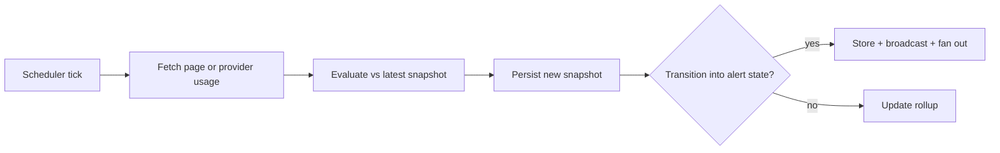
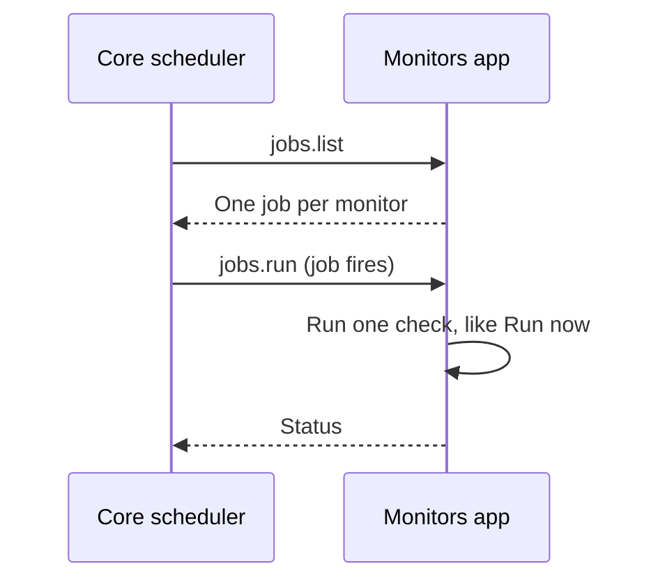

The Monitors app (`@ryu/monitors`) watches websites or provider usage on a schedule and alerts when
a watched signal changes. Website checks fetch a URL and extract one signal. Provider reset checks use Core's
normalized usage reader, then compare selected windows and credit balances against the latest
**snapshot**, the state kept between runs.

The engine, store, and HTTP routes run in the app's own backend process
(`apps-store/monitors/backend/`). Core schedules checks and delivers alerts for it. For the desktop
how-to (creating a monitor, choosing a check type, wiring notifications), see
[Monitors](/docs/surfaces/desktop/productivity/monitors).

<TryInRyu page="monitors" />

## Pipeline

Each scheduled tick (or a manual `POST /api/monitors/:id/run`) runs `MonitorEngine::run_monitor`
(`apps-store/monitors/backend/src/lib.rs`):

A check alerts on a **transition** into an alert state, not on every interval that it stays in
that state.

A provider reset watch saves its first successful snapshot without an alert. Later checks alert when
they detect any of these:

- a selected usage window dropping to near zero;
- a usage drop of at least the configured minimum;
- a reset boundary passing with a refill;
- a selected API-credit balance increasing.

This also catches provider-initiated resets that happen before the old `resetsAt` timestamp.
Detection latency is bounded by the monitor interval. Reset watches default to five minutes and
cannot poll more often than once per minute.

## Check types

`CheckType` (`apps-store/monitors/backend/src/lib.rs`, serde tag `type`) lists the check types.

| `type` | Watches | Key fields | Snapshot `value` |
|---|---|---|---|
| `uptime` | Reachability | `expect_status` (empty = any 2xx/3xx counts as up) | `up` / `down` |
| `keyword` | A substring or regex in page text | `pattern`, `is_regex`, `case_sensitive`, `alert_when_present` | `present` / `absent` |
| `content_diff` | Any change to (optionally scoped) page text | `region_regex` (capture group 1 scopes the watched region) | char count (hash stored separately) |
| `price` | A numeric value crossing a rule | `extract_regex` (group 1 is the number), `comparator`, `threshold` | the parsed number |
| `stock` | Availability by phrase | `in_stock_pattern`, `is_regex`, `alert_when_in_stock` | `in_stock` / `out_of_stock` |
| `provider_usage_reset` | Selected provider usage windows or credit meter values | `provider_id`, `account_id` (optional), `target_ids`, `minimum_drop_percent` | The provider, the account that was read, and the selected normalized values and reset timestamps |

How a `provider_usage_reset` check reads usage:

- `provider_id` comes from the live `usage.providers` catalog.
- `target_ids` come from the provider's current usage snapshot. Windows and meter values each have a
  stable `targetId`.
- The monitor calls the same read-only `usage.query` reader as Core's agent tools, so credentials
  remain inside Core.
- Unsupported, expired, rate-limited, and not-logged-in states stay visible as check errors. They do
  not replace the last successful baseline.

### Account scope

`account_id` chooses which saved provider account a reset watch reads:

- **Omitted** - follow the active account. Each check reads whichever account is active and stores
  that account's identifier with the snapshot. When the active account changes, the check compares
  nothing: it records a new baseline with the note "Provider account changed" and raises no alert,
  because a fresh login's low usage is not a reset.
- **Set** - read exactly that saved account. Another account becoming active does not affect the
  watch. An identifier that is no longer saved fails the check with `account_not_found`; the engine
  never substitutes a different account, and a reading attributed to another account is rejected.

A baseline is compared only when both its provider and its account identifier match the current
reading. Snapshots written before account scoping carry no account identifier, so those monitors
record a fresh baseline on their first check.

Snapshots and alerts store identifiers only, never account names, which can be email addresses.
Alert titles stay `<monitor name> reset detected`.

Per-account readings cover Claude Pro/Max, ChatGPT, OpenAI Codex, and GitHub Copilot. ChatGPT plan,
Kiro, Kimi, Radius, Ant Ling, and agent CLI logins report no per-account usage, so watches for them
follow the active account.

### Price comparators

`price` checks compare the extracted number against the previous snapshot with `NumComparator`.

| `comparator` | Alerts when | Uses `threshold` |
|---|---|---|
| `changed` | The value differs from the previous one | no |
| `less_than` | The value crosses below `threshold` | yes |
| `greater_than` | The value crosses above `threshold` | yes |
| `drops_by_pct` | The value drops by at least `threshold` percent | yes |
| `rises_by_pct` | The value rises by at least `threshold` percent | yes |

The number parser (`parse_number`) strips currency symbols and thousands separators, keeping
digits, a single `.` decimal point, and a leading minus.

<Callout type="warn">
The price parser treats `.` as the decimal point and is not locale-aware: a European
comma-decimal value (`1.299,00`) is not supported. Use an `extract_regex` that captures a
dot-decimal number.
</Callout>

## Fetch backends

`FetchBackend` (`apps-store/monitors/backend/src/lib.rs`) selects where the page comes from. The
default is `http`.

| `backend` | How it fetches | Notes |
|---|---|---|
| `http` | A guarded GET through the shared egress client (30s timeout, SSRF screening, at most 5 redirects, 5 MB body cap) | Fast; no JavaScript rendering |
| `spider` | The Spider crawler (`spider.crawl`), called through Core's MCP registry | For sites that need a real crawl. The URL is screened first |
| `agentbrowser` | Not integrated | Returns an error |

<Callout type="warn">
The `agentbrowser` backend is a stub. It returns an error that directs you to `http` or `spider`.
The `spider` backend requires the Spider tool to be available in the [MCP registry](/docs/core/mcp-registry); when it is not, the check fails with the tool's own reason.
</Callout>

`uptime` is special: a fetch failure *is* the signal (it means "down"), so it evaluates the fetch
result directly rather than short-circuiting to an `error` status. Every other check type returns
`error` (no alert) when the fetch fails.

## Snapshots and storage

Every check persists a `Snapshot` row in `plugin-data/@ryu+monitors/monitors.db` under the data dir
(the app's own data folder). The next check reads back the latest one as its baseline. Three tables
back the engine (`apps-store/monitors/backend/src/store.rs`):

| Table | Holds |
|---|---|
| `monitors` | The watched-site definitions (url, check type, interval), each stored as JSON |
| `snapshots` | One row per check: status, http status, latency, value, content hash, note |
| `alerts` | Change events surfaced to the user |

Mobile push tokens are not stored here. Core keeps them in its notification store and registers them
at `/api/notifications/push-tokens`.

Each snapshot carries a `CheckStatus` value:

| `CheckStatus` | Meaning |
|---|---|
| `ok` | Checked, no alert |
| `triggered` | An alert condition was met |
| `error` | The check could not complete |

For `content_diff`, the comparison baseline is the SHA-256 `content_hash` of the normalized text, not
the `value`. The monitor row also keeps a rollup (`last_check_at`, `last_status`, `last_value`)
updated after each check.

## Notification fan-out

When a check trips an alert, the app stores it and broadcasts it to the SSE endpoint (the desktop
in-app feed plus OS toast). The app then hands the alert back to Core, and Core's
`notify::notify_all` (`apps/core/src/notify/mod.rs`) sends it to every per-monitor `NotifyTarget`
plus all globally registered Expo push tokens.

| `NotifyTarget` (`kind`) | Sends to | Mechanism |
|---|---|---|
| `webhook` | Slack / Discord incoming webhooks or any HTTP endpoint | A JSON POST carrying both `text` and `content` plus the structured `alert` |
| `telegram` | A Telegram chat | `sendMessage` via the Bot API (`bot_token`, `chat_id`) |
| `expo_push` | A specific Expo push token | The Expo push API, in addition to globally registered devices |
| `email` | An email recipient | The node's configured SMTP transport; only the recipient is stored in the monitor |

Every send is best-effort: a failing target logs a warning and never blocks the check or the other
targets.

## Scheduler tie-in

A monitor does not run its own loop. The Monitors app lists every monitor as a scheduled job
through the generic `jobs.list` capability. Core keeps one `app_job` per monitor, named
`monitor: <name>`, so monitors ride the same tick loop as workflows and agents (see
[App-owned jobs](/docs/core/scheduler#app-owned-jobs)).

The interval string maps to a scheduler schedule:

| `interval` | Schedule |
|---|---|
| A humantime duration (`5m`, `1h`) | An `every` schedule. Core raises an interval shorter than one minute to one minute |
| Anything else | A cron expression |
| Empty | Every five minutes |

Job lifecycle:

- When the job fires, Core calls the app's `jobs.run` capability, which runs one check exactly like
  **Run now**.
- Disabling a monitor disables (keeps) the job.
- Deleting a monitor removes its snapshots and alerts. Core removes the job on its next reconcile,
  within about 30 seconds.
- While the Monitors app is disabled, its jobs are kept but skipped.
- A monitor created before app jobs keeps its job id (`monitor-<id>`) and its run history.

See [Scheduler](/docs/core/scheduler) for the tick loop itself.

## Routes

All routes are under `/api/monitors`, the app's `public_mount` (`apps-store/monitors/backend/src/api.rs`).

| Method + path | Purpose |
|---|---|
| `GET /api/monitors` | List all monitors (newest first) |
| `POST /api/monitors` | Create a monitor and its backing job |
| `GET /api/monitors/:id` | One monitor |
| `PUT /api/monitors/:id` | Replace a monitor's definition |
| `DELETE /api/monitors/:id` | Remove a monitor, its history, and its job |
| `POST /api/monitors/:id/run` | Run one check immediately, return the status |
| `GET /api/monitors/:id/snapshots?limit=N` | Recent check history |
| `GET /api/monitors/:id/alerts` | Alerts for one monitor |
| `GET /api/monitors/alerts?limit=N` | The global alert feed |
| `GET /api/monitors/alerts/stream` | SSE feed of new alerts as they fire |
| `POST /api/monitors/alerts/:id/ack` | Acknowledge an alert |
| `GET /api/monitors/usage/providers` | List provider IDs with a supported normalized usage reader |
| `POST /api/monitors/usage/query` | Read one provider's current usage windows and credit meters, for the active account or an optional `account_id` |

Core also calls four capability-only routes: `POST /api/monitors/list` (`jobs.list`),
`POST /api/monitors/run` (`jobs.run`), and `POST /api/monitors/data/count` and
`POST /api/monitors/data/purge` (`data.count` and `data.purge`, behind the Danger Zone row). They stay
out of the OpenAPI document, so they never become agent tools.

## Caveats

Mobile delivery requires that the Ryu mobile app has registered a push token. Webhook, Telegram,
and email targets are configured per monitor and do not depend on mobile push registration.

## Related

<Cards>
  <DocCard href="/docs/surfaces/desktop/productivity/monitors" />
  <DocCard href="/docs/core/scheduler" />
  <DocCard href="/docs/core/mcp-registry" />
</Cards>
