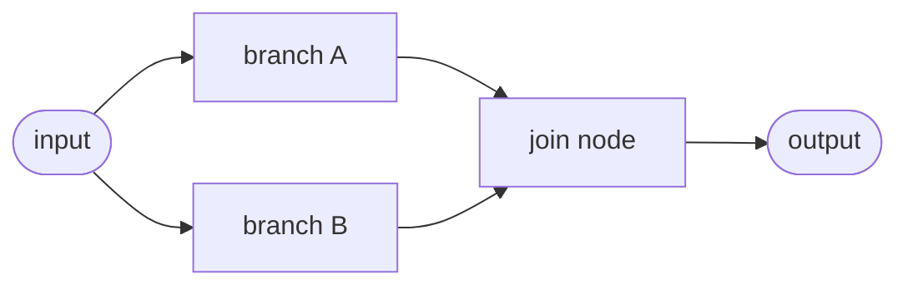
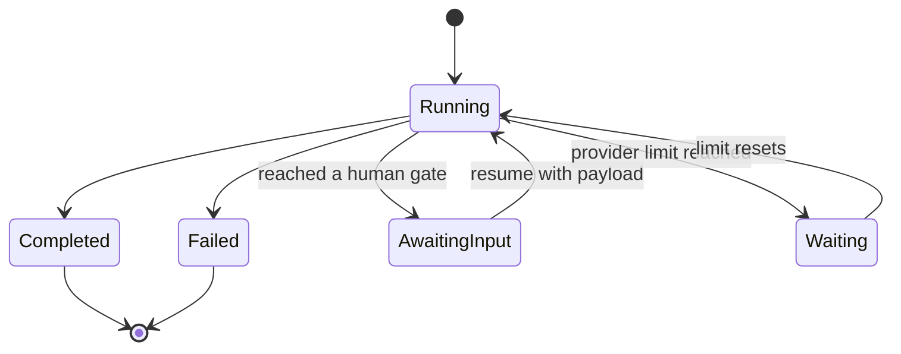
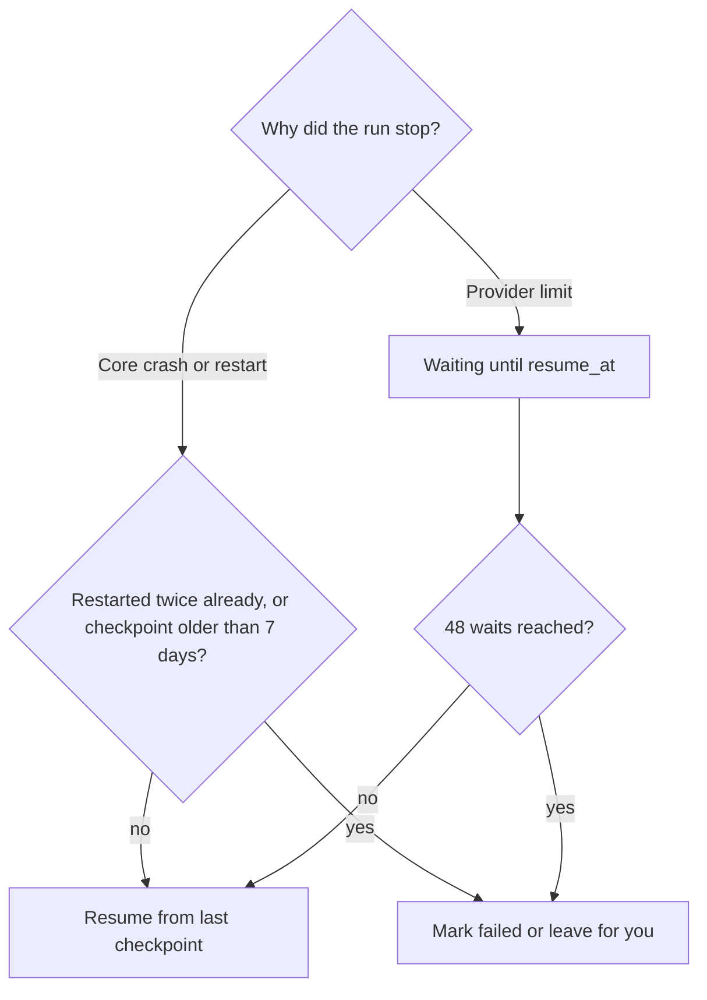

Core runs a workflow graph in dependency order and checkpoints every node, so a run can pause,
retry, and resume after a restart. Run history stays on the node. For node kinds and template
variables, see [Workflows](/docs/core/workflows).

## Execution and resume

### Concurrent branches

Nodes that do not depend on each other run at the same time. When the `input` node feeds two
independent branches, both start together. A node that joins them waits until every incoming edge
has resolved.

A branch that a `condition` prunes still counts as resolved, so a join after a `condition` never
waits for the branch that was not taken.



The workflow's top-level `max_concurrency` field caps how many nodes of one run execute at once. It
defaults to 4 and is clamped between 1 and 16. Set it to `1` to run one node at a time:

```json
{
  "id": "wf_research",
  "name": "Research",
  "max_concurrency": 2,
  "nodes": [],
  "edges": []
}
```

Each node is still checkpointed on its own. Its progress, retries, and durable timers are saved as
it runs, whichever order concurrent branches finish in.

When a node fails, suspends at a human gate, or hits a provider limit, no new node starts. The
nodes already running finish and are saved first. Then the run fails, waits for input, or waits for
the limit to reset.

<Callout type="warn">
  If two concurrent branches write the same `state` key, the branch that finishes last wins. Give
  concurrent branches their own keys.
</Callout>

State keys beginning with `__workflow_`, `__repeat_`, `__loop_`, or `__fanout_` are reserved for
durable execution metadata. `set_state` nodes cannot write them.

### Run states

A run carries a `RunStatus` of `Running`, `Completed`, `Failed`, `AwaitingInput`, or `Waiting`.

| Status | Entered when |
|---|---|
| `AwaitingInput` | The run reaches an `awakeable` node, or a `notify_user` node whose `ack_mode` requires waiting. It waits for a human or an external signal |
| `Waiting` | A step hits a provider rate, usage, or session limit. It waits until the limit resets (see [Automatic resume](#automatic-resume)) |

Because node state is persisted, a resumed run skips already-completed nodes and reuses their
output.



### Read-only dry runs

`POST /workflows/:id/run` accepts `dryRun: true` for a transient, read-only projection:

```json
{
  "input": { "text": "hello" },
  "dryRun": true
}
```

Core validates and walks the saved graph in memory. Each node either runs or is returned as
`skipped` with a reason:

| Dry-run outcome | Node kinds |
|---|---|
| Runs | `input`, `output`, `transform`, `condition`, `set_state`, `delay`, `note`, `while`, and nested `sub_workflow`, `for_each`, and `parallel` children |
| Runs only when Core classifies the tool as `read` or `preview` | `tool`, `mcp` |
| Skipped | `prompt`, `agent`, `skill`, `agent_delegate`, `script`, `plugin`, `code`, `guardrails`, `webhook`, `notify_user`, `channel_send`, `recipe`, `ghost_action`, `awakeable`, and unknown or effectful tools |

The response is marked `dryRun: true`. In this mode Core does not:

- create or overwrite a run file;
- fire workflow lifecycle hooks or create approvals;
- checkpoint timers or make the response resumable;
- honor a caller-provided `runId` (it is ignored).

A normal request without `dryRun` keeps the durable, effectful behavior.

## Reliability and durable execution

Ryu checkpoints progress after each node and loop iteration. Interrupted work resumes from the last
saved checkpoint instead of repeating completed nodes.

### Nesting limits

Sub-workflows and loop bodies can nest up to eight levels below the top-level workflow. Exceeding
that limit fails the run and records the error in its history. A failed child step also stops its
parent before any later parent steps execute.

A human gate inside a sub-workflow, loop body, fan-out child, or plugin workflow suspends every
enclosing run. Resuming the top-level run forwards the payload to the pending child gate. Approval
resumes the child and then continues each enclosing run from its checkpoint; rejection fails the
enclosing runs.

### Retries, timeouts, idempotency, and timers

Nodes can opt into retry policies, timeouts, and durable delays. Idempotency keys are automatic.

| Feature | Field | Behavior |
|---|---|---|
| Per-node retry | `retry` (`RetryPolicy`) | Re-runs a failed attempt with exponential backoff `min(initial * coeff^(n-1), max)` plus optional decorrelated jitter. `attempts` persists in `NodeRunState`, so the budget is total across a Core restart, per node per run |
| Per-node timeout | `timeout_ms` | Wraps one attempt in a wall-clock timeout (the Temporal `StartToClose` analogue). A timeout is a retryable error, so it composes with retry |
| Idempotency keys | (automatic) | A stable `<run_id>:<node_id>` key, identical across crash and resume, is threaded into `tool` args as `__ryu_idempotency_key` (never clobbering an author-set value) and into the `webhook` `Idempotency-Key` header |
| Durable timers | `delay` `ms` | A `delay` computes and persists a `wake_at` instant and checkpoints before sleeping, so a crash mid-sleep resumes with only the remaining time |

The `RetryPolicy` fields and defaults:

| Field | Default |
|---|---|
| `max_attempts` | 1, so a bare `"retry": {}` is inert until raised |
| `initial_interval_ms` | 100 |
| `backoff_coefficient` | 2.0 |
| `max_interval_ms` | 60000 |
| `jitter_fraction` | 0.0 |
| `non_retryable_errors` | empty |

An `awakeable` suspend is never treated as a retryable error. In the desktop workflow editor, retry
and timeout controls appear on node types that support them.

### Guardrails

The `guardrails` node checks incoming text with the Gateway firewall and fails the run when blocked.
If the Gateway is unavailable, the check fails closed. Policy remains owned by the
[Gateway](/docs/start-here/architecture/core-vs-gateway).

### Automatic resume

Ryu continues interrupted runs on its own:

- **After a crash or restart.** When Ryu starts, each run that was still running continues from its
  last checkpoint once the node is ready. Each run is restarted automatically at most twice. If it
  stops Ryu again, it is marked failed with an explanation instead of restarting in a loop. Runs
  whose last checkpoint is more than 7 days old are left for you.
- **After a provider limit.** The run is not failed. It moves to `Waiting` with a `resume_at` time
  taken from the provider's reset signal (5 minutes when none is given). It continues from the same
  step at that time, including after a restart. Waiting out a limit does not spend the step's retry
  budget. A run that keeps hitting limits fails after 48 waits.
- **After a background task crash.** A resumed run executes under a supervisor. If the task running
  it crashes, the run is restarted within the same two-attempt allowance.
- **Sub-agents.** Agent delegation and
  [workflow script](/docs/core/workflow-code-and-scripts#workflow-scripts) steps save each sub-agent
  that finishes, so a resumed step reruns only the sub-agents that did not finish. A sub-agent
  stopped by a limit moves the whole run to `Waiting`.

Nested sub-workflows and loop bodies resume with their top-level run.



Automatic resume shares the **Resume interrupted chats** setting under **Settings > General >
Chats**. Turning it off also stops workflow runs from resuming on their own.

Nothing resumes automatically in Safe Mode, while [Kill Switch](/docs/plugins/kill-switch) is
pausing execution, or while the node is not entitled to run. A limit wake that is held this way
checks again every five minutes.

To continue an interrupted or waiting run yourself, call `POST /workflows/runs/:run_id/continue`.
Use it when auto-resume is off or you know a limit has already reset.

| Response | Meaning |
|---|---|
| `202` | The run continues in the background; the body carries its `run_id` |
| `404` | The run does not exist |
| `409` | The run is not interrupted or waiting, or is already running |

## Related

<Cards>
  <DocCard href="/docs/core/workflows" />
  <DocCard href="/docs/core/workflow-loops-and-fan-out" />
  <DocCard href="/docs/core/workflow-runs-and-api" />
</Cards>
