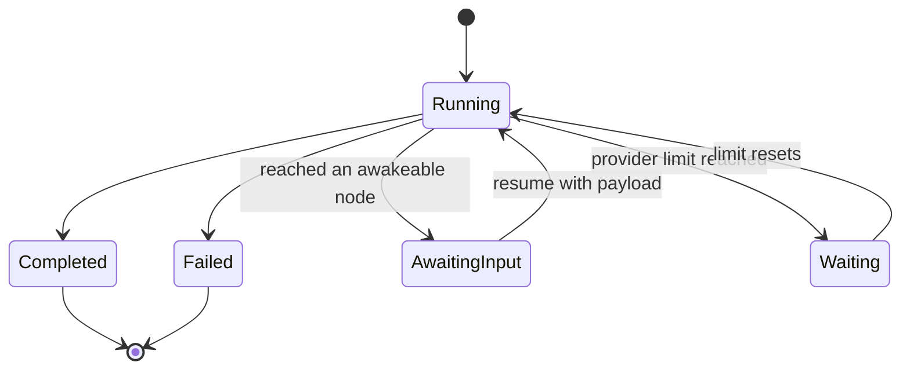

Core runs a workflow graph in dependency order and checkpoints every step, so a run can pause,
retry, and resume. For node kinds and template variables, see [Workflows](/docs/core/workflows).

## Execution and resume

Runs execute nodes in dependency order, saving each node's state after every step. Run history stays
on the node and supports resuming after a restart.

### Concurrent branches

Nodes that do not depend on each other run at the same time. When the `input` node of a graph feeds
two independent branches, both start together, and a node that joins them waits until every
incoming edge has resolved. A branch that a `condition` prunes is still resolved, so a join after a
`condition` never waits for the branch that was not taken.

The workflow's top-level `max_concurrency` field caps how many nodes of one run execute at once. It
defaults to 4 and is clamped between 1 and 16. Set it to `1` to run one node at a time:

```json
{
  "id": "wf_research",
  "name": "Research",
  "max_concurrency": 2,
  "nodes": [],
  "edges": []
}
```

Each node is still checkpointed on its own: a node's progress, retries, and durable timers are
saved as it runs, whichever order concurrent branches finish in. When a node fails, suspends at a
human gate, or hits a provider limit, no new node starts; the nodes already running finish and are
saved first, and then the run fails, waits for input, or waits for the limit to reset. If two
branches write the same `state` key at the same time, the branch that finishes last wins, so give
concurrent branches their own keys.

A run carries a `RunStatus` of `Running`, `Completed`, `Failed`, `AwaitingInput`, or `Waiting`.
When an `awakeable` node is reached (or a `notify_user` node whose `ack_mode` requires waiting), the
run suspends to `AwaitingInput` and waits for a human or an external signal. When a step hits a
provider rate, usage, or session limit, the run moves to `Waiting` until the limit resets (see
[Automatic resume](#automatic-resume)). Because node state is persisted, a resumed run skips
already-completed nodes and reuses their output.



### Read-only dry runs

The same `POST /workflows/:id/run` endpoint accepts `dryRun: true` for a transient, read-only
projection:

```json
{
  "input": { "text": "hello" },
  "dryRun": true
}
```

Core validates and walks the saved graph in memory. Input, transform, condition, state-template,
output, note, delay, and loop-control evaluation can run without persistence. An MCP `tool` or
`mcp` node runs only when Core classifies the tool as `read` or `preview`; unknown and effectful
tools are skipped. Prompts, agents, skills, delegation, plugins, code steps, guardrail checks,
webhooks, notifications, channel sends, recipe replay, ghost actions, and human-in-the-loop gates are also
skipped and appear as `skipped` nodes with a reason.

The response is marked `dryRun: true`. Core does not create or overwrite a run file, fire workflow
lifecycle hooks, create approvals, checkpoint timers, or make the response resumable. A caller
provided `runId` is ignored in this mode. A normal request without `dryRun` keeps the durable,
effectful behavior described above.

State keys beginning with `__workflow_`, `__repeat_`, `__loop_`, or `__fanout_` are reserved for
durable execution metadata and cannot be written by `set_state` nodes.

## Reliability and durable execution

Workflow runs are crash-recoverable. A run records its completed nodes and can resume from the next
unfinished step after a restart.

Sub-workflows and loop bodies can nest up to eight levels below the top-level workflow.
Exceeding that limit fails the run and records the error in its history. A failed child
step also stops its parent before any later parent steps execute.

Human-input pauses belong in the top-level workflow. A sub-workflow, plugin workflow,
or loop body that reaches a human-input gate fails its parent with a visible error;
continuing a parent from a nested pause is not supported. The child's saved
run retains its pending gate, and resuming that child separately does not resume its parent.

Ryu checkpoints progress after each node and loop iteration. Interrupted work resumes from the last
saved checkpoint instead of repeating completed nodes.

Nodes can also opt into retry policies, timeouts, idempotency keys, and durable delays.

| Feature | Field | Behavior |
|---|---|---|
| Per-node retry | `retry` (`RetryPolicy`) | Re-runs a failed attempt with exponential backoff `min(initial * coeff^(n-1), max)` plus optional decorrelated jitter. `attempts` persists in `NodeRunState`, so the budget is total across a Core restart, per node per run |
| Per-node timeout | `timeout_ms` | Wraps one attempt in a wall-clock timeout (the Temporal `StartToClose` analogue). A timeout is a retryable error, so it composes with retry |
| Idempotency keys | (automatic) | A stable `<run_id>:<node_id>` key, identical across crash and resume, is threaded into `tool` args as `__ryu_idempotency_key` (never clobbering an author-set value) and into the `webhook` `Idempotency-Key` header |
| Durable timers | `delay` `ms` | A `delay` computes and persists a `wake_at` instant and checkpoints before sleeping, so a crash mid-sleep resumes with only the remaining time |

The `RetryPolicy` fields are `max_attempts` (default 1, so a bare `"retry": {}` is inert until
raised), `initial_interval_ms` (100), `backoff_coefficient` (2.0), `max_interval_ms` (60000),
`jitter_fraction` (0.0), and `non_retryable_errors`. An `awakeable` suspend is never treated as a
retryable error.

The `guardrails` node checks incoming text with the Gateway firewall and fails the run when blocked.
If the Gateway is unavailable, the check fails closed. Policy remains owned by the
[Gateway](/docs/start-here/architecture/core-vs-gateway).

In the desktop workflow editor, retry and timeout controls appear on node types that support them.

### Automatic resume

Ryu continues interrupted runs on its own:

- **After a crash or restart.** When Ryu starts, each run that was still running when it stopped
  continues from its last checkpoint once the node is ready. Each run is restarted automatically
  at most twice; if it stops Ryu again, it is marked failed with an explanation instead of
  restarting in a loop. Runs whose last checkpoint is more than 7 days old are left for you.
- **After a provider limit.** When a step hits a rate, usage, or session limit, the run is not
  failed. It moves to `Waiting` with a `resume_at` time taken from the provider's reset signal
  (5 minutes when none is given) and continues from the same step at that time, including after a
  restart. Waiting out a limit does not spend the step's retry budget. A run that keeps hitting
  limits fails after 48 waits.
- **After a background task crash.** A resumed run executes under a supervisor; if the task
  running it crashes, the run is restarted within the same two-attempt allowance.
- **Sub-agents.** Agent delegation and
  [workflow script](/docs/core/workflow-code-and-scripts#workflow-scripts) steps save each
  sub-agent that finishes, so a resumed step reruns only the sub-agents that did not finish.
  A sub-agent stopped by a limit moves the whole run to `Waiting`.

Nested sub-workflows and loop bodies resume with their top-level run.

Automatic resume shares the **Resume interrupted chats** setting under **Settings > General >
Chats**: turning it off also stops workflow runs from resuming on their own. Nothing resumes
automatically in Safe Mode, while [Kill Switch](/docs/plugins/kill-switch) is pausing execution,
or while the node is not entitled to run. A limit wake that is held this way checks again every
five minutes.

To continue an interrupted or waiting run yourself, for example when auto-resume is off or you
know a limit has already reset, call `POST /workflows/runs/:run_id/continue`. It returns `202`
once the run continues in the background and `409` when the run is not interrupted or waiting,
or is already running.

## Related

<Cards>
  <DocCard href="/docs/core/workflows" />
  <DocCard href="/docs/core/workflow-loops-and-fan-out" />
  <DocCard href="/docs/core/workflow-runs-and-api" />
</Cards>
