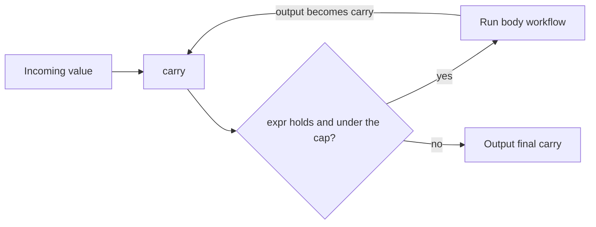
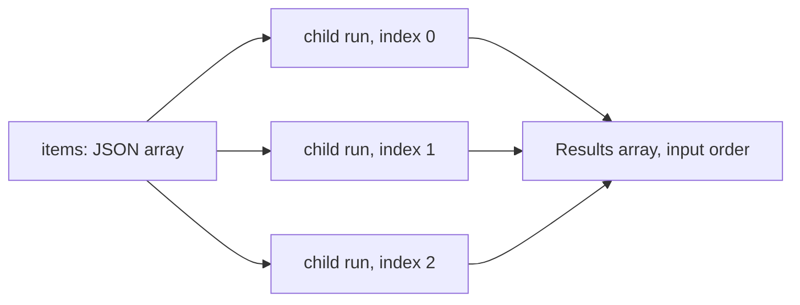

Four constructs run work more than once in a [workflow](/docs/core/workflows):

| Construct | Runs | Use it to |
|---|---|---|
| `while` node | A body workflow while a condition holds | Loop over several steps |
| `for_each` node | A body workflow once per list item | Map over a JSON array |
| `parallel` node | Several different workflows at once | Fan out and join by branch id |
| `repeat` policy | One step on its own output | Refine, poll, or sample without a graph cycle |

Each iteration is checkpointed like any other node, so a run resumes mid-loop after a restart.

## While loops

The `while` node has two forms, distinguished by whether `body_workflow_id` is set.

### Bounded loop

With `body_workflow_id` set, the node re-executes the named body workflow as long as `expr` holds.
It stops after 100 iterations. An optional `max_iterations` lowers that cap but can never raise it.

Each iteration runs as a sub-workflow, so the outer DAG stays acyclic and graph validation remains
intact. Progress is checkpointed after every iteration.

The loop variable is called the **carry**:

1. The carry is seeded with the node's incoming value.
2. `expr` checks the carry, for example `input < 10`.
3. Each iteration's output replaces the carry.
4. On exit, the node outputs the final carry.



### One-shot branch gate

With `body_workflow_id` absent, the node evaluates `expr` once. It activates only the matching true
or false outgoing edge, like a `condition`.

### Loop caveats

<Callout type="warn">
  Loops are at-least-once, not exactly-once. A side-effecting body node (`tool`, `webhook`,
  `ghost_action`, `prompt`) interrupted mid-call re-runs on resume.
</Callout>

An `awakeable` or member acknowledgement gate inside a loop body suspends the enclosing run:

- Approving the child gate resumes that same iteration and then continues the loop.
- Rejecting it fails the enclosing run.
- The iteration counter and carry stay unchanged while approval is pending, including after a
  restart.
- Resuming an enclosing run forwards the payload to its pending child gate. It cannot bypass a
  member acknowledgement policy.

This gate behavior also applies to nested `sub_workflow` nodes and workflow runnables contributed by
plugins.

The on-canvas back-edge form (drawing a body to `while` edge directly) is not available. Author the
body as a separate workflow named by `body_workflow_id`.

## Map over a list (`for_each`)

A `for_each` node runs a body workflow once for every element of a JSON array, with bounded
concurrency. It emits a JSON array of the results in the same order as the input:

```json
{
  "id": "summarize_each",
  "type": "for_each",
  "body_workflow_id": "wf_summarize_page",
  "items": "{{state.urls}}",
  "max_concurrency": 3
}
```

| Field | Default | Behavior |
|---|---|---|
| `body_workflow_id` | required | The workflow run once per item. It cannot be the workflow itself |
| `items` | `{{input}}` | A template that must resolve to a JSON array, for example `{{state.urls}}` or `{{nodes.search}}` |
| `max_concurrency` | 4 | How many items run at once, clamped between 1 and 16 |

Each item runs as its own durable child run with two run inputs:

- `input` - the element (a string element as-is, any other element as JSON text);
- `index` - the element's 0-based position.

The body's output becomes that item's result. A result that is a JSON object or array stays
structured in the output array; anything else is a string. Up to 1000 items are allowed.



### Resume and failure

Every finished item is saved as soon as it completes. A run that resumes after a restart, an
approval, or a provider limit skips the finished items and continues only the unfinished ones.

A human gate inside the body suspends the whole run. Approving it resumes that item. Any other item
still waiting on its own gate suspends the run again until it is approved too.

A failed item fails the node once the items already running have finished.

## Fan out to several workflows (`parallel`)

A `parallel` node runs several different workflows at the same time. It joins their results into
one JSON object keyed by branch id:

```json
{
  "id": "review",
  "type": "parallel",
  "max_concurrency": 4,
  "branches": [
    { "id": "security", "workflow_id": "wf_security_review" },
    { "id": "style", "workflow_id": "wf_style_review" },
    { "id": "tests", "workflow_id": "wf_test_review", "input": "{{state.diff}}" }
  ]
}
```

| Branch field | Behavior |
|---|---|
| `id` | Unique within the node; 1 to 64 letters, digits, `_`, or `-` |
| `workflow_id` | The workflow the branch runs. It cannot be the workflow itself |
| `input` | Optional template. Without it, the branch receives the node's input |

A node needs at least one branch and allows up to 1000. `max_concurrency` defaults to 4 and is
clamped between 1 and 16.

Branches run as durable child runs with the same resume, approval, limit, and failure behavior as
`for_each` items. A resumed run skips the branches that already finished.

## Repeating a step

Any data or action step can loop on its own output with a `repeat` policy, without a separate body
workflow or a graph cycle. The outer graph still sees one node that produces one value. Typical uses:

- refine a draft over several passes;
- poll a tool until a job finishes;
- collect several samples from one prompt.

```json
{
  "id": "refine",
  "type": "prompt",
  "prompt": "Improve this draft. Reply DONE when it needs no changes.\n\n{{input}}",
  "repeat": { "max_iterations": 5, "until": "input contains \"DONE\"" }
}
```

| Field | Default | Behavior |
|---|---|---|
| `max_iterations` | 1, or 100 when an exit condition is set | Upper bound on passes. Always capped at 100 |
| `until` | none | Stop as soon as this condition holds against the latest output |
| `while` | none | Keep going only while this condition holds against the latest output |
| `stop_when_unchanged` | `false` | Stop once a pass returns exactly the previous pass's output |
| `feed_output` | `true` | Feed each pass's output in as the next input. Set `false` to give every pass the original input, which suits polling and sampling |
| `collect` | `"last"` | `"last"` emits the final pass's output; `"all"` emits a JSON array of every pass's output |
| `interval_ms` | 0 | Pause between passes, for example while polling. At most 3600000 (1 hour); a larger value is rejected. The pause survives a restart: a resumed run waits only for the time left |

### Exit conditions

Conditions use the same grammar as a `condition` node, where the `input` keyword is the latest
output. Operators are `==`, `!=`, `contains`, `starts_with`, `ends_with`, `empty`, `nonempty`, and
numeric `<`, `>`, `<=`, `>=`.

After each pass, Ryu checks these in order:

1. the iteration cap;
2. `until`;
3. `while`;
4. `stop_when_unchanged`.

### Pass behavior

Each pass is a full execution of the step, so `retry` and `timeout_ms` apply to every pass. A
successful pass resets the retry budget. Progress is checkpointed after every pass.

Each pass gets its own idempotency key, agent conversation, and child run. A repeated `tool` or
`webhook` call is never deduplicated as a replay of the previous pass.

`repeat` is rejected on `awakeable` gates, `notify_user` nodes that wait for acknowledgements,
`condition` nodes, and `while` nodes. To loop over several steps at once, use a
[`while` loop](#while-loops) with a body workflow.

In the desktop workflow editor, open a step and turn on **Repeat step** to set these options.

## Related

<Cards>
  <DocCard href="/docs/core/workflows" />
  <DocCard href="/docs/core/workflow-triggers-and-history" />
  <DocCard href="/docs/core/workflow-code-and-scripts" />
</Cards>
