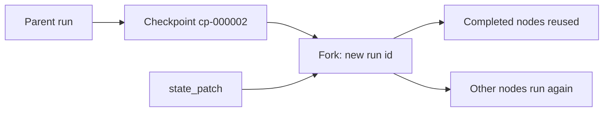

Every workflow run records checkpoints you can inspect and fork, and Core serves the workflow
routes. For node types and durable execution, see [Workflows](/docs/core/workflows) and
[Workflow Execution and Reliability](/docs/core/workflow-execution).

## Run history and time travel

Every run keeps an append-only history of checkpoints. Each checkpoint carries:

- the node id;
- how many times that node had run (its `repeat` or `while` iteration count);
- a timestamp;
- a full snapshot of the run's `state`, node statuses, and outputs at that moment.

Ryu records a checkpoint at these moments. The `event` field names it:

| `event` | Recorded when |
|---|---|
| `run_started` | The run starts |
| `forked` | The run was created by a fork (always its first checkpoint) |
| `node_completed` | A node completes |
| `node_failed` | A node fails |
| `node_suspended` | A node suspends at a human gate |
| `node_parked` | A node hits a provider limit |
| `run_completed` | The run finishes successfully |
| `run_failed` | The run fails |

### List checkpoints

List a run's checkpoints, oldest first:

```bash
curl http://127.0.0.1:7980/workflows/runs/run_123/history
```

```json
{
  "success": true,
  "run_id": "run_123",
  "checkpoints": [
    {
      "checkpoint_id": "cp-000002",
      "sequence": 2,
      "event": "node_completed",
      "node_id": "remember",
      "iteration": 1,
      "status": "running",
      "created_at": "2026-10-21T10:00:01Z",
      "state": { "topic": "rust" },
      "nodes": { "remember": { "status": "completed", "output": "rust" } },
      "output": {}
    }
  ]
}
```

### Fork a run

To replay a run from any checkpoint, fork it. The fork is a **new** run that starts from that
checkpoint, optionally with a patch applied to its `state` map:

```bash
curl -X POST http://127.0.0.1:7980/workflows/runs/run_123/fork \
  -H 'Content-Type: application/json' \
  -d '{ "checkpoint_id": "cp-000002", "state_patch": { "topic": "go" } }'
```

The response is the fork's run once it settles. Its `forked_from` field names the parent run and
checkpoint, and its own history starts with a `forked` checkpoint. The parent run is never changed.



What a fork reuses and what it runs again:

- Nodes that had completed at the checkpoint are reused with their recorded outputs. They do not run
  again, so their side effects are not repeated.
- Every other node runs again. Because the fork has its own run id, those nodes get new idempotency
  keys, agent conversations, and child runs. A re-run `tool` or `webhook` call is a new call, not a
  duplicate of the parent's.
- `state_patch` values are stored as strings (other JSON values as JSON text). Keys reserved for the
  engine, such as `__workflow_` keys and `notify_user` acknowledgement state, are rejected.
- Forking from a failure checkpoint re-runs the failed node with the patched state. Use this to retry
  a run after fixing its data.

<Callout type="info">
  A nested child run cannot be forked directly; fork the top-level run instead. Runs of ad-hoc
  scripts and dry runs cannot be forked.
</Callout>

In TypeScript, `listRunHistory` and `forkRun` from the Core client call these endpoints.

## Working with workflows

The workflow DAG routes are served at the Core root under `/workflows`, without the `/api` prefix.
The template catalog is under `/api/workflows/catalog`, and the public webhook is
`POST /api/workflows/:id/webhook`.

| Action | Endpoint |
|---|---|
| List workflows | `GET /workflows` |
| Create or persist a workflow | `POST /workflows` |
| Fetch a workflow | `GET /workflows/:id` |
| Delete a workflow | `DELETE /workflows/:id` |
| Run a workflow | `POST /workflows/:id/run` |
| Fetch a run's state | `GET /workflows/runs/:run_id` |
| List live runs | `GET /workflows/runs/live` |
| Resume a suspended run | `POST /workflows/runs/:run_id/resume` |
| Continue an interrupted or waiting run | `POST /workflows/runs/:run_id/continue` |
| List a run's checkpoints | `GET /workflows/runs/:run_id/history` |
| Fork a run from a checkpoint | `POST /workflows/runs/:run_id/fork` |
| List workflow templates | `GET /api/workflows/catalog` |
| Fetch one template | `GET /api/workflows/catalog/:id` |
| Install or preview a template | `POST /api/workflows/catalog/install` |

- Creating a workflow validates the DAG before persisting it.
- Running one executes end to end and returns the run with its status and outputs.
- Resuming supplies the payload an `awakeable` was waiting for.

For the version routes, see
[Workflow Triggers and History](/docs/core/workflow-triggers-and-history#version-api).

### TypeScript client

The `@ryuhq/core-client` workflow client (`packages/core-client/src/workflows.ts`) checks workflow
and run responses before using them:

- Replies missing required fields, or containing fields with the wrong type, fail the request.
- Missing optional fields keep their defaults.
- Extra JSON fields on workflow nodes are preserved.
