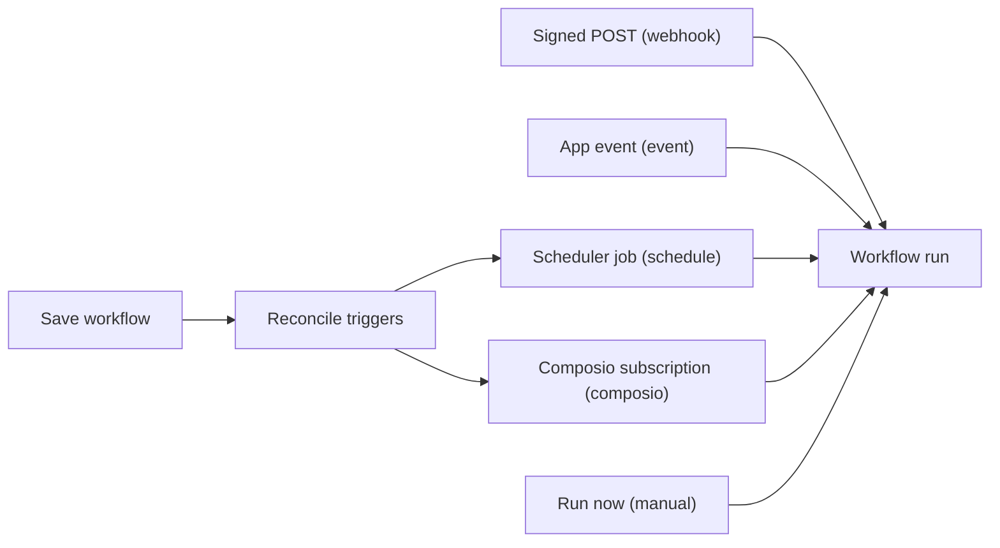
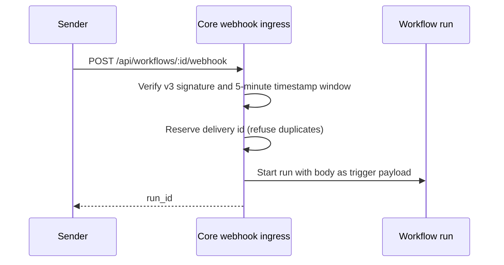

Triggers decide when a workflow runs, and version history records each saved definition. For node
types, runs, resumes, and durable execution, see [Workflows](/docs/core/workflows).

## Triggers and schedules

A workflow declares zero or more triggers in its `triggers` array (`WorkflowTrigger` in
`apps/core/src/workflow/mod.rs`). On every save, Core reconciles those declarations into the
scheduler jobs and subscriptions that start runs (`apps/core/src/workflow/triggers.rs`).
Reconciling is idempotent, so a re-save converges to the declared set.



### Trigger types

| Trigger | Fires when | Reconciles into |
|---|---|---|
| `manual` | The "Run now" button or `POST /workflows/:id/run` | Nothing (no external resource) |
| `schedule` | A cron expression or `every` interval | A scheduler job with a deterministic id `wf-sched-<workflow_id>-<idx>` and target `JobTarget::Workflow` |
| `webhook` | An HTTP POST hits the workflow's public ingress URL (`POST /api/workflows/:id/webhook`) | A status surface on the webhook-ingress seam; `secret` is the HMAC signing secret |
| `composio` | A Composio event fires (`toolkit`, `trigger_slug`, optional `connected_account_id`) | A Composio trigger subscription whose `target_kind` is `workflow` |
| `event` | An installed app raises the named app event (`event`, for example `@example/meetings#meeting.ended`) | Nothing. Core scans saved workflows when the event is emitted |

A `webhook`, `composio`, or `event` trigger seeds its payload into the run's reserved
`state["trigger"]` key before execution, so `{{trigger.<field>}}` template variables resolve against
it.

An `event` trigger can name an event whose app is not installed yet; it fires once the app is
installed and emits it. Apps declare these events in their manifest's `contributes.hook_events`
(see [Plugin activation](/docs/extend/develop/sdk/plugin-activation)).

### Schedule updates

For a `schedule` trigger, `cron` takes precedence when both `cron` and `every` are set. A trigger
with neither value is skipped. Set `require_approval: true` to make each scheduled firing wait for an
inbox approval before the workflow runs; it is off by default.

- Saving changes removes schedules and subscriptions that are no longer configured.
- Deleting a workflow removes all of its jobs and subscriptions.
- The scheduler runs fired jobs with bounded concurrency (`MAX_CONCURRENT_JOBS = 8`), so one slow run
  does not stall the tick.

See [Scheduler](/docs/core/scheduler) for schedule options.

### Webhook signing

A workflow webhook needs a configured secret; a `webhook` trigger without one refuses every
delivery. The body must be valid JSON. Every delivery carries three headers:

| Header | Value |
|---|---|
| `webhook-id` | A fresh delivery id of 1 to 128 letters, digits, hyphens, or underscores |
| `webhook-timestamp` | Unix seconds |
| `webhook-signature` | `v3,<hex HMAC-SHA256>` |

To sign, compute HMAC-SHA256 with the workflow's secret over these exact bytes:

```text
ryu-workflow-webhook-v3\n<workflow id>\n<timestamp>\n<delivery id>\n<raw JSON body>
```

Core then checks the delivery:



- The timestamp must fall within a five-minute window.
- The signature is bound to the selected workflow. A delivery signed for one workflow is refused by
  every other workflow, even when several workflows share a secret.
- Signed delivery ids are remembered through restarts, so changing an unsigned transport id cannot
  replay a captured request.

A minimal Node.js sender:

```ts
import { createHmac, randomUUID } from "node:crypto";

const workflowId = "wf_123"; // the id in /api/workflows/<id>/webhook
const body = JSON.stringify({ event: "deploy" });
const timestamp = String(Math.floor(Date.now() / 1000));
const deliveryId = randomUUID();
const digest = createHmac("sha256", process.env.WORKFLOW_WEBHOOK_SECRET ?? "")
  .update(`ryu-workflow-webhook-v3\n${workflowId}\n${timestamp}\n${deliveryId}\n${body}`)
  .digest("hex");

await fetch(`https://<your-node>/api/workflows/${workflowId}/webhook`, {
  method: "POST",
  headers: {
    "content-type": "application/json",
    "webhook-id": deliveryId,
    "webhook-timestamp": timestamp,
    "webhook-signature": `v3,${digest}`,
  },
  body,
});
```

<Callout type="warn">
  **Upgrading senders.** Only `v3` signatures are accepted. Earlier forms are rejected with `401`, namely
  the body-only HMAC (`sha256=<hex>`, `v1,<hex>`, or a bare hex digest) and the short-lived `v2`
  envelope that did not include the workflow id.

  There is no compatibility window. Each older form lets one valid delivery start a different
  workflow that shares its secret, or be replayed. Update every sender to the v3 envelope when you
  upgrade the node; until then, its deliveries are refused and no run starts.
</Callout>

The webhook responds as soon as the run starts and returns its `run_id`. Check that run's status for
the outcome.

A redelivery of the same id within five minutes of the first delivery's timestamp is acknowledged
as a duplicate and does not start a second run, even if the first run later fails. Send a fresh id
for every new event. To read or rotate a workflow's secret, see
[Webhook Ingress](/docs/core/webhook-ingress#webhook-endpoints-and-secrets).

### Composio event data

Configure a Composio trigger in the workflow editor. When it starts a run, the event payload is
available as `{{trigger.<field>}}`.

<Callout type="info">
  Saving a Composio trigger reconciles the project's V3 webhook subscription against the node's
  current public ingress URL before the trigger instance is created. If the URL or signing secret
  cannot be made ready, Ryu keeps the existing workflow subscriptions instead of replacing them with
  an unreachable configuration. See [Webhook Ingress](/docs/core/webhook-ingress).
</Callout>

## Catalog and version previews

Preview a workflow template install with `dryRun: true` (`POST /api/workflows/catalog/install`) to
see its metadata and planned changes before anything is created. Version restore also supports
`dryRun=true`, so a client can show the target version and undo behavior before changing the
current definition.

### Video Drama Studio template

**Video Drama Studio** runs one video idea through a production crew, with each role as its own
step:

1. **Producer**: development brief (logline, runtime, aspect ratio, audience, scope, constraints).
2. **Showrunner**: story bible, beat sheet, and scene outline.
3. **Casting Director**: reusable look and voice descriptions so generated characters stay
   consistent.
4. **Screenwriter** and **Script Editor**: a first draft, then two writers'-room passes of notes and
   revisions.
5. **Script Supervisor**: the locked shooting script with timings and continuity notes.
6. **Director**, **Director of Photography**, **Production Designer**, and **Composer/Sound
   Designer**: shot list, look book, design pack, and sound plan, written in parallel.
7. **First Assistant Director**: a shot-by-shot production manifest with generation prompts, audio
   lines, music cues, and captions.
8. **Production Unit** and **Editor**: generate the media, cut it, and render the finished video.
9. **Executive Producer**: a delivery report that checks the result against the brief.

The production and editing steps use the Ryu agent with write access. They render through the
Video Studio app when it is installed and a video generation model is available.

If either is missing, those steps report which step could not run and return the unexecuted shot
list rather than a video. Every step is an ordinary workflow node, so you can edit prompts, swap
agents, or remove roles after installing.

## Version history

Every workflow keeps an immutable version history on its node. The history view lists saved
definitions and lets you compare or restore a version. History contains workflow definitions only;
it does not include run state, credentials, or provider data.

### Save and restore

- Saving a workflow records its current definition. Repeated identical saves are coalesced unless
  you add a checkpoint label.
- Restoring a version first keeps the current definition as an undo point, then applies the selected
  version and reconciles its triggers.

**Save version** first saves your current canvas, then snapshots that acknowledged revision. If
another client saves in between, the checkpoint is refused and your draft stays visible. The
acknowledged save remains saved. Use **Reload latest workflow**, confirm discarding your local
edits, and retry against the latest definition.

### Version API

| Action | Endpoint |
|---|---|
| List a workflow's versions (newest first) | `GET /workflows/:id/versions` |
| Snapshot the current definition | `POST /workflows/:id/versions` |
| Fetch one version in full | `GET /workflows/:id/versions/:version_id` |
| Restore a version (snapshots current first) | `POST /workflows/:id/versions/:version_id/restore` |

The snapshot request accepts an optional JSON body with `label` and `expectedRevision`. Use the
workflow save response's `updated_at` as the opaque `expectedRevision` string.

- If `expectedRevision` differs from the current revision, the API returns HTTP 409 with
  `code: "workflow_revision_conflict"` and `current_updated_at`, and creates no version.
- Omitting `expectedRevision` snapshots the current definition without this revision guard.

Workflow history is separate from document history. See [Spaces and RAG](/docs/core/spaces-rag)
for document versioning.
