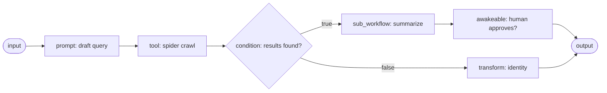

A **workflow** is a directed acyclic graph (DAG) of typed nodes that Core executes in process.
Workflows are Runnables (see [The Runnable Model](/docs/start-here/architecture/runnable-model)):
an agent can invoke a workflow as a named tool, and a workflow can call agents as steps. The engine
is file backed and resumable: every node and every loop iteration is checkpointed to disk, so a run
survives a Core restart.

To build a workflow visually or record desktop steps into one, see [Recipes and the canvas](/docs/surfaces/desktop/productivity/recipes). To author a workflow as a
Runnable in code, see [Authoring workflows](/docs/extend/develop/extensions/author-workflows).

## A run in the desktop

The desktop shows a run's steps, activity, progress, and tool output together while the graph
executes. The chat ignores malformed node progress instead of displaying a partial checklist.

<SurfacePreview surface="workflow" />

## Node kinds

A workflow is a set of typed node entries connected by edges. An edge can carry an optional
`branch` label, so a `condition` or one-shot `while` routes down a true or false path. `NodeKind` is a tagged enum (`type`,
snake_case) with 27 variants:

| Node (`type`) | What it does | Key fields |
|---|---|---|
| `input` | Reads the run's input value | - |
| `output` | Writes the run's output value | - |
| `prompt` | Calls a model with a template, optionally routed to an `agent_id`; the Agent node in the canvas wires to this kind | `prompt`, `agent_id?` |
| `condition` | Branches on a boolean expression, following the true or false edge | `expr` |
| `transform` | A pure data op (uppercase, lowercase, trim, json_parse, template, identity) | `op`, `template?` |
| `tool` | Invokes a Core tool by its fully qualified id `<server>.<tool>` (for example `spider.crawl`) | `name`, `args` |
| `mcp` | The explicit two-field form of `tool` - names an MCP `server` and `tool` separately, joined into `<server>.<tool>` before the call | `server`, `tool`, `args` |
| `webhook` | POSTs the resolved value to an external URL | `url` |
| `set_state` | Writes a resolved template into the run's `state` map, then passes input through unchanged | `key`, `value` |
| `delay` | Pauses for `ms` milliseconds (a durable timer, see below) | `ms` |
| `note` | A documentation-only annotation that forwards its input unchanged | `text` |
| `while` | A bounded loop or a one-shot branch gate (see [While loops](/docs/core/workflow-loops-and-fan-out#while-loops)) | `expr`, `body_workflow_id?` |
| `guardrails` | Routes the incoming text through the Gateway firewall and fails the run on a block | `checks` |
| `sub_workflow` | Runs another persisted workflow by id and forwards its output (max depth 8) | `workflow_id` |
| `for_each` | Runs a body workflow once per element of a JSON array and collects the results in order (see [Map over a list](/docs/core/workflow-loops-and-fan-out#map-over-a-list-for_each)) | `body_workflow_id`, `items?`, `max_concurrency?` |
| `parallel` | Runs several workflows at once and joins their results by branch id (see [Fan out to several workflows](/docs/core/workflow-loops-and-fan-out#fan-out-to-several-workflows-parallel)) | `branches`, `max_concurrency?` |
| `agent_delegate` | Fans out to sub-agents with caps (see [Delegation](/docs/core/delegation)) | - |
| `script` | Runs JavaScript that orchestrates sub-agents with `agent()`, `parallel()`, `pipeline()`, and `phase()` (see [Workflow scripts](/docs/core/workflow-code-and-scripts#workflow-scripts)) | `code`, `agent_id?`, `preset?` |
| `agent` | Runs one installed agent on a task as a single in-context step (the alternative to a raw `prompt`) | `agent_id`, `task?` |
| `skill` | Applies an installed Agent Skill (its `SKILL.md` body) to the input, under an optional `agent_id` or the default Gateway model | `skill`, `agent_id?`, `task?` |
| `plugin` | Runs a Runnable an installed plugin bundles, dispatched to that kind's path (tool, agent, workflow, or skill) | `plugin_id`, `runnable_id`, `args` |
| `awakeable` | A durable pause for human-in-the-loop input | - |
| `recipe` | Replays a whole recorded ghost desktop automation by name | `recipe`, `params` |
| `ghost_action` | Runs a single recorded desktop action (click, type, scroll, ...) | `action`, `target`, `params` |
| `notify_user` | Pings org/team/members across devices, optionally suspending as a HITL ack gate (see [Notify and provider steps](#notify-and-provider-steps)) | `target`, `title`, `body`, `ack_mode`, `ack_timeout_ms?` |
| `channel_send` | Sends a message to an external channel (Telegram, Slack, Discord, or an HTTP webhook) | `platform`, `recipient`, `text` |
| `code` | Runs or checks a Lean 4, Bend, or BAML program (see [Code steps](/docs/core/workflow-code-and-scripts#code-steps-lean-bend-and-baml)) | `language`, `source`, `mode?`, `input?`, `function?`, `args?`, `model?` |

The `guardrails` `checks` field names the firewall categories to enforce (`pii`, `jailbreak`,
`moderation`), mapped to the Gateway firewall's scan categories server side. The `recipe` and
`ghost_action` nodes drive recorded desktop automations through the ghost engine.

### Notify and provider steps

`agent`, `skill`, and `plugin` run a peer Runnable as a workflow step, so a graph is not limited to
prompts and raw tools. Core decides *what runs*. Gateway governs model requests routed through its
endpoint; provider-native runtimes and direct tool integrations can use other destinations.
`mcp` is the two-field form of `tool` - an author picks a `server` and a `tool` separately instead
of writing the compound `<server>.<tool>` id. The executor reuses the `tool` path, so the
idempotency key and `input` folding behave the same.

`notify_user` pings one or more org members, a team, or an explicit member set across their devices
(the app inbox, the desktop OS toast, and mobile push). Its `target` is a tagged `NotifyTargetSpec`
with three forms:

| `target.kind` | Pings | Extra field |
|---|---|---|
| `org` | Every member of the node's bound organization | - |
| `team` | Every member of one team in the org | `team_id` |
| `members` | A hand-picked set of member user ids, verified against the bound organization when the node runs | `user_ids` |

The `ack_mode` field decides the node's shape. Absent or `none` is fire-and-forget: deliver, emit a
JSON receipt as the node output, and continue downstream. Any of `first`, `all`, `quorum` (with `n`), or `percentage` (with `percent`) turns the
node into a human-in-the-loop gate - it delivers, then suspends the run to `AwaitingInput` until the
ack policy is met, exactly like an `awakeable`. `quorum` requires a count; `percentage` uses ceiling
rounding, so 50% of 3 recipients requires 2 approvals. Each selected member receives an inbox Ack
action, and the run resumes automatically once the threshold is reached. A direct workflow resume
cannot bypass a notification gate. Membership is resolved over the Gateway key against the node's
bound org (the control plane owns *who is a member*).

The Workflows editor exposes the bound organization directory in the `Members` target. Select one or
more people, then choose `At least this many` or `At least this percentage`; the selected IDs are
stored in the workflow definition, while Core re-checks that every ID is still an organization member
before delivery. `first` and `all` remain available for one-person and unanimous approval flows.

<Callout type="warn">
  `recipe` and `ghost_action` fail with an error until the ghost sidecar is installed. See [Recipes](/docs/surfaces/desktop/productivity/recipes).
</Callout>

### Code and script steps

`code` steps run or check a Lean 4, Bend, or BAML program, and `script` steps orchestrate
sub-agents from JavaScript. Both are covered in
[Workflow code and script steps](/docs/core/workflow-code-and-scripts).

### Shared node fields

Every node also carries three optional, orthogonal fields: a `retry` policy, a `timeout_ms`, and a
`repeat` policy. All default to absent (run once, unbounded). Retry and timeout are covered under
[Reliability and durable execution](/docs/core/workflow-execution#reliability-and-durable-execution), and repeat under
[Repeating a step](/docs/core/workflow-loops-and-fan-out#repeating-a-step).

A graph wires these node kinds together. A `Condition` routes down a true or false path:

## Template variables

String fields can reference run data with `{{...}}` tokens, resolved just before the node runs.
Everything is treated as a string, JSON passes through verbatim, and any unknown token or missing
key resolves to the empty string.

| Token | Resolves to |
|---|---|
| `{{input}}` | The node's incoming value |
| `{{nodes.<id>}}` | The output string of an upstream node |
| `{{state.<key>}}` | A value from the run's `state` map (written by `set_state`) |
| `{{trigger.<field>}}` | A dotted JSON path into the trigger payload, for example `{{trigger.body.email}}` |
| `{{loop.iteration}}` | Inside a [repeating step](/docs/core/workflow-loops-and-fan-out#repeating-a-step): the current pass, starting at 1 |
| `{{loop.previous}}` | Inside a repeating step: the previous pass's output (empty on the first pass) |
| `{{loop.original}}` | Inside a repeating step: the value the step first received |

The resolver runs in `prompt`, `transform` (the template op), `tool` args, `webhook` url,
`set_state`, `recipe` and `ghost_action` params, and the `condition` and `while` expression
evaluator.

## Execution and reliability

Runs execute nodes in dependency order, run independent branches concurrently, and checkpoint each
node so a run survives a restart. For concurrent branches, run states, read-only dry runs, retries,
timeouts, durable timers, and automatic resume, see
[Workflow Execution and Reliability](/docs/core/workflow-execution).

## Loops and fan-out

A `while` node loops over a body workflow, `for_each` maps a body workflow over a list, `parallel`
fans out to several workflows at once, and a `repeat` policy loops one step on its own output. See
[Workflow Loops and Fan-Out](/docs/core/workflow-loops-and-fan-out) for their fields, limits, and resume behavior.

## Triggers, schedules, and version history

A workflow declares zero or more triggers in its `triggers` array (`WorkflowTrigger` in
`apps/core/src/workflow/mod.rs`): `manual`, `schedule`, `webhook`, or `composio`. On every save, Core
reconciles those declarations into the scheduler jobs and subscriptions that fire the workflow
(`apps/core/src/workflow/triggers.rs`). A Composio event payload is seeded into the run's reserved
`state["trigger"]` key, so `{{trigger.<field>}}` tokens resolve against the live event.

For trigger types, webhook signing, schedule rules, template previews, and version history, see
[Workflow Triggers and History](/docs/core/workflow-triggers-and-history).

## Run history and routes

For run checkpoints, time travel, forking a run, and the workflow routes, see
[Workflow Run History and API](/docs/core/workflow-runs-and-api).

## Natural-language builder

A workflow can be assembled through the chat builder or on the canvas. Describe a flow in natural
language and the builder creates a draft graph that you can review and refine.

The builder applies incremental changes and checks the graph after each edit. If validation fails,
it returns the error to the builder so it can correct the draft.

Chat and canvas saves use the same validation and update configured triggers.

<Callout type="warn">
  The builder reads and writes the **persisted** definition, and the React Flow canvas is a second
  editor with its own Save button. Unsaved canvas edits are clobbered when the builder writes and the
  canvas reloads, so save canvas edits before driving the chat.
</Callout>

## Run a workflow from chat

A workflow can be run directly from the chat composer, without leaving the thread for the Workflows
app. Type `@` and pick a workflow in the new **Workflows** group (or `@WorkflowName` inline), then
send. The message text becomes the workflow's initial input, its nodes stream back as a live
checklist (for example `agent · planner → agent · implementer → agent · verifier`), and the run's
output is delivered as the assistant reply in the same conversation.

Only workflows that **accept a chat input** appear as targets: a workflow is chat-triggerable when at
least one *root* node (no incoming edges) is an `input` node, because that is the node that reads the
typed message. A workflow whose entry never reads the run input is left out of the mention list and
rejected with an error if you target it directly. `GET /workflows` stamps this as a `chat_input`
field on each workflow.

On the wire, the chat turn carries a `workflow_id` alongside `agent_id` and `team_id`.

| Field | Meaning |
|---|---|
| `workflow_id` | Route the turn to a workflow; its nodes decide what runs. Takes precedence over agent and team targets. |

If the run suspends at an `awakeable` (human-in-the-loop) gate, the reply reports what input the gate
is waiting for and the run stays resumable from the Workflows app (`POST /workflows/runs/:run_id/resume`).

## Related

<Cards>
  <DocCard href="/docs/core/workflow-execution" />
  <DocCard href="/docs/core/workflow-loops-and-fan-out" />
  <DocCard href="/docs/core/workflow-triggers-and-history" />
  <DocCard href="/docs/core/workflow-code-and-scripts" />
  <DocCard href="/docs/surfaces/desktop/productivity/recipes" />
  <DocCard href="/docs/extend/develop/extensions/author-workflows" />
  <DocCard href="/docs/core/delegation" />
  <DocCard href="/docs/core/scheduler" />
</Cards>
