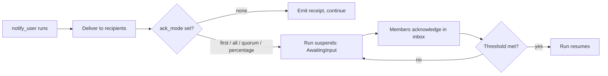
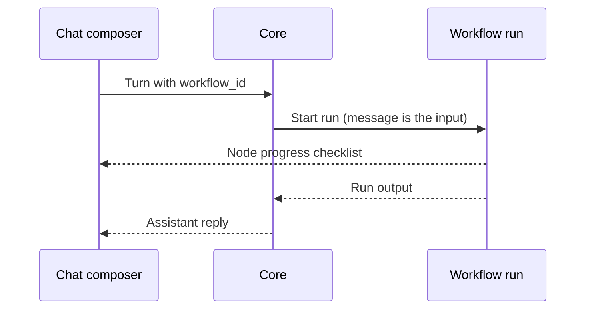

A **workflow** is a directed acyclic graph (DAG) of typed nodes that Core executes in process. The
engine is file backed and resumable. Every node and every loop iteration is checkpointed to disk, so
a run survives a Core restart.

<Figure name="workflows" />

Workflows are Runnables (see [The Runnable Model](/docs/start-here/architecture/runnable-model)).
An agent can invoke a workflow as a named tool, and a workflow can call agents as steps.

- To build a workflow visually or record desktop steps into one, see
  [Recipes and the canvas](/docs/surfaces/desktop/productivity/recipes).
- To author a workflow as a Runnable in code, see
  [Authoring workflows](/docs/extend/develop/extensions/author-workflows).

## A run in the desktop

The desktop shows a run's steps, activity, progress, and tool output together while the graph
executes. The chat ignores malformed node progress instead of displaying a partial checklist.

<SurfacePreview surface="workflow" />

## Node kinds

A workflow is a set of typed nodes connected by edges. An edge can carry an optional `branch`
label, so a `condition` or one-shot `while` routes down a true or false path. `NodeKind` is a
tagged enum (`type`, snake_case) with 27 variants, grouped below by job.

### Data and control flow

| Node (`type`) | What it does | Key fields |
|---|---|---|
| `input` | Reads a value from the run's input (the node id is the default key) | `key?` |
| `output` | Writes its incoming value to the run's output (the node id is the default key) | `key?` |
| `condition` | Branches on a boolean expression, following the true or false edge | `expr` |
| `transform` | A pure data op (`uppercase`, `lowercase`, `trim`, `json_parse`, `template`, `identity`) | `op`, `template?` |
| `set_state` | Writes a resolved template into the run's `state` map, then passes its input through unchanged | `key`, `value` |
| `delay` | Pauses for `ms` milliseconds as a durable timer | `ms` |
| `note` | A documentation-only annotation that forwards its input unchanged | `text` |

### Models, agents, and plugins

| Node (`type`) | What it does | Key fields |
|---|---|---|
| `prompt` | Calls a model with a template, optionally routed to an `agent_id`. The canvas Agent node wires to this kind | `prompt`, `agent_id?` |
| `agent` | Runs one installed agent on a task as a single in-context step | `agent_id`, `task?` |
| `skill` | Applies an installed Agent Skill (its `SKILL.md` body) to the input, under an optional `agent_id` or the default Gateway model | `skill`, `agent_id?`, `task?` |
| `agent_delegate` | Fans out to sub-agents with caps (see [Delegation](/docs/core/delegation)) | `delegates`, `caps?` |
| `script` | Runs JavaScript that orchestrates sub-agents (see [Workflow scripts](/docs/core/workflow-code-and-scripts#workflow-scripts)) | `code`, `agent_id?`, `preset?` |
| `code` | Runs or checks a Lean 4, Bend, or BAML program (see [Code steps](/docs/core/workflow-code-and-scripts#code-steps-lean-bend-and-baml)) | `language`, `source`, `mode?`, `input?`, `function?`, `args?`, `model?` |
| `plugin` | Runs a Runnable an installed plugin bundles, dispatched to that kind's path (tool, agent, workflow, or skill) | `plugin_id`, `runnable_id`, `args` |
| `guardrails` | Routes the incoming text through the Gateway firewall and fails the run on a block | `checks` |

The `guardrails` `checks` field names the firewall categories to enforce (`pii`, `jailbreak`,
`moderation`). Core maps them to the Gateway firewall's scan categories server side.

### Tools and external calls

| Node (`type`) | What it does | Key fields |
|---|---|---|
| `tool` | Invokes a Core tool by its fully qualified id `<server>.<tool>` (for example `spider.crawl`) | `name`, `args` |
| `mcp` | The two-field form of `tool`. Names an MCP `server` and `tool` separately, joined into `<server>.<tool>` before the call | `server`, `tool`, `args` |
| `webhook` | Sends the incoming value to an external URL (`method` defaults to `POST`) | `url`, `method?` |
| `channel_send` | Sends a message to an external channel (Telegram, Slack, Discord, or an HTTP webhook) | `platform`, `recipient`, `text`, `bot_token?`, `webhook_url?` |

### Loops and fan-out

| Node (`type`) | What it does | Key fields |
|---|---|---|
| `while` | A bounded loop or a one-shot branch gate (see [While loops](/docs/core/workflow-loops-and-fan-out#while-loops)) | `expr`, `body_workflow_id?`, `max_iterations?` |
| `sub_workflow` | Runs another persisted workflow by id and forwards its output (max depth 8) | `workflow_id` |
| `for_each` | Runs a body workflow once per element of a JSON array and collects the results in order (see [Map over a list](/docs/core/workflow-loops-and-fan-out#map-over-a-list-for_each)) | `body_workflow_id`, `items?`, `max_concurrency?` |
| `parallel` | Runs several workflows at once and joins their results by branch id (see [Fan out to several workflows](/docs/core/workflow-loops-and-fan-out#fan-out-to-several-workflows-parallel)) | `branches`, `max_concurrency?` |

### Human gates and desktop automation

| Node (`type`) | What it does | Key fields |
|---|---|---|
| `awakeable` | A durable pause for human-in-the-loop input. `prompt` tells the UI what input is expected | `prompt?` |
| `notify_user` | Pings org members across devices, optionally suspending as an acknowledgement gate (see [Notify and provider steps](#notify-and-provider-steps)) | `target`, `title`, `body`, `ack_mode`, `ack_timeout_ms?` |
| `recipe` | Replays a whole recorded ghost desktop automation by name | `recipe`, `params` |
| `ghost_action` | Runs a single recorded desktop action (click, type, scroll, ...) | `action`, `target`, `params` |

<Callout type="warn">
  `recipe` and `ghost_action` drive recorded desktop automations through the ghost engine. They
  fail with an error until the ghost sidecar is installed. See [Recipes](/docs/surfaces/desktop/productivity/recipes).
</Callout>

### Notify and provider steps

`agent`, `skill`, and `plugin` run a peer Runnable as a workflow step, so a graph is not limited to
prompts and raw tools. Core decides *what runs*. Gateway governs model requests routed through its
endpoint; provider-native runtimes and direct tool integrations can use other destinations.

`mcp` reuses the `tool` execution path, so the idempotency key and `input` folding behave the same
for both.

`notify_user` pings members across their devices (the app inbox, the desktop OS toast, and mobile
push). Its `target` is a tagged `NotifyTargetSpec` with three forms:

| `target.kind` | Pings | Extra field |
|---|---|---|
| `org` | Every member of the node's bound organization | - |
| `team` | Every member of one team in the org | `team_id` |
| `members` | A hand-picked set of member user ids, verified against the bound organization when the node runs | `user_ids` |

Core resolves membership over the Gateway key against the node's bound org. The control plane owns
*who is a member*.

The `ack_mode` field decides the node's shape:

| `ack_mode` | Behavior |
|---|---|
| absent or `none` | Fire and forget. Deliver, emit a JSON receipt as the node output, and continue downstream |
| `first` | Wait for one acknowledgement |
| `all` | Wait for every recipient |
| `quorum` (with `n`) | Wait for at least `n` acknowledgements |
| `percentage` (with `percent`) | Wait for a share of recipients, rounded up (50% of 3 recipients requires 2) |

Any waiting mode turns the node into a human-in-the-loop gate, like an `awakeable`. Each selected
member receives an inbox Ack action, and the run resumes once the threshold is reached. A direct
workflow resume cannot bypass a notification gate.

In the Workflows editor, the `Members` target shows the bound organization directory. Select one or
more people, then choose `At least this many` or `At least this percentage`. The selected IDs are
stored in the workflow definition, and Core re-checks that every ID is still a member before
delivery.

### Shared node fields

Every node also carries three optional, orthogonal fields. All default to absent (run once,
unbounded).

| Field | Covered in |
|---|---|
| `retry` | [Reliability and durable execution](/docs/core/workflow-execution#reliability-and-durable-execution) |
| `timeout_ms` | [Reliability and durable execution](/docs/core/workflow-execution#reliability-and-durable-execution) |
| `repeat` | [Repeating a step](/docs/core/workflow-loops-and-fan-out#repeating-a-step) |

A graph wires these node kinds together. A `condition` routes down a true or false path:

## Template variables

String fields can reference run data with `{{...}}` tokens, resolved just before the node runs.
Everything is treated as a string and JSON passes through verbatim. An unknown token or a missing key
resolves to the empty string.

| Token | Resolves to |
|---|---|
| `{{input}}` | The node's incoming value |
| `{{nodes.<id>}}` | The output string of an upstream node |
| `{{state.<key>}}` | A value from the run's `state` map (written by `set_state`) |
| `{{trigger.<field>}}` | A dotted JSON path into the trigger payload, for example `{{trigger.body.email}}` |
| `{{loop.iteration}}` | Inside a [repeating step](/docs/core/workflow-loops-and-fan-out#repeating-a-step): the current pass, starting at 1 |
| `{{loop.previous}}` | Inside a repeating step: the previous pass's output (empty on the first pass) |
| `{{loop.original}}` | Inside a repeating step: the value the step first received |

The resolver runs in these places:

- `prompt` templates and the `transform` template op;
- `tool` and `mcp` args, and the `webhook` url;
- `set_state` values;
- `recipe` and `ghost_action` params;
- the `condition` and `while` expression evaluator.

## Related workflow pages

| Topic | Page |
|---|---|
| Dependency order, concurrent branches, run states, dry runs, retries, timeouts, durable timers, automatic resume | [Workflow Execution and Reliability](/docs/core/workflow-execution) |
| `while` loops, `for_each` maps, `parallel` fan-out, and the per-step `repeat` policy | [Workflow Loops and Fan-Out](/docs/core/workflow-loops-and-fan-out) |
| `manual`, `schedule`, `webhook`, `composio`, and `event` triggers, template previews, version history | [Workflow Triggers and History](/docs/core/workflow-triggers-and-history) |
| Run checkpoints, time travel, forking a run, and the workflow routes | [Workflow Run History and API](/docs/core/workflow-runs-and-api) |

## Natural-language builder

A workflow can be assembled through the chat builder or on the canvas. Describe a flow in natural
language, and the builder creates a draft graph that you can review and refine.

The builder applies incremental changes and checks the graph after each edit. If validation fails,
it returns the error to the builder so it can correct the draft. Chat and canvas saves use the same
validation and update configured triggers.

<Callout type="warn">
  The builder reads and writes the **persisted** definition, and the React Flow canvas is a second
  editor with its own Save button. Unsaved canvas edits are clobbered when the builder writes and the
  canvas reloads, so save canvas edits before driving the chat.
</Callout>

## Run a workflow from chat

You can run a workflow from the chat composer without leaving the thread:

1. Type `@` and pick a workflow in the **Workflows** group (or type `@WorkflowName` inline).
2. Send the message. Its text becomes the workflow's initial input.
3. The nodes stream back as a live checklist, for example
   `agent · planner → agent · implementer → agent · verifier`.
4. The run's output arrives as the assistant reply in the same conversation.

Only workflows that **accept a chat input** appear as targets. A workflow is chat-triggerable when
at least one *root* node (no incoming edges) is an `input` node, because that node reads the typed
message. Other workflows are left out of the mention list and rejected with an error if you target
them directly. `GET /workflows` stamps this as a `chat_input` field on each workflow.

On the wire, the chat turn carries a `workflow_id` alongside `agent_id` and `team_id`.

| Field | Meaning |
|---|---|
| `workflow_id` | Route the turn to a workflow; its nodes decide what runs. Takes precedence over agent and team targets. |

If the run suspends at an `awakeable` (human-in-the-loop) gate, the reply reports what input the gate
is waiting for. The run stays resumable from the Workflows app (`POST /workflows/runs/:run_id/resume`).

## Related

<Cards>
  <DocCard href="/docs/core/workflow-execution" />
  <DocCard href="/docs/core/workflow-loops-and-fan-out" />
  <DocCard href="/docs/core/workflow-triggers-and-history" />
  <DocCard href="/docs/core/workflow-code-and-scripts" />
  <DocCard href="/docs/surfaces/desktop/productivity/recipes" />
  <DocCard href="/docs/extend/develop/extensions/author-workflows" />
  <DocCard href="/docs/core/delegation" />
  <DocCard href="/docs/core/scheduler" />
</Cards>
