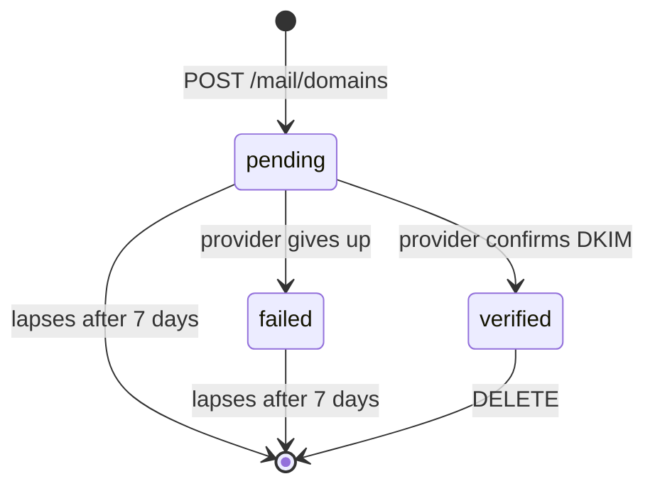

This is the route reference for hosted [Agent Inboxes](/docs/extend/develop/agent-inboxes). For
the self-hosted process, see [Standalone Ryu Mail](/docs/standalone/mail).

## Authentication

The hosted API is mounted under `/api/mail`. Authenticate with one of:

- a signed-in **session** for the current user and active organization; or
- an organization-scoped `x-gateway-key` for programmatic access. This is what makes it an agent
  service: an agent presents its node's gateway key and reads and sends its own mail with no
  interactive session.

Team and personal node credentials cannot access organization-wide Mail and get `403` with
`code: "node_not_org_scoped"`.

When the service is not configured, every route except `GET /mail/status` returns **503**. Nothing
(pods, domains, webhooks, scheduled drafts) is stored that could fail later, and the status
endpoint reports availability.

### What a gateway key can do

A gateway key acts for its own node.

| A gateway key can | A gateway key cannot (403) |
|---|---|
| Read and send from the organization's shared inboxes | Change custom domains or pods |
| Read and send its own node's agents' mail | Change organization- or pod-wide lists |
| Change settings and allow/block lists of its own node's agent inboxes | Create or change shared inboxes, or change other nodes' agent inboxes |

Use a signed-in session with Mail management permission for the refused operations.

### Refusals

Refusals use the shape `{ error, code, message?, suggestions?, retryAfterSeconds? }`. A `429` also
sets the `Retry-After` header.

## Routes

**Mailbox and agent addresses (session only).** A gateway key gets `403` with
`code: "session_required"`.

| Method and path | Purpose |
|---|---|
| `GET /mail/mailbox` | Returns `{ mailbox, selection, aliasHostsEnabled }`. `mailbox` is `null` until the organization claims or adopts one, and `selection.required` and `selection.candidates` then list the existing shared inboxes an admin can choose from |
| `GET /mail/mailbox/check` | With `?handle=`, whether a handle can be claimed, with the mailbox `address` and `aliasHost` it would name, a `reason`, and `suggestions`; rate-limited |
| `POST /mail/mailbox` | Claim the mailbox `{ handle, confirmAddress, name? }`; `confirmAddress` must be the exact address. `201`, or `200` when the same handle is already yours |
| `POST /mail/mailbox/adopt` | Make one of your shared inboxes the mailbox at its unchanged address `{ inboxId, confirmAddress }` |
| `POST /mail/mailbox/alias-host` | Choose the agent address host once `{ label }`, for a mailbox that has none yet |
| `PATCH /mail/mailbox` | `{ name?, enabled?, aliasClaimPolicy?, brandingRemoved? }`; the address and handle never change |
| `GET /mail/aliases` | Every agent address, `?status=pending\|active\|revoked&cursor=&limit=`, with `usage: { used, limit }` |
| `GET /mail/aliases/check` | With `?localPart=&domainId=`, whether an admin can assign a name; rate-limited |
| `POST /mail/aliases` | Assign an address to an agent `{ agentId, localPart, displayName?, domainId? }`; always active |
| `POST /mail/aliases/:id/approve` · `/reject` | Decide a pending claim |
| `POST /mail/aliases/:id/revoke` | Retire an address `{ reason? }` |
| `POST /mail/aliases/:id/reinstate` | Return a revoked address to the same agent within 30 days |
| `POST /mail/aliases/:id/transfer` | Move an active address to another agent `{ agentId, confirmAddress }` |
| `PATCH /mail/aliases/:id` | Change the sender name `{ displayName }` |
| `GET /mail/send-policy` · `PUT /mail/send-policy` | Read or set the send policy, `?aliasId=` / `{ aliasId?, mode, maxRecipientsPerMessage?, newRecipientsPerDay?, preApprovedDomains? }`; `aliasId: null` sets the default |
| `DELETE /mail/send-policy/alias/:aliasId` | Remove one address's policy override |
| `GET /mail/approvals` | Agent sends waiting for approval, with every recipient, Reply-To, headers, both bodies, attachments, and reasons |
| `POST /mail/drafts/:id/approve` · `/reject` | Send or discard a held agent send |

**Agent routes (gateway key or session).** `:agentId` is `<nodeId>:<agentId>` (see
[Agent addresses](/docs/extend/develop/agent-inboxes#agent-addresses)). Every route reads and writes only that agent's own address.

| Method and path | Purpose |
|---|---|
| `GET /mail/agents/:agentId/alias` | `{ alias, mailbox: { address, aliasHost } }`; `alias` is `null` before a claim |
| `GET /mail/agents/:agentId/alias/check` | With `?localPart=&displayName=`, whether the agent can claim a name; without `localPart`, the name derived from `displayName` is checked; rate-limited |
| `POST /mail/agents/:agentId/alias` | Claim the agent's address `{ localPart?, displayName?, domainId? }`. Returns `201` with `status` `active` or `pending_approval`, or `200` with `status: "existing"` |
| `GET /mail/agents/:agentId/messages` | The agent's mail, newest first, `?cursor=&limit=&unread=` (limit 1–50, default 20) |
| `GET /mail/agents/:agentId/messages/:messageId` | One message; marks it read |
| `GET /mail/agents/:agentId/threads/:threadRef` | One conversation, oldest first. `threadRef` is the `threadId` of a message or list row (any message id of the agent's mail works); another agent's message id returns `404` |
| `POST /mail/agents/:agentId/send` | `{ to, cc?, subject, text, replyTo? }`. Returns `200 { status: "sent", messageId }`, or `202 { status: "pending_approval", draftId, reasons }` |
| `POST /mail/agents/:agentId/messages/:messageId/reply` | `{ text, replyAll? }`, answered like send |
| `GET /mail/agents/:agentId/verification-codes` | `?sinceMinutes=&fromDomain=` (1–1440 minutes, default 30): sign-up codes and links from recent mail |
| `GET\|POST /mail/agents/:agentId/inbox` | Deprecated. The agent's address shaped as an inbox; `POST` claims it like `POST /mail/agents/:agentId/alias` |

**Inboxes, messages, and the rest.**

| Method and path | Purpose |
|---|---|
| `GET /mail/status` | `{ configured, domain }`, no auth |
| `GET /mail/usage` | The allowance and what it has used: `allowance` (inbox, address, email, and storage limits, `null` when unlimited, plus emails sent this month) and `aliases.used` |
| `GET /mail/inboxes` | List the caller's inboxes, `?agentId=` to filter to one agent; a gateway key never sees the mailbox or other nodes' agent inboxes |
| `POST /mail/inboxes` | Closed to new inboxes: `409` with `use_mailbox_setup`, or `use_alias_claim` when an `agentId` is given. A repeated request with the `clientId` or `agentId` of an existing inbox still returns it |
| `GET /mail/addresses/check` | With `?localPart=&domainId=`, whether an address can be used, why not, and alternatives; rate-limited |
| `POST /mail/inboxes/:id/address` | Always `409` with `code: "address_permanent"` |
| `GET /mail/inboxes/:id` | A single inbox |
| `PATCH /mail/inboxes/:id` | Rename, toggle, set the webhook, or rotate its signing secret with `rotateWebhookSecret: true` |
| `DELETE /mail/inboxes/:id` | Delete an older inbox with its messages, stored raw MIME and attachments, drafts, and events; its address stays retired. The mailbox returns `409` with `code: "mailbox_permanent"` |
| `GET /mail/inboxes/:id/messages` | List/search messages, `?direction=`, `?labels=`, `?q=`, and `?limit=` |
| `GET/PATCH/DELETE /mail/inboxes/:id/messages/:messageId` | Read, label/mark, or remove one message with its stored objects and events |
| `GET /mail/messages/:id` | One message, scoped through its inbox |
| `POST /mail/inboxes/:id/messages/:messageId/reply` | Threaded reply |
| `POST /mail/inboxes/:id/messages/:messageId/reply-all` | Threaded reply to all visible recipients |
| `POST /mail/inboxes/:id/messages/:messageId/forward` | Forward a message |
| `GET /mail/inboxes/:id/threads` | List/search conversation threads |
| `GET/POST/PATCH/DELETE /mail/inboxes/:id/drafts...` | Save, schedule, update, delete, or send drafts |
| `POST /mail/inboxes/:id/send` | Send `{ to, cc?, bcc?, subject, text?, html?, replyTo?, attachments?, headers?, labels?, references?, inReplyTo?, trackOpens?, clientId?, fromAliasId? }`, plan + quota gated |
| `GET /mail/inboxes/:id/metrics/usage` | Message count and stored bytes for the inbox, plus the allowance it draws on: limits, emails used this month, and stored bytes |
| `GET/POST/PATCH/DELETE /mail/webhooks...` | Signed event webhooks, custom header names, and delivery records; `aliasIds` narrows a webhook to some agent addresses; `PATCH` with `rotateSecret: true` replaces the signing secret |
| `GET /mail/events` | Replay durable received, blocked, sent, delivery, and open events |
| `GET/POST/DELETE /mail/lists...` | Manage `send`, `receive`, or `reply` allow/block entries for inboxes, pods, organizations, or users |
| `GET/POST/PATCH/DELETE /mail/pods...` | Group inbox and webhook scope; `PATCH` renames a pod |
| `GET/POST/PATCH/DELETE /mail/domains...` | Register custom domains and change their subdomain, tracking, and pod settings |
| `POST /mail/domains/:id/verify` | Check the domain's DNS verification and update its `status` |
| `POST /mail/inbound` | Public AWS SNS webhook for SES inbound |

## Custom domains

Custom domains need a paid plan or an Enterprise contract. A personal account can hold up to 5
custom domains and an organization up to 20, verified or not. See
[Agent Inboxes billing](/docs/billing/agent-inboxes#custom-domains) for the plans that include them.

Registering a domain with `POST /mail/domains` returns it as `pending` with the DNS `records` to
publish and an `expiresAt` time. Each record has a `type`, `name`, `value`, `ttl`, `purpose`, and
`required` flag:

- **`dkim`** (required): three `CNAME` records that prove you control the domain and sign its mail.
- **`inbound`** (optional): an `MX` record. Add it only if the domain should receive mail through
  Ryu, because it routes all of the domain's mail here. A dedicated subdomain such as
  `agents.example.com` keeps your existing mail untouched.
- **`spf`** (optional): an SPF `TXT` value. If the domain already has an SPF record, merge the
  `include:` into it rather than adding a second one.

### Verification

After the records are published, the service re-checks a pending domain automatically: every
10 minutes for its first hour, then hourly. Call `POST /mail/domains/:id/verify` only to check
right away.

The domain becomes `verified` only when both hold:

- the mail provider confirms this domain's own DKIM records (verification inherited from a parent
  domain doesn't count); and
- the three `dkim` CNAMEs resolve at the registered name.

This can take up to 72 hours while DNS propagates. Until then the domain stays `pending`, or becomes
`failed` if the provider gives up. Verifying again later also catches a domain whose records were
removed.

Only a `verified` domain can host agent addresses. Claiming one on any other domain returns `409`.

A registration that isn't verified within 7 days lapses. It is removed along with its
verification, and anyone who controls the domain can register it again. Verified domains don't
lapse. Registrations made before this limit existed lapse 7 days after they were created unless
they are verified.

### Ownership and removal

A domain can be registered by one account at a time:

- Another account can't register the same domain, one of its subdomains, or a domain above it.
- Nobody can register a subdomain of a domain the service operator manages, or the shared mail
  domain, its parents, or its subdomains.

If the provider can't be reached at registration, the domain is still saved as `pending` with a
`verificationError`. Verify again later.

Deleting a domain also removes its verification. If the provider can't remove it right away,
`DELETE` answers `202` with `cleanupPending: true`. In that case:

- The domain is gone from your account and no longer counts toward the limit.
- The service retries the removal in the background.
- Until it finishes, registering the same domain again returns `409` saying it is still being
  removed. Try again a few minutes later.

`identityManagedBy` is `ryu` once Ryu has set up the domain's verification, or `operator` for a
domain whose verification the service operator manages. Verifying an `operator` domain reports its
stored `status` and changes nothing.

## Events and open tracking

Mail events (`GET /mail/events` and `GET /mail/inboxes/:id/events`) are kept for 90 days after they
are recorded, then removed automatically. This is the same window a deactivated inbox's stored mail
is retained. Messages are not affected.

Webhook delivery records (`GET /mail/webhooks/:id/deliveries`) follow the same 90-day window from
the first attempt. Deliveries are retried only right after the event is recorded, so none is still
pending when its record is removed. Keep your own copy of any event you need for longer, for
example from webhook deliveries.

`trackOpens: true` adds a one-pixel image to the HTML body when open tracking is enabled for the
service. The first load records a `message.opened` event.

- Without `trackOpens: true`, no pixel is added.
- Plain-text messages are never tracked.
- Loading the pixel URL of a message sent without tracking still returns the image but records no
  open.

## Addresses, policies, and headers

### Send, receive, and reply policies

- Every outbound recipient must satisfy the `send` policy.
- Every inbound sender must satisfy the `receive` policy. Messages without a sender are rejected.
- Replies must also satisfy the `reply` policy, including explicit reply actions when the original
  message has no Message-ID.
- Remote attachment URLs must use public HTTPS destinations. The service checks and pins the
  resolved address during download and limits each attachment to the send size cap.

### Reserved names

On the shared mail domain and on agent address hosts, nobody can claim role and operator names,
admins included:

- role mailboxes such as `postmaster`, `abuse`, `admin`, `hostmaster`, `webmaster`, `security`,
  `support`, `billing`, and `noreply`;
- operator prefixes such as `admin2` or `postmaster-eu`.

The request returns `409` with `code: "address_reserved"` (`alias_reserved` for an agent address).

On a verified custom domain the organization owns the names. An agent still can't claim role names
such as `admin`, `billing`, `support`, `ceo`, or `noreply` there: its claim returns `403` with
`code: "alias_admin_only"`. An admin can assign them with `POST /mail/aliases`.

### Permanent addresses

Every address, once claimed, is reserved forever. It is never renamed, released, or given to anyone
else, including after its inbox is deleted, the plan ends, or the organization is deleted.

A taken or retired address, and a mailbox handle that looks like another owner's (such as `acrne`
for `acme`), answers `address_unavailable` with the message "That address is taken, and addresses
are never reissued, so retrying it cannot succeed. Choose a different name."

Address checks are limited to 10 a minute and 60 an hour per organization or personal account.
Over that, they return `429` with `code: "rate_limited"`.

### Recipients and list entries

- **Recipients.** Each `to`, `cc`, `bcc`, and `replyTo` entry must be one mailbox, either a bare
  address or `Name <address>`. Comma lists and groups in a single entry are rejected.
- **Allow and block matching.** Lists are evaluated against the bare address, so a display name
  can't hide a blocked destination.
- **`email` entries.** Stored as the bare, lower-cased address, so `"Name" <Person@Example.com>` is
  saved as `person@example.com`. A comma list or group is rejected.
- **`domain` entries.** Stored without a leading `@`, and match addresses at exactly that domain.
  Without an `entryType`, a value with no `@` is treated as a domain.

Reading or deleting an entry by path accepts either spelling.

### Authenticated inbound senders

The `From` header can be forged. An inbound allow-list entry only matches when both hold:

- SES reports a DMARC `PASS` for the sender's domain; and
- the message has exactly one `From` mailbox.

Mail from a domain that fails or has no DMARC policy, or with duplicate `From` fields or several
`From` addresses, can't satisfy an allow list. Block entries still apply to every claimed sender.

Mail with an SES virus verdict of `FAIL` is never stored. Each stored inbound message carries SES's
`authentication` verdicts (`spf`, `dkim`, `dmarc`, `spam`, `virus`) in the API and webhook payloads.

### Custom headers

`headers` can't set addressing, MIME, or threading headers, or `Sender`, `Return-Path`,
`Resent-*`, `DKIM-Signature`, `Authentication-Results`, `ARC-*`, `Received-SPF`, or `X-SES-*`.

## Related

<Cards>
  <DocCard href="/docs/extend/develop/agent-inboxes" />
  <DocCard href="/docs/extend/develop/agent-inboxes-sending" />
  <DocCard href="/docs/billing/agent-inboxes" />
</Cards>
