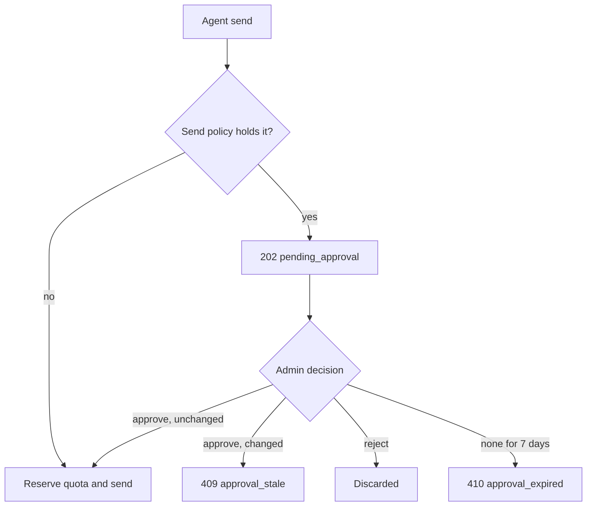
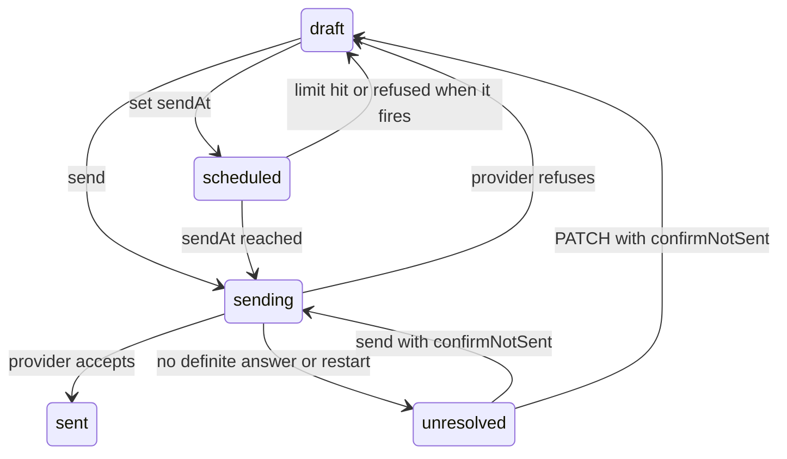

This page covers sending through hosted [Agent Inboxes](/docs/extend/develop/agent-inboxes). The
routes are listed in [Agent Inboxes API](/docs/extend/develop/agent-inboxes-api).

## Sending as an agent

An agent always sends as its own address, with its `displayName` as the sender name. A reply goes
out as the address that received the original.

| Refusal | Status | Cause |
|---|---|---|
| `from_not_allowed` | 400 | The request sets `from` |
| `reply_to_not_allowed` | 400 | `replyTo` is not the agent's own address |
| `alias_revoked` | 403 | The agent's address was revoked |
| `alias_missing` | 409 | The agent has no address |
| `mailbox_inactive` | 403 | The mailbox is disabled |

A signed-in member sends as the mailbox by default, or as an agent's address by passing
`fromAliasId` to `POST /mail/inboxes/:id/send`. A member's `replyTo` must be an external address or
one the organization owns.

### Send approval

The service, not the agent's node, decides whether an agent's send needs a person's approval. The
send policy applies to agent sends. Sends by members with `mail.manage` are exempt, because they
are the approvers.



| Setting | Default | Meaning |
|---|---|---|
| `mode` | `first_contact` | `auto` sends; `first_contact` holds a send to anyone the address has not corresponded with; `always` holds every send |
| `maxRecipientsPerMessage` | 10 | A send to more recipients is held |
| `newRecipientsPerDay` | 20 | A send that takes the address past this many new recipients in a day is held |
| `preApprovedDomains` | none | Recipients at these domains never count as new |

The recipient limits apply in every mode. `PUT /mail/send-policy` sets the organization's policy,
or one address's override with `aliasId`.

#### Known recipients

- A recipient becomes known after an approved send to them, or after they send authenticated mail
  to that address.
- Under `auto`, a recipient a send reaches is known from then on, so repeat sends to them don't
  count as new recipients again.
- Each address has its own contacts, so one agent's contacts never approve another agent's sends.
- People an existing inbox already exchanged mail with before send approval was introduced
  (recipients of its delivered sends and authenticated senders it received from) start out known.
  Turning on `first_contact` doesn't hold mail to them.

#### Held sends

A held send returns `202` with `status: "pending_approval"`, a `draftId`, and the `reasons`
(`policy_always`, `first_contact`, `over_recipient_cap`, `over_new_recipient_limit`). It uses no
send quota until it is approved.

An admin reviews it in `GET /mail/approvals` and decides with `POST /mail/drafts/:id/approve` or
`/reject`. Each approval lists everything that would be sent: To, Cc, Bcc, Reply-To, headers, the
text and HTML bodies, and each attachment's name, type, and size.

| Refusal | Status | Cause |
|---|---|---|
| `approval_stale` | 409 | Something changed since the request. Approval sends exactly what was reviewed |
| `approval_pending` | 409 | The agent tried to edit a held send. It sends again instead |
| `approval_expired` | 410 | The request is older than 7 days |

## Sending rate limits

Besides the monthly send quota, every plan has short-window limits that stop an agent loop from
sending in bursts:

| Limit | Sends |
|---|---|
| One agent address, per minute | 20 |
| One inbox, per minute (the mailbox: 60) | 20 |
| One organization or personal account, per minute | 60 |
| One organization or personal account, per hour | 600 |

A send over a limit returns `429` with `code: "send_rate_limited"` and these fields:

- `limit`, `window` (`minute` or `hour`), and `subject` (`alias`, `inbox`, or `account`);
- a `retryAfterSeconds` value, plus a `Retry-After` header.

A refused send uses none of the monthly quota. Replies, forwards, and drafts sent now count toward
these limits. A scheduled draft that hits a limit returns to the `draft` state.

## Plan gating

Quotas are decided by the shared plan catalog. Per-plan mailbox, agent address, monthly email, and
stored-mail allowances are listed in
[Agent Inboxes billing](/docs/billing/agent-inboxes#limits-by-plan). Check your current plan with
`GET /mail/usage` before claiming an address or scheduling a send.

### Who is metered

- Claiming the mailbox or an agent address gates on a live entitlement.
- A paid plan meters its organization or personal account.
- The Free baseline is one allowance per person. An organization without a paid plan draws on its
  owner's inbox, email, and storage allowance, shared with the owner's personal workspace and their
  other unpaid organizations.

### How sends are counted

Sending atomically reserves durable monthly units before the provider call. Each listed recipient
counts as one email.

- A send the provider refuses releases the units.
- An accepted send stays counted, even if its history row needs reconciliation.
- An `unresolved` send stays counted, because it may have been delivered.

### Sending past the monthly allowance

On a paid plan, a send past the monthly allowance goes ahead while the organization has credits.
Each recipient beyond the allowance is charged once the provider accepts the message. See
[Agent Inboxes billing](/docs/billing/agent-inboxes#sending-past-the-monthly-allowance) for the price.

| Situation | Result |
|---|---|
| No credits, the Free baseline, or an Enterprise contract limit | `403` |
| The service briefly can't check or record a charge | `503` without sending; retry it |

### Agent address limits

- Pending and active agent addresses count toward the address limit, and so do agent inboxes
  created before mailboxes. Revoked addresses don't.
- Agent addresses add no emails or storage. They share their organization's allowance.
- On the Free baseline, a person who already has a mailbox in one organization gets `403` with
  `code: "mailbox_requires_plan"` for a second organization's mailbox.
- An organization already over a limit when it moved to mailboxes keeps everything it has. Only new
  claims are refused.

### Stored mail

Stored mail counts message bodies, attachments, and unsent drafts in every inbox the allowance
covers, including paused and deactivated ones. Sends, replies, forwards, and drafts that would
exceed it are refused.

Inbound mail over the cap, or for a deactivated inbox, is not stored. The service records a
`message.received.blocked` event (sent to signed webhooks) and, when storage is full, notifies the
inbox's readers.

After a downgrade, inboxes beyond the Free baseline's one mailbox pause sending for a 30-day grace
period, then deactivate. Inboxes are kept active oldest first. See
[Agent Inboxes billing](/docs/billing/agent-inboxes) for the full enforcement rules.

## Send permissions

Organization session callers need `mail.manage` to send, reply, forward, or schedule a draft.
Creating or updating a draft with a send time uses the same permission. Read-only access with
`mail.read` does not authorize sending.

When a scheduled draft fires, the service checks again before sending:

- Agent Inboxes are still enabled for the organization.
- The member who last scheduled or edited it still has `mail.manage`.
- For a draft last scheduled or edited with a gateway key, that key is not revoked or expired,
  still allows mail, and still reaches the inbox.

If a check fails, the draft returns to an unscheduled draft without sending.

## Deletion

Deleting a message, thread, or inbox removes its stored objects first. If storage refuses, the
request returns `503` and keeps every message record so you can retry. An inbox stays disabled
until the retry succeeds.

## Retries and idempotency

### Inbound notifications

- Inbound SES delivery ids are unique per inbox and agent address, so retries are
  storage-idempotent.
- Repeated SES delivery, bounce, and complaint notifications update a message once and produce one
  event each.
- A later notification never moves a message back from bounced, complained, or opened.

Two webhook paths run after storage. Both are best-effort and cannot delay the public inbound
acknowledgement.

| Path | Delivery |
|---|---|
| An inbox's own `webhookUrl` | Called after storage with SSRF checks and time bounds, one attempt per message |
| A managed webhook resource | A signed event envelope with bounded retries |

Only members with `mail.manage` (and gateway keys) can read an inbox's `webhookUrl`. Other members
see only `webhookConfigured` and `webhookSigned`.

### Idempotency-Key

`Idempotency-Key` makes sends, replies, forwards, and draft sends safe to retry. Keys are kept for
30 days. The key is claimed before anything is sent.

| Retry situation | Result |
|---|---|
| Same key, different request data | `409` |
| Same key, the first request is still being sent | `409`, still in progress. Retry shortly to get the stored message |
| The first request was refused before sending (monthly limit, mail provider) | The key is not used up |
| The first send ended without a definite answer, or never finished | `409`, outcome unknown |

For an unknown outcome, check the inbox's sent messages. Send again with a new key only if the
message is not there.

JSON request bodies for inbox routes are limited to 24 MiB. Larger bodies return `413`.

### Drafts



- A draft that is already being sent, or has been sent, cannot be sent again or edited. Those
  requests return `409` even with the same key.
- A draft send that the mail provider refuses returns the draft to its previous state. A scheduled
  draft refused when it fires becomes an unscheduled draft.

A draft send that ended without a definite answer from the provider may have been delivered. The
draft moves to `unresolved` instead, with its `sendAt` cleared. A draft left being sent by a
service restart moves there too.

The scheduler never sends an `unresolved` draft, and sending or editing it returns `409` until you
confirm:

1. Check the inbox's sent messages first. If the message was delivered, delete the draft.
2. If it is not there, send the draft with `{"confirmNotSent": true}` in the body of
   `POST /mail/inboxes/:id/drafts/:draft_id/send`.
3. Or include `"confirmNotSent": true` in a `PATCH` to edit or reschedule it. An edit without a new
   `sendAt` returns it to `draft`.

Confirming also marks a message that the earlier attempt left `queued` as `unresolved`, so the
confirmed send goes out instead of being answered with that message. If Ryu recorded the provider
accepting the earlier attempt, that message answers the send and the draft is marked sent without a
second copy.

## Verifying webhook deliveries

Managed webhooks and inbox `webhookUrl` deliveries are signed with
[Standard Webhooks](https://www.standardwebhooks.com/), so the Standard Webhooks and Svix libraries
verify them with the webhook's secret. Each signed delivery carries:

```text
webhook-id: <event id>
webhook-timestamp: <unix seconds>
webhook-signature: v1,<base64>
```

The same values are repeated as `svix-id`, `svix-timestamp`, and `svix-signature`.

To verify a delivery by hand:

1. Take the base64-decoded part of the secret after `whsec_` as the key.
2. Compute a base64 HMAC-SHA256 over `<webhook-id>.<webhook-timestamp>.<raw body>`.
3. Compare it with the `v1,` value in `webhook-signature`.
4. Reject deliveries whose timestamp is far from your clock. The libraries allow five minutes by
   default.

The id is the event id, so use it to deduplicate. An inbox `webhookUrl` delivery uses the id of the
`message.received` event for the same message.

### Secrets

Secrets are returned once:

- a managed webhook's `secret` on create;
- an inbox's `webhookSecret` when its `webhookUrl` is first set with `PATCH`.

`PATCH /mail/webhooks/:id` with `rotateSecret: true`, or `PATCH /mail/inboxes/:id` with
`rotateWebhookSecret: true`, returns a new secret once. The old secret stops verifying immediately.
Clearing an inbox's `webhookUrl` also removes its secret.

The mailbox's own `webhookUrl` receives message metadata only, without message bodies or previews,
because the mailbox holds every agent's mail. Use a managed webhook for full payloads.

### Older integrations

Existing integrations keep working:

- **Inbox webhooks configured before signing** have no secret and keep receiving unsigned requests
  (`webhookSigned: false`) until you rotate the secret or set the URL again.
- **Managed webhooks created before Standard Webhooks signing** report `signatureScheme: "legacy"`.
  - Their `webhook-signature` already uses the Standard Webhooks key, so a Standard Webhooks library
    verifies the `webhook-*` headers with the existing secret.
  - Their `svix-signature` is still keyed by the UTF-8 bytes of the whole `whsec_...` secret,
    prefix included, as earlier versions signed it.
  - Svix SDKs check the `svix-*` headers first. Rotate the secret before switching to one, which
    moves the webhook to `signatureScheme: "standard"`.

A custom header can't use a name the signer sets (`webhook-id`, `webhook-timestamp`,
`webhook-signature`, any `svix-*` name, `content-type`, `content-length`, `host`, or `cookie`).

## TypeScript client

The public TypeScript client exposes the same developer surface as `client.mail.send`,
`client.mail.listThreads`, `client.mail.createDraft`, `client.mail.createWebhook`,
`client.mail.rotateWebhookSecret`, `client.mail.verifyDomain`, and the list/domain/pod methods.

Hosted callers authenticate as described in
[Agent Inboxes API](/docs/extend/develop/agent-inboxes-api#authentication). Self-host callers use
the standalone Mail bearer and the same path spelling.

## Related

<Cards>
  <DocCard href="/docs/extend/develop/agent-inboxes" />
  <DocCard href="/docs/extend/develop/agent-inboxes-api" />
  <DocCard href="/docs/billing/agent-inboxes" />
</Cards>
