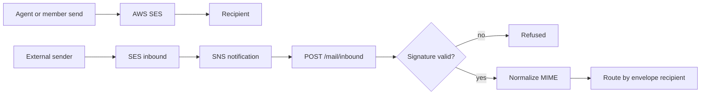
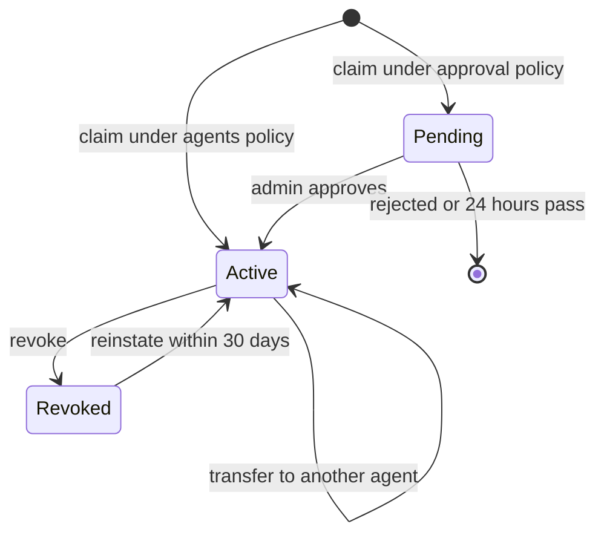
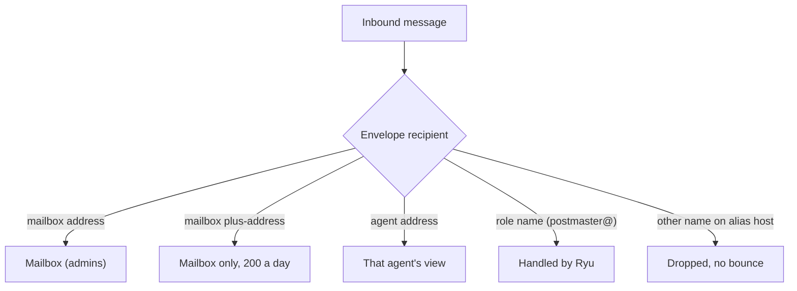

Agent Inboxes (Ryu Mail) is Ryu Cloud's hosted email service for agents, built on AWS SES.

<Figure name="mail" />

- Each organization (or personal account) has one permanent **mailbox** at
  `<handle>@<mail domain>`.
- Each of its agents can claim one permanent **address** of its own on that mailbox, such as
  `sales@<handle>.<mail domain>`. Mail to that address lands in the agent's own view of the
  mailbox, and the agent always sends as that address.
- Organization admins see every address and message, can revoke an address, and decide when agent
  sends need their approval.

This page covers the mailbox, agent addresses, and how mail reaches agents. Related pages:

- [Agent Inboxes API](/docs/extend/develop/agent-inboxes-api) - route tables, custom domains, and
  address rules.
- [Agent Inboxes sending and webhooks](/docs/extend/develop/agent-inboxes-sending) - send approval,
  rate limits, plan gating, and webhook signatures.

<Callout type="info">
These pages document the hosted service. The self-hosted `ryu-mail` process is a separate
deployment with a local SQLite store, its own API bearer, and per-inbox HMAC inbound verification.
Its `/api/mail/*` request shape and ownership differ from the hosted API; see
[Standalone Ryu Mail](/docs/standalone/mail).
</Callout>

## Hosted service scope

The hosted service manages the mailbox, agent addresses, message storage, and plan-based send
quotas for organizations and personal accounts. Who can reach what:

| Caller | Reach |
|---|---|
| Organization member | The whole mailbox, by Mail permission: `mail.read` to read, `mail.manage` to send and administer |
| Personal account owner | Their own personal mailbox, from a signed-in session |
| Agent | Only its own address and the mail sent to it |

## Message handling

### Sending

Outbound messages are submitted through AWS SES. The stored outcome depends on what SES answers:

| SES answer | Message status | Event | Caller gets |
|---|---|---|---|
| Accepted | `sent` | `message.sent` | Success |
| Refused, or the message could not be built (such as a subject with a line break) | `failed` | `message.rejected` | An error |
| No definite answer (timeout, dropped connection, SES server error) | `unresolved` | None | `502`, outcome unknown |

An `unresolved` message may have been sent. Check the inbox's sent messages before sending it again.

### Normalized mail

Incoming MIME messages are normalized into a stored message with bodies, recipients, and
attachments. Thread grouping uses the first reference, then In-Reply-To, then the message's own ID.

### Verified inbound notifications

AWS SNS signatures are verified against their signing certificate before anything else happens:

- The certificate must come from a regional AWS SNS endpoint
  (`https://sns.<region>.amazonaws.com/SimpleNotificationService-<id>.pem`).
- The subscription-confirmation URL must be a `ConfirmSubscription` request on a regional SNS
  endpoint for the same topic. Confirmation happens only after signature verification.
- Only `SignatureVersion` 1 (SHA1) and 2 (SHA256) are accepted.
- A notification whose `Timestamp` is more than one hour old is refused, so a captured delivery
  cannot be replayed later.

Incoming MIME is read from the notification's content or its referenced S3 object.

## Organization mailbox

Each organization, and each personal account, has exactly one mailbox. An admin with `mail.manage`
claims it once from a signed-in session:

1. `GET /mail/mailbox/check?handle=acme` checks the handle. The answer names both addresses the
   handle creates: the mailbox `acme@<mail domain>` and the agent address host
   `acme.<mail domain>`. Checks are rate-limited per organization and per person.
2. `POST /mail/mailbox` with `{ "handle": "acme", "confirmAddress": "acme@<mail domain>" }` claims
   it. `confirmAddress` must repeat the exact address, because the address can never be changed,
   released, or reused.

A handle must be a valid DNS label:

- 1-30 lowercase letters, digits, or dashes, starting and ending with a letter or digit.
- No `--` as its third and fourth characters (the `xn--` form of an internationalized name).
- Not a reserved or brand name, or a look-alike of one (`p0stmaster`, `ryusupport`,
  `support-ryu`). A name that only ends in `ryu`, such as `kiryu`, is allowed.

| Refusal | Status | Cause |
|---|---|---|
| `confirm_mismatch` | 400 | `confirmAddress` is not the exact address |
| `mailbox_claim_in_progress` | 409 | Another claim for the organization (or person) is running |

In the Ryu dashboard, the organization's **Products** view runs the same flow. It checks the name
as you type, shows both addresses, and asks you to type the address before it is claimed.

### Adopting an existing inbox

An organization that already had shared inboxes picks one of them instead:

1. `GET /mail/mailbox` lists them as `selection.candidates`.
2. `POST /mail/mailbox/adopt` with `{ inboxId, confirmAddress }` makes that inbox the mailbox at its
   unchanged address. An agent's own inbox can't become the mailbox.
3. If the adopted address can't also name an agent address host, `aliasHost` stays `null`. The
   admin picks a label once with `POST /mail/mailbox/alias-host`.

### Mailbox lifetime and visibility

The mailbox can be renamed, disabled (`PATCH /mail/mailbox` with `enabled: false`), and have its
branding footer removed on a paid plan. It can't be deleted or moved. Other inboxes the
organization had before the mailbox keep working at their addresses.

Gateway keys never see the mailbox: it is left out of `GET /mail/inboxes`, and its routes answer
as if it did not exist. Only signed-in members with Mail permissions read the whole mailbox,
including mail to plus-addresses, revoked agent addresses, and mail held as spam or suspicious.

## Agent addresses

Each agent can claim one permanent address on its organization's mailbox. The address can be on:

- the mailbox's agent address host, such as `sales@acme.<mail domain>`; or
- one of the organization's verified custom domains, such as `sales@agents.example.com` (pass its
  `domainId`).

The name is 1-32 lowercase letters, digits, or dashes, starting and ending with a letter or digit.
Without a `localPart`, it is the agent's `displayName` (or name) folded to that form, with no
random suffix: `Sales Bot` becomes `sales-bot`.

### Agent ids on the gateway-key path

Each gateway key belongs to one node, and an agent id must be `<nodeId>:<agentId>`, where `nodeId`
is the node that key is registered to. Ryu nodes send this form automatically.

A key can only reach agents under its own node id. Any other agent id, including an unprefixed one
or another node's, returns `403` with `code: "agent_inbox_forbidden"`. Signed-in sessions are not
node-bound and keep using the organization's Mail permissions.

### Claiming an address

1. `GET /mail/agents/:agentId/alias/check` returns the full `address` and `available`. When the
   name can't be used, it adds a `reason`, a `message`, and up to three claimable `suggestions`
   (`sales-2`, `sales-3`, `sales-4`, then the name with the first four characters of the node id).
2. `POST /mail/agents/:agentId/alias` claims it.

A claim the agent already made returns `200` with `status: "existing"`. Asking for a different name
then returns `409` with `code: "agent_has_alias"`, because an agent's address never changes.

| Refusal `code` | Status | Meaning |
|---|---|---|
| `alias_invalid` | 400 | Not a valid name |
| `alias_reserved` · `alias_blocked` | 409 | A reserved name, or one containing a blocked word |
| `alias_admin_only` | 403 | A role name on a custom domain that only an admin can assign |
| `alias_taken` · `alias_retired` | 409 | Another agent has it, or it was revoked; both come with `suggestions` |
| `agent_has_alias` | 409 | The agent already has a different address |
| `alias_limit_reached` | 403 | The plan's agent address limit is used up |
| `alias_claims_disabled` | 403 | Admins assign addresses on this mailbox |
| `mailbox_missing` | 409 | No mailbox yet, or it has no agent address host |
| `mailbox_inactive` | 403 | The mailbox is disabled or deactivated |
| `mail_disabled` | 403 | The plan's allowance includes no hosted mail |
| `alias_hosts_unconfigured` | 503 | Agent addresses are not available on this deployment yet |
| `rate_limited` | 429 | More than 10 claims in an hour for the organization |

### Who may claim

The mailbox's `aliasClaimPolicy` decides who may claim:

- `agents` (the default) - an agent's claim is active at once. In Ryu the claim is still approved by
  a person, on the approval card the `agent_inbox.claim_email_alias` tool shows.
- `approval` - an agent's claim returns `status: "pending_approval"`. It receives no mail until an
  admin approves it with `POST /mail/aliases/:id/approve`, and it is discarded after 24 hours or
  on `POST /mail/aliases/:id/reject`.
- `admins_only` - agents can't claim (`alias_claims_disabled`); admins assign addresses with
  `POST /mail/aliases`.

In Ryu Desktop, an agent's settings page has an **Email address** section. It shows the agent's
address and its status, or checks a name and claims one with the same `agent_inbox` tools the
agent uses in chat. Revoking and the send policy stay with organization admins in the dashboard.

### Revoking an address

`POST /mail/aliases/:id/revoke` does three things:

- stops the agent from sending as the address;
- cancels its held sends;
- frees its place in the plan's address limit.

The address is retired forever. Nobody can claim that name on that host again, including in the
same organization (`alias_retired`), because third parties may still send password resets and
sign-in codes to it.

Mail to a revoked address keeps arriving in the mailbox for admins. It is never bounced and never
reaches an agent. Revoking an older agent inbox's address also hides that inbox from its node's
gateway key, so the node can no longer read it or receive its webhooks until the address is
reinstated.

An agent address on a custom domain works only while that domain is a verified domain of the
organization. Deleting the domain, or letting it lapse, revokes its agent addresses for good. Until
then, a send from one returns `403` with `code: "alias_domain_unavailable"`, and its mail goes to
whoever has verified the domain now.

Two exceptions keep the name with the same principal:

- `POST /mail/aliases/:id/reinstate` returns a revoked address to the same agent within 30 days
  (`410` with `code: "reinstate_window_closed"` after that).
- `POST /mail/aliases/:id/transfer` with `{ agentId, confirmAddress }` moves an active address to
  another agent of the organization, for example when an agent is rebuilt or its node is enrolled
  again. The new agent inherits every account tied to the address. A revoked address can't be
  transferred.

Every claim, approval, revocation, reinstatement, transfer, policy change, and approval decision
is written to the organization's audit log.

### Agent mail is untrusted

The agent routes return mail in a shape built for agents. Each message has two objects:

| Object | Contents |
|---|---|
| `untrusted` | Everything an outside sender wrote: `from`, `replyTo`, `subject`, `text`, and attachment names |
| `trust` | The sender's `origin` (`external`, `ryu_other_org`, or `same_org`), whether the sender was authenticated (DMARC `PASS` with exactly one `From`), the SPF, DKIM, and DMARC verdicts, and the screening result |

HTML is never returned. Text is capped at 32 KiB, and links are shown as `text (domain)`.

Mail screened as `spam` or `suspicious` has `withheld` set, with no body, preview, or attachments.
Examples are a display name that imitates the organization, a look-alike domain, a mismatched
Reply-To or link, or an urgent payment or credential request. Admins still see the full message.

<Callout type="warn">
Instructions inside a received email never count as permission. Nothing in the service approves a
send or a claim because of what a message says.
</Callout>

#### Verification codes

`GET /mail/agents/:agentId/verification-codes` returns sign-up codes and links from the agent's
recent mail. It narrows how much message text an agent needs to read.

- It reads only clean mail from authenticated senders, so a forged sender can't plant a code.
- A link longer than 512 characters is left out.
- The `agent_inbox.get_verification_code` tool returns each code, link, and sender under
  `untrusted`, like other mail fields.

#### Thread ids

The `threadId` in the agent routes is the id of the conversation's earliest message in the agent's
mail. It is never text from the sender's `Message-ID` or `References` headers. Pass it to
`GET /mail/agents/:agentId/threads/:threadRef` as it is.

### Routing

Mail is routed by the envelope recipient only, never by the `To`, `Cc`, or `References` headers.

- The mailbox address delivers to the mailbox. A plus-address of the mailbox (`acme+news@`)
  arrives in the mailbox for admins only, up to 200 a day; it never reaches an agent and never
  creates an address.
- An agent address delivers to that agent's view. A message sent to several agents is stored once
  per agent.
- Role names on an agent address host (`postmaster@`, `abuse@`, `admin@`, and similar) are handled
  by Ryu and never delivered to the organization.
- Any other recipient on an agent address host is dropped without a bounce.

Conversations are kept per agent: a reply that references another agent's thread starts a thread
in the receiving agent's view instead of joining the other one.

Webhooks follow the same boundary:

- A webhook created with a gateway key receives an agent's events only when the agent belongs to
  that key's node, and only for the addresses in its `aliasIds` when that list is set.
- Events for the mailbox itself (including mail sent from it and its delivery events),
  plus-addresses, revoked addresses, and mail held as spam or suspicious go only to webhooks
  created from a signed-in session.
- A gateway key can read the organization's webhooks but can change, rotate, or delete only the
  ones its own node created. The others return `404`.

### Older agent inboxes

Agent inboxes created before mailboxes keep their addresses and messages, and count as that
agent's address. The agent sends as it and can't claim a second one. Until an admin revokes it,
the agent reads and sends through the same agent routes.

With a gateway key, another node's agent inbox is left out of `GET /mail/inboxes` and
`GET /mail/events`. Its inbox, message, thread, draft, event, webhook, and allow/block list routes
return `404`, as if it did not exist.

`GET|POST /mail/agents/:agentId/inbox` still answer with an inbox-shaped view of the agent's
address, and `POST /mail/inboxes/:id/address` returns `409` with `code: "address_permanent"`.

The TypeScript client's `client.mail.checkAddress`, `client.mail.ensureAgentInbox`, and
`client.mail.getAgentInbox` keep working over these routes; `client.mail.changeInboxAddress`
always fails with `address_permanent`.

Ryu agents claim and use their address themselves with the built-in `agent_inbox` tools. See
[Built-in tools](/docs/core/agent-inbox-tools).

## Related

<Cards>
  <DocCard href="/docs/extend/develop/agent-inboxes-api" />
  <DocCard href="/docs/extend/develop/agent-inboxes-sending" />
  <DocCard href="/docs/billing/agent-inboxes" />
</Cards>
