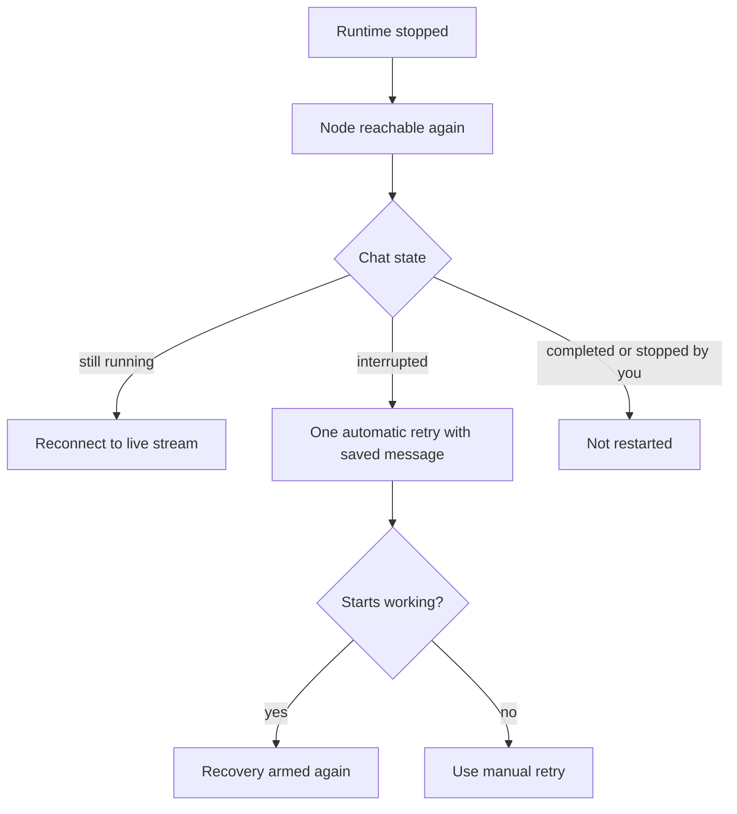

Ryu is an open-core project. Core is Apache-2.0 and Gateway is AGPL-3.0. Desktop, Island, and the
shared UI package are source-available under the Ryu Commercial Source License. The web app, server,
and mobile app are not published. Contributions to the published parts follow the workflow below.

## Repository layout

Ryu is a **Bun + Turborepo** monorepo. TypeScript apps and packages live under Bun workspaces; Rust
apps and crates form Cargo workspaces.

### Open-source units

| App / Crate | Stack | License |
|---|---|---|
| `apps/core` | Rust / Axum | Apache-2.0 |
| `apps/gateway` | Rust | AGPL-3.0 |
| `apps/cli` | TypeScript / Bun + OpenTUI | Apache-2.0 |
| `apps/ghost` + `crates/ghost/*` | Rust | Apache-2.0 |
| `apps/shadow` + `crates/ghost/shadow` | Rust | Apache-2.0 |
| `packages/sdk` | TypeScript | Apache-2.0 |
| `packages/create-ryu-app` | TypeScript | Apache-2.0 |
| `crates/sdk/core` + `ffi` + `napi` | Rust | Apache-2.0 |

### Source-available and closed units

| App / Package | Stack |
|---|---|
| `apps/desktop` | Tauri v2 + React |
| `apps/web` | Next.js |
| `apps/server` | Hono / TS |
| `apps/native` | Expo / RN |
| `apps/island` | Electron |
| `packages/ui` | React / Tailwind CSS |

Desktop, Island, and shared UI source is in the public repository. You can read it, build it
locally, and contribute fixes under the Ryu Commercial Source License, but it is not open source.
See [Open Core](/docs/start-here/architecture/open-core) for the full licensing boundary.

## Build system

### Prerequisites

- **Bun** 1.4.4 (the `packageManager` version in the root `package.json`)
- **Rust** (stable) for Core, Gateway, and Rust crates
- **Node.js** for TypeScript tooling (CI uses Node 22)

### Common commands

```bash
# Install all dependencies
bun install

# Run everything (all apps in parallel)
bun run dev

# Run a specific app
bun run dev:core      # Core on :7980
bun run dev:gateway   # Gateway on :7981
bun run dev:desktop   # Desktop (Tauri)
bun run dev:web       # Web on :3001

# Build everything
bun run build

# Remove generated JavaScript and Rust build artifacts
bun run clean

# Preview a local profile reset without deleting anything
bun run wipe -- --profile dev --depth full --dry-run

# Erase the dev profile, including downloaded engines and models
bun run wipe -- --profile dev --depth full --yes

# Regenerate the API reference pages for the docs site
bun run --cwd apps/fumadocs generate:docs
```

`bun run clean` only removes build output from the checkout. It does not touch Ryu's local data.

### Resetting a local profile

Use `bun run wipe` when you need a fresh local profile. The `dev` profile lives in `~/.ryu-dev`;
the `release` profile lives in `~/.ryu`.

| Flag | Effect |
|---|---|
| `--depth state` | Clears databases and app state, keeps the large `bin/`, `engines/`, and `models/` downloads |
| `--depth full` | Also removes those downloads |
| `--profile all` | Resets both canonical profiles |
| `--dry-run` | Previews the reset without deleting anything |

Ghost and Shadow keep their state inside the data folder (`services/ghost`, `services/shadow`), so
a profile wipe covers them.

### Turborepo

The monorepo uses Turborepo for task orchestration. Tasks declared in `turbo.json` run in
dependency order with caching. Run `turbo run build --filter=core` to build just Core and its
dependencies.

The full-stack `bun run dev` command uses Turbo's parallel mode. Its development processes are
independent and long-running, so it does not depend on a fixed worker count.

## Documentation site

### Versions

Ryu Docs publishes only the current release's documentation, so page URLs carry no version:
`/docs/start-here`, or `/es/docs/start-here` for a translated page. Links published by older
releases that name a version, such as `/docs/0.1.15/start-here`, permanently redirect to the same
page without the version segment. There is no separately maintained historical site.

### Mermaid diagrams

Fenced `mermaid` blocks render as interactive diagrams in the docs site. Click a diagram to open
the full-screen viewer.

| Action | Mouse | Keyboard (Tab to the diagram canvas first) |
|---|---|---|
| Zoom | Mouse wheel over the diagram (stays inside the viewer) | `+` and `-` |
| Pan | Drag | Arrow keys, hold Shift for larger steps |
| Fit | Choose **Fit** | `0` |

### Docs-site integrations

The public docs site keeps the reading, sharing, and agent-discovery paths connected:

- **Feedback**: select text in a paragraph, image, or list item to report the exact section, or
  use the page-level form at the end of the guide. Repeated submissions and busy feedback periods
  use an email draft, so you can still send your report without creating duplicate issues. The
  [Fumadocs feedback integration guide](https://www.fumadocs.dev/docs/integrations/feedback)
  describes the underlying authoring pattern.
- **OpenAPI**: Core and Gateway reference pages are generated from their schemas and rendered as
  interactive request and response documentation. Update the schema or generator, then run
  `bun run --cwd apps/fumadocs generate:docs`. Do not hand-edit generated endpoint pages.
- **Search and agent access**: Fumadocs search powers `/api/search`, while `/llms.txt`,
  `/llms-full.txt`, per-page Markdown projections, MCP, and WebMCP keep the same content useful to
  agents.
- **Sharing**: each guide publishes a title-specific Open Graph card, so links to individual pages
  preview the page being shared rather than a generic site image.
- **Link safety**: run `bun run --cwd apps/fumadocs lint:links` before publishing to validate content links, anchors,
  cards, and legacy version-shaped URLs.

## Code standards

### TypeScript

Ryu uses **Ultracite** (Biome-based) for formatting and linting:

```bash
bun x ultracite fix    # auto-fix formatting + lint issues
bun x ultracite check  # check without fixing
```

The repository also includes a separate anti-slop audit powered by Oxlint.

```bash
bun run check:anti-slop
```

This audit is separate from the default Biome check. Use it when working on type-boundary and
evidence-related code. Resolve its findings one at a time; do not weaken the rules or change the
repository's primary formatter.

Key rules:

- Use `const` by default, `let` only when reassignment is needed
- Arrow functions for callbacks
- Optional chaining (`?.`) and nullish coalescing (`??`)
- No `console.log` in production code
- Semantic HTML and ARIA attributes for accessibility

### Rust

- `cargo fmt` for formatting
- `cargo clippy` for linting
- `cargo test` for unit tests
- Error types use `thiserror` for library code, `anyhow` for application code

### Core-vs-Gateway rule

When placing new code, apply the single design rule:

- **What runs** (which agent, session, workflow, tool) belongs in **Core**.
- **What is allowed, shared, measured, or paid for** (security, routing, budgets, audit) belongs in
  **Gateway**.

Gateway owns model-request policy for traffic routed through its endpoint. Core owns orchestration
and execution access checks. Provider-native runtimes and direct integrations can have separate paths.

### Cross-surface consistency

New work follows one source of truth and explicit projections:

- **Ownership** follows the Core-vs-Gateway rule above. Core's share includes local files, Git,
  and sidecar lifecycle; Gateway's includes authentication, firewall, and evaluations.
  Client-side checks are not authorization.
- **JSON** is the default for machine-managed, cross-language, signed, or API-shaped data.
  **TOML** is for human-authored service policy. New Ryu-native YAML is not introduced; YAML that
  an external ecosystem requires remains in its native format.
- `manifest.json` is the native plugin/app source of truth. Interop manifests, Marketplace views,
  and generated SDK or mirror artifacts are projections and must not become parallel authoring
  surfaces.
- New public contracts use `camelCase` JSON fields and define stable IDs, versioning, limits, errors,
  timestamps, retries, permissions, and migration behavior. Existing contracts keep their field
  spelling for compatibility. Cross-language shapes get a shared contract or fixture test.
- Fumadocs uses MDX with YAML front matter as page metadata, not runtime configuration. Section
  navigation is JSON in `meta.json`, API reference pages are generated from OpenAPI, and public
  content must not expose private or unverified internal details.
- A user-facing change updates Fumadocs in the same change. Visual changes include rendered proof;
  a focused test, build, health check, release object, and fresh deployment are reported as
  separate evidence.

## PR workflow

### 1. Fork and branch

```bash
git checkout -b feat/my-feature
```

### 2. Make changes

- Keep changes focused: one logical unit per PR
- Write or update tests for new behavior
- Run the linter before committing

### 3. Verify

```bash
# TypeScript
bun x ultracite check

# Rust
cargo check --workspace
cargo test --workspace
cargo clippy --workspace
```

### 4. Commit

Use conventional commit messages:

```text
feat(core): add new hook phase for notification filtering
fix(gateway): resolve circuit breaker not tripping on 503s
docs(develop): add hooks & lifecycle reference page
```

### 5. Open a PR

- Describe what changed and why
- Link any related issues
- Include screenshots for UI changes
- Note breaking changes explicitly

## Testing

### Unit tests

Use the workspace's `test` script when running its complete suite. Workspaces
that isolate test files do so to keep module mocks and browser globals from
leaking between suites. Include both `.test.ts` and `.test.tsx` files when
checking test discovery.

Tests should call the production code and assert observable results. A missing
required fixture must fail the test, rather than return before its assertions.
Keep schema, security, and compatibility checks; avoid tests that only repeat
a constant already covered elsewhere or verify built-in language behavior.

```bash
# Rust
cargo build -p ryu-core -p ryu-test-sidecar
cargo test --workspace --no-fail-fast -- --test-threads=1

# TypeScript workspaces
bun run test

# Fenced Raycast extension
(cd apps/raycast && bun run test)
```

### Integration tests

Core's test suite includes live sandbox tests (`plugin_host::tests::live_*`) that run the real JS
sandbox against the built-in double-check, goal, and advisor hooks.

### Smoke tests

Run the dev server and verify the flow manually:

```bash
bun run dev:core
# In another terminal:
curl http://localhost:7980/api/health
```

## Working on the Gateway

The Gateway is AGPL-3.0. Key paths:

- `apps/gateway/src/router/` - model routing (smart and deterministic)
- `apps/gateway/src/pipeline/` - request pipeline
- `apps/gateway/src/firewall/` - firewall scans
- `apps/gateway/src/egress.rs` - outbound egress checks
- `apps/gateway/src/budget.rs` - budget enforcement
- `apps/gateway/src/evals.rs` and `apps/gateway/src/evaluators/` - eval scoring
- `apps/gateway/src/passthrough/` - Claude Code and Codex passthrough

## Working on Core

Key paths:

- `apps/core/src/server/mod.rs` - Axum routes and chat handler
- `apps/core/src/sidecar/` - sidecar lifecycle and ACP/OpenAI-compatible adapters
- `apps/core/src/plugins/` - plugin manifest, lifecycle, and binding registry
- `apps/core/src/plugin_host/` - turn hook runtime (JS sandbox)
- `apps/core/src/workflow/` - DAG engine and durable execution
- `apps/core/src/sidecar/mcp/catalog.rs` and `crates/core/tool-registry/` - unified tool catalog

### Chats across development reloads

<Callout type="info">
This applies only to the local **Dev** profile. Other profiles keep their own Core runtime and data
folder. See [Release Channels](/docs/start-here/release-channels) for the profile table and the
custom data-folder isolation caveat.
</Callout>

The local development stack keeps chat execution in a separate runtime. Reloading the desktop or
replacing its local Core entry point leaves running turns, tools, and pending approvals alive.
When the connection returns, the desktop reconnects to the same turn, including chats in
background tabs.

The execution runtime keeps the code version it started with. New turns use that same version
until you restart the runtime. Finish or stop running work before restarting to apply changes to
execution code.

#### When the execution runtime stops

If the execution runtime stops unexpectedly, Ryu remembers chats that were actively working. Once
the selected node is reachable, it checks each chat's current state.



- A turn that kept running reconnects to its live stream.
- An interrupted turn gets one automatic retry using its saved user message.
- Completed chats and chats you explicitly stopped are not restarted.
- Starting a new turn restores normal recovery for that chat.

How retries are tracked:

- Recovery records expire after 30 minutes and are kept separately for each node.
- An automatic retry is claimed before it starts, so another reload cannot start the same failed
  attempt again.
- Once a fresh snapshot confirms the retried chat is working, recovery is armed for a later
  interruption.
- If an attempt fails before the chat starts working, use the chat's manual retry action.

Normal release builds keep automatic retry optional through
[Reconnect Retry](/docs/plugins/reconnect-retry).

An explicit execution-runtime restart still interrupts running work. Recovery starts another turn
rather than restoring the model's original network connection.

## Working on the SDK

The TypeScript SDK (`packages/sdk/`) and Rust SDK (`crates/sdk/core`) share the Runnable contract.
The public source, binding projects, examples, and release workflow live in the
[SDK hub](https://github.com/amajorai/ryu-sdk); see [SDK Reference](/docs/extend/develop/sdk) for
the API surface.

```bash
# Build the native addon (required for model client)
cd crates/sdk/napi && npm run build

# Run SDK tests
cd packages/sdk && bun test
```

In a checkout of the SDK hub, `bun run test:packages` runs the complete public package gate.

## Community plugins

Third-party plugins are built with `manifest.json` and the SDK. The plugin runtime lives in
open-source Core, so Desktop stays extensible. See [Build an Extension](/docs/extend/develop/extensions) for the
three extension paths.

## Related

<Cards>
  <DocCard href="/docs/start-here/architecture/open-core" />
  <DocCard href="/docs/extend/develop/extensions" />
  <DocCard href="/docs/extend/develop/sdk" />
  <DocCard href="/docs/extend/develop/quickstart" />
</Cards>
