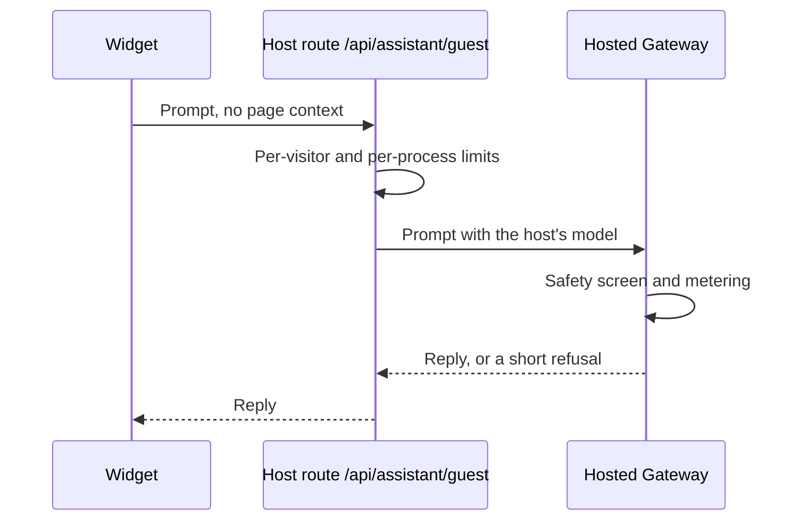

Ryu ships the assistant surface as a reusable UI package. Use it when your product needs the
same floating or docked chat surface as Desktop but owns its own route, transport, or
conversation policy.

| Surface | Choose it when |
|---|---|
| `RyuAssistantCoreChat` | You talk to a Ryu Core node and want the chat loop handled for you |
| `RyuAssistantChat` | Your application already owns chat state and the transport |
| `RyuAssistantWidget` | You want the complete public-site assistant behavior as-is |
| `RyuAssistantWidgetIframe` | The assistant is served by another route or deployment |

All of them use the same compact surface. The iframe form is a delivery boundary, not a second
chat implementation.

## Core-backed surface

For a [Ryu Core](/docs/core) node, the ready-made wrapper owns the chat loop and only needs a target:

```tsx
import { RyuAssistantCoreChat } from "@ryu/assistant-widget";

<RyuAssistantCoreChat
  agentId="ryu"
  placement="floating"
  target={{ token: nodeToken, url: "http://127.0.0.1:7980" }}
/>;
```

The target token stays in the host's memory and is sent directly to Core. Do not put it in an
iframe URL or expose it in a public page. Core still owns agent routing, grants, model policy,
and the chat stream.

Core keeps a saved reply running when its stream closes, so the wrapper's **Stop** control also
asks Core to cancel the conversation's turn (`POST /api/chat/cancel`). If you drive
`RyuAssistantChat` with your own transport on Core's chat stream, make your `onStop` handler send
that request with the same `conversation_id` as well as aborting the stream.

## React surface

Install or link `@ryu/assistant-widget`, then pass the same state that your chat transport already
uses:

```tsx
import { RyuAssistantChat } from "@ryu/assistant-widget";

export function AssistantPanel({ messages, sendMessage, status, stop }) {
  return (
    <RyuAssistantChat
      messages={messages}
      onSend={({ content }) => sendMessage({ text: content })}
      onStop={stop}
      placement="floating"
      status={status}
    />
  );
}
```

| `placement` | Layout |
|---|---|
| `docked` | Fills a sidebar-sized surface |
| `inline` | Fits an existing page layout |
| `floating` | The compact panel treatment, with the minimal composer. Attachments and secondary controls stay available through the host's chosen affordances |

| The primitive owns | The host owns |
|---|---|
| The transcript, shared `RyuAssistantComposer`, title row, recent-chat handoff, and responsive geometry | `messages`, `status`, `onSend`, `onStop`, authentication, and the server transport |

This split keeps provider credentials and product-specific policy out of the UI package.

For custom composition, use the lower-level `RyuAssistantWidgetFrame`,
`RyuAssistantWidgetHeader`, and `RyuAssistantRecentChats` primitives. Desktop uses these same
seams, so a shared surface does not need a second copy of the shell layout.

## Complete public-site assistant

Use `RyuAssistantWidget` when you want the complete public-site assistant as one reusable
component. It starts as the same compact launcher as Desktop's floating Ask Ryu window, expands
through `RyuAssistantMorph`, and offers browser-local, Ryu guest, and explicitly approved
local-node modes:

```tsx
import { RyuAssistantWidget } from "@ryu/assistant-widget/docs-assistant";

<RyuAssistantWidget docsBaseUrl="https://docs.ryuhq.com" />;
```

The shared chat surface owns the transcript and composer. The widget owns the runtime choice,
browser-model preparation, public-document grounding, and local credential boundary.

### Runtime modes

Choose the runtime from the settings button in the widget's header. Until the selected runtime can
answer, its setup (downloading the browser model or connecting a node) appears in the composer.

| `initialMode` | Runtime | Use it when |
|---|---|---|
| `"browser"` (default) | Local inference in the tab | Prompts should stay in the tab |
| `"guest"` | Ryu guest chat through the hosted Gateway | Visitors should get answers with no setup |
| `"node"` | A Core node you control, explicitly approved | You run your own node |

Layout options:

- `inline openOnMount showLauncher={false}` renders the assistant as an expanded page section.
- An explicit `max-width` on a custom `RyuAssistantMorph` surface fits the launcher on narrow
  mobile viewports.

The widget wears the same glass surface, title row, and composer as Desktop's floating Ask Ryu
window. It follows the page's light or dark appearance and does not force a nested dark mode
around the widget.

### Page context

On a browser page, once the Browser or Local node runtime is ready, the composer shows **Add current
page** and **Add selected text** chips. Both are off by default.

- An added chip's label opens a read-only preview of the exact text and its source. Its remove
  control takes it back out.
- Selected text means text selected on the page. Text selected inside the widget itself (the
  composer, the transcript, or a preview) is never sent as selected text.
- The widget announces newly selected text to assistive technology, and the chips work with the
  keyboard.
- Included text is sent with the next question to the chosen runtime. Ryu guest turns send only the
  question, so the chips do not appear in that mode.
- The widget reads only its own document and does not inspect a parent page around a hosted
  iframe.

### Ryu guest chat

Ryu guest chat needs no API key from the visitor.



- The widget sends each guest prompt, without page context, through the host's same-origin
  `/api/assistant/guest` route to Ryu's hosted Gateway.
- The Gateway screens every prompt with Ryu's platform safety floor and meters it like other hosted
  Gateway traffic.
- The host picks one low-cost model, so there is no model menu.
- The route also limits each visitor and each server process.
- A prompt the safety screen refuses gets a short refusal without the screen's reasons.
- When the host has not configured a guest lane, the widget shows the mode as unavailable instead
  of failing on send.

### Badge and reply images

When you embed the widget on a member's own site, pass `poweredByRyu` to show the
[Powered by Ryu badge](/docs/billing/powered-by-ryu) under the transcript. It is off by
default. Turn it on unless the member's plan removes the badge.

```tsx
<RyuAssistantWidget poweredByRyu={!memberPlanRemovesBadge} />;
```

Public-widget replies keep Markdown formatting and links, but display image descriptions
without loading images. Model output cannot start an image request automatically in any
runtime mode. Links open only when selected. Hosts using `RyuAssistantChat` directly can
set `allowResponseImages={false}` to apply the same reply-image policy.

### Page tools (WebMCP)

When the host page exposes WebMCP tools to the widget's document, the complete widget also shows a
**Page tools** action. It:

- reads the current `getTools()` results and displays each source origin;
- renders bounded schema arguments;
- adds results to the transcript as untrusted page content.

Read-only tools require one click. Other tools, and tools marked `consequentialHint`, require a
second review click. The widget does not infer or auto-submit a tool call from the local model's
prose.

Hosts that want this affordance must register tools with `document.modelContext` in the document
tree, and delegate cross-origin access explicitly when needed.

Hosts that manage chat state with the lower-level `RyuAssistantChat` can compose the same consumer
in its `actions` prop using `useWebMcpPageTools` and `PageToolsPopover`. The host decides how to add
the untrusted result to its own transcript.

### Custom trigger or runtime

For a different trigger or a host-owned runtime, compose `RyuAssistantMorph` with
`RyuAssistantChat` directly. Its floating placement uses the shared `RyuAssistantComposer` by
default. The morph owns the open/close animation and keeps its content mounted until the closing
animation finishes.

To keep the same glass as Desktop, pass `ASSISTANT_GLASS_FILL` and `ASSISTANT_GLASS_CHROME` from
`@ryu/assistant-widget/skin` as the morph's `bgClassName` and `chromeClassName`.

For responsive fixed surfaces, set `contentMaxWidth` and `contentMaxHeight` to CSS values such as
`calc(100vw - 2rem)` and `calc(100svh - 2rem)`. The content layer follows the constrained surface.

## Hosted iframe

When the assistant is served by another route or deployment, use the safe iframe wrapper:

```tsx
import { RyuAssistantWidgetIframe } from "@ryu/assistant-widget";

<RyuAssistantWidgetIframe
  className="h-[620px] w-full"
  src="https://assistant.example.com/embed"
  title="Ryu assistant"
/>;
```

The wrapper sets `sandbox="allow-scripts"` and `referrerPolicy="strict-origin-when-cross-origin"`,
and grants no browser permissions unless you pass `allow`. The hosted page must handle its own
sign-in and session, and must not put a Core bearer token in the iframe URL. If the hosted
assistant needs a capability, expose it through the hosted page's own server boundary.

<Cards>
  <DocCard href="/docs/extend/develop/extensions/support-widget" />
  <DocCard href="/docs/extend/develop/extensions/chat-widget-templates" />
  <DocCard href="/docs/extend/develop/extensions/companion-ui" />
  <DocCard href="/docs/extend/develop/extensions/desktop-companion" />
  <DocCard href="/docs/ui" />
  <DocCard href="/docs/surfaces/desktop/user-guide/chat" />
</Cards>
