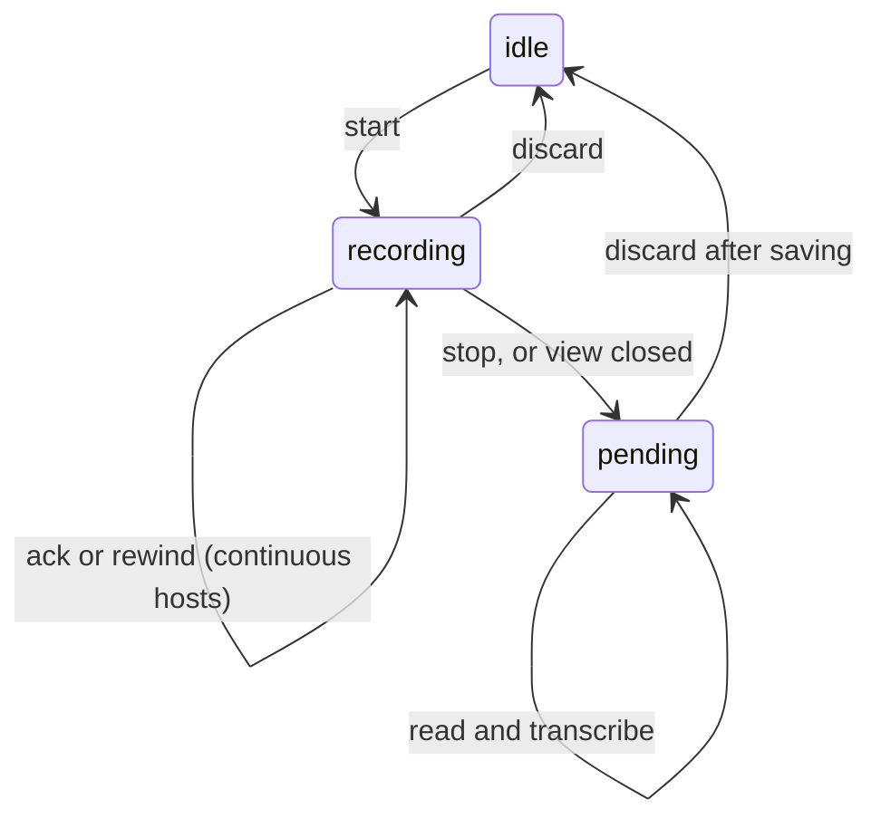

Apps use the host bridge to record a device's microphone. They never receive a
device file path, microphone stream, or node credential. Capture stays on the
physical device. Transcription can use the selected Ryu node.

See [Native bridges](/docs/extend/develop/extensions/native-bridges) for host availability
and device permission behavior, [Companion UI](/docs/extend/develop/extensions/companion-ui)
for the host surface contract, and [Life Recorder](/docs/apps/life-recorder) for a user-facing
app that combines speech capture, transcription, and private recall.

| Operation | Required approved grant |
| --- | --- |
| `media.recording` | `media:record` |
| `media.transcribe` | `media:transcribe` |
| `timeline.transcripts` | `timeline:speech` |

`timeline:speech` permits speech history without granting access to captured
screens or other timeline lanes. Declaring a grant in a manifest does not
approve it. The host checks approved grants before dispatch, and starting a
microphone still requires the device's microphone permission.

## Recording lifecycle

Call `window.ryu.media.recording({ action: "status" })` first. A host without a
recording implementation returns `available: false`. A supported host returns
`state: "idle"`, `"recording"`, or `"pending"`, plus an opaque `id` when a session
exists. `background` and `continuous` describe that host's capture behavior.

| Action | Input | Behavior |
| --- | --- | --- |
| `start` | `{ action: "start" }` | Request microphone access and start recording. Repeated calls return the existing session. |
| `stop` | `{ action: "stop", id }` | Stop capture and preserve audio awaiting processing. |
| `read` | `{ action: "read", id }` | Return pending audio as a WAV data URL. Reading does not delete it. |
| `ack` | `{ action: "ack", id: chunkId }` | On continuous hosts, delete an acknowledged chunk after its transcript has been saved. |
| `rewind` | `{ action: "rewind", id, seconds: 15 }` | On continuous hosts, return recent audio without ending the session. `300` seconds is also supported. |
| `discard` | `{ action: "discard", id }` | Stop a session and delete its remaining temporary audio. Ask the user to confirm this destructive action. |

### Host differences

| | Continuous host (iPhone) | Whole-recording host (Desktop, Island) |
| --- | --- | --- |
| Output | Chunks: `pendingChunks`, `chunkId`, `chunkStartedAt`, `durationMs` | One whole recording |
| Length | Native code rotates minute-long files while JavaScript is suspended | Stops after five minutes |
| `ack` and `rewind` | Supported | Not supported |
| Concurrency | - | One app at a time. A `start` while another app records fails with an error that names the conflict |

On Desktop and Island, capture stops when the app's view is closed, and the pending recording stays
available to `read` or `discard`.

After `stop`, the microphone stays open for about 1.5 seconds without keeping audio. An app that
records short clips back to back can `start` again without reopening the device. Audio between
clips is not captured.

### Transcribe and persist

Process audio with `media.transcribe({ audio, filename: "recording.wav", detailed: true })`.

Desktop and Island transcribe with the engine the user chose in Voice Recognition settings, the
same engine their own voice input uses. Apps cannot choose an engine.

- With no saved choice, the Voice Recognition default (Parakeet) is used, as for voice input.
- If the setting cannot be read, the node's default engine is used.
- Local engines keep the audio on the node. The Gateway engine sends it to the speech-to-text
  provider configured for the user's Gateway.

Then save the text before you release the audio:

1. Persist the result through the existing storage or Spaces bridge.
2. Track each `chunkId` durably, so a lost acknowledgement can be retried without duplicating text.
3. Acknowledge the chunk with `ack` (continuous hosts), or `discard` the recording
   (whole-recording hosts).

A failed transcription must leave audio available.

### Safety rules

- The native host provides a stop control outside app WebViews, so the user can stop a microphone
  even when an app or its node is unavailable.
- Never present a network failure as successful capture, or silently restart a terminated
  recording.
- Do not write audio or transcript contents to logs.

## Speech history

`window.ryu.timeline.transcripts({ start, end, limit, offset })` reads existing
Shadow transcripts on the host's physical computer. Island additionally checks
its context-reading consent. A phone reads its own microphone recordings rather
than pretending a remote node's audio came from the phone.

| Parameter | Rule |
| --- | --- |
| `start`, `end` | RFC 3339 UTC timestamps spanning at most one day |
| `limit` | 1 to 500, default 100 |
| `offset` | Starts at zero, at most 10,000 |

The response contains `segments` and `nextOffset`.

- A `truncated: true` response means the pagination bound was reached. Query a shorter range
  instead.
- Keep the time range fixed when following pages.
- Deduplicate by segment ID if transcription is still catching up.

Each segment contains `id`, `startedAt`, `endedAt`, `text`, and `timing`.
Shadow returns whole overlapping windows with `timing: "window"`. Consumers
must not imply exact word-level clipping at a rewind boundary.

Use `createResourceId()` from `@ryuhq/core-client/ids` for stored record IDs in
sandboxed WebViews, where `crypto.randomUUID()` may be unavailable.
