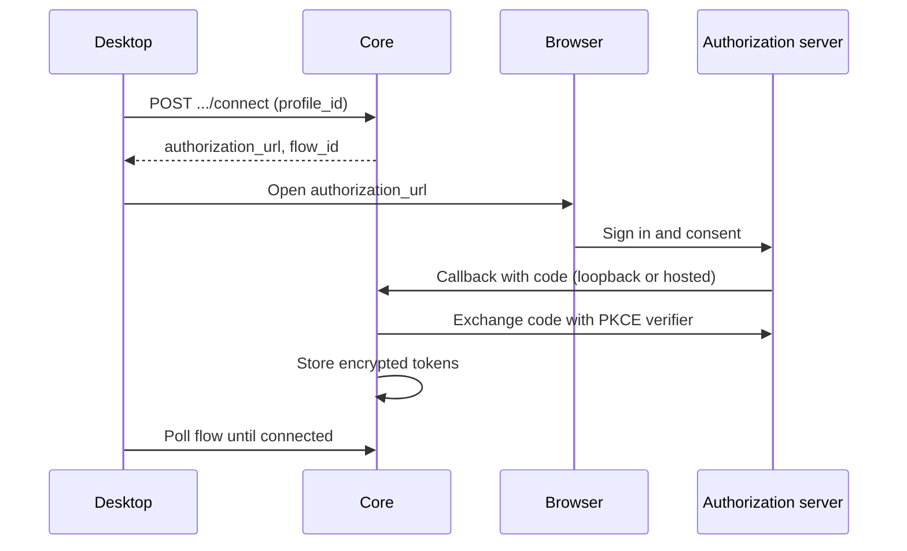

An app or plugin can ask Ryu to connect a user's account to a remote MCP (Model Context Protocol)
server. Ryu opens the provider's authorization page, keeps the resulting tokens encrypted in the
configured identity service, refreshes them when needed, and attaches a bearer token only to that
MCP server.

<Figure name="mcp" />

OAuth applies to remote Streamable HTTP and legacy HTTP+SSE MCP servers. Stdio servers, direct HTTP
tools, and long-running sidecars keep their existing API-key or process-specific authentication.

## Declare OAuth

Add `auth` to the remote server and request both governance grants:

```json
{
  "permission_grants": ["mcp:server", "identity.read"],
  "mcp_servers": {
    "mail": {
      "type": "streamable-http",
      "url": "https://mcp.example.com/mcp",
      "auth": {
        "type": "oauth"
      }
    }
  }
}
```

If the provider assigned your plugin a public client ID, add `client_id`. Otherwise Ryu uses a
Client ID Metadata Document when the authorization server advertises support and the node has a
stable HTTPS public callback. It falls back to dynamic client registration when available.

```json
"auth": {
  "type": "oauth",
  "client_id": "provider-issued-public-client-id"
}
```

The `auth` object accepts no client secret, token, endpoints, redirect URI, or scope
list. Ryu discovers those values from the MCP authorization challenge, protected-resource metadata,
and authorization-server metadata. A manifest containing an unknown auth field is rejected.

Ryu chooses the scopes to request in this order:

1. The scopes named in the MCP server's authentication challenge.
2. Without a challenge, the protected resource's published `scopes_supported`.
3. Only when the resource publishes none, the authorization server's list.

Outside a challenge it also requests `offline_access` when the authorization server lists it, so
providers that issue refresh tokens only for that scope still return one. Reconnecting an existing
connection also requests the scopes it already holds.

OAuth MCP URLs must use HTTPS. Plain HTTP is accepted only for an explicit loopback development
server. An OAuth declaration cannot be combined with a static `Authorization` header.

## What users see

After enabling the app or plugin, its account appears under **Marketplace → Connections**. The user
chooses an identity profile and selects **Connect**. Ryu opens the system browser and polls the
short-lived flow until it completes. On a node with a hosted callback, the browser then shows a
one-time code, which the user enters in Ryu to finish (see [Hosted callbacks need owner
confirmation](#hosted-callbacks-need-owner-confirmation)).



| Node | Callback |
|---|---|
| Personal node | An ephemeral `127.0.0.1` callback per flow |
| Remote node with an HTTPS `RYU_NODE_PUBLIC_URL` | A fixed, state-bound hosted callback, confirmed with a one-time code. The node also publishes a Client ID Metadata Document from the same origin |

In both modes, Core performs the code exchange on the node that owns the PKCE verifier. The
browser never receives an access or refresh token.

### Hosted callbacks need owner confirmation

The hosted callback is one public URL, and an authorization link can be forwarded. Ryu therefore
does not save a hosted connection when the browser returns. It exchanges the code, holds the tokens,
and shows a one-time code such as `ABCD-EFGH` in the browser. The connection is saved only when the
person who selected **Connect** enters that code in Ryu, on the **Connections** card or in the
chat's connect card.

- The code works only for the Ryu user who started the connection, within five minutes of signing
  in.
- Five wrong codes end the attempt. The held tokens are discarded and an existing connection is
  left unchanged.
- If the code is never entered, the attempt expires and Ryu asks the provider to revoke the held
  tokens.
- If someone sends you a sign-in link you did not start, close the browser page and do not share
  the code. Sharing it would connect your provider account to their Ryu account.

### Hosted callbacks need the `iss` parameter

One hosted callback serves every authorization server. A hosted connection therefore requires the
authorization server to return the RFC 9207 `iss` parameter matching the issuer Ryu discovered.

- A server whose metadata does not set `authorization_response_iss_parameter_supported` is refused
  when you start the connection, before any browser consent screen. The message says hosted nodes
  cannot connect it.
- A response without `iss`, or with a different issuer, fails before the authorization code is
  exchanged, whatever the server's metadata advertises.
- Providers that do not return `iss` can still be connected from a personal node, whose per-flow
  `127.0.0.1` callback already identifies the flow.

### Passport remote mode

When standalone Passport remote mode is configured, Passport owns the PKCE verifier, hosted
callback, encrypted tokens, and authenticated MCP requests. Core forwards authorized lifecycle
operations and sends runtime requests using the calling agent's separate Passport credential.

Configure Passport's public HTTPS origin and explicit MCP runtime bindings as described in
[Passport API](/docs/standalone/passport-api#mcp-oauth-custody). Rules in this mode:

- The provider endpoint must be public HTTPS.
- Additional static headers must match operator-pinned Passport configuration. Passport refuses
  routing, framing, authentication, and session overrides.
- Legacy HTTP+SSE is supported when both sides select the SSE transport. Passport owns that stream
  and permits only a same-origin announced message endpoint.
- Remote failures never fall back to the node's retained local credentials.

### Tools and reconnects

Connecting an account does not attach the server's tools to an agent. Agent tool allowlists and the
normal Gateway capability checks remain authoritative.

If a tool is called before the account is connected, or a refresh token is no longer valid, Ryu
pauses the action with a Connect prompt. After authorization, the user can retry the operation. On a
node with a hosted callback, the prompt carries no sign-in link: the agent asks you to connect from
**Connections** or the chat's connect card, where you can enter the confirmation code.

## Connection API

The protected Core API exposes metadata and flow status, never credential material:

- `GET /api/plugins/{plugin_id}/auth` lists OAuth MCP servers and connections for the caller.
- `POST /api/plugins/{plugin_id}/auth/{server_name}/connect` accepts `profile_id` and an optional
  `callback_mode` of `auto`, `loopback`, or `hosted`.
- `GET /api/plugins/{plugin_id}/auth/flows/{flow_id}` reports `pending`, `awaiting_confirmation`,
  `connected`, or `failed`.
- `POST /api/plugins/{plugin_id}/auth/flows/{flow_id}/confirm` accepts `{ "code": "ABCD-EFGH" }` from
  the caller who started a hosted flow and saves the connection.
- `DELETE /api/plugins/{plugin_id}/auth/{server_name}?profile_id=…` revokes when possible and always
  deletes the binding in the configured identity service.

`connect` returns a short-lived `authorization_url`, `flow_id`, callback mode, requested scopes,
status, and expiry. The caller opens the URL and polls the flow endpoint. When the flow reports
`awaiting_confirmation`, the caller asks the user for the code the browser shows and posts it to
`confirm`.

A `failed` flow carries an English `error` and a stable `error_code`, and a refused `confirm`
answers `400` with `{ "error", "code" }`. Show the user your own message for the code instead of the
English text: `code_mismatch`, `too_many_attempts`, `expired`, `cancelled`, `not_awaiting`,
`issuer_mismatch`, `missing_code`, `invalid_state`, or `protocol` for any other provider or
token-exchange failure. Older nodes send only `error`.

## Credential lifecycle

- Access, refresh, and ID tokens plus dynamic-client material are encrypted in Passport.
- Connections are isolated by user, identity profile, plugin, and MCP server. One account is active
  for each such binding.
- Ryu refreshes shortly before expiry and stores rotated refresh tokens atomically.
- Disabling a plugin blocks its MCP server but retains the encrypted connection and performs no
  refresh traffic.
- **Disconnect** attempts provider revocation and always removes the local encrypted credentials.
- Removing a plugin attempts revocation for every owned profile and then removes its local
  connections and pending flows. If a provider cannot confirm revocation, Ryu reports that warning
  instead of claiming the remote token was revoked.

Tokens never enter model arguments, tool results, plugin settings, sidecar environments, or the MCP
registry configuration. They are resolved immediately before an outbound request and are sent only
to the declared MCP resource origin.

## Provider requirements

The MCP server must implement the MCP authorization challenge and publish OAuth protected-resource
metadata. Its authorization server must support authorization code with PKCE S256 and one of:

- client ID metadata documents for a node with a stable HTTPS callback;
- a public client ID registered for the plugin; or
- dynamic client registration.

Providers that advertise none of those registration paths cannot be connected without adding a
provider-specific secret, so Ryu reports an unsupported-registration error.

OAuth discovery, client registration, token, and revocation requests connect directly to the address
Ryu resolved and screened. They do not use `HTTPS_PROXY`, `HTTP_PROXY`, `ALL_PROXY`, or
operating-system proxy settings, because a proxy would resolve the hostname again outside that
screen. In Passport remote mode, Passport's authenticated MCP requests also connect directly.

<Callout type="warn">
A network that allows outbound HTTPS only through a proxy cannot complete OAuth for these servers.
</Callout>

## Related

<Cards>
  <DocCard href="/docs/extend/mcp/configuration" />
  <DocCard href="/docs/extend/mcp/security" />
  <DocCard href="/docs/security/authentication-and-pairing" />
  <DocCard href="/docs/gateway/governance" />
  <DocCard href="/docs/extend/develop/extensions" />
</Cards>
