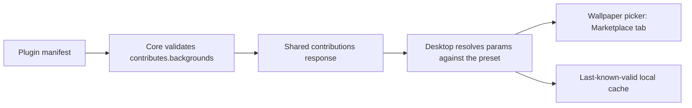

An extension can add a wallpaper preset to the Ryu desktop app through
`contributes.backgrounds`. The host owns rendering and controls. A background names one preset
from the shared `@ryu/ui` backdrop registry, provides bounded default parameters, and credits its
source. The manifest never carries CSS, HTML, shader source, or executable rendering code.

## Declare a background

```json
{
  "id": "@example/wallpapers",
  "name": "Example Wallpapers",
  "version": "1.0.0",
  "runnables": [],
  "contributes": {
    "backgrounds": [
      {
        "id": "@example/wallpapers:aurora",
        "label": "Aurora",
        "description": "Slow northern-lights colors over a dark sky.",
        "backdropId": "aurora-flow",
        "params": {
          "speed": 0.7,
          "colors": ["#22c55e", "#8b5cf6"]
        },
        "attribution": "PatternCraft",
        "attributionUrl": "https://example.com/patterncraft/aurora"
      }
    ]
  }
}
```

The `id` combines the owning plugin id and a stable local name with a colon. Keep it stable when
renaming the display label, because Desktop stores a user's selected wallpaper by this id.
`backdropId` must name a renderer preset the host recognizes. Multiple plugins can publish
different variants of the same renderer.

### Parameters

`params` contains small JSON values supported by the selected preset. Desktop resolves them
against that preset's control definitions:

- Unknown keys are ignored.
- Invalid colors fall back to the preset defaults.
- Numeric controls stay within their declared ranges.
- Arbitrary nested objects, executable code, and remote image data are rejected.

| Limit | Value |
| --- | --- |
| Backgrounds per plugin | 32 |
| Parameters per background | 64 keys and 4 KiB |
| Background rows in the shared contributions response | 256 |

### PatternCraft adapter

The host also provides the `patterncraft-css` adapter for entries in its bundled PatternCraft
catalog. Set `params.patternId` to a catalog id such as `top-gradient-radial`. The host resolves that
id to its validated local CSS data. This adapter does not accept CSS text, stylesheets, or code from
the plugin, so a contribution stays portable and renders offline.

```json
{
  "id": "@example/wallpapers:top-gradient-radial",
  "label": "Top Gradient Radial",
  "backdropId": "patterncraft-css",
  "params": { "patternId": "top-gradient-radial" },
  "attribution": "PatternCraft",
  "attributionUrl": "https://patterncraft.fun/"
}
```

`attribution` is the visible credit. `attributionUrl` must be an HTTPS URL without embedded
credentials. Core does not fetch it. Desktop opens the link only when the user follows the
credit.

## Where it appears

After the plugin is installed and enabled, its variants appear in **Settings → Appearance →
Wallpaper → Animated → Marketplace**. The selected preview shows the source credit.

- OS and the account/node chooser use the same wallpaper.
- When the app starts offline, it uses its last-known-valid local cache.
- A successful contribution refresh removes variants whose plugin is disabled or uninstalled.



### Built-in Marketplace presets

The **Marketplace** wallpaper tab ships these presets without any extension:

- all 258 presets from the pinned [PatternCraft source](https://github.com/megh-bari/pattern-craft/blob/1550af7903f50b4f19a1b44786f27ca01f3ef6ab/src/data/patterns.ts);
- two curated Remocn backgrounds, [Mesh Gradient and Dynamic Grid](https://www.remocn.dev/docs/components).

These defaults use Ryu's local CSS and shader adapters, so they keep working offline.
PatternCraft's [MIT license](https://github.com/megh-bari/pattern-craft/blob/1550af7903f50b4f19a1b44786f27ca01f3ef6ab/LICENSE)
is included with Desktop.

See [OS](/docs/surfaces/desktop/ryu-os) for the wallpaper picker and chooser, and
[Contribution surfaces](/docs/extend/develop/extensions/contribution-surfaces) for the host-owned
extension model.
