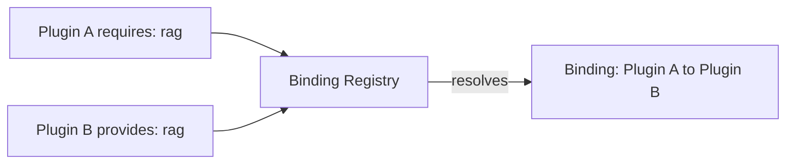

The capability broker lets a plugin declare abstract capabilities, and Core resolves them to
concrete provider apps. A provider app can then be swapped without changing its consumers.

## The concept

A plugin declares what it needs (`requires`) and what it offers (`provides`). The binding registry
resolves the abstract requirements to concrete providers at enable time.



## Declaring capabilities in manifest.json

### Providing a capability

```json
{
  "id": "@ryu/rag",
  "provides": [
    {
      "capability": "rag",
      "version": "1.0.0",
      "sidecar": "ryu-rag",
      "route": "/api/rag",
      "grant": "rag:use"
    }
  ]
}
```

| Field | Purpose |
|---|---|
| `capability` | The abstract capability name (for example `rag`, `web.search`, `memory`) |
| `version` | Semver version of the capability |
| `sidecar` | The sidecar process name to spawn |
| `route` | The HTTP route prefix for the capability |
| `grant` | The Gateway grant required to use this capability |
| `title` | Optional display name for the capability's picker header |
| `selectable` | Opt in to the user-picks-one mode instead of an ambiguity error |
| `default` | Preferred pick among the providers of a selectable capability |
| `target` | For a capability that controls a machine, whether that machine is this one (`local-machine`) or a separate one (`remote-desktop`) |
| `layerKind` | Optional product layer for the capability (`decision-model` or `tunnel`). `decision-model` places typed-decision providers in the Decision Models picker rather than Toolkits. |
| `tools` | Canonical verb to this provider's tool, the seam that keeps tool ids stable across a swap |

### Requiring a capability

```json
{
  "id": "com.example.my-plugin",
  "requires": {
    "capabilities": ["rag"]
  }
}
```

When this plugin is enabled, the binding registry resolves `rag` to a concrete provider.

## Two modes: strict and selectable

A capability resolves in one of two modes. **Strict** (used by `rag` and `engines`) fails with
`capability_ambiguous` when two or more providers exist and no override is set. **Selectable**
(every provider declares `"selectable": true`) picks the provider declaring `"default": true`, else
the lowest provider id. For the full resolution ladder, version floors, and enable-time gates, see
[how the capability broker resolves bindings](/docs/extend/integrate/capability-broker).

<Callout type="warn">
If any provider of a capability omits `"selectable": true`, the capability falls back to strict
resolution. With two or more providers and no override, binding then fails with
`capability_ambiguous`.
</Callout>

## Built-in capabilities

Strict capabilities, resolved to one provider:

| Capability | Built-in provider | Description |
|---|---|---|
| `rag` | `@ryu/rag` | Embedding and vector retrieval |
| `engines` | `@ryu/engines` | Local inference engines |

Selectable capabilities, which the user swaps at runtime, include `web.search`, `web.extract`,
`web.crawl`, `memory`, `browser.control`, `computer.control`, and `document.parse`. These also
bind **canonical verbs**, so swapping the provider does not change the tool ids an agent calls. See
[Swappable Layers](/docs/core/swappable-layers) for that mechanism, the declarative binding fields,
and adapters.

Typed decision providers (`decision.typed`) use the same selectable binding contract but declare
`"layerKind": "decision-model"`. Core exposes that capability through its own Decision Models
picker and keeps it separate from the Toolkits list. The canonical `decision.predict` tool remains
stable when the provider changes.

Tunnel adapters provide `network.tunnel` with `"layerKind": "tunnel"`. They appear in the node's VPN
menu beside the built-in network backends instead of in Toolkits. See
[Build a Tunnel Adapter](/docs/extend/develop/extensions/tunnel-adapters) for the route contract.

Every selectable capability above accepts third-party providers. To add one, ship an app that declares
the same capability in `provides`. Map the canonical verbs to your own tools declaratively, or with an
adapter when a field map is not enough, or serve a route for route-backed capabilities such as
`document.parse`. Core lists your app in the matching picker once it is installed and enabled.

## Setting overrides

An override chooses which provider serves a capability. Set it with
`PUT /api/capabilities/bindings` (`set_capability_bindings` in `apps/core/src/server/mod.rs`). The
body replaces the whole override map. Each key is a capability and each value is the id of an
installed app that provides it. Core stores the map in the `binding.overrides` preference
(`apps/core/src/plugins/binding.rs`).

For example, `@ryu/exa` declares `"default": true` for `web.search`. To use Brave Search instead:

```bash
curl -X PUT http://127.0.0.1:7980/api/capabilities/bindings \
  -H "Authorization: Bearer $RYU_TOKEN" \
  -H 'Content-Type: application/json' \
  -d '{ "overrides": { "web.search": "@ryu/brave" } }'
```

Core validates the new map against the enabled plugins first. If an enabled consumer would become
unbound or ambiguous, the request returns `409` with `error`, the affected `plugin`, and a
`binding_error` field that holds one of the codes below. The old map stays in effect.

`GET` the same route to read the current override map, and `GET /api/capabilities` for the full
read model (candidate providers, which one is bound, and the verbs it serves).

## How it connects to the dependency graph

Core lowers a resolved binding to a bare app-id edge in the plugin dependency graph
(`apps/core/src/plugins/graph.rs`), so enable order, cycle detection, and disable cascades apply
unchanged. See [Graph lowering](/docs/extend/integrate/capability-broker#graph-lowering).

## Error handling

| Error code | Meaning | Fix |
|---|---|---|
| `capability_ambiguous` | Multiple providers for one strict capability | Set an override |
| `capability_unprovided` | No provider for a required capability | Install a provider plugin |
| `capability_override_not_provider` | The override names a plugin that does not provide the capability | Fix or clear the override |
| `capability_version_unsatisfied` | The chosen provider's capability version does not satisfy the requirement | Update the provider |
| `capability_invalid_version_req` | The requirement's version floor is malformed | Fix the `requires` entry |
| `capability_selection_required` | Every candidate binds only through an explicit override | Pick a provider |

### Canonical tool effects

Canonical tools carry effect metadata through the shared registry. Read operations
such as search, snapshots, and screenshots remain available to read-only agents.
Navigation, input, memory writes, and crawl-job creation are classified as mutations
and are blocked for read-only or trial agents. The classification follows the
canonical verb when the provider changes. Provider grants and approvals still apply.

### Adapter failures and multi-step calls

An adapter receives provider results through `callTool` and its declared
`callNamed` allowlist. MCP tool failures can arrive as a normal result with
`isError: true`. HTTP tools can return an unavailable or non-success status
envelope. Check those results before transforming them or performing the next
step. Preserve the failure payload instead of returning an empty result set or
claiming that a write succeeded.

Agent Browser stops a targeted action when switching tabs fails, and stops before
pressing Enter when typing fails. Browser Run preserves failed responses without
inventing a tab or screenshot. Browser Run projects page content and the caller-selected
URL handle. Provider-specific snapshot fields remain in the raw response instead
of becoming capability fields. Exa and Parallel preserve free-search MCP errors.
Firecrawl stops polling when its status endpoint returns an error or an
unrecognized response. These failures remain visible to the caller so it can
correct the configuration or retry.

<Cards>
  <DocCard href="/docs/core/swappable-layers" />
  <DocCard href="/docs/extend/develop/extensions/tunnel-adapters" />
  <DocCard href="/docs/core/app-manifest-lifecycle" />
  <DocCard href="/docs/extend/develop/extensions/plugin-json-manifest" />
  <DocCard href="/docs/start-here/architecture/platform-decomposition" />
  <DocCard href="/docs/start-here/architecture/capability-layers" />
  <DocCard href="/docs/extend/develop/sdk/plugin-api" />
</Cards>
