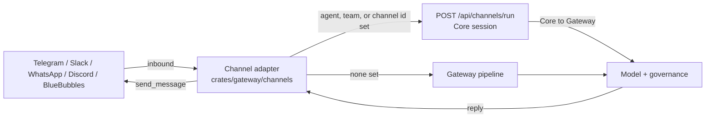

A **Channel** is one of the eight [Runnable kinds](/docs/start-here/architecture/runnable-model).
It binds a messaging platform to a Core session. An inbound chat message becomes one agent (or
[group](/docs/core/agent-teams)) turn, and the reply goes back to the originating chat.

The platform adapters ship with the Gateway (`crates/gateway/channels/src/`, wired in
`apps/gateway/src/channels_host.rs`). A plugin declares the channel as a Runnable in
`manifest.json`.

To configure and route a bot from the Desktop UI, see [Channels](/docs/gateway/channels).

<Callout type="info">
  Channel listeners run inside the **Gateway**, not Core. The Gateway owns external messaging
  surfaces because routing inbound traffic to a model, applying the firewall/DLP/budget controls, and
  delivering the reply are all "what is allowed and measured" concerns. See
  [Core vs Gateway](/docs/start-here/architecture/core-vs-gateway).
</Callout>

## How a channel turn flows

A registered channel implements the `Channel` trait (`crates/gateway/channels/src/lib.rs`). It
owns its transport (long-poll loop, socket, or webhook), normalizes inbound text into an
`InboundMessage`, and delivers outbound replies with `send_message`. The shared `handle_turn` path
then picks one of two inbound paths per bot config:

- **Session path** (recommended) - when the bot config carries an `agent_id`, `team_id`, or
  store-backed `channel_id`, the adapter POSTs the turn to Core's `POST /api/channels/run`.
  Conversation history persists in the Core conversation store, and model calls still flow Core
  to Gateway so every call stays governed.
- **Pipeline path** (legacy) - when none of those ids is set, `handle_turn` builds an
  OpenAI-style request body and runs the Gateway `pipeline` directly. There is no Core session
  and no persisted history.



### The Core session endpoint

The session path is one non-streaming call.

```text
POST /api/channels/run
```

| Field | Type | Required | Meaning |
|---|---|---|---|
| `conversation_id` | string | yes | Stable per-chat identifier (for example the Telegram `chat_id`) used as the Core conversation id, so multi-turn exchanges share history |
| `channel_id` | string | no | Store-backed channel record id |
| `agent_id` | string | no | Which agent answers the turn |
| `team_id` | string | no | Targets a whole [group](/docs/core/agent-teams); the lead orchestrates members. Takes precedence over `agent_id` |
| `text` | string | yes | The user's inbound message |
| `author_name` | string | no | Display name of the sender |
| `idempotencyKey` | string | no | Stable provider delivery id. Replays a completed turn instead of running the model twice after a webhook/send retry |
| `channelAction` | object | no | Typed button callback `{ actionId, label, payload }`, delivered to `pre_user_turn` hooks |

The response is JSON:

| Field | Meaning |
|---|---|
| `reply` | The reply text |
| `assistantMessageId`, `assistantMessageIds` | Ids of the stored assistant messages |
| `agentId` | Optional. The agent that answered |
| `fallbackWarning` | Optional. Set when a deleted agent binding fell back to the default agent |
| `interactiveMarkup` | Optional. Platform-neutral quick replies, callback buttons, or URL buttons from a hook |
| `agentReactions` | Emojis the agent placed on the user's message, oldest first, for the adapter to mirror |

For example:
`{ "reply": "...", "assistantMessageId": "...", "assistantMessageIds": [], "interactiveMarkup": { "layout": "inline", "rows": [] } }`.

Telegram renders both `interactiveMarkup` layouts, a reply keyboard and inline buttons. Other adapters send the reply text without
buttons. Callback payloads are untrusted, so the hook that handles them must authorize them.

### Retries and idempotency

When `idempotencyKey` is supplied, Core retains the completed result for 30 days and rejects
different payloads that reuse the same key. An in-flight retry receives a retryable `503`. Retry
the same request with the same key.

Internally a non-empty `team_id` dispatches to `run_team_reply_text` and otherwise to
`run_reply_text` (`apps/core/src/sidecar/adapters/adapter_core/`). These use the same ACP path, memory,
and Gateway routing as Desktop chat.

## Declaring a channel in manifest.json

A plugin bundles a channel as a Runnable entry. Each entry carries its identity fields plus a
per-kind `config`. For `kind: "channel"` the only required field is `platform`
(`ChannelConfig` in `crates/core/kernel-contracts/src/schema.rs`).

```json
{
  "id": "io.example.telegram-support",
  "name": "Support Bot",
  "version": "1.0.0",
  "runnables": [
    {
      "id": "channel-telegram",
      "name": "Telegram Support",
      "kind": "channel",
      "config": {
        "platform": "telegram"
      }
    }
  ]
}
```

`validate_runnable` rejects a channel entry with no `config` or a missing `platform`
(error `runnable '...' (kind=channel): missing required 'config' (needs 'platform')`). See the
[manifest.json reference](/docs/extend/develop/extensions/plugin-json-manifest) for the full
manifest shape and the [Runnable model](/docs/start-here/architecture/runnable-model) for the
other seven kinds.

<Callout type="warn">
  The manifest `ChannelConfig` declares the **platform only**. The plugin declares *that the bot
  exists*; the operator wires *how it routes*.

  Credentials (bot token, signing secret), the routed `agent_id`/`team_id`, model, and system
  prompt live in the control-plane channel config. The Gateway reads it at
  `GET /api/channels/gateway/enabled`, and you edit it in the Desktop Gateway dialog. See
  [Channels](/docs/gateway/channels).
</Callout>

## Supported platforms

Each platform has its own adapter file under `crates/gateway/channels/src/`.

| Platform | `platform` value | Adapter | Transport |
|---|---|---|---|
| Telegram | `telegram` | `telegram.rs` | Bot API `getUpdates` long-poll (no public URL needed) |
| Slack | `slack` | `slack.rs` | Socket Mode WebSocket (no public URL needed) |
| WhatsApp Personal | `whatsapp_personal` | `openwa.rs` | OpenWA webhook |
| WhatsApp Business (Cloud API) | `whatsapp` | `whatsapp.rs` | Meta WhatsApp webhook |
| Discord | `discord` | `discord.rs` | Discord Gateway WebSocket |
| BlueBubbles (iMessage through a Mac) | `bluebubbles` | `bluebubbles.rs` | BlueBubbles Server REST API plus webhook |

A new messaging surface implements the `Channel` trait in a new adapter file. The shared inbound
path (`handle_turn`, `build_request_body`, `extract_reply`) and the Core session seam are reused
unchanged, so only the transport differs.

## Caveats

<Callout type="warn">
  The channel contract is verified at the API level. Live platform credentials and provider
  delivery still need to be tested in your deployment. The pipeline-path default bot model is
  `gpt-4o` (`DEFAULT_BOT_MODEL`, `apps/gateway/src/channels_host.rs`) when a store-sourced config
  omits a model. Set an explicit model, or use the session path with an `agent_id`, to control
  routing.
</Callout>

- The session path requires a reachable Core at the adapter's configured `core_url`
  (default `http://127.0.0.1:7980`). When no agent, team, or channel id is set, the bot
  falls back to the Gateway pipeline path and does not persist conversation history.
- Channel-originated traffic carries no HTTP API key. The Gateway builds a request context
  scoped to the channel (`channel:<name>`) so audit and rate-limit buckets are namespaced per
  channel without per-user auth.

<Cards>
  <DocCard href="/docs/gateway/channels" />
  <DocCard href="/docs/start-here/architecture/runnable-model" />
  <DocCard href="/docs/extend/develop/extensions/plugin-json-manifest" />
  <DocCard href="/docs/core/agent-teams" />
</Cards>
