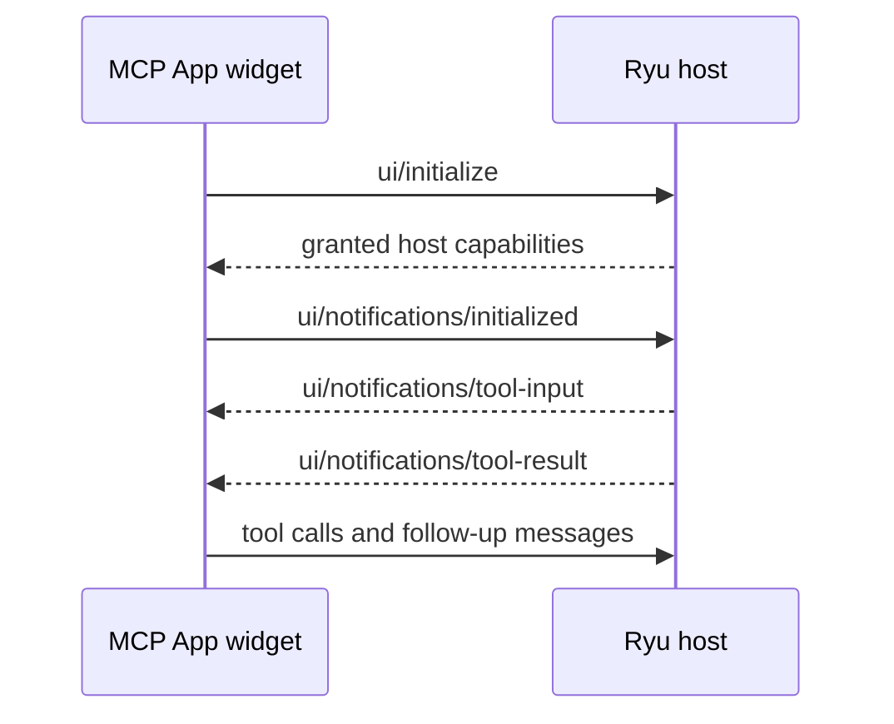

`contributes.chat_widget_templates[]` lets an app declare chat prompts that answer with one of its
visual surfaces. A calendar app can show the next seven days, a social app can show a queue, a
quest app can show a board, and a monitoring app can show recent checks. MCP Apps can also render
their own interactive widgets in chat (see [MCP Apps widgets](#mcp-apps-widgets)).

## Native template contract

| Field | Required | Meaning |
| --- | --- | --- |
| `id` | yes | Template id |
| `title` | yes | Display title |
| `display_mode` | yes | How the answer renders, for example `inline` |
| `backing` | yes | Exactly one `tool_id` or `view_id` for an available template |
| `description` | no | Short summary |
| `examples` | no | Sample prompts, also used as composer suggestions |
| `triggers` | no | Phrases that match the template |
| `safe_action_ids` | no | Action identifiers only, never executable payloads |
| `availability` | no | `available` (default), `coming-soon`, or `unavailable` |

A template that is not available may omit the binding while an app finishes its renderer. Desktop
offers a template in chat only when all three hold:

- it is `available`;
- it has a backing;
- it has at least one example or trigger.

```json
{
  "contributes": {
    "chat_widget_templates": [
      {
        "id": "next-seven-days",
        "title": "Next seven days",
        "description": "Show upcoming events in a calendar",
        "examples": ["What is happening next week?"],
        "triggers": ["next week", "upcoming"],
        "display_mode": "inline",
        "backing": { "view_id": "calendar" }
      }
    ]
  }
}
```

The template is not an HTML widget and does not grant a tool. The host validates the backing,
filters the contribution to the current surface, and applies the app's normal grants and allowlist.

Choose the contribution by the answer you need:

- **Self-contained interactive HTML card** - use `contributes.widgets[]` plus a render tool.
- **Open or project the app's shared Library surface** - use a view-backed template.

See [Contribution surfaces](/docs/extend/develop/extensions/contribution-surfaces) for the
view and widget contracts.

## Patterns to publish

Keep the public contract focused on the shape of a contribution, not on a package inventory. These
examples show the kinds of intent a package can expose:

| Pattern | Example chat intent | Backing |
| --- | --- | --- |
| Calendar summary | “What is happening next week?” | A calendar view |
| Review queue | “Show the items waiting for me” | A bounded list view |
| Detail card | “Open the current plan” | One named record or tool |
| Workflow status | “Show this week's workflow runs” | A run-status view |

Publish a template when the host can render a useful first projection. Keep experimental or
unrendered ideas in design notes until a public app surface exists.

## Designing good templates

- Start with a question users naturally ask in chat, not with the app's internal route name.
- Keep examples short enough to become composer suggestions.
- Choose one backing per template. Split calendar, board, and detail intents into separate templates.
- Return a bounded, useful first projection. Let the user open the full app for deep editing.
- Make the no-data and unavailable states readable. A missing provider or permission is not an empty
  successful result.
- Add tests for manifest validation, backing availability, and the host's fallback renderer.

## MCP Apps widgets

MCP Apps can use the standard window JSON-RPC transport in a sandboxed Ryu widget.

### Opening and initialization

- Opening a global app creates an owning conversation and keeps the existing Ryu chat composer
  beside the app. Thread entrypoints reuse their provided conversation.
- If initialization requests input, the conversation and form appear while the app is still
  opening.
- Activation retries reuse the same operation key and original request. Changing the selected
  agent, file, or account starts a separate activation.



Tool calls and follow-up messages still use the widget's approved grants. Unsupported methods
return a JSON-RPC error.

### Model context

With the `assistant:context` grant, `ui/update-model-context` replaces that app instance's model
context. Supported content:

- text;
- inline PNG, JPEG, WebP, and GIF images;
- resource links;
- embedded text or base64 binary resources;
- `structuredContent`.

Binary resources become file attachments, and the selected model must support their MIME type.
The payload is limited to 2,000,000 bytes and 32 content items. Resource links are references, not
implicit permission to fetch another resource. `_meta` is excluded from model context.

Current context is attached to the owning conversation's next request without adding another
visible user message:

- Content items appear as removable composer attachments. Removing an item updates the app's
  accepted context.
- `annotations.audience: ["assistant"]` keeps background context hidden.
- Text and image labels use `openai/title`; text previews may use an HTTPS `openai/thumbnail`.
- The response and `ui/notifications/host-context-changed` include
  `openai/modelContext.updateId`, so the app can confirm the state the host accepted.

### Display modes

`ui/request-display-mode` supports `inline`, `fullscreen`, and `pip`. Picture in picture keeps the
app in a bounded floating window with Restore and Close controls. Restore and Escape return it to
the original message. Changing the display mode preserves the mounted app frame.

### Editable files

When the host explicitly opens an editable file for an app, the app can use `resources/read` and
`openai/resources/write` for that resource only.

- Reads expose an etag.
- Text and base64 blob writes accept `ifMatch` and report saved, conflict, or too-large outcomes.
- Subscriptions receive `notifications/resources/updated` after confirmed changes.

An app cannot choose a different file path or gain filesystem access through this resource
contract.

### Composer mentions

Apps can advertise composer mention search through a tool's
`_meta["openai/extensions"]["mentions/search"]` marker and app visibility in
`_meta.ui.visibility`. While a user types `@`, Ryu calls that tool with `{ query }` using the
selected agent's existing permissions.

Resource links from `structuredContent.items` appear in the existing mention picker. Selecting a
result preserves its resource URI for the outgoing model request.

### Deep links

A Ryu app deep link uses
`ryu://plugins/<encoded-server-id>/app/<encoded-tool-name>?path=<encoded-app-relative-url>`.
It opens the registered app through Ryu's contribution route. It does not install the plugin or
send a prompt.

The app receives its relative path in `hostContext["openai/deepLink"].url` on initialization and
in later context notifications. The path defaults to `/`, must be relative to the app, and cannot
contain a fragment. Remote app deep links work only in the Desktop host.

See [Library views](/docs/extend/develop/extensions/contribution-surfaces#library-views),
[native bridges](/docs/extend/develop/extensions/native-bridges), and
[built-in tools](/docs/core/built-in-tools) for the adjacent contracts.
