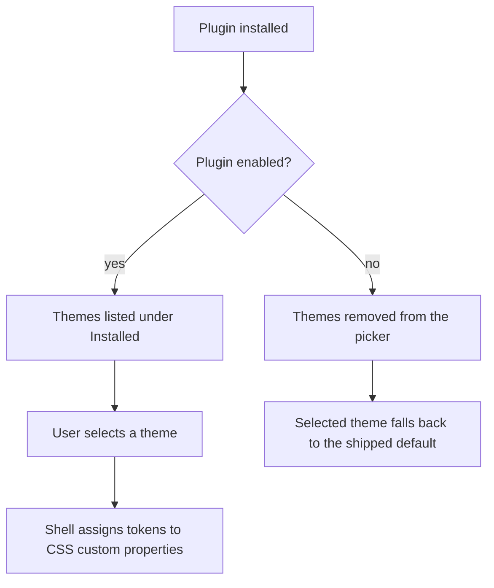

A **color theme** in Ryu is a plugin whose only contribution is `contributes.themes`, the same
shape VS Code and Zed use. It is not its own kind of marketplace listing. A plugin can also ship a
theme alongside other contributions, such as an app with a matching skin.

A theme inherits these from the plugin system:

- install, uninstall, and enable/disable;
- versioning and signing;
- the Store detail page, reviews, and the trust scorecard.

A theme ships no code, so it needs no permission grants. The shell only assigns your `tokens` to
CSS custom properties and never evaluates them. A hostile theme can only change how the app looks.

## The whole plugin is one file

<Files>
  <Folder name="midnight-theme" defaultOpen>
    <File name="manifest.json" />
  </Folder>
</Files>

```json title="manifest.json"
{
  "id": "@acme/midnight-theme",
  "name": "Midnight Theme",
  "version": "1.0.0",
  "category": "Themes",
  "description": "A deep indigo dark theme with a violet accent.",
  "tagline": "Midnight, a dark theme",
  "keywords": ["theme", "dark", "midnight"],
  "engines": { "ryu": ">=0.1.0" },
  "runnables": [],
  "contributes": {
    "themes": [
      {
        "id": "@acme/midnight-theme:midnight",
        "label": "Midnight",
        "mode": "dark",
        "preview": {
          "bg": "oklch(0.16 0.02 280)",
          "surface": "oklch(0.21 0.02 280)",
          "primary": "oklch(0.68 0.18 295)",
          "text": "oklch(0.94 0.01 280)"
        },
        "tokens": {
          "--background": "oklch(0.16 0.02 280)",
          "--foreground": "oklch(0.94 0.01 280)",
          "--card": "oklch(0.21 0.02 280)",
          "--card-foreground": "oklch(0.94 0.01 280)",
          "--popover": "oklch(0.21 0.02 280)",
          "--popover-foreground": "oklch(0.94 0.01 280)",
          "--primary": "oklch(0.68 0.18 295)",
          "--primary-foreground": "oklch(0.16 0.02 280)",
          "--secondary": "oklch(0.26 0.02 280)",
          "--secondary-foreground": "oklch(0.94 0.01 280)",
          "--muted": "oklch(0.26 0.02 280)",
          "--muted-foreground": "oklch(0.68 0.02 280)",
          "--accent": "oklch(0.26 0.02 280)",
          "--accent-foreground": "oklch(0.94 0.01 280)",
          "--destructive": "oklch(0.58 0.22 27)",
          "--border": "oklch(1 0 0 / 10%)",
          "--input": "oklch(1 0 0 / 12%)",
          "--ring": "oklch(0.68 0.18 295)",
          "--sidebar": "oklch(0.13 0.02 280)",
          "--sidebar-foreground": "oklch(0.94 0.01 280)",
          "--sidebar-primary": "oklch(0.68 0.18 295)",
          "--sidebar-primary-foreground": "oklch(0.16 0.02 280)",
          "--sidebar-accent": "oklch(0.26 0.02 280)",
          "--sidebar-accent-foreground": "oklch(0.94 0.01 280)",
          "--sidebar-border": "oklch(1 0 0 / 10%)",
          "--sidebar-ring": "oklch(0.68 0.18 295)"
        }
      }
    ]
  }
}
```

`"runnables": []` is correct for a theme. There is nothing to run.

## The fields

| Field | Role |
| --- | --- |
| `id` | Stable id, persisted as the user's selection. **Namespace it with your plugin id** (`@acme/midnight-theme:midnight`) so two plugins cannot collide and a rename does not lose the selection. |
| `label` | The name shown in Settings → Appearance. |
| `mode` | `"light"` or `"dark"`, the slot this theme fills. |
| `preview` | The four colors the picker paints as a swatch **before** the theme is applied. Drawn as inline style, so use plain CSS colors. |
| `tokens` | Map of CSS custom property to value. The key set is open, so a new design-system token reaches clients without a Ryu release. |

### Light and dark are two entries, not one theme

Ryu keeps an independent preset per mode. A user can run your light theme by day and someone
else's dark theme at night. A matched pair is therefore two entries in the same `themes` array, each
with its own `id`.

<Callout type="warn">
  Cover the whole token set. The shell applies your `tokens` over whatever the previous theme left in
  place, so a property you omit keeps its old value. A half-specified dark theme can end up with
  white borders. The list in the example above is the minimum.
</Callout>

## Export a theme you already made

You do not have to write the token map by hand. Build the theme in the app, then export it:

1. **Settings → Appearance → Color theme**, adjust the colors and **Save as preset**.
2. Select your saved theme. A **share** button appears next to the picker.
3. Click it. Ryu copies a complete `manifest.json` to your clipboard.
4. Save it into a new folder and publish.

The export re-keys the theme under a plugin id, because the locally saved id embeds the moment you
saved it and would change on every re-export.

## Publish it

Publish the theme from its GitHub repository after attaching an immutable `.ryupack` release:

```bash
bunx ryu github-publish https://github.com/your-org/your-theme
```

Themes land on the **Themes** shelf in the Store. See
[Marketplace](/docs/extend/develop/extensions/marketplace) for listing, pricing, and signing, and
[GitHub topic discovery](/docs/extend/develop/extensions/github-topic-discovery) for the free index.

For a versioned folder or archive that carries a theme definition and its safe appearance metadata,
see [Portable packages](/docs/extend/develop/extensions/portable-packages). The theme contribution
itself remains declarative: colors, typography, sizing, spacing, density, radius, and layout
defaults are data. Executable code and undeclared permissions are not part of a theme package.

## How it reaches the picker

Installed themes appear in Settings → Appearance under an **Installed** header, above the built-ins
and below the user's own saved themes.

- Only enabled plugins contribute themes.
- Disabling the plugin removes its themes from the picker. A user who had one selected falls back
  to the shipped default.
- Updating the plugin repaints the window immediately, with no restart.


