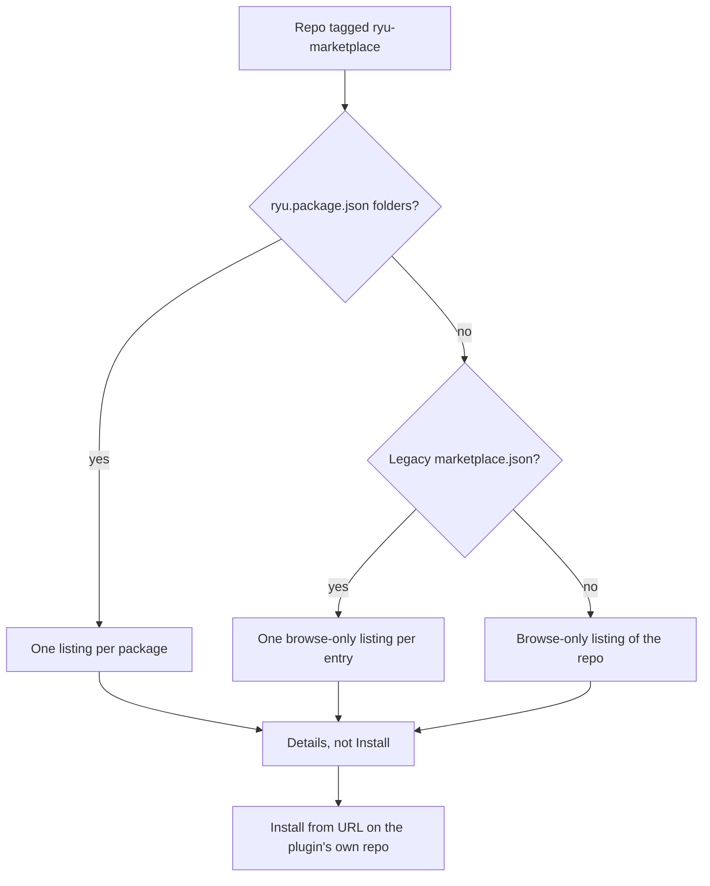

[GitHub topic discovery](/docs/extend/develop/extensions/github-topic-discovery) turns a public repo into
one listing. A package collection is the collection form of the same idea: a repo tagged
`ryu-marketplace` contains one or more folders with a `ryu.package.json`, and Ryu discovers those
packages directly from GitHub.

GitHub owns the package source and immutable releases. Ryu stores only the binding, offer,
entitlement, and moderation records needed to operate the marketplace.



The old `marketplace.json` collection format remains readable for compatibility, but it is not the
source of truth for new listings and should not be added to new repositories.

Nobody reviews a topic-discovered collection, so it is not an install path in itself. Its
entries are browse-only, like a topic-discovered plugin. Installing one is a separate, explicit act
against the plugin's own repository. Read the [trust section](#trust-listing-is-not-an-install)
before you publish this way.

<Callout type="info">
  The `ryu-marketplace` topic makes a public collection **auto-discoverable**. For a paid or private
  listing, paste the GitHub repository URL into Ryu's seller flow. The seller completes the one-time
  GitHub App installation; buyers do not connect GitHub or configure credentials.
</Callout>

## 1. Add the topic

Push your collection to GitHub and tag a public repository `ryu-marketplace` (**Settings** on the repo
page, or the gear next to **About**). Public topic discovery needs no submission.

To sell packages from a private repository, use the seller publish flow with the repository URL and
authorize Ryu's GitHub App for that repository. The installation ID is stored only as a server-side
source binding.

If the same repo also carries `ryu-app` or `ryu-plugin`, the marketplace classification wins. The
repo renders as a collection of its `ryu.package.json` folders, not as one single-package listing.

## 2. Add package folders

Each package lives in a folder containing `ryu.package.json`. The folder name is not the package
identity. The manifest's `id`, `version`, and `kind` are.

A release must contain the deterministic `.ryupack` asset produced from that folder. For a listing
bound through the seller flow, Ryu validates the manifest, release digest, and signature before
exposing an install action. Topic-discovered entries stay browse-only (see
[Trust](#trust-listing-is-not-an-install)).

```text
packages/
  calendar/
    ryu.package.json
    manifest.json
    sidecar/
  research-agent/
    ryu.package.json
    manifest.json
```

Supported package kinds include apps, plugins, skills, Agent Templates, workflows, themes, output styles,
spaces, profiles, and bundles. Keep the release immutable: publish a new version and a new
`.ryupack` asset for every update.

## Legacy compatibility: `marketplace.json`

Existing community collections may still use `marketplace.json` at these paths as a read-only
fallback, first hit wins:

1. `.ryu-plugin/marketplace.json`
2. `.agents/plugins/marketplace.json`
3. `.claude-plugin/marketplace.json`
4. `.cursor-plugin/marketplace.json`

Each object in the `plugins` array becomes a browse-only compatibility listing. New paid listings
must use a GitHub package binding instead:

```json
{
  "name": "my-bazaar",
  "displayName": "My Bazaar",
  "plugins": [
    {
      "name": "thing-tool",
      "displayName": "Thing Tool",
      "description": "Does the thing.",
      "version": "1.2.0",
      "source": "you/thing-tool",
      "icon": "lucide:brain",
      "hasCompanion": false
    },
    {
      "name": "canvas",
      "displayName": "Canvas",
      "source": { "repo": "you/canvas" },
      "hasCompanion": true
    }
  ]
}
```

Field notes:

- **`source`** is where each plugin actually lives: a bare `owner/repo` slug, a git URL, or the
  Claude-style source object (`{ "repo": "owner/repo" }` or `{ "url": "…" }`). It drives the
  link-out and the install handoff. An entry's repo is its own repo, never the marketplace's.
- **`hasCompanion: true`** classifies the entry as an **app** (it claims a UI destination).
  Anything else is a plugin. A marketplace repo can collect both kinds.
- **`displayName`** is the card title. **`name`** is the kebab-case identity (and the
  stable part of the listing's catalog id, so it must be unique within the marketplace). Optional
  card fields: `description`, `version`, `tagline`, `category`, `icon` (a glyph id), `iconUrl`,
  `homepage`.
- The marketplace's own **`name` / `displayName`** becomes the heading under which all of its
  entries render.

A marketplace whose legacy `marketplace.json` is missing or declares no readable entries still renders
as a compatibility listing of the repo itself. It does not create an installable paid package.

## 3. How it renders

Community marketplaces live in the Store's **Community** area, inside the Apps and Plugins tabs.
Entries are grouped under a **Community Marketplaces** heading, with one sub-heading per marketplace
and its entries in a grid underneath. Standalone topic-discovered repos keep their own trailing
"From the community" shelf. One "Not reviewed by Ryu" notice covers the whole community area.

The rest matches topic discovery:

- Cards sort by stars. Search matches on entry name, description, and the marketplace repo's topics.
- Every card carries the **Community** and **Descriptor** badges, and the action is **Details**, not
  Install. The detail panel links out to the plugin's own repository.
- Your entry's catalog id is `ghmp:<owner>/<repo>:<entry>`, namespaced so it can never collide
  with, or masquerade as, an installed plugin id.
- Opening a listing surfaces the marketplace attribution ("Marketplace: your name") in the detail
  metadata.

## When it shows up

- Discovery is cached for 6 hours per install, so a new marketplace is not instant.
- The topic query returns the top 100 repos by star count. A zero-star repo in a crowded topic may
  not surface until it picks up stars.
- When GitHub is unreachable or rate-limited, clients keep serving the last good list with a
  staleness note rather than blanking the section.

## Trust: listing is not an install

<Callout type="warn">
  A community marketplace is discovered automatically from the public `ryu-marketplace` topic.
  Anyone can tag a repo. Its entries are published by third parties and are not reviewed by Ryu.
  There is no moderation, no signature, and no vetting. Install at your own discretion.
</Callout>

Being discovered means exactly one thing: a public repo carries the topic. It is not a
recommendation or evidence that anyone ran the code.

- A marketplace entry carries no installable manifest in the catalog. Install-by-id skips it
  fail-closed. Tagging a repo cannot make code run on anyone's machine.
- To install, a user takes a separate, explicit action (**Install from URL** against the plugin's
  `source` repo). That is a per-repo decision, not a trust grant to the catalog.
- Write the plugin's own README as the thing that earns the install. If you want review and
  signing instead, publish each plugin to the [Marketplace](/docs/extend/develop/extensions/marketplace).

## Reference

| Surface | Where | Notes |
|---|---|---|
| Topic | `ryu-marketplace` | Discovery topic for a collection; wins over `ryu-app`/`ryu-plugin` on the same repo |
| Package discovery | folders containing `ryu.package.json` | Primary collection index. No generated file |
| Legacy marketplace manifest | `.ryu-plugin/marketplace.json`, then `.agents/plugins/`, `.claude-plugin/`, `.cursor-plugin/` | Read-only compatibility fallback |
| Entry `source` | `owner/repo`, git URL, or `{ repo }` / `{ url }` object | The plugin's own repo. Drives the link-out and install handoff |
| Catalog id | `ghmp:<owner>/<repo>:<entry>` | Namespaced, so it never collides with an installed plugin id |
| Trust triple | `origin: "community"`, `reviewed: false`, `descriptor_only: true` | Drives the Community Marketplaces section, the notice, and the Details-not-Install CTA |
| Cache TTL | 6 hours | Stale-serves the last good list when GitHub is unreachable |

<Cards>
  <DocCard href="/docs/extend/develop/extensions/github-topic-discovery" />
  <DocCard href="/docs/extend/develop/extensions/marketplace" />
  <DocCard href="/docs/extend/develop/extensions/plugin-json-manifest" />
  <DocCard href="/docs/extend/develop/extensions/release-channels" />
  <DocCard href="/docs/security/trust-model" />
</Cards>
