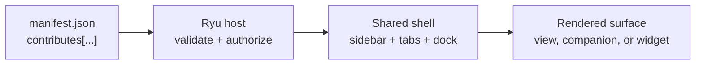

Plugins and apps share one rule for Desktop UI: declare the place you want to join, and let the
host render the chrome. Extensions then fit the sidebar, tabs, summaries, themes, and wallpapers
that users already know. These contribution surfaces share one shell skeleton even when the
app-owned content differs.

<ContributionSurfaces />

## The host-owned path

An extension declares a contribution, and the host turns it into a familiar shell surface. The
extension supplies data or content. The host keeps navigation, focus, authentication, and theme
behavior consistent.



## Support, extension, and implementation are different facts

A package's support (`surfaces`), what it extends (`provides` and `contributes`), and where its
implementation runs are three separate facts. [Plugins vs Apps](/docs/extend/develop/extensions/plugins-vs-apps#describe-an-extension-on-three-axes) owns that three-axis model.
A Marketplace row in this form shows all three:

```text
Support:        Desktop (Full), Web (Full), Mobile (Limited)
Extends:        Browser - browser.control, browser.session
Where it lives: Core runtime · Shared Ryu shell · Package sidecar
```

A plugin or app should not add a bespoke Core route only to appear in another client.
Declare the existing capability or contribution seam, then declare the surfaces where that seam is
usable. The Marketplace detail view renders these facts together so "supported on Mobile" and "owns
the Mobile shell" cannot be mistaken for the same thing.

## Repository ownership

The source paths in the extension guides use Ryu's source layout. Each public repository holds
one part of it:

| You are changing… | Public home |
| --- | --- |
| Core, Gateway, CLI, Desktop, Island, or their shared runtime dependencies | [`amajorai/ryu`](https://github.com/amajorai/ryu) |
| A feature app's backend, UI, sidecar, or app manifest | The matching [`amajorai/ryu-<app>`](https://github.com/amajorai) satellite |
| A declarative plugin, Marketplace metadata, schema, or icon | [`amajorai/ryu-marketplace`](https://github.com/amajorai/ryu-marketplace) |
| SDK packages, Rust SDK crates, bindings, or examples | [`amajorai/ryu-sdk`](https://github.com/amajorai/ryu-sdk) |

The main public runtime hub may contain `generated/ryu-runtime/`. That directory contains only the
manifest and embedded asset inputs Core must compile into the runtime; it is generated during the
mirror and is not an app or plugin authoring surface. Do not open a feature-app or plugin source
change there. Accepted public-hub changes may be rewritten by a later sync.

## Pick a surface by the job

| If your extension needs to… | Use | What you own |
| --- | --- | --- |
| Show a live list of app-owned records | `contributes.sidebar_sections[]` | The title, icon, data source, row map, target, and optional create/action specs |
| Add one plugin navigation destination | `contributes.sidebar_buttons[]` | The label, icon, order, and target route. Only a Core-derived first-party App uses the Apps shelf, never an id namespace alone |
| Keep progress visible while work runs | `contributes.live_activities[]` | The activity title, accent, live source, status/progress map, and target |
| Offer a persistent workspace tool | `contributes.dock_panels[]` | The tab label, icon, placement, and companion/view binding |
| Show an agent-scoped view on the agent profile | `contributes.agent_profile_tabs[]` | The tab label, icon, order, and one of your own companions, mounted with the agent's id |
| Add a Library tab with a host-rendered view | `contributes.sidebar_sections[]` with a view spec | The record source, field mapping, view kind, filters, and target |
| Ship a focused app UI | `runnables[].kind = "companion"` | The sandboxed companion bundle and its host context |
| Render a result inline in chat | `contributes.widgets[]` plus a widget render tool | A self-contained `ui://widget/...` HTML template and the tool-to-template binding |
| Suggest a chat result surface | [`contributes.chat_widget_templates[]`](/docs/extend/develop/extensions/chat-widget-templates) | The title, display mode, examples, triggers, and a view or tool backing |
| Change the product palette | [`contributes.themes[]`](/docs/extend/develop/extensions/color-theme) | Light/dark tokens and the preview palette |
| Add an OS wallpaper variant | [`contributes.backgrounds[]`](/docs/extend/develop/extensions/background-contributions) | A host backdrop preset, bounded parameters, and source attribution |
| Dress agent avatars or add an avatar style | [`contributes.avatar_accessories[]` and `contributes.avatar_styles[]`](/docs/extend/develop/extensions/avatar-contributions) | Shape-only parts for a ghost or style region, and styles with palettes and regions |

The first four are shell slots. A companion or declarative view supplies the content
inside a slot. It does not replace the shell's navigation or tab geometry.

For a companion that edits one record, make the host section's `itemTarget` the
record route and read the selected id from the mount context. Keep the companion's
space for the record itself. A second primary record picker inside the
companion creates two navigation systems that can disagree about selection, focus,
and deep links.

### Agent profile tabs

An agent profile tab adds an icon tab to the profile that a chat opens for its agent. The tab
embeds one of your plugin's own companion runnables. The host mounts it with
`window.ryu.context` set to `{ "surface": "agent-profile", "agentId": "…", "agentName": "…" }`.
Your companion should scope itself to that agent. Core drops a tab whose `companion` is not a
companion runnable in the same manifest. Disabling the plugin removes the tab.

```json
{
  "agent_profile_tabs": [
    {
      "id": "calendar",
      "title": "Calendar",
      "icon": "calendar-04",
      "companion": "calendar-companion"
    }
  ]
}
```

`title` is the tab's accessible name. `icon` takes the same glyph ids as other contributions.
Tabs appear after the profile's built-in views, sorted by the optional `order` (lower first).

### Widgets and app use cases

Use a widget when the result is easier to understand or act on visually: a checklist, a small
table, a chart, a form, or a preview card. The render tool remains the source of truth for its
validated input and output. The widget is a presentation surface. A widget may call only tools the
host exposes to it, and those calls return through the normal governed path.

```json
{
  "widgets": [
    {
      "tool_id": "app.research_render",
      "uri": "ui://widget/research.html",
      "ui_entry": "src/widgets/research.tsx",
      "mime": "text/html+skybridge",
      "default_display_mode": "inline"
    }
  ]
}
```

The template is packaged as a self-contained HTML resource. `inline` is the default display mode.
The widget contract also supports `fullscreen` and `pip`. Widget discovery is not widget
permission. The host still checks the app's declared grants and the caller's tool allowlist before
running the render or any follow-up action.

## A small manifest can join several surfaces

This example gives an app a sidebar list, a live status card, and a workspace tab. The app owns the
data and route names. Desktop owns authentication, the Apps shelf, layout, icons, focus
behavior, and theme tokens.

```json
{
  "id": "com.example.research",
  "name": "Research",
  "version": "0.1.0",
  "runnables": [],
  "permission_grants": ["ui:declarative-http"],
  "contributes": {
    "sidebar_sections": [
      {
        "id": "notes",
        "title": "Research",
        "icon": "lucide:book-open",
        "spec": {
          "source": {
            "http": { "path": "/api/research/notes" },
            "map": { "id": "id", "title": "title", "subtitle": "status" }
          },
          "itemTarget": "/research/notes/{{item.id}}"
        }
      }
    ],
    "live_activities": [
      {
        "id": "research-run",
        "title": "Research pass",
        "accent": "hsl(26 73% 51%)",
        "spec": {
          "source": {
            "http": { "path": "/api/research/runs" },
            "map": { "id": "id", "title": "title", "detail": "step", "status": "state", "progress": "progress" }
          },
          "target": "/research/runs/{{item.id}}"
        }
      }
    ],
    "dock_panels": [
      {
        "id": "research-panel",
        "title": "Research",
        "icon": "lucide:search",
        "placement": "both",
        "panel": "companion",
        "spec": { "companion": "research-companion" }
      }
    ]
  }
}
```

Each `dock_panels` entry is a movable workspace tab. `placement` is only where it opens
first: `bottom` (the default, also used for an unrecognized value), `right`, `left`, `center`,
or `both` (offered from both the Right and Bottom add menus). Once someone moves the tab, their
position wins. On Desktop, a `left` panel opens on the right while the left edge holds
navigation. Disabling the app removes the panel from add menus. A tab that is already open shows
a placeholder until it is closed or the app returns.

`spec` is data, not an escape hatch for arbitrary host markup. Unknown render kinds
degrade to no contribution on an older shell, while the rest of the manifest can still
load.

### Sidebar ownership

A sidebar section may read a same-origin node route with `GET`. The host keeps the
selected node and its credentials outside the app frame. Mutating declarative actions
remain limited to authenticated `/api/` routes. Request the `ui:declarative-http`
grant for either form. Without approved consent the host renders no source-backed rows
and performs no declarative mutation.

The host shares source reads across Sidebar, Library and chat for the same endpoint
and signed-in identity. Switching identities uses a separate cache. Collapsing a sidebar section
stops its own refresh timer.

The optional `create` field has two exclusive forms. Use `create.http` when the host can
create a record declaratively, or `create.target` when creation belongs in the app's own
companion. A navigation-only create action never performs a request in the shell.

```json
{
  "create": { "label": "New note", "target": "/plugin/research-companion" },
  "entity": { "anchor": "research-note", "idKey": "note_id" }
}
```

`entity` gives every mapped row a stable host identity. Matching
`context_menu_items` contributions then appear in that row's context menu and receive
the mapped id under `idKey`. This lets the app own its records while the host supplies
consistent navigation, menus, keyboard behavior, ordering, and saved sidebar settings.

## Library views

Library sections are data-first. The host owns the layout, keyboard behavior, focus management,
loading state, and theme. The app owns the records and their field mapping. The built-in view
registry (`LIBRARY_VIEW_KINDS` in `packages/app-host/src/views.ts`) recognizes these kinds:

| View kind | Host projection |
| --- | --- |
| `board`, `kanban` | Grouped cards by a status or badge field |
| `table`, `data-table`, `database` | Tabular record projection |
| `calendar` | Records grouped by their date field |
| `timeline` | Records arranged by time with status/detail metadata |
| `feed` | Reverse-chronological activity rows |
| `list` | Compact title/subtitle rows |
| `gallery` | Media-first cards with a title and metadata |
| `card` | One record per readable card |
| `map` | Records plotted on an interactive map by their coordinates. Clicking a marker opens the record |
| `custom` | A plugin/app-owned renderer selected by the host contract |

`kanban`, `data-table`, and `database` are aliases, not separate permission systems. A plugin can
declare a custom view id, but the host must either have a renderer for it or show an explicit
unavailable state. New views are therefore additive. A plugin can ship a renderer without
making every existing Library tab understand a new layout.

The `map` view reads each record's raw fields for a coordinate: `lat`/`latitude` with
`lng`/`lon`/`long`/`longitude`, the same keys nested under `geo`, `location`, `coordinates`,
`coords`, `position`, `point`, or `geometry`, a GeoJSON `[lng, lat]` pair or `Point` geometry, or a
`"lat,lng"` string. The map fits itself to the plotted records, labels each marker with the mapped
`title`, and notes how many records had no location. When no record has a coordinate, the view
shows an empty state. Base map tiles load from OpenFreeMap, so the map needs network access.

### View actions

A view row or header can offer actions. An action with an `http` handler runs as a declarative
request from the host (this needs the `ui:declarative-http` grant). An action without one is
relayed to the owning app as a `view.action` intent carrying its `intent` and `payload`. This
needs the `views:actions` grant and a hook on the `view_action` phase. See
[Hooks and lifecycle](/docs/extend/develop/extensions/hook-recipes#handling-declarative-view-actions).
If the app declares no such hook, the action fails with an error that names the missing hook.

### Declarative view recovery

A failed view source read shows an error with **Try again**, rather than reporting an empty
collection. Actions stay disabled while their request is pending, and destructive actions still
require confirmation. Form inputs preserve typed values, including zero and false. A select
without an explicit value starts with its first declared option, and secondary form actions do
not also submit the form. List titles can be selected with the keyboard before running a global
action.

## Chat widget templates

`contributes.chat_widget_templates[]` tells the host which questions an app can answer visually,
such as "put my quests on a board". A template is not a permission and not an HTML widget. Use
`contributes.widgets[]` plus a render tool for an interactive inline card. See
[Chat widget templates](/docs/extend/develop/extensions/chat-widget-templates) for the fields,
availability states, and design guidance.

## The pinned summary is a host-owned layout

The pinned summary rail is the same across chats. An app can contribute live activity data that
the rail or Island presents, and it can offer a full custom surface through `dock_panels[]`. It
cannot inject a second summary layout or arbitrary React into the chat shell. That boundary keeps
focus, dismissal, responsive docking, and accessibility predictable.

## Theme behavior

The preview above follows the current docs theme. Desktop companions follow the same rule. They
consume the host theme bridge and semantic design tokens instead of a fixed dark-only palette (see
[Build a Companion UI](/docs/extend/develop/extensions/companion-ui)). A contributed theme supplies
only CSS token values, and the host assigns them without evaluating plugin code.

For the full manifest fields, see [Extension schemas & folder layouts](/docs/extend/develop/extensions/schemas-and-layouts).
For the plugin/app ownership boundary, see [Plugins vs Apps](/docs/extend/develop/extensions/plugins-vs-apps).

## Declarative plugin settings

A plugin can contribute `settings_tabs` with text, textarea, toggle, select, number, secret,
model-picker, or agent-picker fields. Each control reads and writes the declared `pref_key` on the
selected node. Select controls display the declared default when no saved preference exists.
Saved choices take precedence. Numeric controls validate declared bounds and step before saving.

A model-picker field can return to the node default with **Use default**. Credential fields use a
separate write-only store: **Save** replaces a value, **Clear** removes it, and reopening the panel
shows only its stored state. Stored values are never filled back into the input. The status also
identifies credentials that the plugin cannot read or that an environment variable overrides.
Switching to another node or plugin discards unsaved field drafts, including typed credentials,
so a draft is never submitted to a different owner.

Preference controls wait for the saved value before allowing edits. If the node cannot load
a preference, the field shows an error and **Retry** instead of an editable default.

A failed write keeps the existing saved state. Retry from the same field after correcting the
reported problem. See [BYOK credentials](/docs/providers/byok) and
[plugin permissions](/docs/security/permissions) for the corresponding node boundaries.
