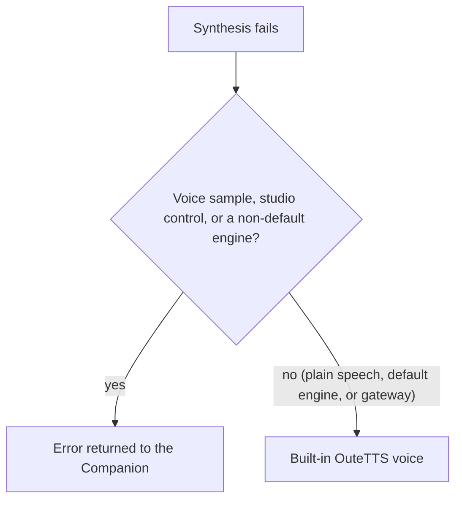
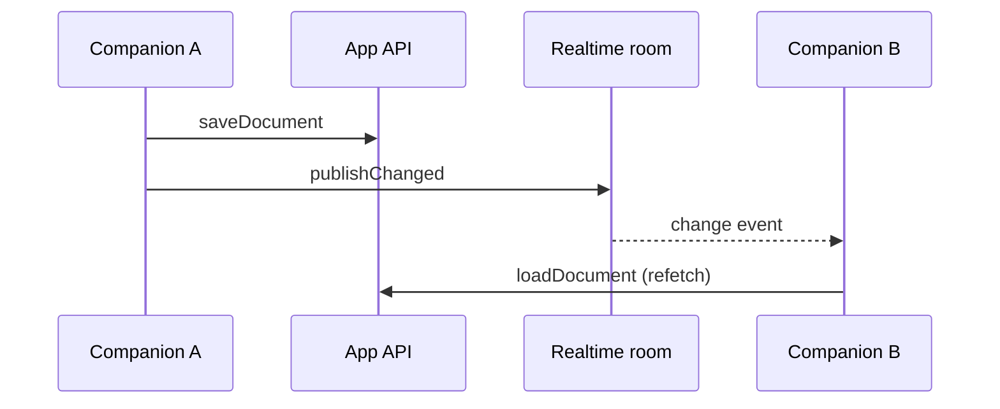

These host APIs build on the
[Companion capability table](/docs/extend/develop/extensions/desktop-companion#capabilities). Each
section names the manifest grant it needs.

## The shared runtime catalog

Apps that need a model, provider, or agent choice should consume the same Ryu catalog instead of
calling a provider API or building a private list. Declare the read-only `core:list_agents` grant,
then read the catalog through the host bridge:

```ts
const catalog = await window.ryu.catalog.snapshot();

for (const provider of catalog.providers) {
  console.log(provider.label, provider.authKind, provider.suggestedModels);
}

const liveModels = await window.ryu.catalog.models({ providerId: "openai" });
```

| The projection includes | It never includes |
| --- | --- |
| Provider authentication kind (`subscription`, `api-key`, or another host-defined value) | API keys or OAuth tokens |
| Configured/managed state and routing hints | Provider endpoints |
| Model suggestions and agents | Hook code or plugin grants |
| Enabled app summaries, and hook/event declarations with enabled state | Provider account identifiers, account labels, or account timestamps |

Providers whose models are discovered dynamically still appear as provider lanes even when their
suggestion list is empty. `catalog.models` asks Core to discover that lane server-side and returns
only model ids and display names.

The shared Ryu model/agent picker consumes this projection and returns a controlled selection
value. It does not change provider settings.

Valid plugins held back by an unmet host-version floor also appear as `compatible: false` metadata
with disabled hook/event rows. They are listed so a picker can explain them, but they do not run
until the host satisfies their declared floor.

Reading the catalog does not run anything. To run work, use one of these lanes:

- `model.complete` sends a model intent through the normal Core/Gateway route.
- `agent.run` asks Core to run a bounded agent. It is the lane that can preserve an authorized
  native agent session.

Core and Gateway resolve BYOK and managed providers. Subscription-preserving passthrough is not a
URL an app can call. It remains a loopback-only, Core-controlled agent transport, as described in
[the Gateway route guide](/docs/gateway/loopback-routes).

The catalog also lists safe metadata about enabled apps and hooks, so a shared picker or workflow
surface can discover them. Hook execution stays ownership-bound: an app can run its own declared
hook when separately granted, and only the declaring app can emit an app event. The catalog does
not let one app call another app's code or read its secrets.

## Speech generation

The `media:generate` grant exposes the live TTS engine catalog:

```ts
const engines = await window.ryu.media.ttsEngines();
const cloneModel = engines.find((engine) => engine.supports_cloning);
```

Each engine row reports whether the runtime is installed, its preset voices and languages, and
whether it accepts a voice sample.

A Companion may pass `reference_audio_data_url` to `window.ryu.media.tts` only as a bounded WAV
data URL. Core stages those bytes under the private voice-reference directory for one local
synthesis request and removes the temporary file when the request ends. Arbitrary paths and remote
sample URLs are rejected.

Installing an optional local TTS runtime requires the separate `voice:models:manage` grant:

```ts
await window.ryu.media.ttsEngineInstall({ engine: "pocket" });
```

### Studio controls

`window.ryu.media.tts` also accepts optional studio controls. Every field except `text` is
optional, and each is validated at the bridge and again by Core:

- Unknown top-level fields are ignored.
- An unknown effect type, effect key, effect parameter name, or enum value is rejected, as is a
  non-finite number.
- An effect parameter outside its range is clamped to the nearest limit.

| Field | Accepted values |
| --- | --- |
| `text` | Required. Up to 50,000 characters. Pause tags such as `[pause 500ms]` may add at most 60 seconds of silence and appear at most 200 times in one request; a request over either limit is rejected |
| `seed` | Integer from 0 to 4294967295, for repeatable takes on engines that report `supports_seed` |
| `instruct` | Up to 500 characters: a delivery instruction, or a voice description on engines that report `supports_design` |
| `reference_text` | Up to 1000 characters: the transcript of the voice sample |
| `effects` | Up to 12 `{ type, params }` entries, applied in order. `type` is one of the effects below, and `params` holds finite numbers using the names below. A parameter you leave out uses its default |
| `normalize` | `off`, `peak`, `podcast`, or `acx` |
| `format` | `wav` (default), `mp3`, `ogg`, or `flac` |

Effect parameters, with their range and default:

| Effect | Parameters |
| --- | --- |
| `gain` | `gain_db` -24 to 24 (0) |
| `highpass` | `cutoff_hz` 20 to 2000 (80) |
| `lowpass` | `cutoff_hz` 500 to 20000 (8000) |
| `compressor` | `threshold_db` -60 to 0 (-18), `ratio` 1 to 20 (3), `attack_ms` 0.1 to 200 (5), `release_ms` 5 to 2000 (120), `makeup_db` 0 to 24 (0) |
| `reverb` | `room_size` 0 to 1 (0.5), `damping` 0 to 1 (0.5), `wet_level` 0 to 1 (0.25), `dry_level` 0 to 1 (0.4) |
| `echo` | `delay_ms` 20 to 1500 (250), `feedback` 0 to 0.9 (0.35), `mix` 0 to 1 (0.3) |
| `pitch_shift` | `semitones` -12 to 12 (0) |

```ts
const audio = await window.ryu.media.tts({
  text: "Welcome back.",
  engine: "kokoro",
  seed: 7,
  effects: [{ type: "highpass", params: { cutoff_hz: 80 } }],
  normalize: "podcast",
  format: "mp3",
});
// audio is a data URL such as "data:audio/mpeg;base64,..."
```

### Output and failures

The returned data URL carries the container that was actually produced, so check the data URL
prefix before saving a file:

- Engines that only render WAV (the built-in OuteTTS, audio.cpp) ignore the studio controls and
  return `audio/wav` even when another `format` was requested.
- The cloud engine returns its provider's audio type.

Engine rows may also report `supports_instruct`, `supports_design`, `supports_seed`,
`native_speed`, `paralinguistic_tags`, `license`, and `commercial_use`. Older nodes omit them, so
treat a missing field as unsupported.



## Subscription accounts and usage

Apps that show or plan around subscription limits (for example a usage dashboard or a reset
monitor) can read every saved login of each subscription provider and how much of each one's
limit is left. Declare the `subscriptions:read` grant.

People see it on the consent screen as **See your subscription accounts**. The app learns which
logins are saved for each provider and their remaining limits, and never sees passwords or tokens.

```ts
const subscriptions = window.ryu.subscriptions;
if (subscriptions) {
  const snapshot = await subscriptions.list({ usage: "cached" });
  for (const provider of snapshot.providers) {
    if (!provider.capabilities.accountUsage) continue;
    for (const account of provider.accounts) {
      renderRow(provider.label, account.label, account.state, account.usage);
    }
  }

  const reading = await subscriptions.usage({
    providerId: "claude-pro-max",
    accountId: snapshot.providers[0]?.accounts[0]?.accountId,
  });
}
```

- **Owner and admins only.** Account labels are often email addresses, so Ryu answers these
  calls only when the person using the app is the node owner or an admin, even when the grant
  is approved. Show labels in your UI, but do not store or send them anywhere.
- **Cached by default.** `list` returns what Ryu already knows and never waits on the provider.
  An account with no recent reading has state `pending`, and Ryu refreshes it in the background.
  Pass `usage: "refresh"` to read stale accounts, or `usage: "none"` to list accounts without usage.
  `usage` reads one account (the active account when you omit `accountId`). Ryu limits how often
  one app can trigger a live read of the same account, and serves the cached reading in between.
- **Exact accounts.** An unknown or removed `accountId` returns `available: false` with reason
  `account_not_found`. Ryu never substitutes another account.
- **Account states.** Ryu lists accounts that need a fresh login (`needs_reauth`), accounts
  excluded from the pool (`pool_disabled`), and providers without per-account usage
  (`unsupported`), but it does not read their usage.
- **Stable targets.** Each window and meter carries a `targetId` that stays the same between
  reads, so you can compare readings over time.

Per-account usage covers Claude Pro/Max, ChatGPT, OpenAI Codex, and GitHub Copilot. ChatGPT plan,
Kiro, Kimi, Radius, Ant Ling, and CLI logins report no per-account usage
(`capabilities.accountUsage` is `false`).

Older Ryu hosts do not provide `window.ryu.subscriptions`, and a direct call answers
`Unknown method`. Check that the namespace exists before you use it, and hide the feature when it
does not. Saved accounts never appear in `catalog.snapshot`; this grant is the only way to read
them.

## Realtime app resources

Apps that edit shared resources can use the generic application-room bridge instead of polling. Add
`app:realtime` to the manifest's `permission_grants`, then join a room whose id is stable for that
resource.

The trusted host owns the node token, user identity, and WebSocket. The sandbox receives only the
opaque `window.ryu.realtime` connection (`window.ryu.tokenTable` is an alias).

`window.ryu.realtime.connect({ roomId }, callbacks)` returns the room id, access level, member id,
and initial presence. The returned handle exposes `publish`, `publishPresence`, and `close`.

| Callback | Receives |
| --- | --- |
| `onEvent` | Named events |
| `onPresence` | Presence snapshots |
| `onResyncRequired` | Resync signals |
| `onClose` | Close notifications |
| `onError` | Errors |

The host bounds queued events and coalesces replaceable presence snapshots, so it closes a stalled
Companion instead of keeping an unbounded stream.

The `@ryu/app-host/realtime` helper keeps your governed API authoritative. A realtime event tells
peers to refetch. The helper suppresses the sender's own echo and refetches after a lag signal:



```tsx
import { openRealtimeResource } from "@ryu/app-host/realtime";

const channel = await openRealtimeResource({
  roomId: documentId,
  onChanged: () => loadDocument(documentId),
  onPresence: (presence) => showCollaborator(presence),
});

await saveDocument(documentId, nextDocument);
await channel.publishChanged();
```

Call `channel.close()` when the resource unmounts. Use `publishPresence()` only for ephemeral state
such as the active selection or pointer; durable state still belongs in your app API. Canvas,
Whiteboard, Workflows, and Dashboards use this same contract.

## Related

<Cards>
  <DocCard href="/docs/extend/develop/extensions/desktop-companion" />
  <DocCard href="/docs/extend/develop/extensions/desktop-companion-capabilities" />
</Cards>
