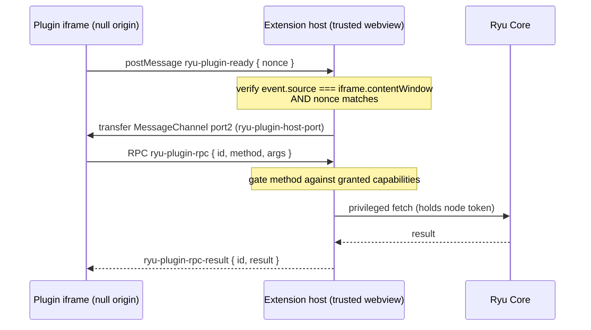

A **Companion** is a plugin surface that renders its own UI inside Desktop: a sidebar panel, an
overlay, or a settings pane. Plugin code is untrusted, so Desktop runs it in a sandboxed iframe.
The iframe reaches Core only through a capability-gated RPC bridge. The steps below use the
built-in example plugin (`packages/app-host/src/example-plugin.ts`) as the worked example.

`Companion` is one of the eight `RunnableKind` variants
(`crates/core/kernel-contracts/src/runnable.rs`), so a Companion is declared in a `manifest.json` manifest like any
other Runnable. For the manifest schema and grant strings, see
[the manifest.json manifest reference](/docs/extend/develop/extensions/plugin-json-manifest).

<Callout type="warn">
Unit tests and Chromium end-to-end tests cover the Desktop extension host's RPC dispatch,
handshake, and Companion document policy. Provider accounts, node permissions, and your own sidecar
still need an end-to-end check in your environment.
</Callout>

## The three-tier UI model

Plugin UIs use three tiers. Each tier has a different trust level and capability set:

| Tier | Trust level | What it can do | Example |
|---|---|---|---|
| **Widget** (in-chat) | Lowest - sandboxed iframe, null origin | Render data from a tool call; call companion tools via `callTool` through the host | Checklist, chart, data grid |
| **Companion** (sidebar/overlay) | Medium - sandboxed iframe, capability-gated RPC | Read agent lists, call Core APIs through the gated bridge | Settings panel, extension page |
| **Full-page app** | Highest - iframe with host bridge | Deep Core integration via the RPC bridge; the host holds the node token | Extension pages, whiteboard |

All three tiers share the same security model: the iframe is null-origin, the host is the single
trusted proxy, and every RPC method is gated by a declared capability. The difference is the surface
area each tier exposes.

### Widget tier (in-chat)

Widgets render inline in a chat message. They are produced by a "render" tool and consume the
tool's arguments and output through `window.openai.toolInput` / `toolOutput`. See
[Ryu Apps](/docs/extend/develop/extensions/ryu-apps) for the full authoring path.

### Companion tier (sidebar/overlay)

Companions are sidebar panels or overlays that persist across turns. They use the same null-origin
iframe and RPC bridge as widgets, but they are not tied to a single tool call. A companion can
maintain state, subscribe to resource changes, and call multiple Core APIs.

### Full-page app tier

Full-page apps (also called "extension pages") render in the Desktop main content area. They use
the same `ExtensionHost` iframe and capability-gated RPC bridge, with the full page for their UI.

## The security model

The host renders your plugin in an `<iframe sandbox="allow-scripts">` **without**
`allow-same-origin`, so the frame runs at a **null origin**
(`packages/app-host/src/ExtensionHost.tsx`). Design your plugin around these consequences:

- The frame cannot read the parent DOM, cannot touch app storage, and does **not** receive
  `window.__TAURI__`. Tauri injects IPC into the app's own webview, never into a null-origin
  sandboxed frame.
- Your plugin reaches Core **only** by sending RPC envelopes to the host. The host (the trusted
  webview) is the single place that holds the Core node token and performs the privileged fetch.
  The plugin never sees the token.
- Each RPC method is gated by a declared **capability**. A call to a method whose capability the
  plugin was not granted is rejected before any service runs.
- Full-HTML companions and model-generated artifact documents receive their CSP and bridge shell
  before any app-controlled HTML is parsed, including scripts placed before a `<head>` element.
  Keep the frame's `connect-src 'none'` policy; direct network access is not a companion API.

There is one narrow addition for client-side form handlers: compiled-in first-party full-HTML
Companions may receive `allow-forms` when their host-built CSP contains both
`connect-src 'none'` and `form-action 'none'`. This allows a React or browser submit handler to
run, while the CSP still blocks network access and native form navigation or POSTs. Third-party
plugin frames, widgets, and module bundles keep the base `allow-scripts` sandbox without
`allow-forms`.



<Callout type="info">
Because the frame is null-origin, `event.origin` is the literal string `"null"` and is useless as
an auth boundary - any null-origin context matches it. The real identity check is
`event.source === iframe.contentWindow` plus the host-generated nonce. An origin allowlist adds no
protection here.
</Callout>

## Step 1 - Announce readiness from your frame

The host bakes a per-mount nonce (a `crypto.randomUUID()`, host-generated, never plugin or user
input) into your document. Your frame echoes that nonce back in a `ryu-plugin-ready` message so
the host can verify the message came from the frame it created:

```js
const NONCE = /* baked in by the host */;
window.parent.postMessage({ kind: "ryu-plugin-ready", nonce: NONCE }, "*");
```

## Step 2 - Accept the channel port

After the host verifies your handshake it transfers one `MessagePort` into your frame, tagged with
the same nonce. Accept only the port carrying your nonce, then run all RPC over it:

```js
let port = null;
window.addEventListener("message", (ev) => {
  const msg = ev.data;
  if (!msg || msg.kind !== "ryu-plugin-host-port" || msg.nonce !== NONCE) {
    return;
  }
  port = ev.ports?.[0];
  if (port) {
    port.onmessage = onPortMessage;
  }
});
```

Point-to-point ports sidestep the `targetOrigin: "*"` ambiguity that a null-origin frame would
otherwise force on every message.

## Step 3 - Call Core over the gated bridge

Send a request envelope over the port and correlate the reply by `id`. The envelope shape is
defined in `packages/app-host/src/rpc.ts`. A minimal client looks like this:

```js
let nextId = 1;
const pending = {};

function call(method, args) {
  return new Promise((resolve, reject) => {
    if (!port) {
      reject(new Error("bridge not ready"));
      return;
    }
    const id = nextId++;
    pending[id] = { resolve, reject };
    port.postMessage({ kind: "ryu-plugin-rpc", id, method, args: args ?? [] });
  });
}

// then: await call("core.listAgents", [])
```

The host replies with a `ryu-plugin-rpc-result` envelope carrying exactly one of `result` or
`error`.

## The RPC contract

These are the envelope kinds exchanged over the bridge (`rpc.ts`):

| Kind | Direction | Payload |
|---|---|---|
| `ryu-plugin-ready` | frame to host | `{ nonce }` |
| `ryu-plugin-host-port` | host to frame | `{ nonce }` + a transferred `MessagePort` |
| `ryu-plugin-rpc` | frame to host | `{ id, method, args }` |
| `ryu-plugin-rpc-result` | host to frame | `{ id, result }` or `{ id, error }` |

The host validates every inbound payload with `asRpcRequest`, so any message not shaped like the
envelope is dropped before it reaches dispatch.

## Capabilities

Every callable method maps to a required capability in `METHOD_CAPABILITY` (`rpc.ts`). The map is
derived from the host API contract (`crates/core/kernel-contracts/schemas/host-api.json`). A method
that is not in the map is **unknown** and always rejected. There is no default-allow path.

| Method | Capability | Manifest grant | Result |
|---|---|---|---|
| `core.listAgents` | `core.listAgents` | `core:list_agents` | The agents on the active node |
| `catalog.snapshot` | `core.listAgents` | `core:list_agents` | The shared provider, model, agent, app, and hook catalog |
| `catalog.models` | `core.listAgents` | `core:list_agents` | Server-side model discovery for one provider lane |
| `subscriptions.list` | `subscriptions.read` | `subscriptions:read` | Each subscription provider with its saved accounts and their usage |
| `subscriptions.usage` | `subscriptions.read` | `subscriptions:read` | The usage reading for one saved account of one provider |
| `model.complete` | `model.complete` | `hook:side-model` | One Gateway-governed model completion |
| `agent.run` | `agent.run` | `hook:run-agent` | One bounded, Core-mediated agent task |
| `media.image` | `media.generate` | `media:generate` | Generated or edited images as `data:` URLs |
| `media.video` | `media.generate` | `media:generate` | Generated clips as `{ url, mediaType }` with `data:` URLs |
| `media.audio` | `media.generate` | `media:generate` | Generated music or sound effects as `{ url, mediaType }` |
| `ui.openExternal` | `ui.displayMode` | none (local host capability) | Opens an HTTP(S) URL through the trusted host |
| `assistant.publishContext`, `assistant.clearContext` | `assistant.context` | `assistant:context` | Replace or clear this app's context chips in the Ask Ryu assistant |
| `assistant.registerSurface`, `assistant.clearSurface` | `assistant.context` | `assistant:context` | Lend the Ask Ryu assistant this page's label, instructions, starter prompts, and optional `thread` (one conversation per topic), or hand it back |
| `assistant.open` | `assistant.context` | `assistant:context` | Show the Ask Ryu assistant, optionally asking a question attributed to the app |

The app's approved `hook:run-agent` grant does not replace the signed-in caller's `agent.run`
permission. Core resolves an omitted or routed agent id, then checks permission for that concrete
agent before dispatching the task.

A streamed `agent.run` follows the same grant rule as `host.runAgent`. With `hook:run-agent`
alone, the agent is **read-only**: it is offered only tools annotated `readOnlyHint: true`, gets
no client or Composio actions, and must run on a Core-governed model route. An agent whose runtime
executes its own tools (for example an ACP coding agent) is refused. Agents that can edit files
or run commands need `hook:run-agent:write` as well.

The [media, HTTP, and navigation reference](/docs/extend/develop/extensions/desktop-companion-capabilities)
covers `media.*`, app-owned HTTP reads, and `ui.openExternal`. The
[runtime catalog and resources reference](/docs/extend/develop/extensions/desktop-companion-runtime)
covers `catalog.*`, speech generation, `subscriptions.*`, and realtime app resources.

## Reference implementation

`packages/app-host/src/example-plugin.ts` is a complete Companion document. It runs the handshake,
accepts the port, and calls `core.listAgents` from a **List agents** button.

## Next steps

<Cards>
  <DocCard href="/docs/extend/develop/extensions/desktop-companion-capabilities" />
  <DocCard href="/docs/extend/develop/extensions/desktop-companion-runtime" />
  <DocCard href="/docs/extend/develop/extensions/plugin-json-manifest" />
  <DocCard href="/docs/extend/develop/extensions/typescript-sdk" />
  <DocCard href="/docs/core/app-manifest-lifecycle" />
</Cards>
