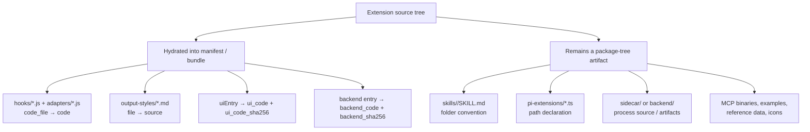
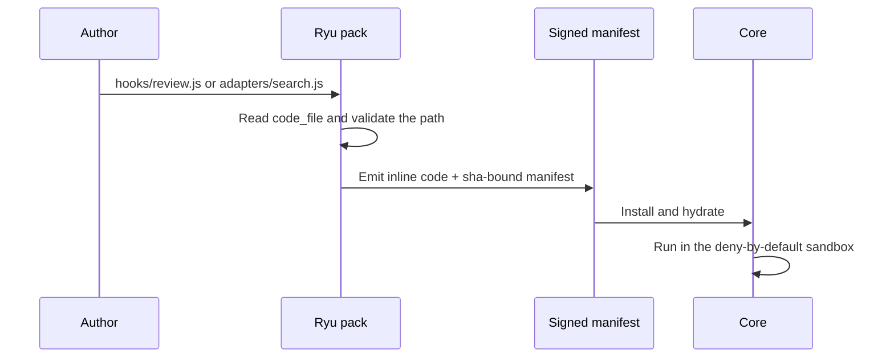

This page extends [Extension schemas and folder layouts](/docs/extend/develop/extensions/schemas-and-layouts),
which explains how `manifest.json`, the interop files, and `ryu.package.json` relate.

## What can be bundled

An extension can combine declarative contributions, code fragments, resources, processes, and UI.
The important distinction is whether `ryu pack` inlines a source file into a signed JSON bundle or
whether the file must remain in the portable source tree.



| Authoring path | Native declaration | Packed or installed form | Practical rule |
|---|---|---|---|
| `hooks/<name>.js` | `contributes.turn_hooks[].code_file` | Hydrated `code` body | Keep exactly one of `code_file` or inline `code`; the body is part of the signed manifest after packing. |
| `adapters/<verb>.js` | `provides[].tools[].adapter.code_file` | Hydrated adapter body | The adapter can only call the tools allowlisted by its provider declaration. |
| `output-styles/<name>.md` | `contributes.output_styles[].file` | Inlined `source` text | Front matter and body stay together so one parser owns the style metadata. |
| `skills/<slug>/SKILL.md` | `runnables[].config.skill_id` plus folder convention | Copied into the canonical Skills home on enable | A single JSON bundle does not invent the missing directory; publish the skill tree as package artifacts. |
| `mcp_servers` | Native manifest map | Registered by Core on enable | The native map and Agent Plugins projection support stdio, Streamable HTTP, and legacy SSE; the native map additionally carries Ryu-only grants and OAuth metadata. |
| `ui/` or `uiEntry` | Companion/widget contribution | Self-contained `ui_code` plus hash for packed UI | Build a single self-contained HTML payload; no external iframe chunk. |
| `sidecar/` or `backend/` | `sidecars[]` and optional backend fields | Managed process or package-tree artifact | The process reaches Ryu through generic proxy/capability seams, never a bespoke Core route. |
| `pi-extensions/*.ts` | `contributes.pi_extensions[].file` | Path remains a source-tree dependency | Treat this as a source-tree/built-in lane until a pack format carries the file explicitly. |

### Hooks and adapters: source form versus wire form



`code_file` is the readable, reviewable authoring form. `code` is the wire form that keeps the
executed body inside the signed surface. Never leave a `code_file` unresolved in a published JSON
bundle.

## Canonical folder layouts

### A plugin source tree

```text
my-plugin/
├── manifest.json                 # native Ryu source of truth
├── README.md
├── hooks/                        # optional turn-hook bodies
│   └── review.js
├── adapters/                     # optional capability adapters
│   └── search.js
├── skills/                       # optional Agent Skills
│   └── research/
│       ├── SKILL.md
│       └── examples/             # optional skill resources
├── output-styles/                # optional Markdown styles
│   └── plain-technical.md
├── mcp.json                      # generated Agent Plugins interop, when needed
├── plugin.json                   # generated Agent Plugins interop manifest
├── pi-extensions/                # optional source-tree Pi extensions
│   └── monitor.ts
├── ui/                           # optional companion/widget source
└── ryu.package.json              # only when publishing as a portable package
```

`plugin.json` is not a second native manifest. The generator projects safe metadata, the true Ryu
id, and MCP compatibility data into the Agent Plugins extension namespace. A compatible host can
still read the portable `skills/` and `mcp.json` conventions even if it does not understand Ryu's
full `manifest.json`.

### An apps-store satellite

```text
my-app/
├── manifest.json                 # same native PluginManifest schema
├── README.md
├── backend/                      # optional Rust or other service
│   └── ...
├── sidecar/                      # optional packaged process/runtime
│   └── ...
├── ui/                           # optional companion or full-page UI
│   └── ...
├── hooks/                        # optional flat sandbox fragments
├── skills/                       # optional bundled Skills
├── mcp.json                      # generated interop when MCP is declared
├── plugin.json                   # generated interop manifest
└── output-styles/                # optional contributed styles
```

An app satellite owns its process and UI in its own package/repository. The host owns lifecycle,
grant validation, generic ext-proxy routing, capability binding, and surface mounting. Keep the
sidecar independent of Core; declare its public mount and capabilities in the manifest.

### A portable package or collection

```text
my-package/
├── ryu.package.json              # outer envelope
├── manifest.json                 # if kind is plugin or app
├── agent.json / workflow.json    # artifact for standalone kinds
├── skills/<slug>/SKILL.md        # if the package carries a Skill
└── assets/                       # declared, traversal-safe artifacts

my-collection/
├── agents/research/ryu.package.json
├── plugins/review/ryu.package.json
├── external_plugins/cloudflare/ryu.package.json
└── apps/browser/ryu.package.json
```

The folder is canonical:

- A `.ryupack` is a deterministic transport of that tree.
- A collection repository is discovered by scanning package folders rather than maintaining a
  generated central index.
- Keep local providers under `plugins/` and hosted or otherwise outside-the-machine providers under
  `external_plugins/`. The native manifest's explicit `external` flag is what the Marketplace uses
  to show that boundary.

See [Portable packages](/docs/extend/develop/extensions/portable-packages).

## Related

<Cards>
  <DocCard href="/docs/extend/develop/extensions/schemas-and-layouts" />
  <DocCard href="/docs/extend/develop/extensions/portable-packages" />
  <DocCard href="/docs/extend/develop/extensions/hooks-authoring" />
</Cards>
